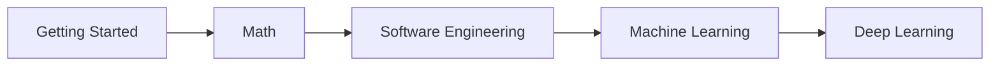

# AI/ML Roadmap

A free, beginner-friendly path from high-school math to machine learning, deep learning, and LLM engineering. Every topic explains the intuition first and the formulas second, and links each idea to a real AI/ML use case.

## Who this is for

You know high-school math and want to understand how modern AI works, from the ground up. No prior programming or university math is assumed.

## The learning path

1. [Getting Started](getting-started/README.md): set up Python and Jupyter, and learn just enough Python and NumPy.
2. [Math](math/README.md): linear algebra, calculus and optimization, probability and statistics.
3. [Software Engineering](software-engineering/README.md): coming soon.
4. [Machine Learning](machine-learning/README.md): classic models, data preparation, evaluation.
5. [Deep Learning](deep-learning/README.md): neural networks, CNNs, Transformers, LLMs, MLOps.

## Setup

Each course has its own requirements file:

| Course | Install |
|---|---|
| Getting Started, Math | `pip install -r requirements-math.txt` |
| Machine Learning | `pip install -r requirements-ml.txt` |
| Deep Learning | `pip install -r requirements-dl.txt` |

Full instructions: [getting-started/setup](getting-started/setup/README.md).

## How to use this repo

Follow the study order in each course README. Every topic has a README (the lesson) and a resources list; some also have a notebook, exercises, an assignment, a paper note, or a lab. See [docs/learning-guide.md](docs/learning-guide.md).

## License

Code is MIT licensed and written content is CC BY 4.0. See [LICENSE](LICENSE).
