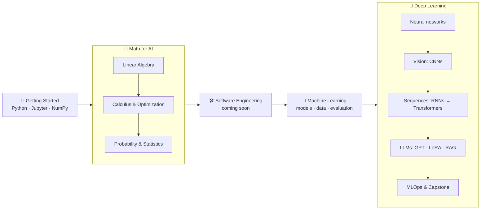

# AI/ML Roadmap

**A free, beginner-friendly path from high-school math to machine learning, deep learning, and LLM engineering.**

Intuition first, formulas second, and every idea connected to real AI.

[**Start here**](getting-started/README.md) · [Roadmap](#the-roadmap) · [Full topic map](#full-topic-map) · [Setup](#setup)

---

## Why this roadmap

- **Made for beginners.** You only need high-school math. No prior programming or university math is assumed.
- **Intuition first.** Every topic starts with the idea in plain words and pictures, then the math.
- **Always connected to AI.** Each topic shows where the idea is used in real machine learning, from dot products in embeddings to gradients in backpropagation.
- **Learn by building.** You implement core ideas from scratch before using libraries, so you understand what the tools do.
- **Free.** Every resource listed is free to access.

## The roadmap

| Stage | Course | What you'll learn |
|:---:|---|---|
| 1 | 🚀 [Getting Started](getting-started/README.md) | Set up Python and Jupyter (or just use Colab), learn just enough Python and NumPy |
| 2 | 📐 [Math for AI](math/README.md) | Vectors and matrices, derivatives and gradients, probability and statistics: the language of ML |
| 3 | 🛠️ [Software Engineering](software-engineering/README.md) | *Coming soon* |
| 4 | 🤖 [Machine Learning](machine-learning/README.md) | Regression, classification, trees and ensembles, clustering, data preparation, evaluation |
| 5 | 🧠 [Deep Learning](deep-learning/README.md) | Neural networks, CNNs, Transformers, LLMs, RAG, alignment, MLOps, and a capstone project |

## Full topic map

Study the topics in this order. Click a course to expand it.

<b>🚀 Getting Started</b>

1. [Setup](getting-started/setup/README.md)
2. [Python basics](getting-started/python-basics/README.md)
3. [How to use this repo](getting-started/how-to-use-this-repo/README.md)

<b>📐 Math: Linear Algebra</b>

1. [Vectors and matrices](math/linear-algebra/vectors-and-matrices/README.md)
2. [Linear equations and Gaussian elimination](math/linear-algebra/linear-equations-and-gaussian-elimination/README.md)
3. [Matrix operations and LU decomposition](math/linear-algebra/matrix-operations-and-lu-decomposition/README.md)
4. [Vector spaces and subspaces](math/linear-algebra/vector-spaces-and-subspaces/README.md)
5. [Independence, basis, and dimension](math/linear-algebra/independence-basis-and-dimension/README.md)
6. [Orthogonality and Gram-Schmidt](math/linear-algebra/orthogonality-and-gram-schmidt/README.md)
7. [Projections and least squares](math/linear-algebra/projections-and-least-squares/README.md)
8. [Eigenvalues and eigenvectors](math/linear-algebra/eigenvalues-and-eigenvectors/README.md)
9. [Linear transformations](math/linear-algebra/linear-transformations/README.md)
10. [Singular value decomposition](math/linear-algebra/singular-value-decomposition/README.md)
11. [Review and project](math/linear-algebra/review-and-project/README.md)

<b>📐 Math: Calculus and Optimization</b>

1. [Limits and continuity](math/calculus-and-optimization/limits-and-continuity/README.md)
2. [Derivatives and Taylor series](math/calculus-and-optimization/derivatives-and-taylor-series/README.md)
3. [Integrals](math/calculus-and-optimization/integrals/README.md)
4. [Multivariable calculus](math/calculus-and-optimization/multivariable-calculus/README.md)
5. [Gradient descent and its variants](math/calculus-and-optimization/gradient-descent-and-its-variants/README.md)
6. [Newton and quasi-Newton methods](math/calculus-and-optimization/newton-and-quasi-newton-methods/README.md)
7. [Conjugate gradient and trust region](math/calculus-and-optimization/conjugate-gradient-and-trust-region/README.md)
8. [Constrained optimization and KKT](math/calculus-and-optimization/constrained-optimization-and-kkt/README.md)
9. [Applications and project](math/calculus-and-optimization/applications-and-project/README.md)

<b>📐 Math: Probability and Statistics</b>

1. [Probability basics](math/probability-and-statistics/probability-basics/README.md)
2. [Random variables](math/probability-and-statistics/random-variables/README.md)
3. [Probability distributions](math/probability-and-statistics/probability-distributions/README.md)
4. [Expectation, variance, and covariance](math/probability-and-statistics/expectation-variance-and-covariance/README.md)
5. [Bayesian probability](math/probability-and-statistics/bayesian-probability/README.md)
6. [Hypothesis testing and confidence intervals](math/probability-and-statistics/hypothesis-testing-and-confidence-intervals/README.md)
7. [Estimation and MLE](math/probability-and-statistics/estimation-and-mle/README.md)
8. [Markov chains and sampling](math/probability-and-statistics/markov-chains-and-sampling/README.md)
9. [Review and project](math/probability-and-statistics/review-and-project/README.md)

<b>🛠️ Software Engineering</b>

Coming soon.

<b>🤖 Machine Learning</b>

1. [What is machine learning?](machine-learning/what-is-machine-learning/README.md)
2. [The data science stack](machine-learning/data-science-stack/README.md)
3. [KNN and model evaluation](machine-learning/knn-and-model-evaluation/README.md)
4. [Linear regression](machine-learning/linear-regression/README.md)
5. [Regularization and hyperparameter tuning](machine-learning/regularization-and-hyperparameter-tuning/README.md)
6. [Logistic regression and Naive Bayes](machine-learning/logistic-regression-and-naive-bayes/README.md)
7. [Data cleaning](machine-learning/data-cleaning/README.md)
8. [Feature engineering and scaling](machine-learning/feature-engineering-and-scaling/README.md)
9. [Data visualization](machine-learning/data-visualization/README.md)
10. [Imbalanced data](machine-learning/imbalanced-data/README.md)
11. [Support vector machines](machine-learning/support-vector-machines/README.md)
12. [Explainability and error analysis](machine-learning/explainability-and-error-analysis/README.md)
13. [Decision trees](machine-learning/decision-trees/README.md)
14. [Random forests and bagging](machine-learning/random-forests-and-bagging/README.md)
15. [Gradient boosting](machine-learning/gradient-boosting/README.md)
16. [Dimensionality reduction](machine-learning/dimensionality-reduction/README.md)
17. [Density estimation and GMMs](machine-learning/density-estimation-and-gmm/README.md)
18. [Clustering](machine-learning/clustering/README.md)
19. [Reinforcement learning intro](machine-learning/reinforcement-learning-intro/README.md)
20. [Review and project](machine-learning/review-and-project/README.md)

<b>🧠 Deep Learning</b>

**Foundations**
1. [Neural network basics](deep-learning/neural-network-basics/README.md)
2. [Backpropagation](deep-learning/backpropagation/README.md)
3. [Optimization](deep-learning/optimization/README.md)
4. [Regularization](deep-learning/regularization/README.md)

**Computer vision**

5. [Convolutional networks](deep-learning/convolutional-networks/README.md)
6. [CNN architectures and transfer learning](deep-learning/cnn-architectures-and-transfer-learning/README.md)
7. [Detection, segmentation, and pose](deep-learning/detection-segmentation-and-pose/README.md)
8. [Augmentation and self-supervised learning](deep-learning/augmentation-and-self-supervised-learning/README.md)

**Sequences and Transformers**

9. [Text representations](deep-learning/text-representations/README.md)
10. [Recurrent networks](deep-learning/recurrent-networks/README.md)
11. [Attention and seq2seq](deep-learning/attention-and-seq2seq/README.md)
12. [Transformers](deep-learning/transformers/README.md)

**Large language models**

13. [Pretrained language models](deep-learning/pretrained-language-models/README.md)
14. [GPT and efficient LLMs](deep-learning/gpt-and-efficient-llms/README.md)
15. [Retrieval-augmented generation](deep-learning/retrieval-augmented-generation/README.md)
16. [Alignment and responsible AI](deep-learning/alignment-and-responsible-ai/README.md)

**Beyond text**

17. [Vision Transformers and multimodal](deep-learning/vision-transformers-and-multimodal/README.md)
18. [Graph neural networks](deep-learning/graph-neural-networks/README.md)
19. [Generative models](deep-learning/generative-models/README.md)

**Shipping it**

20. [MLOps](deep-learning/mlops/README.md)
21. [Capstone](deep-learning/capstone/README.md)

## What you'll build

Along the way you build real things, most of them from scratch:

| Project | Where |
|---|---|
| A tiny autograd engine and neural network (micrograd) | Neural network basics |
| An image classifier with transfer learning | CNN architectures and transfer learning |
| A character-level language model (makemore) | Recurrent networks |
| A GPT-style Transformer, trained and sampled | Transformers |
| A LoRA fine-tune of a pretrained language model | GPT and efficient LLMs |
| A retrieval-augmented generation (RAG) app | Retrieval-augmented generation |
| A model served behind an API, with experiment tracking | MLOps |
| Your own end-to-end capstone project | Capstone |

## How each topic is organized

| File | What it's for |
|---|---|
| `README.md` | The lesson: goals, intuition, explanation, and why it matters for AI |
| `resources.md` | Free books, videos, and papers for going deeper |
| `notebook.ipynb` | Runnable code and visualizations (open in Colab with one click) |
| `exercises/` | Practice problems with separate solutions |
| `assignment.md` | A short applied task |
| `paper.md`, `lab.md` | Deep Learning only: a beginner's note on a key paper, and a guided build |

Every topic has a README and a resources list. The other files appear where they help.

## How to use this repo

1. **Follow the order.** Start with [Getting Started](getting-started/README.md), then go course by course. Each course README has its study order, and each topic ends with *Previous / Next* links.
2. **Read, then run.** Read the lesson, then run the notebook and change things to see what happens.
3. **Practice before peeking.** Try the exercises yourself before opening the solutions.
4. **Build it once from scratch.** Then use the library version. You only really understand what you can build.

More tips: [docs/learning-guide.md](docs/learning-guide.md)

## Setup

No installation is needed to start: every notebook has an **Open in Colab** button. To run locally:

| Course | Install |
|---|---|
| Getting Started, Math | `pip install -r requirements-math.txt` |
| Machine Learning | `pip install -r requirements-ml.txt` |
| Deep Learning | `pip install -r requirements-dl.txt` |

Step-by-step instructions: [getting-started/setup](getting-started/setup/README.md)

## License

Code is licensed under [MIT](LICENSE) and written content under [CC BY 4.0](LICENSE). You're free to use, share, and adapt it with attribution.

---

If this roadmap helps you, consider giving it a ⭐ so others can find it too.

