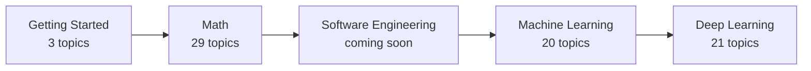

# How to Use this Repo

**Course:** [Getting Started](../README.md)

Welcome. This repo is a free, step-by-step path from high-school math to machine learning, deep learning, and large language models. It is written for people who are starting from the beginning: you need school algebra and some curiosity, and nothing else. Every lesson explains an idea in plain words and pictures first, gives the formulas second, and then shows where the idea is used in real AI.

This page is the map. It shows how the course fits together, what is inside a topic, a routine for studying one, and where to get help. It is short on purpose, so read it once, try the first-session checklist, and move on.

## Learning goals

By the end of this topic you can:

- describe the five stages of the roadmap and why they come in this order;
- find any topic, and tell from its folder which files it has;
- follow a simple routine for studying a topic, and know what to do when you get stuck;
- choose between running the notebooks in Colab or on your own computer;
- read the math notation and the code blocks used in the lessons;
- report a mistake or ask a question through GitHub Issues.

## Prerequisites

- High-school math and curiosity.
- A web browser. You do not need to know how to program, and you do not need to install anything yet.

## Outline

1. [The path and why it is in this order](#1-the-path-and-why-it-is-in-this-order)
2. [How the repo is organised](#2-how-the-repo-is-organised)
3. [What is inside a topic](#3-what-is-inside-a-topic)
4. [How to study a topic](#4-how-to-study-a-topic)
5. [Running the code](#5-running-the-code)
6. [Reading the math](#6-reading-the-math)
7. [Reading the code blocks](#7-reading-the-code-blocks)
8. [Help, feedback, and the license](#8-help-feedback-and-the-license)
9. [Your first session](#your-first-session-10-minutes)

## Key intuition

Think of the repo as a textbook that has been cut into small, self-contained topics, each with its own notebook and practice problems. You are not expected to read it like a novel. The aim is that every time you finish a topic, you can run something, change it, and explain it in your own words.

### 1. The path and why it is in this order

The roadmap has five stages. Each course is a folder at the top of the repo.



| Stage | Course | What it is for |
|:---:|---|---|
| 1 | [Getting Started](../README.md) | A place to run code, and just enough Python and NumPy to follow the notebooks. |
| 2 | [Math](../../math/README.md) | Linear algebra, calculus and optimization, probability and statistics: the language the rest is written in. |
| 3 | [Software Engineering](../../software-engineering/README.md) | A placeholder for now. It will be filled in once its content is ready. |
| 4 | [Machine Learning](../../machine-learning/README.md) | Models that learn from data: regression, classification, trees, clustering, and how to judge them honestly. |
| 5 | [Deep Learning](../../deep-learning/README.md) | Neural networks, vision, Transformers, large language models, and shipping a model. |

(The topic counts above are the lessons planned in each course. The Math course has three parts: Linear Algebra with 11 topics, Calculus and Optimization with 9, and Probability and Statistics with 9.)

**Why this order?** Each stage supplies the tools the next one uses.

- You cannot try anything without a way to run code, so Python and NumPy come first.
- A neural network is mostly matrix multiplication, so linear algebra comes early. The first math topic, [Vectors and Matrices](../../math/linear-algebra/vectors-and-matrices/README.md), already shows how one network layer is a matrix.
- A model learns by nudging its numbers downhill on an error score. "Downhill" is a derivative, and the method is gradient descent, so calculus and optimization come next.
- Data is noisy and models are never certain. Probability and statistics give you the words for that, and the tools to measure how good a model really is.
- Machine learning puts the math to work on small, understandable models. Deep learning then builds networks and language models, which use all of the above at once.

> [!NOTE]
> This repo is written one topic at a time. A topic that has not been written yet is a stub: its README starts with a line saying **Status: planned**, and its sections are empty. The order and the links already exist, so you can see where you are heading. Check for that line at the top of a page before you invest time in it. Some course pages also still carry a "planned" line even though a topic or two inside them is finished.

### 2. How the repo is organised

The top level holds one folder per course, plus a few shared files:

```text
ai-roadmap/
├── getting-started/         the course folders:
├── math/                      three groups of topics (linear-algebra,
│                              calculus-and-optimization,
│                              probability-and-statistics)
├── software-engineering/
├── machine-learning/
├── deep-learning/
├── docs/                    design notes and guides
├── requirements-math.txt    packages for the notebooks (see section 5)
├── requirements-ml.txt
├── requirements-dl.txt
├── LICENSE
└── README.md                the front page
```

Inside a course, every topic has its own folder. The folder names are plain words with dashes (`vectors-and-matrices`), and they carry **no numbers**. That is on purpose, so that topics can be added or reordered later without renaming things. The study order lives in two places instead:

- the **Study order** list in each course's `README.md`, which is the master list;
- the **Previous / Next** links at the bottom of every topic, which let you walk through the course without going back to the list.

For example, a full topic looks like this (the real folder for the first math topic):

```text
math/linear-algebra/vectors-and-matrices/
├── README.md          the lesson
├── resources.md       free books and videos, with chapter pointers
├── notebook.ipynb     runnable code
├── exercises/
│   ├── problems.md
│   └── solutions.md
└── assignment.md      a short applied task
```

### 3. What is inside a topic

Not every topic has every file. A topic always has a `README.md` and a `resources.md`. The rest appear where they help.

| File | What it is | How to use it |
|---|---|---|
| `README.md` | The lesson: learning goals, prerequisites, an outline, the key intuition, why it matters for AI/ML, and links to the previous and next topics. | Read it first, top to bottom. |
| `resources.md` | Free books, videos, and papers for going deeper, with chapter or lecture pointers. Titles and links only. | Go here when the lesson does not click, or when you want a second explanation. |
| `notebook.ipynb` | A Jupyter notebook with runnable demos and pictures. It has an **Open in Colab** badge at the top. | Run it, then change the numbers and run it again. |
| `exercises/problems.md` and `exercises/solutions.md` | Practice problems, and worked solutions kept in a separate file. | Try each problem before opening the solutions. |
| `assignment.md` | One short, applied task with its own data. | Do it last, as a small project. |
| `paper.md` and `lab.md` | Planned for the Deep Learning course only. `paper.md` explains a key paper in plain words, and `lab.md` is a guided build: write it from scratch first, then use the library version. | Read the paper note after the lesson. Build the lab before reaching for the library. |

Why try the exercises before the solutions? Struggling for a few minutes to recall or work something out is what makes it stick. Reading a solution feels like learning, but it is much easier to forget. If you are stuck after a real attempt, peek at one step, then close it and try again.

### 4. How to study a topic

This routine works for almost every topic.

1. **Skim the goals.** Read the "Learning goals" and "Prerequisites" at the top of the lesson, so you know what you are aiming at.
2. **Read the lesson once.** Do not stop to memorise. Follow the example, and mark whatever is unclear.
3. **Run the notebook.** Run it from top to bottom, then pick a number and change it. Predict what will happen before you press run.
4. **Do the exercises.** Work on paper or in a notebook, then check the solutions.
5. **Do the assignment,** if there is one.
6. **Recap in your own words.** Close everything and write or say three to five sentences: what was the idea, how do you compute it, and where would it appear in AI? Gaps show up quickly.

On time: the topics vary a lot in size, and everyone learns at their own speed, so there is no fixed duration. Short, regular sittings tend to work better than one long marathon. Stop when you can do the exercises without looking, not when the clock says so.

**When you get stuck,** go through this list in order:

1. Reread the previous paragraph slowly and run the code in it yourself.
2. Check the **Prerequisites**. If a term is unfamiliar, it was probably taught in an earlier topic.
3. Follow the back-links. This repo teaches each idea once, in the first topic that needs it. Later topics only give a short recap and link back to where the idea is taught in full (the repo calls this *concept ownership*). If a recap feels too quick, click through to the owner topic.
4. Open `resources.md` and try a different explanation of the same idea.
5. Take a break and come back tomorrow. Then, if it is still unclear, ask (see [section 8](#8-help-feedback-and-the-license)).

### 5. Running the code

There are two ways to run a notebook. Choose either; you can change your mind later.

**Colab.** Open the `notebook.ipynb` of any topic on GitHub. At the top is an **Open in Colab** badge. Click it and the notebook opens in your browser, on Google's computers, ready to run. Nothing is installed on your machine.

**Locally.** Install Python and a few libraries on your own computer and run the notebooks there. The [Setup](../setup/README.md) topic walks through it step by step, including how to avoid breaking anything else on your machine.

| | Colab | Local |
|---|---|---|
| Install needed | None (a Google account) | Python, libraries, and an editor |
| Time to first run | A minute | Longer, once |
| Works offline | No | Yes |
| Files stay after you close it | Only if you save them | Yes |
| GPU | Free GPU runtime, with limits | Only if your computer has one |
| Best for | Starting today, and GPU notebooks | Long-term study and your own projects |

The repo has three requirements files at the top level. Each lists the Python packages one stage needs, and each builds on the previous one, so installing the last one gives you everything.

| File | Use it for | Adds |
|---|---|---|
| `requirements-math.txt` | Getting Started and Math | `numpy`, `scipy`, `sympy`, `matplotlib`, `jupyter` |
| `requirements-ml.txt` | Machine Learning | the math packages plus `pandas`, `scikit-learn`, and other data tools |
| `requirements-dl.txt` | Deep Learning | the ML packages plus `torch`, `transformers`, and other deep-learning tools |

The Setup topic explains these files and how to install them. Deep-learning notebooks that train sizeable models are marked **GPU recommended**. They run best on Colab, where you can switch on a free GPU in the runtime settings, but they do not require one.

### 6. Reading the math

The lessons use a small, steady set of symbols. This is a quick reference, and each symbol is explained again where it first matters.

| You see | It means | Example |
|---|---|---|
| $\mathbf{v}$ (bold lowercase) | a vector: a list of numbers | $\mathbf{v} = (2, 3)$ |
| $A$ (capital letter) | a matrix: a grid of numbers | $A$ with 3 rows and 2 columns |
| $v_1, v_2, v_i$ (small low number) | a **subscript**: the 1st, 2nd, or $i$-th entry | $v_2$ is the second entry of $\mathbf{v}$ |
| $x^2$ (small raised number) | a power: $x$ times $x$ | $3^2 = 9$ |
| $\sum_{i=1}^{n} v_i$ | a **sum**: add up $v_1, v_2, \dots, v_n$ | with $n = 3$ it is $v_1 + v_2 + v_3$ |
| $\mathbf{v}\cdot\mathbf{w}$ | the **dot product**: multiply matching entries, then add | $(1,2)\cdot(3,4) = 3 + 8 = 11$ |
| $\lVert\mathbf{v}\rVert$ | the length of a vector | $\lVert(3,4)\rVert = 5$ |
| $\theta, \sigma, \lambda$ (Greek letters) | just names, used for angles, spreads, and other quantities | |

When a formula is important, it is set on its own line as a **display equation**, like this sum:

$$
\sum_{i=1}^{n} v_i = v_1 + v_2 + \dots + v_n
$$

Matrices and multi-line equations are written in a `math` block, which GitHub also draws as a display equation:

```math
A = \begin{bmatrix} 1 & 2 \\ 3 & 4 \end{bmatrix}
```

Read a formula slowly, one piece at a time, and say it out loud as a sentence. Then look for the plain-words explanation just above or below it: in this repo, the words always come first.

> [!TIP]
> **If the math looks broken** (you see dollar signs and backslashes instead of symbols), you are probably looking at raw text. Open the page on github.com in a normal web browser, where it is drawn properly. Raw-file views, some email previews, and plain-text editors show the source instead of the picture. The same goes for the flow diagrams: they are drawn by the browser view.

### 7. Reading the code blocks

Code appears in grey blocks, and the language is named in the corner, as in `python` or `bash`. The convention in this repo is simple: **a block shows the code, and the `text` block right after it shows what it prints.**

```python
print(2 + 3)
```

```text
5
```

To try a Python block, copy it into a notebook cell and press `Shift+Enter`. Running it yourself is better than reading the answer, and you should get the same output. A few more conventions:

- A comment after `#` explains a line and is not part of the output.
- Lines of `bash` are for a terminal, not for a notebook cell. The Setup topic shows what a terminal is.
- In a longer output, `...` means some lines were left out for space.
- Code blocks in a lesson are meant to be run in the order shown, so a name defined in an early block is available in later ones.

### 8. Help, feedback, and the license

This repo is meant to get better as people use it. If you find a mistake, a sentence that does not make sense, a broken link, or a notebook that fails, please open an issue on the repo's [GitHub Issues page](https://github.com/shahin1717/ai-roadmap/issues). Say which topic and which file, and what you expected to see. A confusing explanation counts as a bug, so do not hold back.

You are free to use, share, and adapt the material. Two licenses apply, in plain words:

- The **code** (Python files, notebook code cells, scripts) is under the MIT License: use it however you like, as long as the license notice stays with it.
- The **written content** (the Markdown text, notebook text cells, and figures) is under Creative Commons Attribution 4.0 (CC BY 4.0): share and adapt it, including for commercial use, as long as you give credit.

The exact wording is in the [LICENSE](../../LICENSE) file.

## Your first session (10 minutes)

A small exercise to find your way around.

1. Open the [Python Basics](../python-basics/README.md) lesson and scroll to the bottom. Find the **Previous / Next** links.
2. In the same topic, open `notebook.ipynb`, and find the **Open in Colab** badge at the very top.
3. Open `exercises/problems.md` and `exercises/solutions.md` side by side. Notice that they are separate files.
4. Open the [Linear Algebra study order](../../math/linear-algebra/README.md) and find the first topic. Then open one later topic (try [Eigenvalues and Eigenvectors](../../math/linear-algebra/eigenvalues-and-eigenvectors/README.md)). Read the status line at the top: that is what a planned topic looks like.
5. Open the [Vectors and Matrices](../../math/linear-algebra/vectors-and-matrices/README.md) lesson on GitHub and find a formula with a vector or a matrix in it. Check that the symbols are drawn properly, and find the matching entries in the table in section 6.

<details>
<summary>What you should have found</summary>

1. Every topic ends with a footer such as `← Previous: ... | Next: ... →`.
2. The badge is the first line of the notebook, and it opens the same notebook in Colab.
3. Solutions live in their own file so that you cannot read them by accident.
4. The first topic of Linear Algebra is Vectors and Matrices, and it is complete. The later one starts with a line saying its status is planned, and has empty headings.
5. Formulas appear as symbols, not as `$...$` text. If you see dollar signs, switch to the browser view.

</details>

## Why this path

Machine learning looks like a pile of separate techniques until you notice they share a few ingredients: lists and grids of numbers (linear algebra), an error to minimise (calculus), and uncertainty in data (probability). Learn those first, and each new model becomes a new combination of ideas you already know, which is faster than memorising it from scratch. This is also why the repo asks you to build core ideas by hand before using a library: once you have written a small version, the library stops being magic and starts being a convenience.

## Summary

- The path runs Getting Started, Math, Software Engineering (coming), Machine Learning, Deep Learning, and each stage supplies tools for the next.
- Folders have no numbers. Order lives in each course's Study order list and in the Previous / Next links.
- A topic always has a lesson and a resources list. Notebooks, exercises, assignments, and (for deep learning) paper and lab files appear where they help.
- Study with a routine: read, run, change the numbers, practise before peeking, recap in your own words.
- Run notebooks in Colab, or locally with the Setup topic; the three requirements files match the three courses that need them.
- Math is explained in words first, and displayed properly in a web browser on GitHub.
- Report mistakes through GitHub Issues. Code is MIT, written content is CC BY 4.0.

## Further reading

Free links on reading GitHub's Markdown and math, and on learning effectively, are in [resources.md](resources.md).

---

[← Previous: back to the roadmap](../../README.md) | [Next: Setup →](../setup/README.md)
