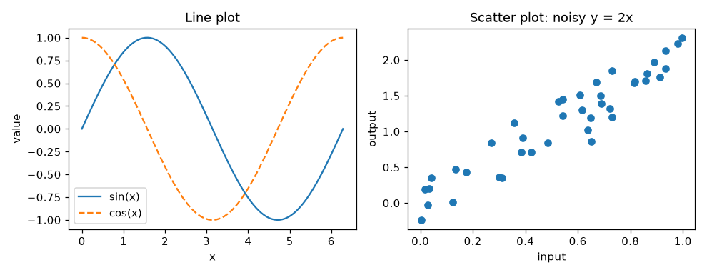

# Python Basics

**Course:** [Getting Started](../README.md) · **Hands-on:** [notebook.ipynb](notebook.ipynb) · **Practice:** [exercises](exercises/problems.md), [assignment](assignment.md)

Every notebook in this roadmap is written in Python, and almost all of them lean on one library, NumPy, to do arithmetic on whole tables of numbers at once. You do not need to become a programmer to follow along. You need about a dozen ideas, used in small doses, and the confidence that a red error message is just the computer telling you what it did not understand. This topic teaches those ideas from zero.

## Learning goals

By the end of this topic you can:

- run code in a notebook cell, add comments, and read an error message from the bottom up;
- store values in variables, tell `int`, `float`, `str`, and `bool` apart, and print results with f-strings;
- keep data in lists, tuples, and dictionaries, and pick out pieces with indexing and slicing;
- make decisions with `if`/`elif`/`else` and repeat work with `for` loops, `while` loops, and list comprehensions;
- write small functions with parameters, default values, return values, and docstrings;
- import modules, and use NumPy arrays (create them, check their shape, slice them, do element-wise arithmetic, multiply with `@`, and summarise along an `axis`);
- explain why array code beats a Python loop, and why random numbers need a seed;
- draw a line plot, a scatter plot, and a grid of subplots with Matplotlib;
- debug calmly: read the last line of a traceback, print shapes, and shrink a failing example.

## Prerequisites

- A working Python and Jupyter setup, or a Google Colab tab. See [Setup](../setup/README.md).
- High-school arithmetic. No programming experience is assumed.

## Outline

1. [Running code and reading errors](#1-running-code-and-reading-errors)
2. [Variables and basic types](#2-variables-and-basic-types)
3. [Lists, tuples, and dictionaries](#3-lists-tuples-and-dictionaries)
4. [Decisions and loops](#4-decisions-and-loops)
5. [Functions](#5-functions)
6. [Modules and imports](#6-modules-and-imports)
7. [NumPy: fast arithmetic on arrays](#7-numpy-fast-arithmetic-on-arrays)
8. [Matplotlib: seeing your data](#8-matplotlib-seeing-your-data)
9. [Debugging habits](#9-debugging-habits)
10. [Why this matters for AI/ML](#why-this-matters-for-aiml)

> [!NOTE]
> **Concept ownership.** This is the first topic that uses Python, so it teaches the language and NumPy in full. Later topics only recap what they need and link back here (see the [ownership map](../../docs/design-notes.md)). It is deliberately "just enough Python": the goal is to read and tweak the math notebooks that follow, not to cover the whole language.

## Key intuition

Programming is writing down a recipe precisely enough that a very fast, very literal helper can follow it. The helper never gets tired and never guesses. That is why it is so useful for arithmetic on thousands of numbers, and also why it stops with an error the moment a step makes no sense. Every section below adds one new kind of step to the recipe.

Every code block in this page was run as shown, and the output underneath is the real output. Type the examples yourself, or paste them into a notebook cell, and change a number to see what happens. Doing is how this sticks.

### 1. Running code and reading errors

A **notebook** (a Jupyter notebook, or a Colab one) is a document made of **cells**. A code cell holds a few lines of Python. Click inside it and press `Shift+Enter` to run it; the result appears right below. The `print` function shows a value on screen:

```python
print("Hello, AI/ML!")
```

```text
Hello, AI/ML!
```

Anything after a `#` on a line is a **comment**: a note for humans that Python ignores. Comments explain why you did something, so that future you (or a friend) can follow the recipe.

```python
# Three apples at 4 coins each.
price = 4          # a comment can also sit after code
print(price * 3)
```

```text
12
```

In a notebook, if the last line of a cell is just a value (no `print`), the notebook shows it for you. Cells share one memory: a name you create in one cell is available in the cells you run afterwards. Run cells from top to bottom, and if the notebook ever behaves strangely, restart it and run everything again from the top.

**Reading an error message.** Sooner or later you will see a wall of red text called a **traceback**. It lists the path Python took before it gave up, and the useful part is at the very bottom: the name of the problem and a short sentence about it. Suppose you mistype a name:

<!-- check: skip -->
```python
total = 10
print(totl)
```

```text
Traceback (most recent call last):
  File "example.py", line 2, in <module>
    print(totl)
          ^^^^
NameError: name 'totl' is not defined. Did you mean: 'total'?
```

Read it in this order: (1) the last line says what went wrong, a `NameError` because the name `totl` does not exist; (2) the line above it says where, line 2; (3) fix the typo and run again. Python often even suggests the right word.

> [!TIP]
> Errors are not a sign you did something terrible. Professional programmers see them all day. Treat each one as a free hint.

**Check yourself**

1. What does Python do with the text after a `#`?
2. In a long traceback, which line do you read first?

<details>
<summary>Answers</summary>

1. It ignores it. A comment is only for human readers.
2. The last line. It names the error type and gives the short reason; the lines above it show where.

</details>

### 2. Variables and basic types

A **variable** is a name attached to a value, like a label on a box. You create one with `=`, which means "store this value under that name", not "is equal to". Every value has a **type** that decides what you can do with it. Four types cover most of what you will see:

| Type | Meaning | Examples |
|---|---|---|
| `int` | whole number | `25`, `-3`, `0` |
| `float` | number with a decimal point | `1.75`, `-0.5`, `3.0` |
| `str` | text (a "string"), written in quotes | `"Ada"`, `'cat'` |
| `bool` | true or false | `True`, `False` |

```python
age = 25            # int
height = 1.75       # float
name = "Ada"        # str
is_student = True   # bool

print(type(age), type(height), type(name), type(is_student))
```

```text
<class 'int'> <class 'float'> <class 'str'> <class 'bool'>
```

Python does arithmetic with the usual symbols, plus three extras worth knowing:

```python
print(7 + 2, 7 - 2, 7 * 2)   # add, subtract, multiply
print(7 / 2)                 # division always gives a float
print(7 // 2)                # floor division: how many whole 2s fit in 7
print(7 % 2)                 # remainder after that division
print(7 ** 2)                # power: 7 squared
```

```text
9 5 14
3.5
3
1
49
```

An **f-string** puts values inside text. Put an `f` before the opening quote and write each value inside `{}`. After a colon you can say how to format it: `.2f` means "two digits after the decimal point".

```python
name = "Ada"
score = 0.91234
print(f"{name} scored {score:.2f}, which is {score * 100:.1f}%")
```

```text
Ada scored 0.91, which is 91.2%
```

You can convert between types with `int()`, `float()`, and `str()`. This matters when data arrives as text, which is common: the string `"42"` cannot be added to a number until you convert it.

```python
print(int("42") + 1)
print(float("3.5") * 2)
print("score: " + str(7))
```

```text
43
7.0
score: 7
```

> [!WARNING]
> **Common mistake: trusting float equality.** Computers store most decimals approximately, so tiny errors creep in. Compare floats by asking whether they are *close*, not whether they are exactly equal.

```python
print(0.1 + 0.2)
print(0.1 + 0.2 == 0.3)
print(abs((0.1 + 0.2) - 0.3) < 1e-9)   # 1e-9 means 0.000000001
```

```text
0.30000000000000004
False
True
```

**Check yourself**

1. What is the type of `3 / 1`?
2. What does `17 // 5` give, and what does `17 % 5` give?

<details>
<summary>Answers</summary>

1. `float`. The `/` operator always returns a float, so `3 / 1` is `3.0`.
2. `3` and `2`. Five goes into 17 three whole times with 2 left over.

</details>

### 3. Lists, tuples, and dictionaries

A **list** holds several values in order, written in square brackets. Each item has a position called an **index**, and counting starts at 0, not 1. Negative indexes count from the end.

| Item | `88` | `92` | `75` | `64` | `99` |
|---|---|---|---|---|---|
| Index | 0 | 1 | 2 | 3 | 4 |
| Negative index | -5 | -4 | -3 | -2 | -1 |

```python
scores = [88, 92, 75, 64, 99]
print(scores[0], scores[-1])    # first and last
print(scores[1:4])              # slice: positions 1, 2, 3 (the end is excluded)
print(scores[:2], scores[3:])   # leave out a bound to mean "from the start" or "to the end"
print(scores[::2])              # every second item
print(scores[::-1])             # reversed

scores.append(70)               # add to the end
print(len(scores), 92 in scores)
```

```text
88 99
[92, 75, 64]
[88, 92] [64, 99]
[88, 75, 99]
[99, 64, 75, 92, 88]
6 True
```

A slice `a[start:stop]` includes `start` and excludes `stop`, so `scores[1:4]` has `4 - 1 = 3` items. The same half-open rule appears in `range` and in NumPy, so it is worth getting comfortable with now.

A list can hold anything, including other lists. A list of lists is a simple table:

```python
grid = [[1, 2, 3],
        [4, 5, 6]]
print(grid[1][2])   # row 1 first, then item 2 inside that row
```

```text
6
```

> [!WARNING]
> **Common mistake: `b = a` does not copy a list.** Both names then point at the same list, so changing one changes the other. Use `a.copy()` when you want an independent copy.

```python
a = [1, 2, 3]
b = a            # same list, two names
b.append(4)
print(a)

c = a.copy()     # a real copy
c.append(5)
print(a, c)
```

```text
[1, 2, 3, 4]
[1, 2, 3, 4] [1, 2, 3, 4, 5]
```

A **tuple** is a list that cannot be changed after creation, written with round brackets. You will meet tuples constantly in NumPy, because the **shape** of an array (its number of rows and columns) is reported as a tuple. Python can **unpack** a tuple into separate names:

```python
shape = (3, 4)
rows, cols = shape
print(rows, cols)
```

```text
3 4
```

A **dictionary** (`dict`) stores **key: value** pairs and looks values up by key instead of by position. Think of a phone book: you look up a name, not "entry number 7".

```python
config = {"learning_rate": 0.01, "epochs": 20, "optimizer": "sgd"}
print(config["epochs"])

config["epochs"] = 50          # change a value
config["batch_size"] = 32      # add a new pair
for key, value in config.items():
    print(key, "->", value)

print(config.get("dropout", 0.0))   # a safe lookup with a fallback
```

```text
20
learning_rate -> 0.01
epochs -> 50
optimizer -> sgd
batch_size -> 32
0.0
```

Machine-learning code uses dictionaries for settings like the one above (called **hyperparameters**, the knobs you choose before training) and for records such as one row of a dataset.

**Check yourself**

1. For `x = [10, 20, 30, 40, 50]`, what are `x[-2]` and `x[1:3]`?
2. Why does `config["dropout"]` raise an error when `"dropout"` is missing, while `config.get("dropout", 0.0)` does not?

<details>
<summary>Answers</summary>

1. `40` and `[20, 30]`.
2. Square-bracket lookup insists the key exists and raises a `KeyError` if it does not. `.get` returns the fallback you supply (here `0.0`) instead.

</details>

### 4. Decisions and loops

A **condition** is a question whose answer is `True` or `False`. You build conditions with comparison operators: `==` (equal), `!=` (not equal), `<`, `>`, `<=`, `>=`, and combine them with `and`, `or`, `not`. Notice `==` has two equals signs, because a single `=` already means "store".

```python
print(5 > 3, 5 == 5.0, 5 != 5, "a" < "b")
print(3 < 5 and 5 < 4, 3 < 5 or 5 < 4, not 3 < 5)
```

```text
True True False True
False True False
```

The **`if` statement** runs a block of code only when a condition holds. The block is marked by a colon and by **indentation** (four spaces). Indentation is not decoration in Python; it is how the language knows which lines belong together.

```python
probability = 0.73      # a model's confidence that an email is spam

if probability >= 0.9:
    label = "definitely spam"
elif probability >= 0.5:
    label = "probably spam"
else:
    label = "not spam"

print(label)
```

```text
probably spam
```

Python checks the conditions from top to bottom and runs only the first block whose condition is true.

A **`for` loop** repeats a block once for each item in a collection. `range(n)` produces the whole numbers $0, 1, \dots, n-1$, and `range(start, stop, step)` gives you more control. `enumerate` hands you the index along with each item, and `zip` walks through two lists in step.

```python
total = 0
for score in [88, 92, 75]:
    total = total + score
print(total)

for i in range(3):
    print("step", i)

print(list(range(2, 10, 3)))

words = ["cat", "dog", "bird"]
lengths = [3, 3, 4]
for i, word in enumerate(words):
    print(i, word)
for word, n in zip(words, lengths):
    print(word, "has", n, "letters")
```

```text
255
step 0
step 1
step 2
[2, 5, 8]
0 cat
1 dog
2 bird
cat has 3 letters
dog has 3 letters
bird has 4 letters
```

A **`while` loop** keeps going as long as its condition is true. Use it when you do not know in advance how many repeats you need, for example "keep improving until the error is small enough", which is exactly what training a model does.

```python
loss = 8.0
steps = 0
while loss > 1.0:
    loss = loss / 2     # pretend each step halves the error
    steps += 1          # shorthand for steps = steps + 1
print(steps, loss)
```

```text
3 1.0
```

> [!WARNING]
> **Common mistake: a loop that never ends.** If nothing inside a `while` loop changes the condition, it runs forever. In a notebook, press the stop button (or the Interrupt command in the Kernel menu).

A **list comprehension** is a compact way to build a new list from a loop, in one line: `[expression for item in collection]`, optionally ending with `if condition` to keep only some items. Once it clicks you will see it everywhere.

```python
squares = [n ** 2 for n in range(6)]
evens = [n for n in range(10) if n % 2 == 0]
celsius = [0, 20, 37]
fahrenheit = [c * 9 / 5 + 32 for c in celsius]
print(squares)
print(evens)
print(fahrenheit)
```

```text
[0, 1, 4, 9, 16, 25]
[0, 2, 4, 6, 8]
[32.0, 68.0, 98.6]
```

**Check yourself**

1. How many times does `for i in range(5)` run its block, and what is the last value of `i`?
2. Write a comprehension that gives the list `[10, 20, 30]` from `[1, 2, 3]`.

<details>
<summary>Answers</summary>

1. Five times; the last value is `4` (counting starts at 0 and `range` stops before 5).
2. `[n * 10 for n in [1, 2, 3]]`

</details>

### 5. Functions

A **function** is a named, reusable recipe. You define it once with `def`, give it **parameters** (the inputs it expects), and use `return` to hand back a result. A string right under the `def` line, called a **docstring**, explains what the function does. Python shows it when you ask for `help`.

```python
def mean(values):
    """Return the average of a list of numbers."""
    return sum(values) / len(values)

print(mean([88, 92, 75, 64, 99]))
```

```text
83.6
```

When you call `mean(...)`, the list you pass in is attached to the parameter name `values` for the duration of the call. Names created inside a function exist only there; they are **local**.

Parameters can have **default values**, used when the caller does not supply one. Callers may also pass arguments by name (**keyword arguments**), which makes calls easier to read:

```python
def scale(values, factor=1.0, offset=0.0):
    """Return a new list with each value multiplied by factor, then shifted by offset."""
    return [v * factor + offset for v in values]

print(scale([1, 2, 3]))
print(scale([1, 2, 3], factor=2))
print(scale([1, 2, 3], 10, offset=-5))
```

```text
[1.0, 2.0, 3.0]
[2.0, 4.0, 6.0]
[5, 15, 25]
```

A function can return several values at once; Python packs them into a tuple, and you can unpack them straight into names:

```python
def min_and_max(values):
    """Return the smallest and largest value."""
    return min(values), max(values)

low, high = min_and_max([4, 9, 2, 7])
print(low, high)
```

```text
2 9
```

> [!WARNING]
> **Common mistake: `print` is not `return`.** `print` only shows something on screen. If a function prints its answer but does not `return` it, then `result = my_function(3)` stores `None` (Python's "nothing here"), and the next line that tries to use `result` fails.

**Why small functions help.** A function with one clear job can be tested on its own with a tiny input, reused in other places, and given a name that says what it does, so the code that calls it reads like a sentence. When something breaks, you only have to look inside one small piece. Machine-learning code is built exactly this way. A model is a function that turns inputs into predictions, and a loss is a function that scores them:

```python
def predict(x, w, b):
    """A one-feature linear model: prediction = w * x + b."""
    return w * x + b

def squared_error(prediction, target):
    """How wrong a prediction is, as a non-negative number."""
    return (prediction - target) ** 2

print(squared_error(predict(3, 2.0, 1.0), 8))
```

```text
1.0
```

Here `predict(3, 2.0, 1.0)` is $2.0 \cdot 3 + 1.0 = 7.0$, the target is 8, and the squared error is $(7 - 8)^2 = 1$. Later topics will build whole training loops out of pieces like these two.

**Check yourself**

1. What does a function return if it has no `return` statement?
2. Given the `scale` function above, what is `scale([1, 2], offset=1)`?

<details>
<summary>Answers</summary>

1. `None`.
2. `[2.0, 3.0]`. The factor stays at its default of `1.0`, so each value is multiplied by 1 and then shifted up by 1.

</details>

### 6. Modules and imports

Python ships with a lot of ready-made code that is not loaded until you ask for it. A file of such code is a **module**, and you load it with `import`. A collection of modules that you install separately (like NumPy) is called a **library** or **package**.

```python
import math

print(math.sqrt(16), math.pi)
```

```text
4.0 3.141592653589793
```

Two variations come up all the time. You can import a single name directly with `from ... import ...`, and you can give a module a shorter nickname with `as`. The community has settled on fixed nicknames for the two libraries you will use most, and every notebook in this roadmap follows them:

```python
from math import exp
import numpy as np
import matplotlib.pyplot as plt

print(exp(0), np.__name__, plt.__name__)
```

```text
1.0 numpy matplotlib.pyplot
```

To learn what a module or function does, ask for its documentation: `help(math.sqrt)` in any Python session, or `math.sqrt?` in a notebook cell. If an import fails with `ModuleNotFoundError`, the library is not installed in the Python you are running (on Colab, NumPy and Matplotlib are already there; the [Setup](../setup/README.md) topic covers installing them locally).

### 7. NumPy: fast arithmetic on arrays

Plain Python lists are flexible, but they are not built for arithmetic. Try multiplying a list by 2 and you get the list repeated, not doubled numbers. **NumPy** (short for "Numerical Python") adds a new container, the **array**: a grid of numbers that all share one type and support arithmetic on the whole grid at once.

```python
import numpy as np

a = [1, 2, 3]
x = np.array([1, 2, 3])

print(a * 2)          # a list: repeats itself
print(x * 2)          # an array: doubles every entry
print(x + 10)
print(x + np.array([10, 20, 30]))
```

```text
[1, 2, 3, 1, 2, 3]
[2 4 6]
[11 12 13]
[11 22 33]
```

This works because arrays do **element-wise** arithmetic: an operation is applied to each entry, or to matching entries of two arrays of the same size. No loop appears in your code.

#### 7.1 Creating arrays and reading their shape

The **shape** of an array tells you how many entries it has along each direction. A list of numbers is one-dimensional; a table with rows and columns is two-dimensional. Always keep the shape in mind. Most NumPy mistakes are shape mistakes.

```python
x = np.array([1.0, 2.0, 3.0])
A = np.array([[1, 2, 3],
              [4, 5, 6]])

print(x.shape, A.shape)     # (3,) means one direction with 3 entries
print(A.ndim, A.size, A.dtype)
```

```text
(3,) (2, 3)
2 6 int64
```

`A` has 2 rows and 3 columns, so its shape is `(2, 3)`. Here `ndim` is the number of dimensions, `size` the total number of entries, and `dtype` the type of the entries. You will rarely type arrays in by hand. These functions build them for you:

```python
print(np.zeros((2, 3)))              # all zeros; the shape goes in as a tuple
print(np.ones(4))                    # all ones
print(np.arange(0, 10, 2))           # like range, but gives an array
print(np.linspace(0, 1, 5))          # 5 evenly spaced numbers from 0 to 1, both ends included
print(np.arange(12).reshape(3, 4))   # same 12 numbers, rearranged into 3 rows and 4 columns
```

```text
[[0. 0. 0.]
 [0. 0. 0.]]
[1. 1. 1. 1.]
[0 2 4 6 8]
[0.   0.25 0.5  0.75 1.  ]
[[ 0  1  2  3]
 [ 4  5  6  7]
 [ 8  9 10 11]]
```

`reshape` changes how the same numbers are arranged, as long as the total count stays the same. A single `-1` in a reshape means "work this one out for me". A shape like `(3,)` (a flat array) is different from `(3, 1)` (a column) and `(1, 3)` (a row), and mixing them up is a classic source of confusing results:

```python
v = np.array([1, 2, 3])
print(v.shape, v.reshape(3, 1).shape, v.reshape(1, 3).shape, v.reshape(-1, 1).shape)
```

```text
(3,) (3, 1) (1, 3) (3, 1)
```

Where do shapes come from in practice? A dataset of 1,000 examples with 20 measurements each is an array of shape `(1000, 20)`. A batch of 64 grayscale photos, each 28 by 28 pixels, is `(64, 28, 28)`. A set of text embeddings is `(number_of_texts, embedding_size)`. Every one of these is an array, and the first question to ask of any of them is "what is its shape?".

#### 7.2 Indexing and slicing

Indexing works like lists, with one comma-separated position per dimension: `A[row, column]`. A lone colon `:` means "everything along this direction".

```python
A = np.arange(12).reshape(3, 4)
print(A[1, 2])        # row 1, column 2
print(A[0])           # the first row
print(A[:, 1])        # every row, column 1: the second column
print(A[1:, :2])      # rows from 1 on, first two columns
```

```text
6
[0 1 2 3]
[1 5 9]
[[4 5]
 [8 9]]
```

You can also select with a **boolean mask**: compare an array with a number to get an array of `True`/`False`, then use it as an index to keep only the `True` positions. This is how you filter data.

```python
scores = np.array([88, 92, 75, 64, 99])
mask = scores > 80
print(mask)
print(scores[mask])
print(scores[scores > 80].mean())
```

```text
[ True  True False False  True]
[88 92 99]
93.0
```

> [!WARNING]
> **Common mistake: a slice is a window, not a copy.** `b = A[0]` gives a view into the same memory, so changing `b` changes `A`. Call `.copy()` if you want your own data.

```python
A = np.arange(6).reshape(2, 3)
row = A[0]
row[0] = 100
print(A)

safe = A[1].copy()
safe[0] = -1
print(A)
```

```text
[[100   1   2]
 [  3   4   5]]
[[100   1   2]
 [  3   4   5]]
```

#### 7.3 Element-wise arithmetic and broadcasting

Operations like `+`, `-`, `*`, `/`, and `**` act entry by entry. NumPy functions such as `np.sqrt` and `np.exp` do the same.

```python
x = np.array([1.0, 2.0, 3.0])
y = np.array([10.0, 20.0, 30.0])

print(x + y)
print(x * y)         # entry by entry, not a dot product
print(x ** 2)
print(np.sqrt(x))
```

```text
[11. 22. 33.]
[10. 40. 90.]
[1. 4. 9.]
[1.         1.41421356 1.73205081]
```

**Broadcasting** is the rule that lets arrays of different shapes work together when the mismatch is simple. The commonest case is a single number combined with an array (the number is treated as if it were repeated everywhere). Another common case is a row combined with a table: the row is applied to every row of the table.

```python
A = np.array([[1, 2, 3],
              [4, 5, 6]])
row = np.array([10, 20, 30])
print(A + 100)
print(A + row)
```

```text
[[101 102 103]
 [104 105 106]]
[[11 22 33]
 [14 25 36]]
```

NumPy compares shapes starting from the right-hand end; two sizes are compatible when they are equal or when one of them is 1. If they are not, you get a shape error (more on that in the [debugging section](#9-debugging-habits)).

#### 7.4 Vectorization: why NumPy is fast

Writing `x * 2` instead of a loop is called **vectorization**. It is shorter, and it is also far faster. A Python loop has to look at each number, check its type, and run a few interpreter steps, one number at a time. NumPy stores its numbers packed together in memory and runs the whole operation in compiled code that does not pay that per-item cost. A rough measurement:

<!-- check: skip -->
```python
import time

n = 1_000_000
values = list(range(n))
arr = np.arange(n)

def sum_of_squares_loop():
    return sum([v * v for v in values])      # a Python loop in disguise

def sum_of_squares_numpy():
    return np.sum(arr * arr)                 # vectorized

def best_time(func, repeats=5):
    """Run func several times and return the fastest time in seconds."""
    times = []
    for _ in range(repeats):
        start = time.perf_counter()
        func()
        times.append(time.perf_counter() - start)
    return min(times)

loop_time = best_time(sum_of_squares_loop)
numpy_time = best_time(sum_of_squares_numpy)
print(f"list: {loop_time:.4f} s, numpy: {numpy_time:.4f} s, about {loop_time / numpy_time:.0f}x faster")
```

```text
list: 0.0289 s, numpy: 0.0008 s, about 35x faster
```

The test uses the fastest of five runs so that one-off hiccups do not distort it. Your numbers will differ with your computer (the notebook runs the same test), but the gap is typically a factor of tens. The same idea scales all the way up: a GPU is a chip built to do thousands of these element-wise operations at the same moment, which is why deep learning is written as operations on whole arrays and almost never as loops over single numbers.

> [!TIP]
> Rule of thumb: if you are about to write a `for` loop over the entries of an array, stop and ask whether an array expression can do it in one line.

#### 7.5 Dot product and matrix multiplication

Two operations multiply arrays "for real" rather than entry by entry. The dot product of two 1-D arrays multiplies matching entries and adds them up. The `@` operator multiplies a matrix by a vector or by another matrix. For a matrix-matrix product, the inner sizes must agree: `(m, n) @ (n, p)` gives `(m, p)`.

```python
w = np.array([0.5, -1.0, 2.0])
x = np.array([4.0, 2.0, 1.0])
print(np.dot(w, x))      # 0.5*4 + (-1)*2 + 2*1
print(w @ x)             # the same thing, written with @

W = np.array([[1, 0, -1],
              [2, 1,  0]])   # shape (2, 3)
print(W @ x)                 # (2, 3) @ (3,) gives shape (2,)
print((W @ x).shape)
```

```text
2.0
2.0
[ 3. 10.]
(2,)
```

What these products mean, and why they sit at the heart of machine learning, is the subject of [Vectors and Matrices](../../math/linear-algebra/vectors-and-matrices/README.md), the first math topic. For now, remember the difference: `*` is entry by entry, `@` is the matrix product.

> [!WARNING]
> **Common mistake: using `*` when you meant `@`.** Both run without complaint on arrays of the same shape, but they give different answers. Check which one you want.

#### 7.6 Summarising along an axis

Functions like `sum` and `mean` can collapse an array to one number, or collapse it along one direction. The direction is chosen with `axis`. The easiest way to remember it: **the axis you name is the one that disappears.** Take a table where each row is an example and each column is a measurement.

```python
data = np.array([[1, 2, 3],
                 [4, 5, 6]])     # 2 examples, 3 measurements

print(data.sum())               # everything
print(data.sum(axis=0))         # collapse the rows: one total per column
print(data.sum(axis=1))         # collapse the columns: one total per row
print(data.mean(axis=0))
```

```text
21
[5 7 9]
[ 6 15]
[2.5 3.5 4.5]
```

Combine `axis` with broadcasting and you can **centre** a dataset (subtract each column's average) in one line. This is a standard first step before many ML methods:

```python
centred = data - data.mean(axis=0)
print(centred)
print(centred.mean(axis=0))
```

```text
[[-1.5 -1.5 -1.5]
 [ 1.5  1.5  1.5]]
[0. 0. 0.]
```

A few other functions you will meet constantly:

| Function | What it does |
|---|---|
| `np.sum`, `np.mean`, `np.std` | total, average, spread (standard deviation); accept `axis` |
| `np.min`, `np.max` | smallest and largest; accept `axis` |
| `np.argmax`, `np.argmin` | the *position* of the largest or smallest entry |
| `np.abs`, `np.sqrt`, `np.exp`, `np.log` | applied to every entry |
| `np.linalg.norm` | length of a vector |
| `A.T` | transpose: swap rows and columns |

#### 7.7 Random numbers and seeds

Machine learning uses randomness everywhere: to split data, to start a model with random weights, to simulate. You create a **random number generator** and ask it for numbers. A **seed** is a starting number that fixes the whole sequence, so that the "random" numbers come out the same every time you run the code. That is what makes an experiment **reproducible**: someone else (or you, next month) can get exactly your result.

```python
rng = np.random.default_rng(seed=42)

print(rng.random(3))                           # three numbers between 0 and 1
print(rng.normal(loc=0, scale=1, size=(2, 3))) # bell-curve numbers, centre 0, spread 1
print(rng.integers(0, 10, size=5))             # whole numbers from 0 up to 9
```

```text
[0.77395605 0.43887844 0.85859792]
[[ 0.94056472 -1.95103519 -1.30217951]
 [ 0.1278404  -0.31624259 -0.01680116]]
[8 4 5 3 1]
```

Run the cell again with the same seed and you get the same numbers; change the seed and you get different ones:

```python
a = np.random.default_rng(0).random(3)
b = np.random.default_rng(0).random(3)
c = np.random.default_rng(1).random(3)
print(np.array_equal(a, b), np.array_equal(a, c))
```

```text
True False
```

> [!NOTE]
> Older tutorials use `np.random.seed(0)` and `np.random.rand(...)`. They still work, but NumPy's own documentation recommends the `default_rng` style used here.

**Check yourself**

1. An array has shape `(5, 3)`. What is the shape of `arr.sum(axis=0)`, and of `arr.sum(axis=1)`?
2. What does `np.arange(6).reshape(2, 3)[:, 1]` return?

<details>
<summary>Answers</summary>

1. `(3,)` and `(5,)`. The summed axis disappears and the other one stays.
2. `[1 4]`, the middle column of the 2-by-3 grid `[[0 1 2], [3 4 5]]`.

</details>

### 8. Matplotlib: seeing your data

Numbers in a table are hard to judge; a picture often shows at a glance what is going on. **Matplotlib** is the standard Python plotting library. You import its `pyplot` module as `plt`, pass it arrays, and call `plt.show()`.

The two plots you will draw most are a **line plot** (`plt.plot`: points joined in order, good for functions and for training curves) and a **scatter plot** (`plt.scatter`: unconnected dots, good for "one dot per example"). Always add labels and a title so a reader knows what they are looking at.

```python
import numpy as np
import matplotlib.pyplot as plt

x = np.linspace(0, 2 * np.pi, 100)
plt.plot(x, np.sin(x))
plt.title("A sine wave")
plt.xlabel("x")
plt.ylabel("sin(x)")
plt.show()
```

For more than one plot in a figure, use `plt.subplots`. It returns the whole **figure** and the **axes** (the individual plot areas), and then you draw on each axes with methods like `ax.plot` and `ax.scatter`. The `label` argument plus `ax.legend()` names each line.

```python
import numpy as np
import matplotlib.pyplot as plt

x = np.linspace(0, 2 * np.pi, 100)
rng = np.random.default_rng(0)
px = rng.random(40)
py = 2 * px + rng.normal(0, 0.2, size=40)    # a line y = 2x, plus noise

fig, (ax1, ax2) = plt.subplots(1, 2, figsize=(9, 3.5))

ax1.plot(x, np.sin(x), label="sin(x)")
ax1.plot(x, np.cos(x), linestyle="--", label="cos(x)")
ax1.set_title("Line plot")
ax1.set_xlabel("x")
ax1.set_ylabel("value")
ax1.legend()

ax2.scatter(px, py)
ax2.set_title("Scatter plot: noisy y = 2x")
ax2.set_xlabel("input")
ax2.set_ylabel("output")

fig.tight_layout()
plt.show()
```



*Left: a line plot of two functions. Right: a scatter plot; the dots rise to the right with some noise, the pattern a model would try to learn. In a notebook the figure appears under the cell.*

`plt.subplots(1, 2)` means "1 row, 2 columns of plots". For a 2-by-2 grid use `plt.subplots(2, 2)`, and `axes` becomes a grid you index as `axes[row, col]`.

> [!TIP]
> Plot early and often: before fitting a model, to see whether the data looks the way you expect; while training, to watch the loss curve go down; after, to see where the model is wrong.

### 9. Debugging habits

Code that works the first time is rare. What separates comfortable beginners from frustrated ones is a short routine for when it does not.

1. **Read the last line of the traceback.** It names the error type and the reason. Then look at the line number just above it.
2. **Look at what you actually have.** Print the value, its `type`, and for arrays its `.shape`. Most bugs are "this is not the thing I thought it was".
3. **Shrink the problem.** Reproduce the error on a tiny input (three numbers rather than three million) so you can see every step.
4. **Change one thing at a time**, then run again.
5. **Restart and run all.** Notebooks remember every cell you have run, in whatever order. If a result looks haunted, restart the kernel and run from the top to clear stale state.
6. **Search the exact error message** (without your own variable names). Someone has hit it before.

Here are the errors a beginner meets most, and what they usually mean:

| Error | Typical cause |
|---|---|
| `SyntaxError` | a typo in the code itself: missing colon, bracket, or quote |
| `IndentationError` | lines inside a block are not lined up |
| `NameError` | a name is misspelled, or its cell has not been run yet |
| `TypeError` | the wrong kind of value, such as adding text to a number |
| `IndexError` | an index past the end of a list or array |
| `KeyError` | a dictionary key that is not there |
| `ValueError` | the right kind of value but unusable, often arrays with incompatible shapes |

Shape errors are the ones you will see most in this roadmap, so here is one on purpose. Multiplying a `(2, 3)` matrix by another `(2, 3)` matrix breaks the "inner sizes must match" rule:

<!-- check: skip -->
```python
import numpy as np

A = np.ones((2, 3))
B = np.ones((2, 3))
print(A.shape, B.shape)     # inspect first
print(A @ B)
```

```text
(2, 3) (2, 3)
Traceback (most recent call last):
  File "example.py", line 6, in <module>
    print(A @ B)
          ~~^~~
ValueError: matmul: Input operand 1 has a mismatch in its core dimension 0, with gufunc signature (n?,k),(k,m?)->(n?,m?) (size 2 is different from 3)
```

The message is technical, but the end of it carries the point: sizes 2 and 3 do not agree. Printing the shapes first showed the problem before the traceback even appeared. Fix it by making the inner sizes equal, for example `A @ B.T`, which turns `B` into shape `(3, 2)` so that `(2, 3) @ (3, 2)` works and gives shape `(2, 2)`.

When you are not sure a shape is what you expect, write that expectation down as code. An `assert` line stops the program with a clear message the moment the expectation is false:

```python
x = np.zeros((4, 3))
assert x.shape == (4, 3), f"unexpected shape {x.shape}"
print("shape ok")
```

```text
shape ok
```

## Why this matters for AI/ML

Each Python idea in this topic has a direct counterpart in real machine-learning work:

| In this topic | In AI/ML |
|---|---|
| Lists and dictionaries | Raw records, settings and hyperparameters, and results collected during an experiment |
| Loops and conditions | The training loop ("repeat until the loss is small enough"), and thresholds that turn a probability into a decision |
| Functions | Reusable model pieces: `predict`, `loss`, `update`. Small, tested functions are how large systems stay understandable |
| NumPy arrays and shapes | The storage format for almost everything: a dataset, an image, a batch, a set of word embeddings, a layer's weights |
| Vectorization | Why NumPy is fast and why GPUs can train big models: one operation applied to millions of numbers at once |
| `@` and `axis` | A neural-network layer is a matrix product, and averaging a loss over a batch is a mean along an axis |
| Seeds | Reproducibility: with a fixed seed, a colleague can rerun your experiment and get the same numbers |
| Matplotlib | Looking at data and loss curves, which catches mistakes early |
| Debugging habits | Shape mismatches are the most common bug in deep-learning code, and printing `.shape` finds most of them |

The next topic is [Vectors and Matrices](../../math/linear-algebra/vectors-and-matrices/README.md). Its notebook uses nothing beyond what you have just learned.

## Summary

- Run cells top to bottom, and read an error from its last line.
- Variables hold values of a type (`int`, `float`, `str`, `bool`); f-strings print them neatly.
- Lists are ordered and indexed from 0, tuples are fixed, dictionaries map keys to values.
- `if` chooses, `for` and `while` repeat, comprehensions build lists in one line.
- Functions give a name to a recipe; keep them small, give them docstrings, and `return` results.
- NumPy arrays have a shape; arithmetic is element-wise, `@` is the matrix product, and `axis` picks which direction to summarise.
- Vectorized code is much faster than loops, and a seed makes random results repeatable.
- Matplotlib turns arrays into pictures. When stuck, print the shape and read the last line of the error.

## Further reading

Chapter pointers and free links are in [resources.md](resources.md).

## Practice

- [Notebook](notebook.ipynb): every idea above as a runnable demo, including the speed test and the plots.
- [Exercises](exercises/problems.md) (with [solutions](exercises/solutions.md)): eleven problems, easy to harder.
- [Assignment](assignment.md): summarise and plot a small made-up health-tracker dataset.

---

[← Previous: Setup](../setup/README.md) | [Next: Vectors and Matrices →](../../math/linear-algebra/vectors-and-matrices/README.md)
