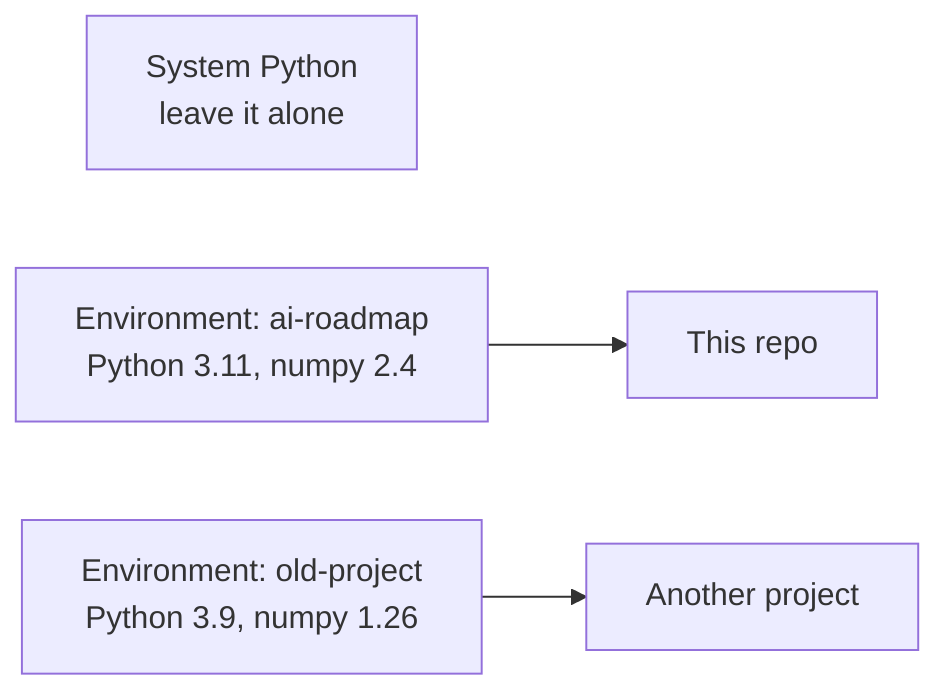

# Setup

**Course:** [Getting Started](../README.md) · **Hands-on:** [notebook.ipynb](notebook.ipynb) · **Practice:** [exercises](exercises/problems.md), [assignment](assignment.md)

Before you can run a single notebook, your computer needs Python, a few libraries, and a place to keep them that will not break other things. This topic builds that, step by step, and explains what each piece is so that the commands stop looking like magic spells. You will learn how Python and its package installer `pip` work, then set up your own environment with either `venv` (built in) or Miniconda, then connect it to an editor. If you would rather not install anything yet, there is also a no-install route using Google Colab.

> [!TIP]
> **In a hurry?** Jump to [Colab](#option-c-no-install-google-colab). Every notebook in this repo has an "Open in Colab" badge, so you can start the math right now and come back here when you want a local setup.

## Learning goals

By the end of this topic you can:

- open a terminal and move around with five or six basic commands;
- say which Python you are running, and why the version number matters;
- explain what an environment and a package are, and why every project gets its own;
- install, list, pin, and remove packages with `pip`, and install a whole project from a `requirements.txt` file;
- create, activate, and delete an environment with `venv` or with Miniconda, and recreate it on another machine from a file;
- connect VS Code or Jupyter to the right environment, and run a notebook;
- verify the setup with a short check script, and diagnose the most common failures;
- clone this repo with git and update it later.

## Prerequisites

- A computer running Windows 10/11, macOS, or Linux, and an internet connection. You do not need administrator rights for anything except installing a few programs (Python, git, VS Code).
- About 1 GB of free disk space for the math environment (a fresh one with the math requirements took roughly 700 MB in our test). The deep-learning libraries need several GB more, which is one reason to use Colab for that course.
- No programming experience. Python itself is taught in the next topic, [Python Basics](../python-basics/README.md).

## Outline

1. [The terminal in ten minutes](#1-the-terminal-in-ten-minutes)
2. [Python: the interpreter and its versions](#2-python-the-interpreter-and-its-versions)
3. [Why environments exist](#3-why-environments-exist)
4. [How pip works](#4-how-pip-works)
5. [Option A: a venv environment](#5-option-a-a-venv-environment)
6. [Option B: Miniconda](#6-option-b-miniconda)
7. [Which one should I choose? (and Option C: Colab)](#7-which-one-should-i-choose-and-option-c-colab)
8. [Editor and notebooks](#8-editor-and-notebooks)
9. [Check your setup, and fix it when it fails](#9-check-your-setup-and-fix-it-when-it-fails)
10. [Get the repo with git](#10-get-the-repo-with-git)
11. [Why this matters for AI/ML](#why-this-matters-for-aiml)

> [!NOTE]
> **How to read the commands.** Commands are shown in code blocks, and the output you should expect is in a separate `text` block after them. The outputs in this page came from a real run on Linux with Python 3.11. Your version numbers and folder names will differ (we write `/home/you/...` for your home folder). Windows and macOS differences are called out with labelled sub-headings.

## Key intuition

A computer does not "have Python" in one place. It can hold several Pythons and many copies of each library, and the command you type decides which ones you get. Most setup trouble comes from mixing them up. The cure is a habit: **one project, one environment, and always check which Python you are talking to.**

### 1. The terminal in ten minutes

A **terminal** (also called the command line or shell) is a window where you control the computer by typing commands instead of clicking. You type a command, press Enter, and the computer prints a result. Setup instructions use it because a typed command is exact and easy to copy.

**Open one.**

| System | How |
|---|---|
| Windows | Press the Windows key, type `PowerShell`, press Enter. (Windows Terminal also works.) |
| macOS | Press `Cmd+Space`, type `Terminal`, press Enter. |
| Linux | Press `Ctrl+Alt+T`, or search your applications for "Terminal". |

You are always "in" one folder, called the **working directory**. These commands cover almost everything you need:

| What you want | macOS / Linux | Windows PowerShell |
|---|---|---|
| Show where you are | `pwd` | `pwd` |
| List the files here | `ls` | `ls` (or `dir`) |
| Go into a folder | `cd folder-name` | `cd folder-name` |
| Go up one folder | `cd ..` | `cd ..` |
| Make a folder | `mkdir folder-name` | `mkdir folder-name` |
| Print a text file | `cat notes.txt` | `cat notes.txt` |
| Clear the screen | `clear` | `clear` |

PowerShell understands the same short names as macOS and Linux, so the commands in the table are identical. Try them:

```bash
pwd
mkdir ai-roadmap-demo
cd ai-roadmap-demo
pwd
ls
```

```text
/home/you
/home/you/ai-roadmap-demo
```

(`ls` prints nothing because the new folder is empty. On Windows, `pwd` shows a path like `C:\Users\you\ai-roadmap-demo`.)

Four habits make the terminal friendlier. Press `Tab` to auto-complete a file or folder name. Press the Up arrow to bring back the previous command. Press `Ctrl+C` to stop a command that is stuck. And if a folder name contains a space, wrap it in quotes: `cd "My Documents"`.

> [!WARNING]
> **Common mistake: running a command in the wrong folder.** A command like `pip install -r requirements-math.txt` looks for that file in the *current* folder. If you see "No such file or directory", run `pwd` and `ls` and check that you are where you think you are.

### 2. Python: the interpreter and its versions

Python is a programming language. The program that reads your Python code and carries it out is called the **interpreter**; when people say "install Python", they mean installing the interpreter plus its **standard library** (a toolbox of ready-made code that comes with it). When you type `python` in a terminal, the computer finds an interpreter file and runs it.

Python versions look like `3.11.16`. The first two numbers (`3.11`) are the **minor version** and they matter: each minor release adds features and drops old ones, and libraries are built for specific minor versions. This repo is tested with **Python 3.11**. Neighbouring versions usually work, but the very newest release can lag behind: heavy libraries like PyTorch sometimes take a while to publish builds for it. When in doubt, use 3.11.

**Check what you have.**

```bash
python --version
```

```text
Python 3.11.16
```

The command name varies by system, so try these in order until one answers:

| System | Try | Notes |
|---|---|---|
| Windows | `python --version`, then `py --version` | `py` is the **launcher** that the python.org installer adds. `py -3.11` picks version 3.11 if several are installed. |
| macOS and Linux | `python3 --version` | Often there is no plain `python`, only `python3`. |

To see *which file* will run, ask the system to locate it:

| System | Command |
|---|---|
| macOS and Linux | `which python3` |
| Windows PowerShell | `Get-Command python` (or `where.exe python`) |

```text
/usr/bin/python3
```

> [!WARNING]
> **Windows gotcha.** In PowerShell, plain `where` is a different command. Use `where.exe python` or `Get-Command python`. Also, if Python is not installed, typing `python` may open the Microsoft Store instead of running anything. That is Windows offering to install it; use the python.org installer below instead.

**If you have no Python, or the wrong one.** You have two choices. For the `venv` route, install Python 3.11 from the downloads page at [python.org](https://www.python.org/downloads/). On Windows, tick the box **Add python.exe to PATH** on the first installer screen. On macOS the same page has an installer. On Debian or Ubuntu Linux, `sudo apt install python3 python3-venv` installs the system Python and the `venv` module. For the Miniconda route you do not need to install Python first, because conda installs the exact version for you (section 6).

> [!IMPORTANT]
> **Windows users who prefer a Linux-style setup** can use **WSL** (Windows Subsystem for Linux). In an administrator PowerShell, run `wsl --install`, restart, and open the Ubuntu app. Everything in this page for Linux then applies inside it. Keep your project in the Linux home folder (`~`), not under `C:\`, for speed. See Microsoft's WSL guide in [resources.md](resources.md). WSL is optional; plain Windows works fine.

**Check yourself**

1. Your terminal says `Python 3.13.1`. Is that the same as 3.11?
2. Why might `python` fail on a Mac while `python3` works?

<details>
<summary>Answers</summary>

1. No. The minor version (13 versus 11) is different, so libraries built for one may not be available for the other.
2. Many Macs and Linux systems only provide the name `python3`. Both names refer to Python 3; the plain `python` name just is not defined there.

</details>

### 3. Why environments exist

Imagine a shared kitchen where every cook keeps their ingredients in one pantry. Cook A needs the 2019 version of a spice mix, cook B needs the 2024 version, and there is room for only one jar. Whoever shops last wins and the other recipe silently tastes wrong.

Software has the same problem, usually called **dependency conflict** (or, with a sigh, "dependency hell"). Project A needs `numpy 1.26`, project B needs `numpy 2.4`, and a computer-wide install of Python can hold only one of them. Worse, a notebook that ran perfectly last year may behave differently or crash today because a library moved on. The classic excuse, "it works on my machine", is the same problem seen from a colleague's laptop.

The fix is to give every project its own private pantry. Two terms you will use constantly:

- A **package** (or library) is a bundle of reusable code that someone else wrote, such as NumPy for arrays or Matplotlib for plots. You install packages instead of writing everything yourself.
- An **environment** is a self-contained folder that holds one Python interpreter and its own set of installed packages. Install into one environment and no other project is affected. Throw the environment away and nothing else breaks.



Two popular tools create environments: `venv`, which comes with Python, and `conda`, which comes with Miniconda. You will meet both below. First, the tool both of them rely on for adding packages.

### 4. How pip works

**pip** is Python's package installer. It downloads packages from **PyPI**, the Python Package Index (a public online catalogue at [pypi.org](https://pypi.org/)), and puts them into the environment it belongs to. When you type `pip install numpy`, pip finds the newest NumPy that fits your Python, downloads it, also fetches whatever NumPy itself needs (its **dependencies**), and installs everything.

> [!IMPORTANT]
> **Always run pip as `python -m pip`.** A computer can have several `pip` programs, each attached to a different Python, and plain `pip` may be the wrong one. `python -m pip ...` means "ask *this* Python to run *its own* pip", so the packages land where you expect. Every command below uses that form. And never use `sudo pip install` or install into the system Python: it can break tools your operating system depends on, and modern Linux systems refuse it with an `externally-managed-environment` error. Make an environment instead.

The following examples were run inside a fresh environment (made in section 5), so you can copy them once you have one. The core commands:

```bash
python -m pip install numpy          # newest compatible version
python -m pip list                   # what is installed here
python -m pip show numpy             # details about one package
python -m pip uninstall numpy        # remove it (asks to confirm; add -y to skip)
python -m pip install --upgrade numpy
```

```text
Successfully installed numpy-2.4.6
```

and `pip list` shows a table:

```text
Package    Version
---------- -------
numpy      2.4.6
pip        26.3
setuptools 79.0.1
```

**Versions and pins.** Packages release new versions all the time. You can ask for one exactly with `==`, which is called **pinning**:

```bash
python -m pip install numpy==1.26.4
```

```text
Successfully installed numpy-1.26.4
```

Other forms exist: `numpy>=1.26` ("at least"), `numpy<2` ("below 2"). With no version, pip takes the newest. Pinning is how you make an environment reproducible, which is why it matters so much in machine learning (see [below](#why-this-matters-for-aiml)).

If you ask for a version that does not exist, pip says so plainly:

```text
ERROR: Could not find a version that satisfies the requirement numpy==9.9.9 (from versions: 1.3.0, 1.4.1, ...)
ERROR: No matching distribution found for numpy==9.9.9
```

**Requirements files.** Typing package names one by one does not scale, so projects list them in a text file, conventionally `requirements.txt`, one package per line. You install them all with `-r` (for "requirements file"):

```bash
python -m pip install -r requirements-math.txt
```

This repo has three of these files at its top level, one per stage of the roadmap:

| File | What it installs | Use for |
|---|---|---|
| `requirements-math.txt` | `numpy`, `scipy`, `sympy`, `matplotlib`, `jupyter` | Getting Started and all the math topics |
| `requirements-ml.txt` | everything in the math file, plus `pandas`, `seaborn`, `scikit-learn`, `xgboost`, `lightgbm`, `shap`, `imbalanced-learn`, `umap-learn` | The machine-learning course |
| `requirements-dl.txt` | everything in the ML file, plus `torch`, `torchvision`, `transformers`, `datasets`, `peft`, `sentence-transformers`, `faiss-cpu`, `mlflow`, `fastapi`, `uvicorn` | The deep-learning course |

The first line of the ML file is `-r requirements-math.txt`, and the first line of the DL file is `-r requirements-ml.txt`. Inside a requirements file, `-r` means "also include everything listed in that other file", so the files stack like layers: installing the DL file installs all three layers. Start with the math file; add the others only when you reach those courses.

**Freezing.** `pip freeze` prints every installed package with its exact version, in the same format a requirements file uses. Save it to make a snapshot you can rebuild from:

```bash
python -m pip freeze > requirements-lock.txt
```

```text
anyio==4.16.0
argon2-cffi==25.1.0
...
numpy==2.4.6
...
```

The `>` sends the output into a file instead of the screen. A frozen list includes the dependencies of dependencies (108 lines for the math file, in our test), so it is long, but it recreates your environment exactly. Anyone, including you in a year, can rebuild it with `python -m pip install -r requirements-lock.txt`.

**Common pip problems**

| Message or symptom | Likely cause and fix |
|---|---|
| `pip: command not found` or `'pip' is not recognized` | The shell cannot find pip. Use `python -m pip ...` (or `python3 -m pip ...`) instead. |
| `No module named pip` | pip is missing from this Python. Run `python -m ensurepip --upgrade`, or recreate the environment. |
| `Permission denied` / `Access is denied` | You are installing into a protected, system-wide Python. Do not use `sudo`. Create an environment and install there. |
| `externally-managed-environment` | The operating system protects its own Python. Create an environment (section 5 or 6). |
| `Could not open requirements file: [Errno 2] No such file or directory` | You are in the wrong folder, or mistyped the name. Check with `pwd` and `ls`. |
| `Could not find a version that satisfies the requirement` | Misspelled name, a version that does not exist, or a Python too old or too new for that package. Check spelling and `python --version`. |
| A yellow `[notice] A new release of pip is available` | Harmless. Update with `python -m pip install --upgrade pip` when convenient. |
| SSL errors, or timeouts behind a company or school network | A proxy or firewall is blocking downloads. Try another network, or ask the network administrator for the proxy settings pip's user guide describes. |

**Check yourself**

1. What is the difference between `pip install numpy` and `python -m pip install numpy`?
2. What does the `-r` in `-r requirements-ml.txt` do inside `requirements-dl.txt`?

<details>
<summary>Answers</summary>

1. The first runs whichever `pip` the shell finds first, which may belong to a different Python. The second runs the pip that belongs to the exact Python you named, so the package goes where you expect.
2. It pulls in all the lines of `requirements-ml.txt`, so the deep-learning file contains the machine-learning packages as well as its own.

</details>

### 5. Option A: a venv environment

`venv` is built into Python, so it needs nothing extra. It makes an environment as a folder (we call it `.venv`) inside your project. You need Python 3.11 installed first (section 2).

**Step 1: open a terminal in your project folder.** If you have not cloned the repo yet, do [section 10](#10-get-the-repo-with-git) first, or just make an empty folder for practice and `cd` into it.

**Step 2: create the environment.**

| macOS and Linux | Windows PowerShell |
|---|---|
| `python3 -m venv .venv` | `py -3.11 -m venv .venv` |

It prints nothing when it works. It makes a `.venv` folder containing its own copy of (or link to) Python and its own empty list of packages. The name `.venv` starts with a dot, so `ls` hides it; `ls -a` (macOS/Linux) or `ls -Force` (PowerShell) shows it. The repo's `.gitignore` already lists `.venv/`, so git will not try to upload it.

**Step 3: activate it.** Creating the environment is like building a room; **activating** is walking in. Afterwards, `python` and `pip` mean the ones inside `.venv`.

| System | Command |
|---|---|
| macOS and Linux | `source .venv/bin/activate` |
| Windows PowerShell | `.venv\Scripts\Activate.ps1` |
| Windows cmd (Command Prompt) | `.venv\Scripts\activate.bat` |

Your prompt gets a `(.venv)` prefix. Confirm it worked:

```bash
python --version
python -m pip --version
```

```text
Python 3.11.16
pip 24.0 from /home/you/ai-roadmap/.venv/lib/python3.11/site-packages/pip (python 3.11)
```

The path in the second line points inside `.venv`. That is the proof that you are in the environment and not the system Python. (On macOS and Linux, plain `python` now works inside the environment even if only `python3` did outside it.)

> [!WARNING]
> **Windows PowerShell gotcha: "running scripts is disabled on this system".** Activating runs a small script, and Windows blocks scripts by default on many machines. The message looks like `...Activate.ps1 cannot be loaded because running scripts is disabled on this system`. Allow scripts you wrote or that are signed, for your user only:
>
> ```powershell
> Set-ExecutionPolicy -Scope CurrentUser -ExecutionPolicy RemoteSigned
> ```
>
> Type `Y` to confirm, then try activating again. You can also dodge the issue by using the Command Prompt activation line above. The policy is explained in Microsoft's PowerShell documentation (see [resources.md](resources.md)).

**Step 4: update pip and install the repo's requirements.** A new venv often comes with an older pip (pip will even print a notice saying so). Update it first, then install the math requirements:

```bash
python -m pip install --upgrade pip
python -m pip install -r requirements-math.txt
```

```text
Successfully installed pip-26.3
...
Successfully installed anyio-4.16.0 ... jupyter-1.1.1 ... matplotlib-3.11.2 ... numpy-2.4.6 ... scipy-1.17.1 sympy-1.14.0 ...
```

This takes a minute or two. Then check that everything fits together:

```bash
python -m pip check
```

```text
No broken requirements found.
```

**Step 5: deactivate when you are done.** This leaves the environment; your prompt goes back to normal:

```bash
deactivate
```

Open the project later and run the activate command again. You do not reinstall.

**Throwing it away and rebuilding.** An environment is disposable, which is its great virtue. To delete it, deactivate and then delete the `.venv` folder (in a file manager, or `rm -r .venv` on macOS/Linux, `Remove-Item -Recurse -Force .venv` in PowerShell; be careful to type the folder name exactly). To rebuild, repeat steps 2 to 4, or rebuild from a snapshot you froze earlier:

```bash
python3 -m venv .venv                          # (Windows: py -3.11 -m venv .venv)
source .venv/bin/activate                      # (Windows: .venv\Scripts\Activate.ps1)
python -m pip install -r requirements-lock.txt
```

```text
Successfully installed contourpy-1.3.3 cycler-0.12.1 ... matplotlib-3.11.2 ... numpy-2.4.6 ...
```

> [!NOTE]
> A good rule: **never copy an environment folder to another computer.** Copy the requirements file instead and build a new environment there. The folder contains paths and compiled files that only work where it was made.

### 6. Option B: Miniconda

**conda** is a package and environment manager from the Anaconda project. It overlaps with `pip` and `venv`, but goes further in two ways. First, it can install **Python itself**, in whatever version you ask for, so you never worry about what the system has. Second, it manages packages that are not Python at all, such as the compiled math libraries and GPU runtimes that NumPy and PyTorch sit on. **Miniconda** is a small installer that gives you `conda` and almost nothing else (the full Anaconda Distribution adds hundreds of packages you do not need).

| | `venv` + `pip` | `conda` |
|---|---|---|
| Comes with | Python | Miniconda |
| Chooses the Python version | No: uses the one you ran it with | Yes: `python=3.11` |
| Installs non-Python software (compilers, CUDA libraries) | No | Yes |
| Package source | PyPI | conda channels (and pip, if you ask) |
| Environment lives | in your project folder | in one central conda folder |

> [!NOTE]
> The conda commands in this section are taken from the official documentation. They were not run while writing this page (installing Miniconda would change the writer's machine), so your output may differ in small ways from what is described.

**Step 1: install Miniconda.** Download it from the official Miniconda page (linked in [resources.md](resources.md)) and follow the instructions for your system:

| System | What to do |
|---|---|
| Windows | Download the Windows installer and double-click it. Choose **Just Me** (the recommended option). Leave **Add Miniconda3 to my PATH** unticked, as the installer advises. When it finishes, open **Anaconda Prompt** from the Start menu. |
| macOS | Download the installer for your chip: **Apple Silicon** (M1 and later, "arm64") or **Intel** ("x86_64"); the Apple menu, "About This Mac", tells you which. Then run it in Terminal: `bash ~/Downloads/Miniconda3-latest-MacOSX-arm64.sh` (adjust the file name to the one you downloaded). |
| Linux | `curl -O https://repo.anaconda.com/miniconda/Miniconda3-latest-Linux-x86_64.sh`, then `bash Miniconda3-latest-Linux-x86_64.sh`. On an ARM machine use the `aarch64` file instead. |
| WSL | Same as Linux, inside the Ubuntu terminal. |

On macOS and Linux the installer asks you to press Enter to read the license, type `yes` to accept, accept the default folder, and answer `yes` to "initialize conda". Then **close the terminal and open a new one**. You should see `(base)` at the start of your prompt: that is conda's default environment.

```bash
conda --version
```

```text
conda 25.x.x
```

(The exact number depends on the day you install.)

> [!NOTE]
> **About the licence prompt.** Anaconda's default package channels have terms of service, and the first `conda create` or `conda install` may ask you to accept them. Read them, as the prompt asks. Anaconda's documentation says commercial use of those channels can require a paid licence. The community-run **conda-forge** channel is free for everyone, and you can ask for it explicitly with `--channel conda-forge --override-channels`, as in the next step. A related installer, **Miniforge**, makes conda-forge the default.

**Step 2: create an environment, never inside `base`.** The `base` environment holds conda itself. Installing project packages into it risks breaking conda, so treat `base` as untouchable and make a new environment per project:

```bash
conda create --name ai-roadmap python=3.11
```

or, using conda-forge:

```bash
conda create --name ai-roadmap --channel conda-forge --override-channels python=3.11
```

conda shows a plan of packages and asks `Proceed ([y]/n)?`. Press Enter.

**Step 3: activate it and check.**

```bash
conda activate ai-roadmap
python --version
```

Your prompt changes from `(base)` to `(ai-roadmap)`, and the version should read `Python 3.11.x`. Windows users do this in Anaconda Prompt (or in PowerShell after running `conda init powershell` once and reopening it).

**Step 4: install packages.** You have two sources, conda and pip, and the safest habit is:

1. Install the **core compiled packages with conda** if you want, for example `conda install numpy scipy matplotlib jupyter`. Do this first.
2. Install **everything else with pip**, as `python -m pip install ...`, which is fine inside a conda environment because the pip belongs to that environment's Python.
3. Do not go back and forth: avoid running `conda install` after you have started using pip in the same environment, because conda cannot see what pip changed.

For this roadmap, the simplest reliable recipe is to let pip handle the repo's files, from the repo folder:

```bash
python -m pip install -r requirements-math.txt
```

**Step 5: manage environments.**

| Task | Command |
|---|---|
| List all environments | `conda env list` |
| Leave the current one | `conda deactivate` |
| List packages in the active one | `conda list` |
| Delete an environment | `conda remove --name ai-roadmap --all` |

**Step 6: save and recreate with a file.** conda's equivalent of `requirements.txt` is `environment.yml`. Export what you explicitly asked for with:

```bash
conda env export --from-history > environment.yml
```

The file looks like this (a hand-written example of the format):

```yaml
name: ai-roadmap
channels:
  - conda-forge
dependencies:
  - python=3.11
  - pip
```

Rebuild it on any machine with:

```bash
conda env create -f environment.yml
```

`--from-history` lists only what you asked for, which keeps the file portable between operating systems. Packages that you installed with pip are not captured by this export, so keep the repo's requirements file (or a `pip freeze` snapshot) alongside it.

### 7. Which one should I choose? (and Option C: Colab)

Pick one local option, or use Colab. Do not install all three.

| | Option A: `venv` | Option B: Miniconda | Option C: Colab |
|---|---|---|---|
| Install needed | Python 3.11 | Miniconda | Nothing (a Google account) |
| Python version control | You pick the one you installed | Any version, per environment | Fixed by Colab |
| Works offline | Yes | Yes | No |
| GPU for deep learning | Only if you have one and set it up | Same, but easier to set up | Free GPU runtime (limited, not guaranteed) |
| Your files persist | Yes | Yes | No, unless saved to Drive or downloaded |
| Best for | You already have Python 3.11 and want the simplest thing | You want a guaranteed Python version, or heavier packages | Starting right now, or the GPU-heavy deep-learning notebooks |

**Our recommendation for beginners.** Start in Colab today so that nothing blocks you. For a local setup, pick **Miniconda** if you do not have Python 3.11 handy: it removes the "which Python is this?" problem. Pick **`venv`** if Python 3.11 is already installed and you like fewer moving parts. Either way, follow the habit from the start of this page: one environment for this roadmap.

#### Option C: no install, Google Colab

**Colab** is a free service from Google that runs notebooks on Google's computers, in your browser. Each repo notebook has a badge at the top, like this:

[](https://colab.research.google.com/github/shahin1717/ai-roadmap/blob/main/getting-started/setup/notebook.ipynb)

1. Click the badge. Colab opens the notebook straight from GitHub (sign in with a Google account when asked).
2. Run a cell with the play button next to it, or press `Shift+Enter`.
3. NumPy and Matplotlib are already installed. For an extra package, put this in a cell and run it:

```python
%pip install some-package
```

The `%pip` form installs into the notebook's own Python, which is what you want. A bare `!pip install ...` also works for most packages; the `!` means "run this line in the terminal, not as Python". Install only the packages you need, not the repo's whole requirements file.

4. Know what resets. Colab gives you a temporary computer. When the session ends (you leave the tab for a while, it sits idle, or it runs too long), the files you created and the packages you installed vanish. Colab keeps the notebook itself if you save it to Drive, but not your data files. Put install commands at the top of the notebook so they run again, and download or save to Drive anything you want to keep.
5. For the deep-learning course, choose **Runtime > Change runtime type** and pick a GPU. A short check is `import torch; print(torch.cuda.is_available())`, which prints `True` when a GPU is attached. Availability and limits change over time, so check Google's Colab FAQ (linked in [resources.md](resources.md)).

### 8. Editor and notebooks

You need somewhere to open `.ipynb` notebook files and write code. **Visual Studio Code** (VS Code) is a free editor that does both well, and works the same on every system.

**Install and connect it.**

1. Download VS Code from its website (linked in [resources.md](resources.md)) and install it.
2. Open the extensions panel (the squares icon on the left, or `Ctrl+Shift+X` / `Cmd+Shift+X`) and install **Python** and **Jupyter**, both published by Microsoft.
3. Use **File > Open Folder** to open the repo folder.
4. Choose the interpreter: press `Ctrl+Shift+P` (`Cmd+Shift+P` on macOS) to open the Command Palette, type **Python: Select Interpreter**, and pick the one that mentions `.venv` or `ai-roadmap`.
5. Open a `.ipynb` file. At the top right, click **Select Kernel** and choose the same environment. A **kernel** is the running Python process that executes your cells; it must belong to the environment that holds your packages.
6. Run a cell with the play button or `Shift+Enter`.

**Or use classic Jupyter.** The `jupyter` package is part of the math requirements. With your environment active, from the repo folder:

```bash
jupyter lab
```

It starts a small local server and opens a page in your browser (at an address like `http://localhost:8888/lab`). Stop it with `Ctrl+C` in the terminal, twice if asked. `jupyter notebook` gives the older, simpler interface.

**Making the kernel show up.** If an environment does not appear in the kernel list, register it once, with the environment active:

```bash
python -m ipykernel install --user --name ai-roadmap --display-name "Python (ai-roadmap)"
```

```text
Installed kernelspec ai-roadmap in /home/you/.local/share/jupyter/kernels/ai-roadmap
```

It then appears in the kernel list as "Python (ai-roadmap)". Restart VS Code or reload the page if it does not show up at once.

### 9. Check your setup, and fix it when it fails

The test is small: import the libraries, print where they come from and their versions, and draw a plot. Save this as `check_setup.py` (or paste it into a notebook cell):

```python
import sys

import matplotlib
matplotlib.use("Agg")          # draw to a file, so this works even without a display
import matplotlib.pyplot as plt
import numpy as np

print("Python     :", sys.version.split()[0])
print("Interpreter:", sys.executable)
print("NumPy      :", np.__version__)
print("Matplotlib :", matplotlib.__version__)

x = np.linspace(0, 2 * np.pi, 50)
plt.plot(x, np.sin(x))
plt.title("Setup check")
plt.savefig("setup_check.png")
print("Plot saved to setup_check.png")
```

Run it with the environment active:

```bash
python check_setup.py
```

```text
Python     : 3.11.16
Interpreter: /home/you/ai-roadmap/.venv/bin/python
NumPy      : 2.4.6
Matplotlib : 3.11.2
Plot saved to setup_check.png
```

**What success looks like:** no red errors, a Python version you expected, an **Interpreter** path that points inside your environment (`.venv` or `.../envs/ai-roadmap/...`), and a `setup_check.png` file with a sine wave. The [notebook](notebook.ipynb) in this topic does the same check in a notebook cell, where the plot appears directly under the cell.

> [!TIP]
> The "Interpreter" line is the most useful diagnostic in this page. If it points somewhere you did not expect, you are using the wrong Python, and almost every other problem follows from that.

**Troubleshooting**

| Symptom | Likely cause | Fix |
|---|---|---|
| `python: command not found`, or `'python' is not recognized` | Python is not installed, not on your PATH (the list of folders the shell searches), or goes by another name | Try `python3` (macOS/Linux) or `py` (Windows). Reinstall Python, ticking "Add python.exe to PATH" on Windows. |
| `python --version` shows the wrong version | An older Python comes first, or the environment is not active | Activate your environment, then recheck. Look for `(.venv)` or `(ai-roadmap)` in the prompt. |
| `ModuleNotFoundError: No module named 'numpy'` in a script | Packages were installed into a different Python than the one running | Activate the environment and install with `python -m pip install ...`. |
| `ModuleNotFoundError` in a **notebook**, even though `pip install` succeeded | The notebook's kernel is a different Python from the one you installed into | Select the correct kernel (section 8). In a notebook cell, run `import sys; print(sys.executable)` to see which Python the kernel is. Install from inside the notebook with `%pip install name`. |
| Environment is missing from the kernel list | The kernel is not registered, or the editor has not refreshed | Run the `ipykernel install` command above, then reload the editor. Make sure `ipykernel` is installed in that environment (the math requirements include it). |
| `Activate.ps1 cannot be loaded because running scripts is disabled` | PowerShell's script policy | `Set-ExecutionPolicy -Scope CurrentUser -ExecutionPolicy RemoteSigned`, or use `activate.bat` in Command Prompt. |
| `conda: command not found` | The terminal was not restarted, or conda was not initialised | Close and reopen the terminal. On Windows, use Anaconda Prompt. If needed, run `conda init` once and reopen. |
| `SSL: CERTIFICATE_VERIFY_FAILED`, connection timed out, or "Retrying..." | A proxy, firewall, or an unstable connection | Try another network. On managed networks ask the administrator for the proxy and certificate settings. Do not turn off certificate checking. |
| `ImportError` mentioning DLL, `GLIBC`, or a compiled file | A package built for another Python version or system | Recreate the environment with Python 3.11 and reinstall the requirements. |
| Everything worked yesterday, today nothing does | The environment is not active in this new terminal | Activate it again; activation lasts only for that terminal window. |

When all else fails, delete the environment and rebuild it (sections 5 and 6). Rebuilding takes a few minutes and is often faster than debugging.

### 10. Get the repo with git

**git** is a tool that tracks changes to files, and **GitHub** is a website that hosts git projects. You do not need to learn git here, only two commands: one to **clone** (download a full copy of the repo) and one to **pull** (fetch newer versions later).

1. Install git: on Windows, the installer from [git-scm.com](https://git-scm.com/downloads) (the default options are fine); on macOS, running `git --version` in Terminal offers to install the developer tools; on Debian or Ubuntu, `sudo apt install git`.
2. Clone the repo. The HTTPS address works for everyone, with no account:

```bash
git clone https://github.com/shahin1717/ai-roadmap.git
cd ai-roadmap
```

```text
Cloning into 'ai-roadmap'...
```

(In a real terminal you also see a few progress lines.) If you already use an SSH key with GitHub, the address `git@github.com:shahin1717/ai-roadmap.git` works too.

3. Later, to get new and fixed topics, from inside the folder:

```bash
git pull
```

```text
Already up to date.
```

If you edit a notebook yourself and git then refuses to pull, make a copy of your edited file under another name first. No git? On the repo's GitHub page, the green **Code** button offers **Download ZIP**.

## Why this matters for AI/ML

- **Reproducibility.** A machine-learning result depends on the library versions that produced it. The same code can train slightly differently, or fail, under another NumPy or PyTorch. Pinning versions (`==`, or a `pip freeze` snapshot) and keeping a requirements or `environment.yml` file is how a colleague, or you in six months, reruns the experiment and gets the same answer. Every serious ML project has such a file for this reason.
- **Isolation.** ML libraries are large and picky about each other: one project wants an older scikit-learn, another a newer PyTorch. One environment per project keeps them from clashing.
- **Hardware awareness.** Deep learning runs fastest on a GPU, and a GPU build of PyTorch must match your drivers and CUDA (NVIDIA's GPU programming platform). That is the hardest setup problem in the field, which is why the deep-learning course points to Colab as the easy GPU route, and the PyTorch website has an install selector if you set up your own (see [resources.md](resources.md)).
- **A habit that pays.** Checking which Python is running, reading the last line of an error, and rebuilding an environment from a file are the same skills you will use on cloud servers and in team projects.

## Summary

- The terminal runs typed commands; `pwd`, `ls`, `cd`, and `mkdir` get you around.
- Python is an interpreter, and its minor version matters. This repo is tested on 3.11.
- An environment is a private folder of Python and packages; make one per project and never install into the system Python.
- `python -m pip` installs from PyPI into the right environment. Pin with `==`, list with `pip list`, snapshot with `pip freeze`, and install a file with `-r`.
- `venv` is built in; Miniconda also manages the Python version and non-Python libraries. Keep `base` clean.
- Colab needs no install but forgets everything when the session ends.
- Match the notebook's kernel to the environment, run the check script, and read the Interpreter path whenever something is off.
- `git clone` gets the repo and `git pull` updates it.

## Further reading

Official documentation and free links are in [resources.md](resources.md).

## Practice

- [Notebook](notebook.ipynb): run the setup check as a notebook cell and see which Python your kernel uses.
- [Exercises](exercises/problems.md) (with [solutions](exercises/solutions.md)): hands-on tasks, from the terminal to a rebuilt environment.
- [Assignment](assignment.md): build a reproducible environment and prove it works.

---

[← Previous: How to Use this Repo](../how-to-use-this-repo/README.md) | [Next: Python Basics →](../python-basics/README.md)
