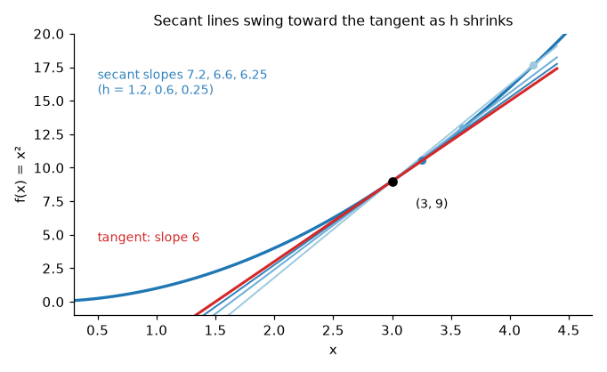
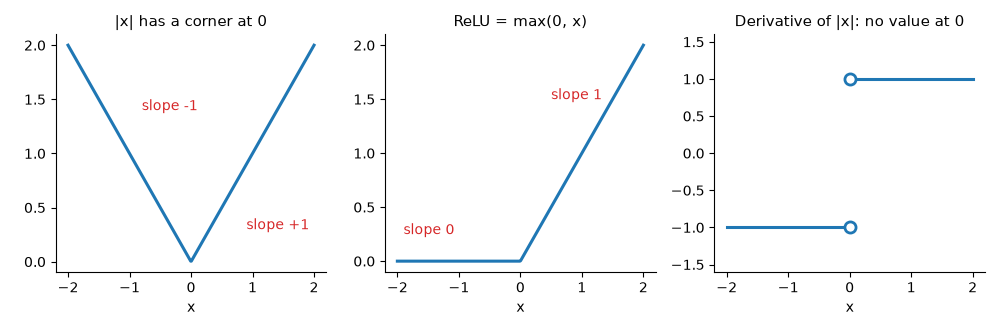
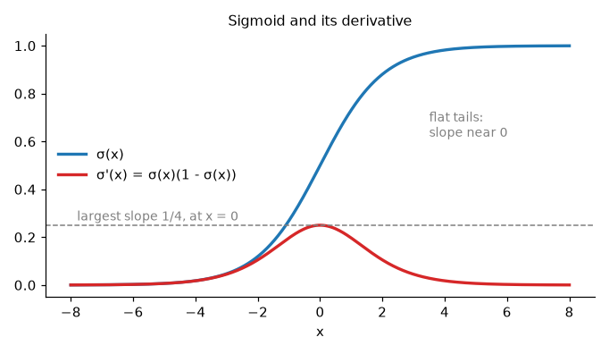
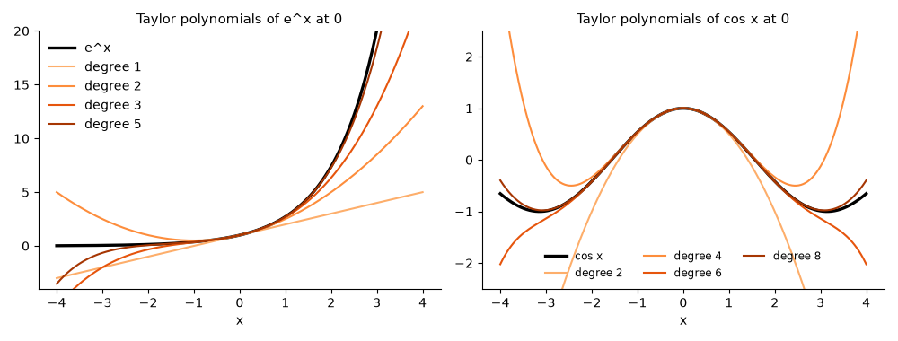
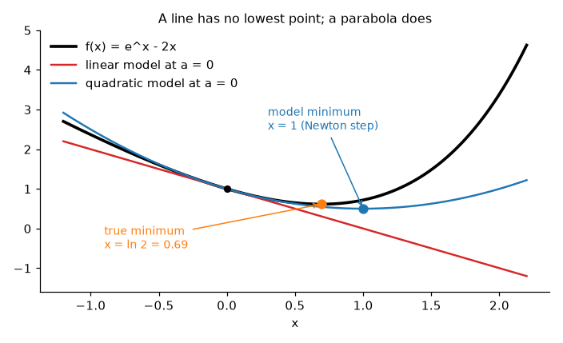

# Derivatives and Taylor Series

**Course:** [Calculus and Optimization](../README.md) · **Hands-on:** [notebook.ipynb](notebook.ipynb) · **Practice:** [exercises](exercises/problems.md), [assignment](assignment.md)

How fast is a falling ball moving at exactly the two-second mark? Speed is distance divided by time, and a single instant has no duration to divide by. The way out is to measure over shorter and shorter windows and watch what number the speeds settle on. That number is the **derivative**: the slope of a curve at one point. It tells you which way a function is heading and where it bottoms out, and it lets you stand in a simple curve for a complicated one near a point (a **Taylor polynomial**). Training a neural network is a long run of derivative calculations, and the chain rule you meet here is backpropagation in one variable.

## Learning goals

By the end of this topic you can:

- compute a derivative from its limit definition, read it as a tangent slope and as a rate of change, and say where it fails to exist (corners, cusps, vertical tangents, jumps);
- differentiate with the power, sum, product, and quotient rules and the derivatives of $e^x$, $\ln x$, $\sin x$, $\cos x$, and apply the chain rule to nested functions, including the sigmoid;
- build a tangent-line approximation and explain why its error shrinks like the square of the distance;
- find critical points, classify them with the first and second derivative tests, and describe concavity and curvature;
- write Taylor polynomials of degree $1$, $2$, and $n$, say how fast their error shrinks, and use the Maclaurin series of $e^x$, $\sin x$, $\cos x$, $\frac{1}{1-x}$, $\ln(1+x)$ with their radius of convergence;
- explain how the chain rule becomes backpropagation, why sigmoid saturates, how automatic differentiation differs from symbolic and numeric differentiation, and how linear and quadratic models lead to gradient descent and Newton's method.

## Prerequisites

- [Limits and continuity](../limits-and-continuity/README.md): limits, one-sided limits, and $\frac{\sin x}{x} \to 1$. A derivative is a limit, so this is the direct prerequisite, and a few lines of recap appear where needed.
- High-school algebra and trigonometry, and the graphs of $e^x$, $\ln x$, $\sin x$, $\cos x$.
- Basic Python and NumPy from [Python Basics](../../../getting-started/python-basics/README.md), only for the code blocks and the notebook.

## Outline

- [Notation at a glance](#notation-at-a-glance)
- [1. From secant slopes to the derivative](#1-from-secant-slopes-to-the-derivative)
- [2. When a derivative does not exist](#2-when-a-derivative-does-not-exist)
- [3. The differentiation rules](#3-the-differentiation-rules)
- [4. The chain rule](#4-the-chain-rule)
- [5. Linear approximation and rates of change](#5-linear-approximation-and-rates-of-change)
- [6. Critical points, derivative tests, and curvature](#6-critical-points-derivative-tests-and-curvature)
- [7. Taylor polynomials and the size of the error](#7-taylor-polynomials-and-the-size-of-the-error)
- [8. Maclaurin series, convergence, and the quadratic model](#8-maclaurin-series-convergence-and-the-quadratic-model)
- [The same ideas in Python and NumPy](#the-same-ideas-in-python-and-numpy)
- [Common mistakes](#common-mistakes)
- [Why this matters for AI/ML](#why-this-matters-for-aiml)

> [!NOTE]
> **Concept ownership.** This topic teaches the derivative, the differentiation rules, the chain rule (one variable), linear approximation, critical points and the derivative tests, higher derivatives, and Taylor polynomials and series in full. Later topics recap them and link back (see the [ownership map](../../../docs/design-notes.md)).

**What this topic leaves for later.**

| Question | Where it is answered |
|---|---|
| What are partial derivatives, gradients, the multivariable chain rule, and the Hessian (the many-variable $f''$)? | [Multivariable calculus](../multivariable-calculus/README.md) |
| How is the area under a curve computed, and how do integrals undo derivatives? | [Integrals](../integrals/README.md) |
| How do we use the slope to train a model step by step? | [Gradient descent and its variants](../gradient-descent-and-its-variants/README.md) |
| How do we find a root or a minimum with the quadratic model of section 8? | [Newton and quasi-Newton methods](../newton-and-quasi-newton-methods/README.md) |

## Key intuition

### Notation at a glance

| You see | It means |
|---|---|
| $f'(a)$, $\dfrac{dy}{dx}$, $\dfrac{d}{dx}f(x)$ | the derivative: the slope of $f$ at $a$ (Leibniz form: a tiny change in $y$ per tiny change in $x$) |
| $f''(x)$, $f^{(n)}(x)$ | the derivative of $f'$, and the $n$-th derivative (differentiate $n$ times) |
| $T_n(x)$, $R_n(x)$ | the degree-$n$ Taylor polynomial, and its error $R_n = f - T_n$ (the remainder) |
| $n!$, $\sum$ | $n$ factorial, $n(n-1)\cdots 2\cdot 1$ (so $4! = 24$, $0! = 1$), and a sum such as $\sum_{k=0}^{n} x^k = 1 + x + \dots + x^n$ |

### 1. From secant slopes to the derivative

A straight line has one slope everywhere. A curve is steeper in some places than others, so we ask for the slope **at one point**. One point gives no rise or run, so we use two points and slide one toward the other. The line through $(a, f(a))$ and $(a+h, f(a+h))$ is a **secant line**, and its slope is the **difference quotient** $\dfrac{f(a+h) - f(a)}{h}$, the average rate of change over a window of width $h$.

Take $f(x) = x^2$ at $a = 3$. Then $f(3+h) - f(3) = 6h + h^2$, so the secant slope is $6 + h$: it is $7$ for $h = 1$, $6.1$ for $h = 0.1$, and $6.01$ for $h = 0.01$. As the window closes the slopes head to $6$, the slope of the **tangent line**, the line that just touches the curve there.



*The secant lines swing toward the red tangent line as the second point slides in.*

**Definition.** The **derivative** of $f$ at $a$ is $f'(a) = \displaystyle\lim_{h \to 0} \frac{f(a+h) - f(a)}{h}$ when the limit exists (from both sides, so $h$ may be negative), and then $f$ is **differentiable** at $a$. The tangent line is the line through $(a, f(a))$ with slope $f'(a)$. For $x^2$ at a general point, $\frac{(a+h)^2 - a^2}{h} = 2a + h \to 2a$. Doing the algebra at every point at once gives the **derivative function** $f'(x) = 2x$: slope $-4$ at $x=-2$, $0$ at the bottom of the bowl, $4$ at $x = 2$. Another one from the definition: for $f(x) = \frac1x$, the quotient is $\frac{-1}{x(x+h)} \to -\frac{1}{x^2}$, which at $x = 2$ is the $-\frac14$ you found in the limits topic.

The names $f'(x)$, $y'$, $\frac{dy}{dx}$, and $\frac{d}{dx}f(x)$ all mean the same thing. Read $\frac{dy}{dx}$ as "change in $y$ per change in $x$" for tiny changes. It is not literally a fraction, but it behaves like one in the chain rule. The sign of $f'$ tells the direction: $f' > 0$ means rising, $f' < 0$ means falling, $f' = 0$ means a flat tangent.

**Check yourself**
1. From the definition, find $f'(2)$ for $f(x) = x^2 + x$.
2. What does the secant slope of $x^2$ between $x = 1$ and $x = 4$ measure, and what is it?

<details><summary>Answers</summary>

1. $f(2+h) - f(2) = (4 + 4h + h^2 + 2 + h) - 6 = 5h + h^2$, so the quotient is $5 + h \to 5$. Hence $f'(2) = 5$.
2. The average rate of change over that stretch: $\frac{16 - 1}{4 - 1} = 5$.
</details>

### 2. When a derivative does not exist

Take $f(x) = |x|$ at $0$. For $h > 0$ the secant slope is $\frac{|h|}{h} = 1$, and for $h < 0$ it is $-1$. The sides disagree, so there is no derivative at $0$, although the function is continuous there. Elsewhere it is fine: $f' = -1$ for $x < 0$ and $f' = 1$ for $x > 0$.



*A corner has two different slopes meeting at a point, so neither one is "the" slope.*

Secant slopes can fail in four ways. Here is each at $x = 0$:

| Shape | Example | Secant slopes as $h \to 0$ |
|---|---|---|
| Corner | $\lvert x\rvert$, ReLU | settle to different numbers on the two sides ($-1$ and $1$; $0$ and $1$ for ReLU) |
| Cusp | $x^{2/3}$ | go to $+\infty$ on one side and $-\infty$ on the other |
| Vertical tangent | $x^{1/3}$ | go to $+\infty$ on both sides |
| Jump | a step function | blow up: a jump of fixed size divided by a tiny $h$ |

If $f$ is differentiable at $a$ it is continuous there (a jump never has a tangent), but not the other way round, as $|x|$ shows. A differentiable function also looks like a straight line when you zoom in, and a corner never straightens. The standard example in AI is **ReLU**, $\max(0, x)$, used in nearly every modern network: its derivative is $0$ for $x < 0$ and $1$ for $x > 0$, with none at exactly $0$. Libraries pick a value there (usually $0$), and since an input is almost never exactly $0.0$, training does not notice.

**Check yourself**
1. Where is $f(x) = |x - 2|$ differentiable, and what is $f'(5)$?
2. Why can a function with a jump at $a$ not have a derivative at $a$?

<details><summary>Answers</summary>

1. Everywhere except $x = 2$ (a corner). Near $x = 5$ the function is $x - 2$, so $f'(5) = 1$.
2. Across a jump of size $J$ the secant slope is about $\frac{J}{h}$, which grows without bound as $h \to 0$, so the limit does not exist.
</details>

### 3. The differentiation rules

Going back to the definition each time is slow. A short list covers almost everything. Here $c$ and $n$ are constants and $f$, $g$ are differentiable functions.

| Rule | Formula |
|---|---|
| Constant, power | $(c)' = 0$, and $(x^n)' = n\,x^{n-1}$ for any real $n$ |
| Constant multiple, sum | $(c\,f)' = c\,f'$, and $(f + g)' = f' + g'$ |
| Product | $(f g)' = f'g + f g'$ |
| Quotient | $\left(\dfrac{f}{g}\right)' = \dfrac{f'g - f g'}{g^2}$ |
| Exponential, logarithm | $(e^x)' = e^x$, and $(\ln x)' = \dfrac1x$ |
| Sine, cosine | $(\sin x)' = \cos x$, and $(\cos x)' = -\sin x$ |

A few reasons. For $n = 3$, $(x+h)^3 - x^3 = 3x^2h + 3xh^2 + h^3$; divide by $h$ and let $h \to 0$ to get $3x^2$. Negative and fractional $n$ work too: $\frac1x = x^{-1}$ has derivative $-x^{-2}$, and $\sqrt x = x^{1/2}$ has $\frac{1}{2\sqrt x}$. For the product rule, picture a rectangle with sides $f$ and $g$ that both grow slightly: the area gains a strip $f'g$ along one side, a strip $fg'$ along the other, and a corner too small to matter. The number $e$ is the base whose curve has slope equal to its height (the limit $\frac{e^h-1}{h} \to 1$ says so at $0$), and the sine rule rests on $\frac{\sin h}{h} \to 1$.

- Sum and power: $\dfrac{d}{dx}(5x^3 - 4x + 7) = 15x^2 - 4$. Product: $\dfrac{d}{dx}\big(x^2 e^x\big) = 2x\,e^x + x^2 e^x = (x^2 + 2x)\,e^x$.
- Quotient: $\dfrac{d}{dx}\dfrac{x}{x^2+1} = \dfrac{1\cdot(x^2+1) - x\cdot 2x}{(x^2+1)^2} = \dfrac{1 - x^2}{(x^2+1)^2}$. Log and product: $\dfrac{d}{dx}(x \ln x) = \ln x + 1$.

**Check yourself**
1. Differentiate $4x^3 - 2\sqrt{x} + \dfrac1x$.
2. Differentiate $x \sin x$ and $\dfrac{\cos x}{x}$.

<details><summary>Answers</summary>

1. $12x^2 - \dfrac{1}{\sqrt{x}} - \dfrac{1}{x^2}$.
2. Product rule: $\sin x + x\cos x$. Quotient rule: $\dfrac{-x\sin x - \cos x}{x^2}$.
</details>

### 4. The chain rule

Most functions feed one function into another: $\sin(x^2)$ squares first and takes the sine second. If $y = f(u)$ and $u = g(x)$, the **chain rule** says

$$\frac{d}{dx} f(g(x)) = f'(g(x))\cdot g'(x), \qquad\text{or}\qquad \frac{dy}{dx} = \frac{dy}{du}\cdot\frac{du}{dx}.$$

In words: differentiate the **outside** function (leaving the inside alone), then multiply by the derivative of the **inside**. Think of gears. If $u$ turns $3$ times as fast as $x$ and $y$ turns $2$ times as fast as $u$, then $y$ turns $6$ times as fast as $x$: rates multiply along the chain.

- Two steps: $\dfrac{d}{dx}(3x+1)^5 = 5(3x+1)^4\cdot 3 = 15(3x+1)^4$. Likewise $\dfrac{d}{dx}\sin(x^2) = 2x\cos(x^2)$ and $\dfrac{d}{dx}e^{-x} = -e^{-x}$.
- Three steps: $y = e^{\sin(x^2)}$ nests three functions, $u = x^2$, $v = \sin u$, $y = e^v$. Work outside in and multiply: $\dfrac{dy}{dx} = e^{v}\cdot\cos u\cdot 2x = 2x\cos(x^2)\,e^{\sin(x^2)}$, about $2.507$ at $x = 1$.

**The sigmoid.** $\sigma(x) = \dfrac{1}{1+e^{-x}} = (1 + e^{-x})^{-1}$ squashes any number into $(0, 1)$ and is a classic network activation. The outside is "power $-1$", the inside is $1 + e^{-x}$ with derivative $-e^{-x}$:

$$\sigma'(x) = -(1+e^{-x})^{-2}\cdot(-e^{-x}) = \frac{e^{-x}}{(1+e^{-x})^2} = \sigma(x)\,\big(1 - \sigma(x)\big),$$

using $1 - \sigma(x) = \frac{e^{-x}}{1+e^{-x}}$. A product $s(1-s)$ with $0<s<1$ is largest at $s = \frac12$, so the biggest slope is $\sigma'(0) = \frac14$, and far from $0$ it is tiny ($\sigma'(4) \approx 0.018$).



*The slope of the sigmoid never exceeds $\frac14$ and nearly vanishes in both tails.*

Two short extras. **Implicit differentiation** handles a curve like $x^2 + y^2 = 25$ where $y$ has no formula: differentiate both sides in $x$, treating $y$ as a function of $x$ (the chain rule puts a factor $y'$ on each $y$-term). Then $2x + 2y\,y' = 0$, so $y' = -\frac{x}{y}$, and the slope at $(3, 4)$ is $-\frac34$. **Logarithmic differentiation** takes $\ln$ of both sides first to turn products and powers into sums: for $y = x^x$, $\ln y = x\ln x$ gives $y' = x^x(\ln x + 1)$.

**Check yourself**
1. Differentiate $(x^2+1)^3$ and $\ln(1 + e^x)$.
2. If $y = u^2$, $u = 3v$, $v = \sin x$, what is $\frac{dy}{dx}$?

<details><summary>Answers</summary>

1. $6x(x^2+1)^2$, and $\dfrac{e^x}{1+e^x}$ (which is $\sigma(x)$).
2. $\frac{dy}{dx} = 2u\cdot 3\cdot\cos x$, and $u = 3\sin x$, so it is $18\sin x\cos x$.
</details>

### 5. Linear approximation and rates of change

Zoom in on a smooth curve and it looks like its tangent line, so near $a$ we can replace $f$ by the line $f(x) \approx L(x) = f(a) + f'(a)\,(x - a)$, the **linear approximation**. It trades a hard function for something you can evaluate in your head.

Take $f(x) = \sqrt{x}$ at $a = 4$: $f(4) = 2$, $f'(x) = \frac{1}{2\sqrt x}$, so $f'(4) = \frac14$ and $L(x) = 2 + \frac{x-4}{4}$. For $\sqrt{4.1}$ this gives $2.025$ against the true $2.02485$, an error of about $1.5\times10^{-4}$. At $4.01$ the error is about $1.6\times10^{-6}$: ten times closer, a hundred times smaller. The error behaves like (distance)$^2$, and section 7 explains why. The code below shows the pattern.

**Rates of change.** The derivative is an instantaneous rate, in output units per input unit. If $s(t)$ is position, $s'$ is velocity and $s''$ is acceleration: for a falling ball $s(t) = 4.9t^2$ metres, $s'(2) = 19.6$ m/s. A population $P(t) = 100\,e^{0.03t}$ has $P' = 0.03\,P$, growing in proportion to its size. **Related rates** tie two changing quantities together through the chain rule: a sphere has $V = \frac43\pi r^3$, so $\frac{dV}{dt} = 4\pi r^2\frac{dr}{dt}$, and a balloon of radius $10$ cm growing $0.5$ cm/s gains volume at $4\pi\cdot100\cdot0.5 \approx 628$ cm$^3$/s.

**Check yourself**
1. Linearize $e^x$ at $a = 0$ and estimate $e^{0.05}$.
2. For $P(t) = 200\,e^{0.05t}$, how fast does $P$ grow at $t = 0$, and when $P = 400$?

<details><summary>Answers</summary>

1. $f(0) = f'(0) = 1$, so $L(x) = 1 + x$ and $e^{0.05} \approx 1.05$ (true value $1.05127$).
2. $P' = 0.05\,P$: that is $10$ per unit time at $t = 0$ and $20$ when $P = 400$.
</details>

### 6. Critical points, derivative tests, and curvature

At a peak or valley the tangent is flat or the curve has a corner. A **critical point** is an input $c$ where $f'(c) = 0$ or $f'(c)$ does not exist. A **local maximum** is a point at least as high as its neighbors, a **local minimum** at least as low. Every interior local extreme is a critical point, but a critical point need not be an extreme.

The **first derivative test** reads the sign of $f'$ on each side of $c$: $+$ then $-$ is a local maximum, $-$ then $+$ a local minimum, no change means neither. Example: $f(x) = x^3 - 6x^2 + 9x + 1$ has $f'(x) = 3(x-1)(x-3)$, so $c = 1, 3$. Since $f'(0) = 9$, $f'(2) = -3$, $f'(4) = 9$, the signs run $+,-,+$: a local maximum at $x = 1$ with $f(1) = 5$ and a local minimum at $x = 3$ with $f(3) = 1$.

**A one-variable minimum.** Fit $\hat y = w x$ through the origin to the points $(1, 2.1)$, $(2, 3.9)$, $(3, 6.2)$ by minimizing $L(w) = (w - 2.1)^2 + (2w - 3.9)^2 + (3w - 6.2)^2$. By the chain rule $L'(w) = 2\big[(w - 2.1) + 2(2w - 3.9) + 3(3w - 6.2)\big] = 2(14w - 28.5)$, which is zero at $w = \frac{28.5}{14} \approx 2.036$. $L'$ is negative to the left and positive to the right, so it is a minimum: least squares in its smallest form (compare [projections and least squares](../../linear-algebra/projections-and-least-squares/README.md)). Remember that a local minimum need not be the global one, and on a closed interval you must also compare the endpoints.

**The second derivative.** Differentiate $f'$ to get $f'' = (f')'$, which tells how fast the slope changes ($s''$ is acceleration). If $f'' > 0$ the slope is increasing and the graph is **concave up** (a cup); if $f'' < 0$ it is **concave down** (a cap). Where the concavity flips is an **inflection point**: $x^3$ has $f'' = 6x$, which changes sign at $0$. The **second derivative test** at a critical point: $f''(c) > 0$ means a local minimum, $f''(c) < 0$ a local maximum, and $f''(c) = 0$ says nothing ($x^4$, $-x^4$, and $x^3$ all have $f'' = 0$ at $0$). On the cubic above $f'' = 6x - 12$, so $f''(1) = -6$ (maximum) and $f''(3) = 6$ (minimum), as before. The size of $f''$ is the **curvature** at a flat spot: $x^2$ has $f'' = 2$ and $10x^2$ has $f'' = 20$, a much narrower valley, and narrow valleys are hard to optimize with fixed steps. Higher derivatives are easy for the standard functions: $e^x$ never changes, and $\sin x$ cycles $\sin, \cos, -\sin, -\cos$.

**Check yourself**
1. Classify the critical points of $f(x) = x^3 - 12x$ with the second derivative test.
2. Where is $f(x) = x^3 - 3x^2$ concave up, concave down, and where is its inflection point?

<details><summary>Answers</summary>

1. $f' = 3(x-2)(x+2)$, so $x = \pm2$. $f'' = 6x$ gives $f''(-2) = -12 < 0$ (local maximum, $f = 16$) and $f''(2) = 12 > 0$ (local minimum, $f = -16$).
2. $f'' = 6x - 6$ is negative for $x < 1$ (concave down) and positive for $x > 1$ (concave up), so the inflection point is $x = 1$.
</details>

### 7. Taylor polynomials and the size of the error

The tangent line matches a function's value and slope at $a$. We can also match its bend, then the change of the bend, and so on. The **Taylor polynomial** of degree $n$ of $f$ around $a$ is

$$T_n(x) = f(a) + f'(a)(x-a) + \frac{f''(a)}{2!}(x-a)^2 + \dots + \frac{f^{(n)}(a)}{n!}(x-a)^n = \sum_{k=0}^{n}\frac{f^{(k)}(a)}{k!}(x-a)^k.$$

Degree $1$ is the linear approximation, and degree $2$ adds the curvature term. The factorials make the $k$-th derivative of $T_n$ at $a$ equal $f^{(k)}(a)$, because differentiating $(x-a)^k$ a total of $k$ times produces $k!$. At $a = 0$ it is also called a **Maclaurin polynomial**.

**Example: $e^x$ around $0$.** Every derivative is $e^x$, which is $1$ at $0$, so $T_n(x) = 1 + x + \frac{x^2}{2!} + \dots + \frac{x^n}{n!}$. At $x = 1$ ($e = 2.71828\ldots$): $T_1 = 2$, $T_2 = 2.5$, $T_3 = 2.6667$, $T_4 = 2.7083$, $T_5 = 2.7167$, with errors $0.718$, $0.218$, $0.0516$, $0.0099$, $0.0016$. **Example: $\cos x$ around $0$.** The derivatives at $0$ run $1, 0, -1, 0, \dots$, so only even powers survive: $T_4(x) = 1 - \frac{x^2}{2} + \frac{x^4}{24}$, which gives $0.877604$ at $x = 0.5$ against $\cos 0.5 = 0.877583$.



*Each extra degree widens the window where the polynomial and the function agree.*

**How big is the error?** Let $R_n(x) = f(x) - T_n(x)$. Taylor's theorem says $R_n(x) = \frac{f^{(n+1)}(c)}{(n+1)!}(x-a)^{n+1}$ for some point $c$ between $a$ and $x$. In plain words, the error looks like the first term you left out, so it shrinks like $|x-a|^{n+1}$. For $e^x$ at $x = 0.1$ the degree-2 error is about $\frac{x^3}{6} \approx 1.67\times10^{-4}$ (the true error is $1.71\times10^{-4}$), and at $x = 0.01$ it is a thousand times smaller. For $n = 1$ the exponent is $2$, the square law of section 5. A higher degree helps most when you stay close to $a$.

**Check yourself**
1. Find the degree-2 Taylor polynomial of $\ln x$ around $a = 1$ and estimate $\ln 1.1$.
2. By what factor does the error of $T_3$ shrink if you move ten times closer to $a$?

<details><summary>Answers</summary>

1. $f(1) = 0$, $f'(1) = 1$, and $f''(x) = -\frac{1}{x^2}$ gives $f''(1) = -1$. So $T_2(x) = (x-1) - \frac{(x-1)^2}{2}$ and $T_2(1.1) = 0.095$ (true value $0.09531$).
2. The error behaves like $|x-a|^4$, so it shrinks by $10^4 = 10{,}000$.
</details>

### 8. Maclaurin series, convergence, and the quadratic model

Let the degree grow forever and the polynomial becomes an infinite sum, a **power series**. The Maclaurin series (Taylor series around $0$) worth knowing:

| Function | Series around $0$ | Valid for |
|---|---|---|
| $e^x$ | $1 + x + \dfrac{x^2}{2!} + \dfrac{x^3}{3!} + \dots$ | all $x$ |
| $\sin x$ | $x - \dfrac{x^3}{3!} + \dfrac{x^5}{5!} - \dots$ | all $x$ |
| $\cos x$ | $1 - \dfrac{x^2}{2!} + \dfrac{x^4}{4!} - \dots$ | all $x$ |
| $\dfrac{1}{1-x}$ | $1 + x + x^2 + x^3 + \dots$ | $\lvert x\rvert < 1$ |
| $\ln(1+x)$ | $x - \dfrac{x^2}{2} + \dfrac{x^3}{3} - \dots$ | $-1 < x \le 1$ |

You can build new series by substitution: $e^{-x} = 1 - x + \frac{x^2}{2} - \dots$, and $\frac{1}{1+x^2} = 1 - x^2 + x^4 - \dots$.

**Radius of convergence.** A series need not add up for every $x$. A power series centered at $a$ has a **radius of convergence** $R$ (possibly $\infty$): it converges for $|x-a| < R$ and diverges for $|x-a| > R$, and the endpoints need a separate check. For $e^x$, $\sin x$, $\cos x$ the radius is $\infty$. For $1 + x + x^2 + \dots$ it is $1$, because $\frac{1}{1-x}$ blows up at $x = 1$ and no polynomial can follow it past that wall. At $x = 0.5$ the partial sums $1, 1.5, 1.75, 1.875, \dots$ head to $2 = \frac{1}{1-0.5}$. At $x = 1.5$ they run $1, 2.5, 4.75, 8.125, \dots$ and grow, though the function is calm there (it equals $-2$). For $\ln(1+x)$ the trouble is at $x = -1$, so $R = 1$ again: the series converges at $x = 1$ (to $\ln 2$) and diverges at $x = -1$. As a guide, the radius is the distance from the center to the nearest trouble spot, counting complex numbers too (which is why $\frac{1}{1+x^2}$ has $R = 1$ although its real graph is smooth).

**The bridge to optimization.** Cut the Taylor polynomial at degree $1$ or $2$ and you have two models of $f$ near $a$: linear, $f(a) + f'(a)(x-a)$, and quadratic, $f(a) + f'(a)(x-a) + \frac12 f''(a)(x-a)^2$. A line with nonzero slope has no lowest point, so it only says which way is downhill. A parabola with $f''(a) > 0$ has one, at $x = a - \frac{f'(a)}{f''(a)}$ (set the model's derivative $f'(a) + f''(a)(x-a)$ to zero). Jumping there is the one-variable form of [Newton's method](../newton-and-quasi-newton-methods/README.md). With many variables the slope becomes the gradient and $f''$ the Hessian matrix, both defined in [multivariable calculus](../multivariable-calculus/README.md).

**Check yourself**
1. Use the table to write the first three nonzero terms of the series for $\sin(2x)$.
2. What is the radius of convergence of $1 + x + x^2 + \dots$, and why does the series fail at $x = 2$?

<details><summary>Answers</summary>

1. Replace $x$ by $2x$ in $x - \frac{x^3}{3!} + \frac{x^5}{5!}$: $2x - \frac{4x^3}{3} + \frac{4x^5}{15}$.
2. $R = 1$, because $\frac{1}{1-x}$ blows up at $x = 1$. At $x = 2$ the terms $2^n$ keep growing, so the partial sums ($1, 3, 7, 15, \dots$) run away, although the function equals $-1$ there.
</details>

## The same ideas in Python and NumPy

The secant slopes of section 1, then the limit and the derivative in SymPy, a library for symbolic math (exact formulas instead of decimals):

```python
import numpy as np
import sympy as sp

f = lambda x: x**2
for h in [1, 0.1, 0.01, 0.001]:
    print(f"h = {h:<6} secant slope = {(f(3 + h) - f(3)) / h:.4f}")

x, h = sp.symbols("x h")
print(sp.limit(((3 + h)**2 - 9) / h, h, 0), sp.diff(x**2, x))
```

```text
h = 1      secant slope = 7.0000
h = 0.1    secant slope = 6.1000
h = 0.01   secant slope = 6.0100
h = 0.001  secant slope = 6.0010
6 2*x
```

The rules and the chain rule checked with SymPy. Its sigmoid derivative is $\frac{e^{-x}}{(1+e^{-x})^2}$, and the last line confirms numerically that it equals $\sigma(1-\sigma)$:

```python
sigmoid = lambda z: 1 / (1 + np.exp(-z))
rules = {
    "product":    x**2 * sp.exp(x),
    "three-step": sp.exp(sp.sin(x**2)),
    "sigmoid":    1 / (1 + sp.exp(-x)),
}
for name, expr in rules.items():
    print(f"{name:<10} d/dx = {sp.diff(expr, x)}")
dsig = sp.lambdify(x, sp.diff(rules["sigmoid"], x))      # SymPy's answer as a NumPy function
pts = np.linspace(-6, 6, 13)
print(np.allclose(dsig(pts), sigmoid(pts) * (1 - sigmoid(pts))), dsig(0.0))
```

```text
product    d/dx = x**2*exp(x) + 2*x*exp(x)
three-step d/dx = 2*x*exp(sin(x**2))*cos(x**2)
sigmoid    d/dx = exp(-x)/(1 + exp(-x))**2
True 0.25
```

Linear approximation (each tenfold step closer cuts the error a hundredfold) and Taylor polynomials of $e^x$ (section 7):

```python
from math import factorial
for d in [0.1, 0.01]:                                    # sqrt at a = 4, tangent line 2 + d/4
    print(f"d = {d:<6} linear-approximation error = {abs(np.sqrt(4 + d) - (2 + d / 4)):.2e}")
taylor = lambda t, n: sum(t**k / factorial(k) for k in range(n + 1))      # degree-n Taylor polynomial of e^x
for n in [1, 2, 3, 4]:
    print(f"degree {n}: T_n(1) = {taylor(1.0, n):.5f}   error = {abs(np.e - taylor(1.0, n)):.2e}")
print(f"degree-2 error at x = 0.1: {abs(np.exp(0.1) - taylor(0.1, 2)):.2e}   (x^3/6 = {0.1**3 / 6:.2e})")
```

```text
d = 0.1    linear-approximation error = 1.54e-04
d = 0.01   linear-approximation error = 1.56e-06
degree 1: T_n(1) = 2.00000   error = 7.18e-01
degree 2: T_n(1) = 2.50000   error = 2.18e-01
degree 3: T_n(1) = 2.66667   error = 5.16e-02
degree 4: T_n(1) = 2.70833   error = 9.95e-03
degree-2 error at x = 0.1: 1.71e-04   (x^3/6 = 1.67e-04)
```

## Common mistakes

- **Differentiating the outside only.** $\frac{d}{dx}\sin(x^2)$ is $2x\cos(x^2)$, and the factor $2x$ from the inside is easy to drop.
- **A product rule that is not a product rule.** $(fg)' = f'g + fg'$, not $f'g'$. Check with $f = g = x$: $(x^2)' = 2x$, not $1$.
- **Treating $f'(c) = 0$ as proof of a maximum or minimum.** $x^3$ has a flat spot at $0$ and no extreme. Look at the sign change, or at $f''$.
- **Using a Taylor polynomial far from its center, or sine in degrees.** The error is tiny near $a$ and can explode far away, and $(\sin x)' = \cos x$ holds only for radians.

## Why this matters for AI/ML

- **Training follows a derivative.** A model has a **loss**, a number scoring how wrong it is, and training nudges each weight in the direction that lowers it. The slope of the loss in a weight says which way that is and how much the loss changes per unit step. For one prediction $\hat y$ and target $y$, the squared error $L = (\hat y - y)^2$ has $\frac{dL}{d\hat y} = 2(\hat y - y)$: the error itself, scaled. For a probability $p = \sigma(z)$ and a target $y \in \{0, 1\}$, the logistic loss $L = -[y\ln p + (1-y)\ln(1-p)]$ has, by the chain rule with $\sigma' = p(1-p)$, $\frac{dL}{dz} = \left(-\frac yp + \frac{1-y}{1-p}\right)p(1-p) = p - y$. The $p(1-p)$ cancels, so a confidently wrong prediction still gets a large signal even where the sigmoid is flat. Many weights turn the slope into the gradient of [multivariable calculus](../multivariable-calculus/README.md), and the stepping rule is [gradient descent](../gradient-descent-and-its-variants/README.md).
- **The chain rule is backpropagation.** A network is a chain of simple functions, and the derivative of the loss in an early weight is a product of local derivatives along the chain, as in section 4. [Backpropagation](../../../deep-learning/backpropagation/README.md) computes that product efficiently.
- **Activation slopes shape learning.** The sigmoid's slope is at most $\frac14$, so a signal sent back through $k$ sigmoid layers is scaled by at most $(\frac14)^k$ from the activations alone, about $10^{-6}$ for $10$ layers. Large weights can offset this, but the tendency to shrink is the **vanishing gradient** problem. ReLU has slope $0$ or $1$, so on active paths nothing shrinks. The price is the **dead ReLU**: a unit whose input is negative for every example has slope $0$ everywhere, so its weights stop updating. See [neural network basics](../../../deep-learning/neural-network-basics/README.md).

### Three ways to get a derivative

**Symbolic** differentiation (SymPy above) applies the rules to a formula and returns a formula: exact, but formulas can swell. **Numeric** differentiation plugs a small step $h$ into the difference quotient (finite differences, from the limits topic): it works on any code but is approximate and has a best step size. **Automatic** differentiation (autodiff) applies the chain rule to the program itself, operation by operation, and gives exact derivatives (up to rounding) with no formula and no step. Deep-learning libraries do this. The simplest version uses **dual numbers**: carry a pair (value, derivative) through the computation and let each operation update both with its own rule. This forward-mode class is about 25 lines, checked here on $e^{\sin(x^2)}$ at $x = 1$ against SymPy and a finite difference:

```python
import math
class Dual:
    """A number that carries its value and its derivative (forward-mode autodiff)."""
    def __init__(self, val, der=0.0):
        self.val, self.der = val, der
    @staticmethod
    def lift(o):                                   # plain numbers become constants (derivative 0)
        return o if isinstance(o, Dual) else Dual(o)
    def __add__(self, o):
        o = Dual.lift(o); return Dual(self.val + o.val, self.der + o.der)
    def __sub__(self, o):
        o = Dual.lift(o); return Dual(self.val - o.val, self.der - o.der)
    def __mul__(self, o):                          # product rule
        o = Dual.lift(o); return Dual(self.val * o.val, self.der * o.val + self.val * o.der)
    def __pow__(self, n):                          # power rule times the inside's derivative
        return Dual(self.val**n, n * self.val**(n - 1) * self.der)
    __radd__, __rmul__ = __add__, __mul__
def apply(fun, dfun, u):                           # chain rule: outer derivative at u.val, times u.der
    return Dual(fun(u.val), dfun(u.val) * u.der)
exp = lambda u: apply(math.exp, math.exp, u)
sin = lambda u: apply(math.sin, math.cos, u)
relu_d = lambda u: apply(lambda v: max(0.0, v), lambda v: 1.0 if v > 0 else 0.0, u)
out = exp(sin(Dual(1.0, 1.0) ** 2))                # e^{sin(x^2)} at x = 1, seed dx/dx = 1
xs = sp.symbols("xs")
exact = float(sp.diff(sp.exp(sp.sin(xs**2)), xs).subs(xs, 1.0))
fd = (math.exp(math.sin(1.0001**2)) - math.exp(math.sin(0.9999**2))) / 0.0002
print(f"value {out.val:.6f}   autodiff {out.der:.6f}   sympy {exact:.6f}   finite difference {fd:.6f}")
```

```text
value 2.319777   autodiff 2.506762   sympy 2.506762   finite difference 2.506761
```

Now a tiny "network", $y = w_2\,\mathrm{relu}(w_1 x)$ with loss $L = (y - t)^2$. The chain is $w_1 \to z_1 = w_1x \to \mathrm{relu}(z_1) \to y \to L$, and the chain rule multiplies one local slope per link, working back from the loss. Writing $\mathbb{1}[z_1 > 0]$ for ReLU's slope ($1$ if the condition holds, else $0$), and $\partial$ for a derivative in one input with the others held fixed: $\frac{\partial L}{\partial w_2} = 2(y-t)\,\mathrm{relu}(z_1)$ and $\frac{\partial L}{\partial w_1} = 2(y-t)\,w_2\,\mathbb{1}[z_1 > 0]\,x$. The code compares these formulas with the dual numbers (seeding one weight with derivative $1$ asks how the loss moves if only that weight moves):

```python
x_in, t, w1, w2 = 1.5, 2.0, 0.8, -0.5              # input, target, two weights
z1 = w1 * x_in
y = w2 * max(0.0, z1)
by_hand = (2 * (y - t) * w2 * (1.0 if z1 > 0 else 0.0) * x_in,       # dL/dw1
           2 * (y - t) * max(0.0, z1))                                # dL/dw2
loss = lambda w1, w2: (w2 * relu_d(w1 * x_in) - t) ** 2
auto = (loss(Dual(w1, 1.0), Dual(w2)).der, loss(Dual(w1), Dual(w2, 1.0)).der)   # one pass per weight
print(f"loss {loss(Dual(w1), Dual(w2)).val:.3f}   dL/dw1, dL/dw2 by hand: {by_hand[0]:.4f}, {by_hand[1]:.4f}   autodiff: {auto[0]:.4f}, {auto[1]:.4f}")
print(np.allclose(by_hand, auto))
```

```text
loss 6.760   dL/dw1, dL/dw2 by hand: 3.9000, -6.2400   autodiff: 3.9000, -6.2400
True
```

Forward mode needs one pass per weight, which is hopeless for millions of weights. Libraries use **reverse mode**: one forward pass, then one backward pass that delivers the derivative in every weight at once. That backward pass is backpropagation (see the survey by Baydin and coauthors in [resources.md](resources.md)).

### Taylor models: why steps are small and why Newton exists

Near $a$ the linear model says $f(a + s) \approx f(a) + f'(a)\,s$, which predicts that a step of any length downhill keeps lowering $f$. That holds only while the line still resembles the curve. Gradient descent steps by $s = -\eta f'(a)$, where $\eta$ is the **learning rate**, and you can read $\eta$ as "how far you trust the linear approximation". The line's error grows like $s^2$ (section 5), so a small $\eta$ stays where the line is right and a large one leaves it and can overshoot. The quadratic model adds the curvature, and its lowest point $s = -\frac{f'(a)}{f''(a)}$ has a step length chosen by the function itself. Here is the picture for $f(x) = e^x - 2x$ at $a = 0$:



*The line heads off downhill forever. The parabola lands near the true minimum in one jump.*

Repeating the jump (re-expanding around each new point; the [notebook](notebook.ipynb) runs it) gives $1,\ 0.7358,\ 0.6940,\ 0.69315,\ 0.693147$ against the true minimum $\ln 2 = 0.693147\ldots$: eight correct digits after five steps. The price is $f''$: with millions of weights it becomes a huge matrix, so large models use first-order methods and [quasi-Newton methods](../newton-and-quasi-newton-methods/README.md) approximate the curvature cheaply.

## Summary

- The derivative $f'(a) = \lim_{h\to0}\frac{f(a+h)-f(a)}{h}$ is the slope of the tangent and the instantaneous rate of change. It fails at corners (such as $|x|$ and ReLU), cusps, vertical tangents, and jumps.
- A handful of rules plus the **chain rule** (outside derivative times inside derivative) differentiate almost anything. The sigmoid has $\sigma' = \sigma(1-\sigma) \le \frac14$.
- The tangent line gives $f(x) \approx f(a) + f'(a)(x-a)$ with error about $(x-a)^2$. Critical points ($f' = 0$) are classified by the sign change of $f'$ or the sign of $f''$, which also describes concavity and curvature.
- A Taylor polynomial of degree $n$ matches $n$ derivatives at $a$, and its error shrinks like $|x-a|^{n+1}$. The series of $e^x$, $\sin x$, $\cos x$, $\frac{1}{1-x}$, $\ln(1+x)$ converge inside their radius of convergence.
- In AI: backpropagation is the chain rule, autodiff computes exact derivatives of programs, the sigmoid saturates while ReLU has slope $0$ or $1$, and the linear and quadratic Taylor models are the ideas behind gradient descent and Newton's method.

## Further reading

Chapter pointers and free links are in [resources.md](resources.md).

## Practice

- [Notebook](notebook.ipynb): secant slopes closing in on a tangent, the limit definition by table and by SymPy, a function and its derivative with sign changes marked, the corner of $|x|$ and ReLU, the rules checked with SymPy, the chain rule step by step, the sigmoid, linear approximation, critical points and both derivative tests, concavity, Taylor polynomials and their errors, the radius of convergence, the quadratic model, forward-mode autodiff, and a tiny network. It follows the lesson:

  | Lesson section | Notebook section |
  |---|---|
  | 1. Secant slopes to the derivative | 1. Secant slopes and the tangent, 2. The limit definition, 3. A function and its derivative |
  | 2. When a derivative does not exist | 4. Corners: $\lvert x\rvert$ and ReLU |
  | 3. Rules, 4. Chain rule | 5. The rules with SymPy, 6. The chain rule step by step, 7. The sigmoid |
  | 5. Linear approximation, 6. Critical points and curvature | 8. Linear approximation, 9. Critical points and the derivative tests, 10. Concavity |
  | 7. Taylor polynomials, 8. Series and the quadratic model | 11. Taylor polynomials, 12. Radius of convergence, 13. The quadratic model |
  | Why this matters for AI/ML | 14. Forward-mode autodiff, 15. A tiny network |

- [Exercises](exercises/problems.md) (with [solutions](exercises/solutions.md)): ten problems, easy to harder.
- [Assignment](assignment.md): build a dual-number autodiff, differentiate a composite function and a tiny network with it, check against SymPy and finite differences, then measure how a Taylor polynomial's error falls with its degree.

---

[← Previous: Limits and Continuity](../limits-and-continuity/README.md) | [Next: Integrals →](../integrals/README.md)
