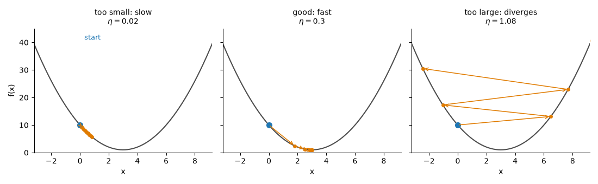
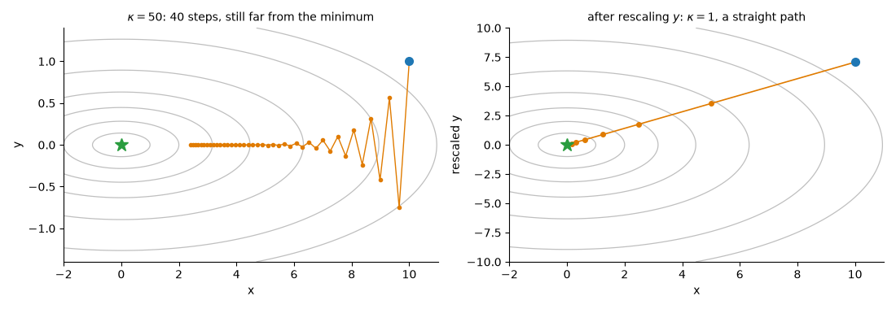
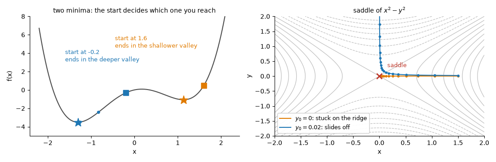
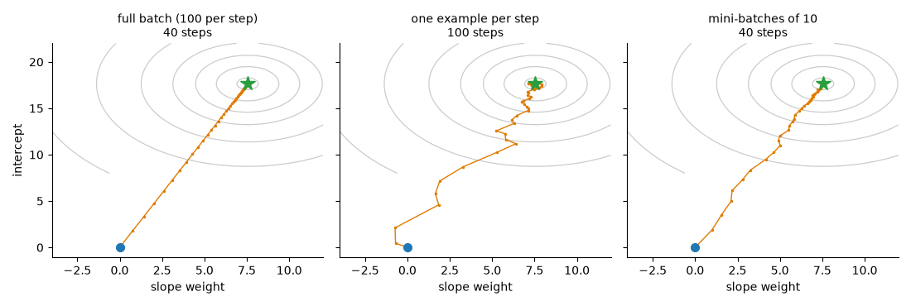
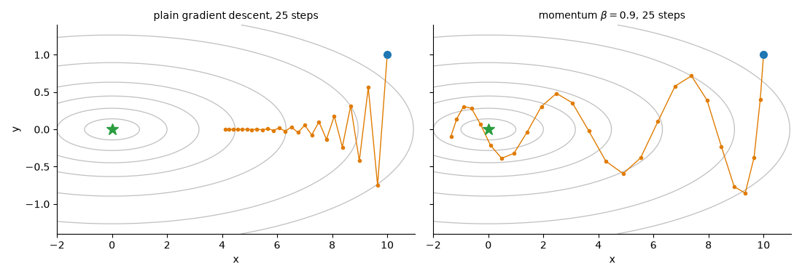

# Gradient Descent and its Variants

**Course:** [Calculus and Optimization](../README.md) · **Hands-on:** [notebook.ipynb](notebook.ipynb) · **Practice:** [exercises](exercises/problems.md), [assignment](assignment.md)

Training a model means searching for the parameter values that make its loss small, and a model can have millions of parameters. You cannot try them all, but you can do something cheaper: look at the slope where you stand, take a small step downhill, and repeat. That is **gradient descent**, the engine under almost every trained model. This topic starts with the plain version, shows exactly when it works and when it breaks, then adds the three upgrades used everywhere in practice: random mini-batches to make each step cheap, momentum to roll through narrow valleys, and per-parameter step sizes (Adam) to cope with parameters on different scales.

## Learning goals

By the end of this topic you can:

- run gradient descent by hand in one and two variables, and explain why stepping against the gradient is the steepest way down;
- predict the three behaviours of the learning rate (too small, good, too large) and compute the largest safe step $2/\lambda_{\max}$ for a quadratic;
- explain how the condition number sets the speed of gradient descent, why long valleys zig-zag, and why scaling features helps;
- compute full-batch, stochastic, and mini-batch gradients, explain their noise, and pick a learning-rate schedule that lets SGD settle;
- write the update rules of momentum, Nesterov momentum, AdaGrad, RMSProp, and Adam, and work out Adam's first step with bias correction by hand;
- implement these optimisers in NumPy, check a gradient with finite differences, and read a loss curve.

## Prerequisites

- Gradients, directional derivatives, the Hessian, and the condition number from [Multivariable calculus](../multivariable-calculus/README.md); Taylor approximations from [Derivatives and Taylor series](../derivatives-and-taylor-series/README.md).
- From linear algebra: eigenvalues of symmetric matrices ([Eigenvalues and eigenvectors](../../linear-algebra/eigenvalues-and-eigenvectors/README.md)) and least squares ([Projections and least squares](../../linear-algebra/projections-and-least-squares/README.md)). Basic Python and NumPy come from [Python Basics](../../../getting-started/python-basics/README.md).

## Outline

- [Notation at a glance](#notation-at-a-glance)
- [1. Gradient descent: walk downhill](#1-gradient-descent-walk-downhill)
- [2. The learning rate and its limit](#2-the-learning-rate-and-its-limit)
- [3. Valleys, the condition number, and feature scaling](#3-valleys-the-condition-number-and-feature-scaling)
- [4. When to stop, and what can go wrong](#4-when-to-stop-and-what-can-go-wrong)
- [5. Stochastic and mini-batch gradient descent](#5-stochastic-and-mini-batch-gradient-descent)
- [6. Epochs and learning-rate schedules](#6-epochs-and-learning-rate-schedules)
- [7. Momentum](#7-momentum)
- [8. Per-parameter step sizes: AdaGrad and RMSProp](#8-per-parameter-step-sizes-adagrad-and-rmsprop)
- [9. Adam](#9-adam)
- [10. Which optimiser, and with what settings](#10-which-optimiser-and-with-what-settings)
- [The same ideas in Python/NumPy](#the-same-ideas-in-pythonnumpy)
- [Common mistakes](#common-mistakes)
- [Why this matters for AI/ML](#why-this-matters-for-aiml)

> [!NOTE]
> **Concept ownership.** This topic teaches gradient descent, the learning rate and its limits, SGD, mini-batches, epochs, schedules, momentum, Nesterov momentum, AdaGrad, RMSProp, and Adam in full. [Linear regression](../../../machine-learning/linear-regression/README.md) and [deep-learning optimization](../../../deep-learning/optimization/README.md) only recap them (see the [ownership map](../../../docs/design-notes.md)).

**What this topic leaves for later.**

| Question | Where it is answered |
|---|---|
| How do you use the Hessian to jump, and pick the step by line search (Newton, BFGS)? | [Newton and quasi-Newton methods](../newton-and-quasi-newton-methods/README.md) |
| Which methods suit huge quadratics, and how do trust regions control the step? | [Conjugate gradient and trust region](../conjugate-gradient-and-trust-region/README.md) |
| How do you minimise while obeying a constraint? | [Constrained optimization and KKT](../constrained-optimization-and-kkt/README.md) |
| How are optimisers used for deep networks (clipping, batch norm, distributed training)? | [Deep-learning optimization](../../../deep-learning/optimization/README.md) |

## Key intuition

### Notation at a glance

| You see | It means |
|---|---|
| $\eta$ ("eta") | the learning rate or step size: how far one step goes per unit of gradient |
| $\ell_i$, $L$ | the loss on example $i$, and the average loss $L = \frac1n\sum_i \ell_i$ over $n$ examples |
| $\mathbf{g}$ | the gradient, or an estimate of it, used in one update |
| $B$ | the batch size: how many examples one update uses |
| $\mathbf{v}$, $\beta$ | momentum: the velocity, and how much of it survives each step |
| $\mathbf{m}$, $\mathbf{s}$, $\rho$, $\beta_1$, $\beta_2$ | running averages of gradients and squared gradients, and their decay rates (RMSProp and Adam) |
| $\varepsilon$ | a tiny number (like $10^{-8}$) added to a denominator so we never divide by zero. Squares, roots, and divisions of vectors act on each coordinate |

### 1. Gradient descent: walk downhill

The problem: given a function $f(\mathbf{x})$ of many inputs, find an $\mathbf{x}$ where it is small. At any point, the [gradient](../multivariable-calculus/README.md#3-the-gradient-and-directional-derivatives) $\nabla f$ points toward steepest ascent. The slope in a unit direction $\mathbf{u}$ is $\nabla f\cdot\mathbf{u} = \lVert\nabla f\rVert\cos\theta$, which is most negative when $\mathbf{u}$ points exactly against the gradient, so $-\nabla f$ is the steepest way down. **Gradient descent** takes a small step that way, over and over:

$$\mathbf{x}_{k+1} = \mathbf{x}_k - \eta\,\nabla f(\mathbf{x}_k).$$

```text
gradient descent
  pick a starting point x and a learning rate eta
  repeat until a stopping rule says stop:
      g = gradient of f at x
      x = x - eta * g
```

Near a minimum the gradient shrinks toward $\mathbf{0}$, so the steps shrink on their own, even with a fixed $\eta$. *One variable.* $f(x) = (x-3)^2 + 1$, so $f'(x) = 2(x-3)$. Start at $x_0 = 0$ with $\eta = 0.1$. Then $x_1 = 0 - 0.1\cdot(-6) = 0.6$, $x_2 = 0.6 - 0.1\cdot(-4.8) = 1.08$, and $x_3 = 1.08 - 0.1\cdot(-3.84) = 1.464$, with $f = 6.76,\ 4.6864,\ 3.3593$. The distance to the minimum at $3$ goes $3, 2.4, 1.92, 1.536$: each step keeps $80\%$ of it.

*Two variables.* $f(x, y) = \frac12(x^2 + 4y^2)$, so $\nabla f = (x, 4y)$. Start at $(4, 1)$ with $\eta = 0.2$, which makes the update $x \leftarrow 0.8x$ and $y \leftarrow 0.2y$. The points are $(4, 1) \to (3.2, 0.2) \to (2.56, 0.04) \to (2.048, 0.008)$, and $f$ falls $10 \to 5.2 \to 3.28 \to 2.097$. The steep direction $y$ is nearly solved after three steps while the gentle direction $x$ crawls. Remember that picture: it is the heart of sections 3 and 7.

**Check yourself:** (1) For $f(x) = x^2 - 4x$, start at $0$ with $\eta = 0.25$ and do three steps. (2) For $f = x^2 + y^2$ at $(1, 2)$ with $\eta = 0.1$, where does one step land?
<details>
<summary>Answers</summary>

(1) $f'(x) = 2x - 4$ gives $x = 1, 1.5, 1.75$, creeping toward the minimum at $2$ with shrinking steps. (2) $\nabla f = (2, 4)$, so the point becomes $(1, 2) - 0.1(2, 4) = (0.8, 1.6)$.
</details>

### 2. The learning rate and its limit

How big should $\eta$ be? For $f(x) = \frac12\lambda x^2$ (curvature $\lambda$) the update is $x \leftarrow (1 - \eta\lambda)x$, so everything depends on the factor $1 - \eta\lambda$. Our parabola $(x-3)^2 + 1$ has $\lambda = 2$, so its error $x - 3$ is multiplied by $1 - 2\eta$ each step. Starting at $x_0 = 0$ (error $3$):

| $\eta$ | factor | $x_5$ | what happens |
|---|---|---|---|
| $0.01$ | $0.98$ | $0.29$ | too small: barely moved after 5 steps |
| $0.1$ | $0.8$ | $2.02$ | steady progress |
| $0.9$ | $-0.8$ | $3.98$ | overshoots each time, but the overshoot shrinks |
| $1.0$ | $-1$ | $6$ | bounces between $0$ and $6$ forever |
| $1.1$ | $-1.2$ | $10.5$ | too large: each overshoot is bigger, so it diverges |


*Same function, three learning rates: crawl, converge, blow up.*

The factor is $0$ at $\eta = 1/\lambda = 0.5$, so one step lands on the minimum. Convergence needs $\lvert 1 - \eta\lambda\rvert < 1$, that is $0 < \eta < 2/\lambda$. With several variables, rotate to the eigenvectors of the [Hessian](../multivariable-calculus/README.md#5-the-hessian-approximations-and-critical-points). On a quadratic each eigen-direction has its own factor $1 - \eta\lambda_i$, and all of them must be safe:

$$0 < \eta < \frac{2}{\lambda_{\max}}.$$

For $f = \frac12(x^2 + 4y^2)$ the Hessian is $\operatorname{diag}(1, 4)$, so the limit is $0.5$. At $\eta = 0.45$ the $y$ factor is $-0.8$ and all is well. At $0.5$ it is exactly $-1$ and $y$ bounces forever. At $0.55$ it is $-1.2$ and the iterate explodes. The steepest direction sets the limit for everyone. For a function that is not quadratic the Hessian changes from place to place, and the limit applies to the curvature where you currently stand (by the [Taylor approximation](../derivatives-and-taylor-series/README.md), the function looks quadratic nearby).

**Check yourself:** (1) For $f(x) = 3x^2$, what is the largest $\eta$ that still converges? (2) For $f = \frac12\lambda x^2$ with $\lambda = 10$ and $\eta = 0.15$, does gradient descent converge?
<details>
<summary>Answers</summary>

(1) The curvature is $f'' = 6$, so we need $\eta < 2/6 = 1/3$. (2) The factor is $1 - 1.5 = -0.5$ and $\lvert -0.5\rvert < 1$, so yes: it flips sign each step while the size halves. (The limit is $2/10 = 0.2$.)
</details>

### 3. Valleys, the condition number, and feature scaling

The error along eigen-direction $i$ shrinks by $1 - \eta\lambda_i$ per step. We must keep $\eta < 2/\lambda_{\max}$, so the gentlest direction ($\lambda_{\min}$) gets a factor close to $1$ and moves slowly. With the best constant step $\eta = 2/(\lambda_{\max} + \lambda_{\min})$ the slowest factor is

$$\frac{\kappa - 1}{\kappa + 1}, \qquad \kappa = \frac{\lambda_{\max}}{\lambda_{\min}},$$

the [condition number](../multivariable-calculus/README.md#5-the-hessian-approximations-and-critical-points). In plain words: the error shrinks by a constant factor each step (called **linear convergence**), and $\kappa$ sets that factor. For $\kappa = 1$ (a round bowl) it is $0$. For $\kappa = 50$ it is $49/51 \approx 0.961$, and cutting the error by $100$ takes about $\ln(0.01)/\ln(0.961) \approx 115$ steps. Roughly, the number of steps grows in proportion to $\kappa$. The picture is a long narrow valley, say $f = \frac12(x^2 + 50y^2)$: the gradient points mostly across the valley, the step jumps over the floor to the opposite wall, and the iterate zig-zags while creeping along the floor.


*A condition number of $50$ makes the zig-zag. Rescaling a coordinate makes the contours round and the path straight.*

**Feature scaling** is the cheapest fix, because we can change the picture before training. Fit $\hat y = wx + b$ to examples with $x$ between $0$ and $10$. The average squared-error loss has Hessian $`\begin{pmatrix}\overline{x^2} & \bar x\\ \bar x & 1\end{pmatrix}`$ (bars are averages over the data), and for our invented data $\kappa \approx 174$. The cause is that $x$ is large and not centred, so changing $w$ and changing $b$ do nearly the same thing. Replace $x$ by $(x - \bar x)/\text{std}(x)$ and the Hessian becomes the identity, $\kappa = 1$: gradient descent needs one step where it needed several hundred. Standardising the inputs (mean $0$, spread $1$) is the first thing to try when training is slow. The Python section runs this example.

**Check yourself:** (1) A loss has Hessian $\operatorname{diag}(2, 200)$. Give $\kappa$ and the largest safe $\eta$. (2) On $f = \frac12(x^2 + y^2)$, how many steps does $\eta = 1$ need to reach the minimum?
<details>
<summary>Answers</summary>

(1) $\kappa = 200/2 = 100$ and $\eta < 2/200 = 0.01$. Even at $\eta = 0.009$ the gentle direction has factor $1 - 0.009\cdot 2 = 0.982$, which is painfully slow. (2) One. Both factors are $1 - 1\cdot 1 = 0$, so $(x, y)$ jumps to $(0, 0)$.
</details>

### 4. When to stop, and what can go wrong

We stop when the gradient norm is small ($\lVert\mathbf{g}\rVert < \text{tol}$), when the loss barely changes between steps, or when an iteration cap runs out, and most code checks all three. A small gradient is the direct sign of a critical point. A tiny change in loss may only mean the step is too small, and the cap protects you from loops that never converge. For a **convex** function (a bowl with no other dips) every critical point is the global minimum, so gradient descent with a safe $\eta$ gets there (if a minimum exists). Neural-network losses are not convex, and three things can happen.

- **Local minima.** A dip lower than its surroundings but not the lowest anywhere. Where you end up depends on where you start (left panel). For large networks, experience suggests the minima that training finds are usually good enough, but there is no guarantee.
- **Saddle points.** The gradient is zero, yet the ground curves up in some directions and down in others ([Hessian eigenvalues of mixed sign](../multivariable-calculus/README.md#5-the-hessian-approximations-and-critical-points)). Started exactly on the ridge, gradient descent walks into the saddle and stays. Any tiny push sideways, from rounding or SGD noise, lets it slide off, though that can take many slow steps.
- **Plateaus.** Flat regions where the gradient is tiny but there is no minimum. Steps are tiny too, so the loss curve looks stuck.


*Left: the starting point picks the minimum. Right: a saddle traps a path that starts exactly on its ridge.*

**Check yourself:** (1) For $f(x) = x^4 - 3x^2 + x$, which valley does a start at $x = 0.5$ reach? ($f'(x) = 4x^3 - 6x + 1$.) (2) The loss changed by $10^{-9}$ in the last step, but $\lVert\mathbf{g}\rVert = 0.5$. Should you stop?
<details>
<summary>Answers</summary>

(1) $f'(0.5) = 0.5 - 3 + 1 = -1.5 < 0$, so $x$ moves right and settles in the shallow valley near $x \approx 1.13$. (A start at $-0.2$ has positive slope, moves left, and finds the deeper valley near $-1.30$.) (2) Probably not. A gradient of $0.5$ is far from zero, so the learning rate is likely tiny or the path is crossing a plateau. Check $\eta$ first.
</details>

### 5. Stochastic and mini-batch gradient descent

In machine learning the loss is an average over $n$ training examples, $L(\mathbf{w}) = \frac1n\sum_{i=1}^n \ell_i(\mathbf{w})$. Gradients are linear, so the full gradient is the average of the per-example gradients, $\nabla L = \frac1n\sum_i \nabla\ell_i$. One **full-batch** step reads every example. With $n = 10^6$ examples and $100$ parameters that is about $10^8$ multiply-adds for one small step, and models take thousands of steps. **Stochastic gradient descent (SGD)** uses one randomly chosen example, $\mathbf{g} = \nabla\ell_i(\mathbf{w})$, at a cost of about $100$ operations. This estimate is **unbiased** (averaged over the random choice it equals the true gradient) and **noisy**, since one example may disagree with the rest.

*Worked example.* The model is $\hat y = wx$ with loss $\ell_i = \frac12(wx_i - y_i)^2$, so $\nabla\ell_i = (wx_i - y_i)x_i$. Take four invented examples $(x, y) = (1,2), (2,3), (3,5), (4,6)$ and $w = 0$. The per-example gradients are $-2, -6, -15, -24$, and their average, the full gradient, is $-11.75$. Mini-batches of two have six possible pairs, with averages $-4, -19.5, -8.5, -15, -13, -10.5$, which also average to $-11.75$. Every estimate points the right way (negative, so $w$ should go up), but single examples range from $-2$ to $-24$ and pairs from $-4$ to $-19.5$.

**Mini-batches** are the compromise: average $B$ random examples, $\mathbf{g} = \frac1B\sum_{i\in\text{batch}}\nabla\ell_i$. Averaging $B$ independent estimates divides the variance by $B$, so the noise (standard deviation) falls like $1/\sqrt{B}$: a batch four times larger halves the noise at four times the cost. Batches also suit GPUs, which process a block of examples almost as fast as one, until the hardware is full. Common batch sizes run from $16$ to a few thousand.


*The same problem with three batch sizes. One example per step wanders but still heads for the minimum.*

**Check yourself:** (1) In the example one example gave $-6$ while the average is $-11.75$. Is that SGD step wrong? (2) With $n = 10^6$ and $B = 64$, how many updates make one pass over the data?
<details>
<summary>Answers</summary>

(1) It points the correct way (downhill for $w$) but is too short. A single estimate can miss, and it is right on average, so progress comes from many steps. (2) $10^6/64 = 15625$.
</details>

### 6. Epochs and learning-rate schedules

One **epoch** is one pass over all $n$ examples, so it holds $n/B$ updates. We **shuffle** the examples at the start of each epoch so that batches differ every time and the order cannot bias the path. With a fixed $\eta$, SGD never fully settles: even at the minimum the per-example gradients disagree, so the iterate keeps jittering inside a ball around it, wider for larger $\eta$ and smaller $B$. Full-batch descent has no such problem, since its gradient is zero at the minimum. The cure is a **schedule** that shrinks $\eta$: big steps early to travel, small steps late to settle. With $t$ the step count and $T$ the total:

| Schedule | Formula | Shape |
|---|---|---|
| step decay | $\eta_t = \eta_0\,\gamma^{\lfloor t/k\rfloor}$ | multiply by $\gamma$ (say $0.5$) every $k$ steps |
| exponential | $\eta_t = \eta_0\,\gamma^t$ | smooth geometric decay |
| cosine | $\eta_t = \frac12\eta_0\bigl(1 + \cos(\pi t/T)\bigr)$ | flat start, fall in the middle, ends near $0$ |
| linear warm-up | $\eta_t = \eta_0\,(t+1)/W$ for $t < W$ | rises over the first $W$ steps, then another schedule takes over |

A classic rule of thumb says the steps should add up to infinity (so we can travel far) while their squares add up to a finite number (so the noise dies out). A schedule that decays like $1/t$ does both. Warm-up exists because early gradients can be erratic, and small first steps keep training safe. *Numbers:* cosine with $\eta_0 = 0.1$ and $T = 100$ gives $\eta_0 = 0.1$, $\eta_{25} \approx 0.0854$, $\eta_{50} = 0.05$, $\eta_{75} \approx 0.0146$, $\eta_{100} = 0$.

**Check yourself:** (1) Cosine schedule with $\eta_0 = 0.2$ and $T = 100$: what is $\eta_{25}$? (2) Why does a decaying schedule help SGD but is unnecessary for full-batch descent on a quadratic?
<details>
<summary>Answers</summary>

(1) $0.1\,(1 + \cos(\pi/4)) \approx 0.1707$. (2) SGD's gradient estimate stays noisy even at the minimum, so a fixed step keeps kicking the iterate and a smaller step shrinks the kicks. The full gradient is exactly zero at the minimum, so a fixed safe step converges.
</details>

### 7. Momentum

Back to the zig-zag. In a narrow valley the across-valley part of the gradient flips sign each step, while the along-valley part keeps pointing the same way. **Momentum** keeps a **velocity** $\mathbf{v}$, a running sum of past gradients, and steps along it:

$$\mathbf{v} \leftarrow \beta\,\mathbf{v} + \nabla f(\mathbf{x}), \qquad \mathbf{x} \leftarrow \mathbf{x} - \eta\,\mathbf{v}.$$

Picture a heavy ball rolling down the valley, with $\beta$ (often $0.9$) as its inertia: $\beta = 0$ is plain gradient descent, and $\beta$ near $1$ means little friction. Gradients that flip sign cancel inside $\mathbf{v}$, which damps the zig-zag. Gradients that agree pile up: a constant gradient makes $\mathbf{v}$ approach $g/(1-\beta)$, a step $10$ times longer for $\beta = 0.9$. On a quadratic, momentum is stable for $\eta\lambda < 2(1+\beta)$, more room than plain descent, and tuned well it needs roughly $\sqrt{\kappa}$ steps where plain descent needs $\kappa$.


*Same valley, same number of steps. Momentum travels along the floor much faster, with some swinging near the end.*

*By hand.* $f(x) = x^2$, so $g = 2x$, with $\eta = 0.1$, $\beta = 0.9$, $x_0 = 4$, $v_0 = 0$. Step 1: $v = 8$, so $x = 4 - 0.8 = 3.2$. Step 2: $v = 7.2 + 6.4 = 13.6$, so $x = 1.84$. Step 3: $v = 12.24 + 3.68 = 15.92$, so $x = 0.248$. Step 4: $v = 14.328 + 0.496 = 14.824$, so $x = -1.2344$. Plain descent gives $3.2, 2.56, 2.048$ for the first three steps. In one dimension momentum builds speed, overshoots the bottom, and swings back, so it is no faster here. Its payoff comes in valleys, where it speeds up the along-valley motion and damps the across-valley one.

**Nesterov momentum** changes one thing: it measures the gradient where momentum is about to carry you. With the look-ahead point $\tilde{\mathbf{x}} = \mathbf{x} - \eta\beta\mathbf{v}$, use $\mathbf{v} \leftarrow \beta\mathbf{v} + \nabla f(\tilde{\mathbf{x}})$ and $\mathbf{x} \leftarrow \mathbf{x} - \eta\mathbf{v}$. Looking ahead lets it brake sooner when it is about to overshoot.

**Check yourself:** (1) A constant gradient $g = 1$ with $\beta = 0.9$: what are $v$ after steps 1 and 2, and where does $v$ settle? (2) What does $\beta = 0$ give?
<details>
<summary>Answers</summary>

(1) $v_1 = 1$, $v_2 = 0.9 + 1 = 1.9$, and it settles at $1/(1 - 0.9) = 10$. (2) Plain gradient descent, because $\mathbf{v} = \nabla f$ every time.
</details>

### 8. Per-parameter step sizes: AdaGrad and RMSProp

Momentum fixes direction. A different problem is scale: one parameter may see gradients near $10$ and another near $0.1$, yet one $\eta$ serves both. **Adaptive methods** give each coordinate its own step by dividing by the typical size of that coordinate's gradients. **AdaGrad** keeps the running sum of squared gradients $\mathbf{G}$:

$$\mathbf{G} \leftarrow \mathbf{G} + \mathbf{g}^2, \qquad \mathbf{x} \leftarrow \mathbf{x} - \eta\,\frac{\mathbf{g}}{\sqrt{\mathbf{G}} + \varepsilon}.$$

Coordinates with big gradients get smaller steps and coordinates with small gradients get larger ones, so the method barely cares how the loss is scaled, and rarely active parameters (such as weights of rare words) keep large steps. The drawback is that $\mathbf{G}$ only grows. With a constant gradient the step shrinks like $\eta/\sqrt{t}$, so AdaGrad slowly **stalls**, even when progress is still needed. **RMSProp** repairs this by using an exponential moving average (decay rate $\rho$, often $0.9$) that forgets old gradients:

$$\mathbf{s} \leftarrow \rho\,\mathbf{s} + (1-\rho)\,\mathbf{g}^2, \qquad \mathbf{x} \leftarrow \mathbf{x} - \eta\,\frac{\mathbf{g}}{\sqrt{\mathbf{s}} + \varepsilon}.$$

*By hand.* Take $g = 2$ at every step and divide each step by $\eta$. AdaGrad: $G = 4$ gives $2/2 = 1$, then $G = 8$ gives $0.707$, then $0.577$, $0.5$, always shrinking. RMSProp with $\rho = 0.9$: $s = 0.1\cdot 4 = 0.4$ gives $2/\sqrt{0.4} = 3.16$, then $s = 0.76$ gives $2.29$, then $1.92$, $1.71$. The steps head for $1$, but the first is over three times too large, because $\mathbf{s}$ starts at zero and has not heard enough gradients yet. Section 9 fixes that.

**Check yourself:** (1) Two coordinates have gradients $10$ and $0.1$ at every step. How far does each move in AdaGrad's first step? (2) Under a constant gradient, how large is AdaGrad's step at step $100$ compared with step $1$?
<details>
<summary>Answers</summary>

(1) Both move $\eta$: $10/\sqrt{100} = 1$ and $0.1/\sqrt{0.01} = 1$. The step ignores the gradient's size. (2) $G = 100g^2$, so the step is $\eta g/(10g) = \eta/10$, a tenth of the first.
</details>

### 9. Adam

**Adam** combines both ideas: a running average of the gradient (momentum) and a running average of the squared gradient (RMSProp), plus a repair for their cold start. With $t$ counting steps from $1$:

```text
Adam (defaults: eta = 0.001, beta1 = 0.9, beta2 = 0.999, eps = 1e-8)
  m = 0, v = 0, t = 0
  repeat:
      t = t + 1
      g = gradient at x
      m = beta1 * m + (1 - beta1) * g        # average of gradients
      v = beta2 * v + (1 - beta2) * g^2      # average of squared gradients
      m_hat = m / (1 - beta1^t)              # bias correction
      v_hat = v / (1 - beta2^t)
      x = x - eta * m_hat / (sqrt(v_hat) + eps)
```

**Why the bias correction?** Both averages start at $0$, so early on they are pulled toward $0$. The weights of an exponential average add up to $1 - \beta^t$ rather than $1$, and dividing by that sum fixes it. *First step by hand* with $g = 2$ at every step: $m_1 = 0.1\cdot 2 = 0.2$ and $v_1 = 0.001\cdot 4 = 0.004$. Without correction, $m_1/\sqrt{v_1} = 0.2/0.0632 = 3.16$, so the step is $3.16\,\eta$, and at step 2 it is $0.38/0.0894 = 4.25$, still growing. With correction, $\hat m_1 = 0.2/(1 - 0.9) = 2$ and $\hat v_1 = 0.004/(1 - 0.999) = 4$, so the ratio is $2/\sqrt4 = 1$ and the step is exactly $\eta$, and again $1$ at step 2. So Adam's step in each coordinate is roughly $\eta$ whatever the gradient's scale, which makes $\eta$ a distance in parameter space. After many steps $\beta^t \to 0$ (about $50$ steps for $\beta_1$, a few thousand for $\beta_2$) and the correction fades. **AdamW** applies weight decay directly to the weights instead of through the gradient (see [regularization](../../../machine-learning/regularization-and-hyperparameter-tuning/README.md) and [deep-learning optimization](../../../deep-learning/optimization/README.md)).

**Check yourself:** (1) With $g = -3$ at the first step, what is Adam's step and which way does $x$ move? (2) When does the bias correction for $\beta_2 = 0.999$ still matter?
<details>
<summary>Answers</summary>

(1) $\hat m = -3$ and $\hat v = 9$, so the ratio is $-1$ and $x \leftarrow x - \eta(-1) = x + \eta$: it moves up by $\eta$. (2) During the first few thousand steps. At $t = 10{,}000$ the factor $1 - 0.999^t$ is about $0.99995$, so it no longer matters.
</details>

### 10. Which optimiser, and with what settings

| Optimiser | Good fit | Typical settings | Watch out |
|---|---|---|---|
| full-batch GD | small, smooth problems that fit in memory | $\eta$ by trial | large $\kappa$ needs scaling |
| SGD with momentum | image models and many others, with a tuned schedule | $\eta$ from $10^{-3}$ to $1$, $\beta = 0.9$, $B$ from 16 to 512 | $\eta$ needs the most tuning |
| AdaGrad, RMSProp | sparse features (AdaGrad); recurrent networks and older recipes (RMSProp) | $\rho$ from $0.9$ to $0.99$ | AdaGrad stalls on long runs; RMSProp is rarely the first choice now |
| Adam / AdamW | a strong default, especially for Transformers | $10^{-3}$, $\beta_1 = 0.9$, $\beta_2 = 0.999$, $\varepsilon = 10^{-8}$ | may generalise slightly worse than tuned SGD on some tasks |

These are common starting points, not laws. The learning rate matters most, so tune it first, on a log scale. None of these methods promises the global minimum: on convex problems they reach it, and on non-convex ones they reach a point where the gradient is small, which is often good enough.

**Check yourself:** (1) You fit logistic regression to $500$ rows with $3$ features. Which approach fits? (2) You fine-tune a Transformer. What optimiser and schedule are a common default?
<details>
<summary>Answers</summary>

(1) Full-batch gradient descent on standardised features, or an off-the-shelf solver. The data is tiny, so there is no need for noise or mini-batches. (2) AdamW with a linear warm-up followed by a decay such as cosine.
</details>

## The same ideas in Python/NumPy

First, gradient descent written once, checked against the hand results of sections 1 and 2, and tried below, at, and above the limit $2/\lambda_{\max} = 0.5$.

```python
import numpy as np

def gradient_descent(grad, x0, eta, steps):
    x = np.array(x0, dtype=float)
    path = [x.copy()]
    for _ in range(steps):
        x = x - eta * grad(x)
        path.append(x.copy())
    return np.array(path)

grad_bowl = lambda p: np.array([1.0, 4.0]) * p            # f(x, y) = (x^2 + 4 y^2) / 2
print(gradient_descent(lambda x: 2 * (x - 3), [0.0], 0.1, 3).ravel())
print(gradient_descent(grad_bowl, [4, 1], 0.2, 3)[-1])
for eta in [0.45, 0.5, 0.55]:                             # the limit is 2 / lambda_max = 0.5
    print(eta, gradient_descent(grad_bowl, [4, 1], eta, 50)[-1, 1])
```

```text
[0.    0.6   1.08  1.464]
[2.048 0.008]
0.45 1.4272476927059662e-05
0.5 1.0
0.55 9100.438150002214
```

Next, the invented regression data of section 3 (a score against hours studied): condition numbers, the least-squares answer, and mini-batch descent with a decaying step. Batch size $100$ is the full batch. Each run makes $30$ passes over the data, so only the number of updates differs.

```python
rng = np.random.default_rng(0)
n = 100
hours = rng.uniform(0, 10, n)
score = 2.5 * hours + 4 + rng.normal(0, 0.8, n)
X_raw = np.column_stack([hours, np.ones(n)])              # columns: feature, intercept
X_std = np.column_stack([(hours - hours.mean()) / hours.std(), np.ones(n)])
mse = lambda w, X: 0.5 * np.mean((X @ w - score) ** 2)
grad_mse = lambda w, X, y: X.T @ (X @ w - y) / len(y)

for name, X in [("raw", X_raw), ("standardised", X_std)]:
    lam = np.linalg.eigvalsh(X.T @ X / n)
    print(f"{name}: kappa = {lam[-1] / lam[0]:.1f}, step limit 2/lambda_max = {2 / lam[-1]:.4f}")
w_best = np.linalg.lstsq(X_std, score, rcond=None)[0]     # the normal-equation answer
print("least squares:", w_best.round(3), " loss", round(mse(w_best, X_std), 4))

def minibatch_gd(X, batch, eta0, epochs, seed=1):
    r = np.random.default_rng(seed)
    w = np.zeros(2)
    for epoch in range(epochs):
        eta = eta0 / (1 + 0.1 * epoch)                    # a slowly decaying step
        idx = r.permutation(n)                            # reshuffle every epoch
        for s in range(0, n, batch):
            b = idx[s:s + batch]
            w = w - eta * grad_mse(w, X[b], score[b])
    return w

for batch, eta0 in [(1, 0.05), (10, 0.2), (100, 0.5)]:
    w = minibatch_gd(X_std, batch, eta0, 30)
    print(f"batch {batch:3d}: {30 * n // batch:4d} updates, w = {w.round(3)}, distance to least squares {np.linalg.norm(w - w_best):.3f}")
```

```text
raw: kappa = 174.3, step limit 2/lambda_max = 0.0500
standardised: kappa = 1.0, step limit 2/lambda_max = 2.0000
least squares: [ 7.546 17.644]  loss 0.3008
batch   1: 3000 updates, w = [ 7.578 17.635], distance to least squares 0.033
batch  10:  300 updates, w = [ 7.553 17.641], distance to least squares 0.008
batch 100:   30 updates, w = [ 7.544 17.64 ], distance to least squares 0.004
```

The weights belong to standardised inputs, so the slope is the original slope times the spread of the hours. The largest batch makes only $30$ updates yet lands closest: its steps are exact and the standardised problem is perfectly conditioned, while SGD pays for its noise. Last, momentum and Adam as small classes that hold their own state, checked against the hand results of sections 7 and 9. With the bias correction both Adam coordinates move about $\eta$, and without it about $3.16\,\eta$.

```python
class SGD:                                                 # plain GD when momentum = 0
    def __init__(self, lr=0.1, momentum=0.0):
        self.lr, self.beta, self.v = lr, momentum, None
    def step(self, w, g):
        self.v = g if self.v is None else self.beta * self.v + g
        return w - self.lr * self.v

class Adam:
    def __init__(self, lr=0.001, b1=0.9, b2=0.999, eps=1e-8, correct=True):
        self.lr, self.b1, self.b2, self.eps, self.correct = lr, b1, b2, eps, correct
        self.m, self.v, self.t = 0.0, 0.0, 0
    def step(self, w, g):
        self.t += 1
        self.m = self.b1 * self.m + (1 - self.b1) * g
        self.v = self.b2 * self.v + (1 - self.b2) * g**2
        m_hat = self.m / (1 - self.b1**self.t) if self.correct else self.m
        v_hat = self.v / (1 - self.b2**self.t) if self.correct else self.v
        return w - self.lr * m_hat / (np.sqrt(v_hat) + self.eps)

opt, w, xs = SGD(0.1, 0.9), np.array([4.0, -2.0]), []    # f = x^2 + y^2, as in section 7
for _ in range(4):
    w = opt.step(w, 2 * w)
    xs.append(w[0])
print("momentum x:", np.round(xs, 4), np.allclose(xs, [3.2, 1.84, 0.248, -1.2344]))
w0, g0 = np.array([1.0, 1.0]), np.array([2.0, 0.02])      # two gradients, 100 times apart
print("Adam first step, corrected:  ", w0 - Adam(lr=0.1).step(w0, g0))
print("Adam first step, uncorrected:", w0 - Adam(lr=0.1, correct=False).step(w0, g0))
```

```text
momentum x: [ 3.2     1.84    0.248  -1.2344] True
Adam first step, corrected:   [0.1        0.09999995]
Adam first step, uncorrected: [0.31622772 0.31622277]
```

## Common mistakes

- **Using $+\nabla f$ (ascent) by accident.** A loss that climbs from the very first step usually means a flipped sign.
- **Judging the learning rate from one run.** Too large gives a loss that grows or turns into `nan`, too small gives a curve that barely moves. Try several values on a log scale, such as $10^{-3}, 10^{-2}, 10^{-1}$.
- **Forgetting to scale features, or reading SGD's wiggles as divergence.** Raw features on very different scales give a huge condition number and a tiny safe step. And each batch is different, so the SGD loss jitters: compare averages over many steps, or the validation loss.
- **Not shuffling, never decaying the step, or dropping Adam's bias correction or $\varepsilon$.** Sorted data makes biased batches, a fixed SGD step leaves a noise floor, and without the correction Adam's first steps are off by a factor of three or more.
- **Assuming a zero gradient means a minimum.** It could be a saddle or the edge of a plateau.

## Why this matters for AI/ML

- **Training is one of these algorithms.** A model's loss $L(\mathbf{w})$ is minimised by mini-batch SGD or Adam, with gradients from [backpropagation](../../../deep-learning/backpropagation/README.md). The weights are $\mathbf{x}$ and the optimiser is the loop around them.
- **Deep learning uses mini-batch SGD and Adam for cost reasons.** A full pass over a large dataset is too slow, and too big for memory, for a single step. A mini-batch step is cheap and fits on the device, and its noise may help the model avoid sharp minima that generalise worse (a common view, not a theorem). Adam is popular because it is less fussy about $\eta$ and about badly scaled parameters. Transformer recipes typically ramp the learning rate up and then decay it with a cosine, as in section 6 (see [transformers](../../../deep-learning/transformers/README.md)).
- **Linear regression: gradient descent or normal equations?** The [normal equations](../../linear-algebra/projections-and-least-squares/README.md) give the exact answer in one solve, costing about $nd^2$ operations for $n$ examples and $d$ features, and win when $d$ is small. Gradient descent costs about $nd$ per step, never forms $X^\top X$, and is the only choice when $d$ or $n$ is huge or the loss has no closed form. The condition number of $X^\top X$ is what slows it, and scaling features cures that.
- **Logistic regression is trained the same way.** Its average log loss has gradient $\frac1n X^\top(\mathbf{p} - \mathbf{y})$ with $\mathbf{p} = \sigma(X\mathbf{w})$, so any optimiser above applies (see [logistic regression](../../../machine-learning/logistic-regression-and-naive-bayes/README.md)). In the notebook, mini-batch Adam separates two invented clouds of points and the decision boundary is drawn.
- **The loss curve is what you watch.** A curve that shoots up or turns into `nan` means $\eta$ is too large (or the gradient has a sign error). One that barely moves means $\eta$ is too small, a plateau, or unscaled inputs. One that falls and then bounces means $\eta$ is near the limit or the batches are noisy, so lower it or add decay. Noisy but trending down is normal for SGD. Training loss falling while validation loss rises is overfitting, which a [regularizer](../../../machine-learning/regularization-and-hyperparameter-tuning/README.md) or earlier stopping addresses, not a learning-rate fix.

### Optimisers from scratch on a two-parameter model

The classes above plug into any loop that supplies a gradient. Here they train the two-parameter line of section 3 on the raw, badly scaled inputs ($\kappa \approx 174$), where plain descent struggles. The least-squares loss for this data is $0.3008$.

```python
gr = lambda w: grad_mse(w, X_raw, score)
for name, mk in [("GD", lambda: SGD(0.04)), ("momentum", lambda: SGD(0.02, 0.9)), ("Adam", lambda: Adam(0.5))]:
    o, w = mk(), np.zeros(2)
    for _ in range(100):
        w = o.step(w, gr(w))
    print(f"{name:9s} 100 steps: w = {w.round(3)}, loss = {mse(w, X_raw):.4f}")
```

```text
GD        100 steps: w = [2.689 2.573], loss = 0.5370
momentum  100 steps: w = [2.484 4.017], loss = 0.3010
Adam      100 steps: w = [2.506 3.92 ], loss = 0.3021
```

### Gradient checking

Before trusting a hand-written gradient, compare it with a centered difference, as in [multivariable calculus](../multivariable-calculus/README.md). A relative error near $10^{-7}$ or smaller means the code is right. It costs two loss evaluations per parameter, so run it on a small model, then switch it off. Here it tests `grad_mse` from above, then a deliberately broken copy.

```python
def num_grad(func, p, h=1e-5):
    p = np.asarray(p, dtype=float); g = np.zeros_like(p)
    for i in range(len(p)):
        e = np.zeros_like(p); e[i] = h
        g[i] = (func(p + e) - func(p - e)) / (2 * h)
    return g

rel_err = lambda a, b: np.linalg.norm(a - b) / (np.linalg.norm(a) + np.linalg.norm(b))
p = np.array([1.0, 2.0])
exact, approx = grad_mse(p, X_raw, score), num_grad(lambda q: mse(q, X_raw), p)
print("correct:", rel_err(exact, approx), "  intercept term doubled:", rel_err(exact * [1, 2], approx))
```

```text
correct: 2.163493045107618e-12   intercept term doubled: 0.07133210625625404
```

## Summary

- Gradient descent steps against the gradient, $\mathbf{x} \leftarrow \mathbf{x} - \eta\nabla f$. On a quadratic it converges when $\eta < 2/\lambda_{\max}$, and the error shrinks by a constant factor set by $\kappa$, so valleys zig-zag and feature scaling helps.
- Stop on a small gradient, a small change in loss, or an iteration cap. Non-convex losses add local minima, saddles, and plateaus, and no method here guarantees the global minimum.
- The loss is an average, so mini-batch gradients are unbiased but noisy, with variance falling like $1/B$. An epoch is one pass, and a decaying or cosine schedule (often with warm-up) lets SGD settle.
- Momentum accumulates velocity, AdaGrad and RMSProp scale each coordinate by past gradient size, and Adam combines momentum with RMSProp and corrects the zero start. In AI, mini-batch Adam or SGD runs these loops on the loss, and the loss curve tells you what to fix.

## Further reading

Chapter pointers and free links are in [resources.md](resources.md).

## Practice

- [Notebook](notebook.ipynb): learning-rate behaviours, GD in two dimensions, the $2/\lambda_{\max}$ limit, feature scaling, stopping rules, non-convex functions, regression by batch GD and normal equations, SGD and mini-batch paths, batch size versus noise, schedules, momentum, AdaGrad versus RMSProp, Adam's bias correction, an optimiser comparison, logistic regression, an optimiser class, and a gradient check. It follows the lesson:

  | Lesson section | Notebook section |
  |---|---|
  | 1. Gradient descent to 4. Stopping | 1. One variable, 2. Three learning rates, 3. Two dimensions, 4. The limit $2/\lambda_{\max}$, 5. Feature scaling, 6. Stopping rules, 7. Local minima, saddles, and plateaus |
  | 5. SGD; 6. Schedules; 7. Momentum | 8. Batch GD versus normal equations, 9. SGD and mini-batch paths, 10. Batch size and gradient variance, 11. Schedules, 12. Momentum |
  | 8. AdaGrad to 10. Which optimiser; AI/ML | 13. AdaGrad and RMSProp, 14. Adam, 15. All the optimisers, 16. Logistic regression, 17. Checking the optimiser classes, 18. Gradient check |

- [Exercises](exercises/problems.md) (with [solutions](exercises/solutions.md)): ten problems, easy to harder.
- [Assignment](assignment.md): fit a model to invented data with gradient descent, SGD, momentum, and Adam written from scratch, compare their loss curves, and report the best settings.

---

[← Previous: Multivariable Calculus](../multivariable-calculus/README.md) | [Next: Newton and Quasi Newton Methods →](../newton-and-quasi-newton-methods/README.md)
