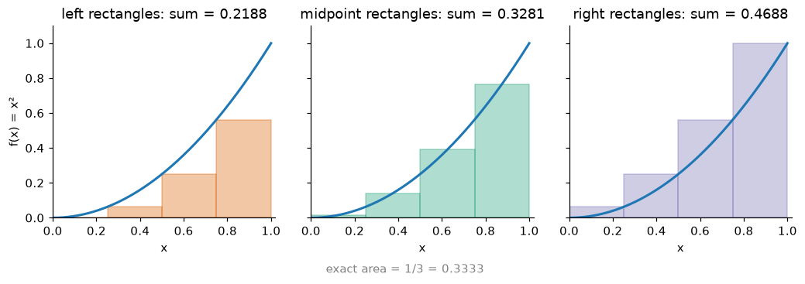
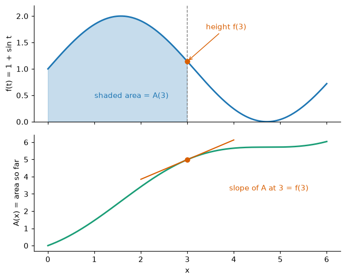
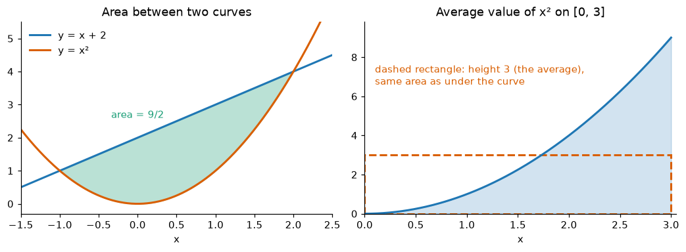

# Integrals

**Course:** [Calculus and Optimization](../README.md) · **Hands-on:** [notebook.ipynb](notebook.ipynb) · **Practice:** [exercises](exercises/problems.md), [assignment](assignment.md)

How much water has flowed into a tank if you know how fast it flows at every moment? How likely is a measurement to land between 1.2 and 1.5 when you know its probability curve? Both questions ask for the **area under a curve**, and the tool that answers them is the **integral**. You build it from thin rectangles, and then comes a twist: finding an area is the derivative run backwards. That link, the fundamental theorem of calculus, turns long sums into short formulas. In AI, every probability is an area, every average over a continuous quantity is an integral, and the constant in front of the bell curve comes from one famous integral.

## Learning goals

By the end of this topic you can:

- approximate the area under a curve with left, right, and midpoint rectangles, and explain the definite integral as the limit of such sums;
- find antiderivatives from a short table, use the $+C$, and state both parts of the fundamental theorem of calculus in plain words and use each one;
- compute an area between curves, an average value, a simple volume by discs, and a total change from a rate;
- evaluate integrals by substitution (the chain rule backwards) and by parts (the product rule backwards), including with limits;
- decide whether an improper integral converges, and estimate any integral with the midpoint, trapezoid, or Simpson rule and `scipy.integrate.quad`;
- explain why probabilities are areas, why a density integrates to $1$, and where the $1/\sqrt{2\pi}$ in the normal density comes from.

## Prerequisites

- [Limits and continuity](../limits-and-continuity/README.md): the integral is a limit of sums.
- [Derivatives and Taylor series](../derivatives-and-taylor-series/README.md): the derivative rules for powers, $e^x$, $\ln x$, $\sin x$, $\cos x$, plus the product and chain rules. Each is recapped in a line where it is used.
- Basic Python and NumPy from [Python Basics](../../../getting-started/python-basics/README.md), only for the code blocks and the notebook.

## Outline

- [Notation at a glance](#notation-at-a-glance)
- [1. Area as a sum of thin rectangles](#1-area-as-a-sum-of-thin-rectangles)
- [2. Antiderivatives and the indefinite integral](#2-antiderivatives-and-the-indefinite-integral)
- [3. The fundamental theorem of calculus](#3-the-fundamental-theorem-of-calculus)
- [4. Area between curves and average value](#4-area-between-curves-and-average-value)
- [5. Volumes by discs](#5-volumes-by-discs)
- [6. Accumulation, total change, and probability as area](#6-accumulation-total-change-and-probability-as-area)
- [7. Substitution](#7-substitution)
- [8. Integration by parts](#8-integration-by-parts)
- [9. Improper integrals](#9-improper-integrals)
- [10. Numerical integration and integrals with no formula](#10-numerical-integration-and-integrals-with-no-formula)
- [The same ideas in Python](#the-same-ideas-in-python)
- [Common mistakes](#common-mistakes)
- [Why this matters for AI/ML](#why-this-matters-for-aiml)

> [!NOTE]
> **Concept ownership.** This topic teaches Riemann sums, the definite and indefinite integral, the fundamental theorem of calculus, substitution, integration by parts, improper integrals, and numerical integration in full. Later topics recap them and link back (see the [ownership map](../../../docs/design-notes.md)).

**What this topic leaves for later.**

| Question | Where it is answered |
|---|---|
| How do you integrate over a region in the plane, and what is a change of variables there? | [Multivariable calculus](../multivariable-calculus/README.md) |
| What is a probability density in full, why is an expected value an integral, and what is the normal distribution? | [Random variables](../../probability-and-statistics/random-variables/README.md), [probability distributions](../../probability-and-statistics/probability-distributions/README.md) |
| How is the expected loss (risk) of a model estimated from data? | [KNN and model evaluation](../../../machine-learning/knn-and-model-evaluation/README.md) |
| How do random samples estimate an integral that is too hard to do directly? | [Markov chains and sampling](../../probability-and-statistics/markov-chains-and-sampling/README.md) |

## Key intuition

### Notation at a glance

| You see | It means |
|---|---|
| $\int_a^b f(x)\,dx$ | the **definite integral**: signed area between the graph of $f$ and the $x$-axis from $x=a$ to $x=b$. The stretched S is a "sum", and $dx$ is the width of an infinitely thin strip |
| $\int f(x)\,dx$ | the **indefinite integral**: all functions whose derivative is $f$ |
| $F(x) + C$ | an antiderivative $F$ plus an arbitrary constant $C$ |
| $[F(x)]_a^b$ | shorthand for $F(b) - F(a)$ |
| $\int_a^\infty f(x)\,dx$ | an **improper integral**: the upper end runs off to infinity |

### 1. Area as a sum of thin rectangles

To find the area under a curve, cover the region with thin rectangles of equal width and add them up. Take $f(x) = x^2$ on $[0, 1]$ with $n$ strips of equal width $\Delta x = 1/n$. Each rectangle takes its height from the curve at the **left** edge, the **right** edge, or the **midpoint** of its strip. The three totals are called **Riemann sums**.



*With four strips the left sum is too small, the right sum too big, and the midpoint sum is already close. The exact area is $1/3$.*

Now let the strips get thinner (for $n = 4$ by hand, the left sum is $0.25\,(0 + 0.0625 + 0.25 + 0.5625) = 0.21875$):

| $n$ | left | right | midpoint |
|---|---|---|---|
| 4 | 0.21875 | 0.46875 | 0.32812 |
| 16 | 0.30273 | 0.36523 | 0.33301 |
| 64 | 0.32556 | 0.34119 | 0.33331 |
| 256 | 0.33138 | 0.33529 | 0.33333 |

All three columns close in on $1/3$. Because $x^2$ is rising, the left sum is always below the true area and the right sum above it, and the gap between them (one strip's width times the total rise) shrinks to $0$.

**Definition.** The **definite integral** is the limit of the Riemann sums as the strips get thinner, $\int_a^b f(x)\,dx = \lim_{n\to\infty} \sum_{i=1}^{n} f(x_i^*)\,\Delta x$, where $x_i^*$ is any chosen point in the $i$-th strip. For a continuous function the limit exists and does not depend on that choice.

The integral measures **signed** area: parts above the $x$-axis count positive, parts below count negative, so contributions can cancel. For $\sin x$ on $[0, 2\pi]$ the two humps have area $2$ each, so $\int_0^{2\pi}\sin x\,dx = 0$ although the total unsigned area is $4$. Since it is a limit of sums, the integral inherits their rules: it is **linear** ($\int (cf + g) = c\int f + \int g$), it **splits** over intervals ($\int_a^c = \int_a^b + \int_b^c$), swapping the limits flips the sign ($\int_b^a f = -\int_a^b f$), and $f \le g$ implies $\int f \le \int g$.

**Check yourself:** (1) With $n=2$ strips, find the left and right sums for $f(x)=x$ on $[0,2]$, and the true area. (2) Given $\int_0^3 f = 5$ and $\int_3^7 f = -2$, find $\int_0^7 f$ and $\int_7^0 f$.
<details>
<summary>Answers</summary>

(1) $\Delta x=1$: left $= f(0)+f(1) = 1$, right $= f(1)+f(2) = 3$, and the triangle has area $\frac12\cdot2\cdot2 = 2$, between them. (2) $5 + (-2) = 3$, and $-3$.
</details>

### 2. Antiderivatives and the indefinite integral

Adding rectangles is slow. The shortcut starts with running the derivative backwards. An **antiderivative** of $f$ is a function $F$ with $F'(x) = f(x)$. Since $\frac{d}{dx}x^3 = 3x^2$, the function $x^3$ is an antiderivative of $3x^2$, and so are $x^3 + 5$ and $x^3 - 100$, because constants vanish when you differentiate. Any two antiderivatives differ by a constant, so we write the whole family as the **indefinite integral** $\int f(x)\,dx = F(x) + C$, where $C$ is the **constant of integration**. Reading the derivative rules backwards gives a table:

| $f(x)$ | $\int f(x)\,dx$ |
|---|---|
| $x^n$, for $n \ne -1$ | $\dfrac{x^{n+1}}{n+1} + C$ |
| $\dfrac1x$ | $\ln\lvert x\rvert + C$ |
| $e^x$ | $e^x + C$ |
| $\sin x$ | $-\cos x + C$ |
| $\cos x$ | $\sin x + C$ |

The power rule backwards says: raise the power by one and divide by the new power. It fails for $n=-1$ (division by $0$), and the logarithm fills that gap. Linearity lets you go term by term, and you can always check an answer by differentiating it. Example: $\int (6x^2 - 4\cos x + e^x)\,dx = 2x^3 - 4\sin x + e^x + C$, and differentiating returns $6x^2 - 4\cos x + e^x$.

**Check yourself:** (1) Find $\int \left(x^3 + \frac1x\right)dx$. (2) Find $f$ with $f'(x) = 2x$ and $f(1) = 5$.
<details>
<summary>Answers</summary>

(1) $\frac{x^4}{4} + \ln\lvert x\rvert + C$. (2) $f(x) = x^2 + C$ and $1 + C = 5$, so $f(x) = x^2 + 4$.
</details>

### 3. The fundamental theorem of calculus

Area under a curve and slope of a curve look unrelated, yet they undo each other. Fix a start $a$ and define the **area function** $A(x) = \int_a^x f(t)\,dt$, the area collected from $a$ up to $x$ (the dummy variable is $t$ so it does not clash with the limit $x$).

**Part 1.** The rate at which area grows is the height of the curve: $A'(x) = f(x)$. Differentiating an integral with respect to its upper limit gives back the function inside.

**Part 2.** If $F$ is any antiderivative of $f$, then $\int_a^b f(x)\,dx = F(b) - F(a) = [F(x)]_a^b$. To get an area, find an antiderivative and subtract its values at the two ends. No rectangles needed.



*Where the curve is high the running total climbs steeply, and where it dips toward $0$ the total flattens.*

**Why it works.** Move the right end from $x$ to $x+h$. The area gains a thin strip about $f(x)$ tall and $h$ wide, so $A(x+h) - A(x) \approx f(x)\,h$. Divide by $h$ and let $h \to 0$: that is Part 1. For Part 2, $A$ and $F$ are both antiderivatives of $f$, so $A(x) = F(x) + C$. Since $A(a) = 0$, $C = -F(a)$, and then $A(b) = F(b) - F(a)$.

Example, Part 1: for $A(x) = \int_0^x (t^2+1)\,dt$ the theorem gives $A'(x) = x^2 + 1$ at once. Check: $A(x) = \frac{x^3}{3} + x$. Example, Part 2: $\int_0^\pi \sin x\,dx = [-\cos x]_0^\pi = 1 + 1 = 2$, and $\int_0^1 x^2\,dx = \left[\frac{x^3}{3}\right]_0^1 = \frac13$, matching section 1.

**Check yourself:** (1) Find $\frac{d}{dx}\int_1^x \frac{\sin t}{t}\,dt$ (the integrand has no closed-form antiderivative, and you do not need one). (2) Evaluate $\int_1^4 (2x+1)\,dx$.
<details>
<summary>Answers</summary>

(1) $\frac{\sin x}{x}$, by Part 1. (2) $[x^2 + x]_1^4 = 20 - 2 = 18$.
</details>

### 4. Area between curves and average value

To find the area between two graphs, integrate (top minus bottom) over the stretch where the top stays on top. Take $y = x+2$ and $y = x^2$. They meet where $x^2 - x - 2 = (x-2)(x+1) = 0$, at $x=-1$ and $x=2$, and the line is above between them:

$$\text{Area} = \int_{-1}^{2} (x + 2 - x^2)\,dx = \left[\frac{x^2}{2} + 2x - \frac{x^3}{3}\right]_{-1}^{2} = \frac{10}{3} - \left(-\frac76\right) = \frac92.$$

The **average value** of $f$ on $[a, b]$ is the height of the flat rectangle with the same area as the region under $f$: $\bar f = \frac{1}{b-a}\int_a^b f(x)\,dx$. It is the continuous version of "add the values and divide by how many". For $x^2$ on $[0, 3]$ the area is $9$, so the average is $9/3 = 3$.



*Left: the shaded gap is the area between the curves. Right: the dashed rectangle and the region under the curve have equal area.*

**Check yourself:** (1) Find the area between $y=x$ and $y=x^2$ for $0\le x\le1$. (2) Find the average value of $\sin x$ on $[0,\pi]$.
<details>
<summary>Answers</summary>

(1) $\int_0^1 (x - x^2)\,dx = \frac12 - \frac13 = \frac16$. (2) $\frac1\pi\int_0^\pi\sin x\,dx = \frac2\pi \approx 0.637$.
</details>

### 5. Volumes by discs

Slice a solid into thin discs, add up their volumes, and you have an integral again. Spin the region under $y=f(x)$, $a\le x\le b$, around the $x$-axis. The slice at $x$ is a round disc of radius $f(x)$ and thickness $dx$, with volume about $\pi f(x)^2\,dx$, so $V = \int_a^b \pi\,[f(x)]^2\,dx$. Example: spin $y=\sqrt x$ on $[0,4]$. The radius squared is $x$, so $V = \pi\int_0^4 x\,dx = \pi\left[\frac{x^2}{2}\right]_0^4 = 8\pi \approx 25.13$.

**Check yourself:** (1) Spin $y=x$ on $[0,3]$. What solid is it, and what is its volume? (2) Write the volume integral for spinning $y=x^2$ on $[0,1]$, and evaluate it.
<details>
<summary>Answers</summary>

(1) A cone of radius $3$ and height $3$: $\pi\int_0^3 x^2\,dx = 9\pi$, which matches $\frac13\pi r^2h$. (2) $\pi\int_0^1 x^4\,dx = \frac\pi5$.
</details>

### 6. Accumulation, total change, and probability as area

Part 2 has a plain reading: **the integral of a rate of change is the total change**, $\int_a^b F'(x)\,dx = F(b)-F(a)$. If water enters a tank at $r(t)=2t$ litres per minute, the gain over ten minutes is $\int_0^{10} 2t\,dt = 100$ litres. For a velocity $v(t)$, $\int v\,dt$ is the **displacement** (net change of position, backward motion counts negative), and $\int\lvert v\rvert\,dt$ is the **distance travelled**. With $v(t) = 3-t$ on $[0,5]$ the displacement is $\left[3t - \frac{t^2}{2}\right]_0^5 = 2.5$. The car moves forward until $t=3$ (area $4.5$) and backward after (area $2$), so it travels $4.5 + 2 = 6.5$.

**Probability as area (a preview).** A **probability density** is a function $f(x)\ge0$ with total area $1$, and the chance that a random quantity $X$ lands in $[a,b]$ is the area $P(a\le X\le b) = \int_a^b f(x)\,dx$. For $f(x)=2x$ on $[0,1]$ the total is $[x^2]_0^1 = 1$ and $P(X\le0.5) = 0.25$. A single value like $X=0.5$ has probability $0$, since a line has no width. The full story is in [random variables](../../probability-and-statistics/random-variables/README.md).

**Check yourself:** (1) Water enters at $r(t)=4t+1$ litres per minute. How much enters in the first $3$ minutes? (2) For the density $2x$ on $[0,1]$, find $P(X>0.5)$.
<details>
<summary>Answers</summary>

(1) $[2t^2+t]_0^3 = 21$ litres. (2) $\int_{0.5}^1 2x\,dx = 1 - 0.25 = 0.75$.
</details>

### 7. Substitution

The chain rule says $\frac{d}{dx}F(g(x)) = f(g(x))\,g'(x)$ when $F'=f$. Backwards, an integral containing an inner function and its derivative simplifies. Put $u = g(x)$, so $du = g'(x)\,dx$, and $\int f(g(x))\,g'(x)\,dx = \int f(u)\,du$.

Example: $\int 2x\cos(x^2)\,dx$. With $u = x^2$ the piece $2x\,dx$ is exactly $du$, so we get $\int\cos u\,du = \sin(x^2) + C$. Check: the derivative of $\sin(x^2)$ is $\cos(x^2)\cdot2x$. If the factor is off by a constant, compensate: for $\int e^{3x}dx$ take $u=3x$, $dx = du/3$, giving $\frac{e^{3x}}{3} + C$.

**Changing the limits.** In a definite integral, convert the limits too and you never return to $x$. For $\int_0^1 2x(x^2+1)^3\,dx$ let $u = x^2+1$. At $x=0$, $u=1$, and at $x=1$, $u=2$, so the integral is $\int_1^2 u^3\,du = \left[\frac{u^4}{4}\right]_1^2 = \frac{15}{4}$.

**Check yourself:** (1) Find $\int\sin(3x)\,dx$. (2) Evaluate $\int_0^2\frac{x}{x^2+1}\,dx$ by changing the limits.
<details>
<summary>Answers</summary>

(1) $-\frac{\cos(3x)}{3} + C$. (2) With $u=x^2+1$, $x\,dx = du/2$ and the limits become $1$ and $5$: $\frac12\int_1^5\frac{du}{u} = \frac12\ln5 \approx 0.805$.
</details>

### 8. Integration by parts

The product rule $(uv)' = u'v + uv'$, integrated and rearranged, gives $\int u\,dv = uv - \int v\,du$: it trades an integral for one that may be easier. Here $u$ is the factor you differentiate and $dv$ the factor you integrate. Example: $\int xe^x\,dx$ with $u=x$, $dv=e^x\,dx$, so $du=dx$ and $v=e^x$:

$$\int xe^x\,dx = xe^x - \int e^x\,dx = (x-1)e^x + C.$$

Check: the derivative of $(x-1)e^x$ is $e^x + (x-1)e^x = xe^x$. With limits, $\int_0^1 xe^x\,dx = [(x-1)e^x]_0^1 = 0-(-1) = 1$. The same trick gives $\int\ln x\,dx = x\ln x - x + C$ (take $u=\ln x$, $dv=dx$).

To pick $u$, use the rule of thumb LIATE: take the first of Logarithm, Inverse trig, Algebraic (powers), Trig, Exponential that appears, so differentiating it simplifies the problem. **Partial fractions** and **trigonometric integrals** are further techniques that exist and fill whole chapters, but we do not need them here: hard integrals go to a computer algebra system or to numerical integration (next sections).

**Check yourself:** (1) Find $\int x\cos x\,dx$. (2) Evaluate $\int_1^e\ln x\,dx$.
<details>
<summary>Answers</summary>

(1) $u=x$, $v=\sin x$: $x\sin x - \int\sin x\,dx = x\sin x + \cos x + C$. (2) $[x\ln x - x]_1^e = 0 - (-1) = 1$.
</details>

### 9. Improper integrals

What is the area under $e^{-x}$ from $0$ out to infinity? The region never ends, yet the area can be finite because the curve drops fast. An **improper integral** replaces the infinite end by a limit, $\int_a^\infty f\,dx = \lim_{b\to\infty}\int_a^b f\,dx$. If the limit is a finite number the integral **converges**, and if it grows without bound it **diverges**. For $e^{-x}$, $\int_0^b e^{-x}dx = 1 - e^{-b}$: it is $0.632$ at $b=1$, $0.9933$ at $b=5$, $0.99995$ at $b=10$, and tends to $1$.

For powers, $\int_1^b x^{-p}\,dx = \frac{b^{1-p}-1}{1-p}$ when $p\ne1$. If $p>1$ then $b^{1-p}\to0$ and the integral converges to $\frac{1}{p-1}$. If $p<1$ it blows up, and for $p=1$ it equals $\ln b\to\infty$. So $\int_1^\infty x^{-2}dx = 1$ ($0.9$ at $b=10$, $0.999$ at $b=1000$), but $\int_1^\infty\frac1x\,dx$ diverges, very slowly: $\ln b$ is about $2.3$, $6.9$, $13.8$ at $b = 10, 10^3, 10^6$. The function $1/x$ shrinks, but not fast enough. (Near $0$ the roles swap: $\int_0^1 x^{-p}dx$ converges when $p<1$.) For $\int_{-\infty}^{\infty}$, split at any point and require both halves to converge.

**Check yourself:** (1) Evaluate $\int_0^\infty e^{-2x}\,dx$. (2) Do $\int_1^\infty x^{-1/2}dx$ and $\int_1^\infty x^{-3/2}dx$ converge?
<details>
<summary>Answers</summary>

(1) $\frac{1-e^{-2b}}{2}\to\frac12$. (2) The first has $p=\frac12<1$ and diverges. The second has $p=\frac32>1$ and converges to $\frac{1}{3/2-1} = 2$.
</details>

### 10. Numerical integration and integrals with no formula

Most integrals have no neat antiderivative, and sometimes you only know $f$ at measured points, so you estimate. Split $[a,b]$ into $n$ strips of width $h=(b-a)/n$ with edges $x_0=a,\dots,x_n=b$, and replace the curve in each strip by something simple: a flat top at the midpoint (**midpoint rule**), a slanted straight top (**trapezoid rule**), or a parabola through three points (**Simpson's rule**).

```text
midpoint:   h * ( f(m_1) + ... + f(m_n) )                          m_i = centre of strip i
trapezoid:  h * ( f(x_0)/2 + f(x_1) + ... + f(x_{n-1}) + f(x_n)/2 )
simpson:    (h/3) * ( f(x_0) + 4 f(x_1) + 2 f(x_2) + 4 f(x_3) + ... + 4 f(x_{n-1}) + f(x_n) )   n even
```

By hand for $\int_0^1 x^2dx$ with $n=4$ ($h=0.25$): midpoint $0.328125$; trapezoid $0.25\,(0 + 0.0625 + 0.25 + 0.5625 + 0.5) = 0.34375$; Simpson $\frac{0.25}{3}(0 + 4\cdot0.0625 + 2\cdot0.25 + 4\cdot0.5625 + 1) = \frac13$, exact (Simpson is exact for polynomials up to degree $3$). For a smooth $f$, the midpoint and trapezoid errors are proportional to $h^2$, so **halving $h$ cuts the error about four times**, and Simpson's error is proportional to $h^4$, about sixteen times. In practice use a library: `scipy.integrate.quad` picks its points adaptively, accepts infinite limits, and returns a value with an error estimate.

**No formula, but a clean total.** Some integrands have no antiderivative made of powers, exponentials, logs, and trig functions. The most important is $e^{-x^2}$, the bell curve. The area up to any point is well defined and has a name, the **error function** $\mathrm{erf}$, but no finite formula in the usual functions differentiates to $e^{-x^2}$. Still, the area over the whole line is a clean number:

$$\int_{-\infty}^{\infty} e^{-x^2}\,dx = \sqrt{\pi} \approx 1.7725.$$

The classic proof squares the integral and switches to polar coordinates, so it waits for [multivariable calculus](../multivariable-calculus/README.md). We check it numerically below. Rescaling $x$ gives $\int_{-\infty}^\infty e^{-x^2/2}dx = \sqrt{2\pi}$.

**Check yourself:** (1) The trapezoid rule with $n=4$ had error $0.0104$ on $\int_0^1x^2dx$. What error do you expect at $n=8$? (2) What is $\int_0^\infty e^{-x^2}dx$, using the symmetry of the curve?
<details>
<summary>Answers</summary>

(1) About a quarter, near $0.0026$. (2) Half the total: $\frac{\sqrt\pi}{2}\approx0.886$.
</details>

## The same ideas in Python

Riemann sums with the three heights (section 1), vectorized so all strips are added at once:

```python
import numpy as np

def riemann(f, a, b, n, rule="mid"):
    dx = (b - a) / n
    left = a + dx * np.arange(n)                  # left edge of each strip
    x = {"left": left, "right": left + dx, "mid": left + dx / 2}[rule]
    return np.sum(f(x)) * dx

f = lambda x: x**2
print(f"{'n':>5} {'left':>9} {'right':>9} {'midpoint':>9}")
for n in [4, 16, 64, 256]:
    print(f"{n:>5} {riemann(f,0,1,n,'left'):>9.5f} {riemann(f,0,1,n,'right'):>9.5f} {riemann(f,0,1,n,'mid'):>9.5f}")
```

```text
    n      left     right  midpoint
    4   0.21875   0.46875   0.32812
   16   0.30273   0.36523   0.33301
   64   0.32556   0.34119   0.33331
  256   0.33138   0.33529   0.33333
```

SymPy integrates exactly (it leaves out the $+C$, and `oo` is its infinity). This checks the fundamental theorem, by parts, substitution, and the improper integrals of sections 3 to 10:

```python
import sympy as sp
x, t = sp.symbols("x t", positive=True)
print(sp.integrate(x**2, (x, 0, 1)), sp.integrate(sp.sin(x), (x, 0, sp.pi)))
A = sp.integrate(t**2 + 1, (t, 0, x))               # area function A(x)
print(A, sp.diff(A, x))                              # FTC part 1: the derivative is the integrand
print(sp.integrate(x * sp.exp(x), x), sp.integrate(sp.log(x), x))   # by parts
print(sp.integrate(2*x*sp.cos(x**2), x), sp.integrate(2*x*(x**2 + 1)**3, (x, 0, 1)))
print(sp.integrate(sp.exp(-x), (x, 0, sp.oo)), sp.integrate(1/x**2, (x, 1, sp.oo)), sp.integrate(1/x, (x, 1, sp.oo)))
print(sp.integrate(sp.exp(-x**2), (x, -sp.oo, sp.oo)), sp.integrate(sp.exp(-x**2), x))
```

```text
1/3 2
x**3/3 + x x**2 + 1
(x - 1)*exp(x) x*log(x) - x
sin(x**2) 15/4
1 1 oo
sqrt(pi) sqrt(pi)*erf(x)/2
```

The last line shows both facts about the Gaussian: the total is $\sqrt\pi$, and the antiderivative needs the special function `erf`. Now the three numerical rules from scratch, their errors on $\int_0^1 e^x\,dx = e-1$ (each doubling of $n$ divides the first two columns by about $4$ and Simpson's by about $16$), `quad`, and the Gaussian totals:

```python
from scipy.integrate import quad
f, exact = np.exp, np.e - 1                          # integrate e^x on [0, 1]

def midpoint(f, a, b, n):
    h = (b - a) / n
    return h * np.sum(f(a + h * (np.arange(n) + 0.5)))

def trapezoid_rule(f, a, b, n):
    x = np.linspace(a, b, n + 1)
    return (b - a) / n * (f(x).sum() - (f(a) + f(b)) / 2)

def simpson_rule(f, a, b, n):                        # n must be even
    x = np.linspace(a, b, n + 1)
    return (b - a) / (3 * n) * (f(x[0]) + 4 * f(x[1:-1:2]).sum() + 2 * f(x[2:-1:2]).sum() + f(x[-1]))

for n in [4, 8, 16, 32]:
    errs = [abs(rule(f, 0, 1, n) - exact) for rule in (midpoint, trapezoid_rule, simpson_rule)]
    print(f"n = {n:>2}   midpoint {errs[0]:.2e}   trapezoid {errs[1]:.2e}   simpson {errs[2]:.2e}")
value, err_estimate = quad(f, 0, 1)
print(value, err_estimate, np.isclose(value, exact))
total, _ = quad(lambda x: np.exp(-x**2), -np.inf, np.inf)
total2, _ = quad(lambda x: np.exp(-x**2 / 2), -np.inf, np.inf)
print(np.isclose(total, np.sqrt(np.pi)), np.isclose(total2, np.sqrt(2 * np.pi)))
```

```text
n =  4   midpoint 4.47e-03   trapezoid 8.94e-03   simpson 3.70e-05
n =  8   midpoint 1.12e-03   trapezoid 2.24e-03   simpson 2.33e-06
n = 16   midpoint 2.80e-04   trapezoid 5.59e-04   simpson 1.46e-07
n = 32   midpoint 6.99e-05   trapezoid 1.40e-04   simpson 9.10e-09
1.7182818284590453 1.9076760487502457e-14 True
True True
```

## Common mistakes

- **Forgetting the $+C$** on an indefinite integral. A definite integral does not need it, because $C$ cancels in $F(b)-F(a)$. That difference is always upper minus lower, and swapping the limits flips the sign.
- **Confusing signed area with total area.** $\int_0^{2\pi}\sin x\,dx = 0$ does not mean there is no area. For the unsigned area, split at the sign changes and integrate $\lvert f\rvert$.
- **Dropping the inner derivative in a substitution.** $\int\cos(x^2)\,dx$ is not $\sin(x^2)$, because the factor $2x$ is missing and no constant can patch that. Also convert the limits, or go back to $x$ before plugging in.
- **Believing an infinite region always has infinite area, or that a shrinking function always has finite area.** $\int_1^\infty x^{-2}dx = 1$, yet $\int_1^\infty\frac1x\,dx$ diverges even though $\frac1x\to0$.

## Why this matters for AI/ML

### Probabilities are areas and averages are integrals

A continuous random quantity has a density $f$ with $\int f = 1$ and $P(a\le X\le b) = \int_a^b f$. Its **expected value** (the average of all outcomes weighted by density) is $E[X] = \int x\,f(x)\,dx$, and every continuous "expected" quantity in ML, a mean, an expected loss, an expected reward, has this form. For $f(x)=2x$ on $[0,1]$, $E[X] = \int_0^1 x\cdot2x\,dx = \frac23$. For the density $e^{-x}$ on $[0,\infty)$, by parts and an improper limit, $E[X] = \int_0^\infty xe^{-x}dx = 1$. The **cumulative distribution function** (CDF) $F(x) = P(X\le x) = \int_{-\infty}^x f(t)\,dt$ is an area function, so Part 1 of the fundamental theorem says $F'(x)=f(x)$: the density is the slope of the CDF.

The **normal density** is $\frac{1}{\sqrt{2\pi}}e^{-x^2/2}$ because $e^{-x^2/2}$ has total area $\sqrt{2\pi}$ (section 10) and a density needs area $1$. The factor is the reciprocal of one integral, and every normalising constant arises the same way (see [probability distributions](../../probability-and-statistics/probability-distributions/README.md)). The **softplus** $\ln(1+e^x)$, a smooth ReLU, is an antiderivative of the sigmoid $\sigma(x)=\frac{1}{1+e^{-x}}$, because $\frac{d}{dx}\ln(1+e^x) = \frac{e^x}{1+e^x} = \sigma(x)$ (the sigmoid's own derivative is $\sigma(1-\sigma)$). A numerical check of all three claims:

```python
density = lambda x: 2 * x                            # a density on [0, 1]
area, _ = quad(density, 0, 1)
mean, _ = quad(lambda x: x * density(x), 0, 1)       # E[X] = integral of x * f(x)
p_half, _ = quad(density, 0, 0.5)                    # P(X <= 0.5) is an area
print(np.isclose(area, 1), mean, p_half)

cdf = lambda x: quad(density, 0, x)[0]               # the CDF is an area function
h = 1e-6
print(np.isclose((cdf(0.7 + h) - cdf(0.7 - h)) / (2 * h), density(0.7)))   # FTC part 1

sigmoid = lambda z: 1 / (1 + np.exp(-z))
softplus = lambda z: np.log1p(np.exp(z))
area_sig, _ = quad(sigmoid, -5, 2)
print(np.isclose(area_sig, softplus(2) - softplus(-5)))                    # FTC part 2
```

```text
True 0.6666666666666667 0.25
True
True
```

### Monte Carlo: random sampling as integration

A grid with $n$ points per axis needs $n^d$ points in $d$ dimensions, hopeless for the millions of weights in a model. The alternative is to average $f$ at random points: $\int_a^b f\approx(b-a)\cdot\frac1N\sum_i f(U_i)$ with $U_i$ uniform on $[a,b]$, "length times average height". The error falls like $1/\sqrt N$ in any dimension, the idea behind [Monte Carlo sampling](../../probability-and-statistics/markov-chains-and-sampling/README.md). On $\int_0^2e^{-x^2}dx$, with the error averaged over 300 runs:

```python
from scipy.special import erf

rng = np.random.default_rng(0)
f = lambda x: np.exp(-x**2)                          # integrate over [0, 2]
exact = np.sqrt(np.pi) / 2 * erf(2)
for n in [100, 1_000, 10_000, 100_000]:
    errors = [abs(2 * f(rng.uniform(0, 2, size=n)).mean() - exact) for _ in range(300)]
    print(f"n = {n:>7,}   mean error {np.mean(errors):.1e}   error * sqrt(n) = {np.mean(errors) * np.sqrt(n):.2f}")
```

```text
n =     100   mean error 5.4e-02   error * sqrt(n) = 0.54
n =   1,000   mean error 1.7e-02   error * sqrt(n) = 0.54
n =  10,000   mean error 5.1e-03   error * sqrt(n) = 0.51
n = 100,000   mean error 1.7e-03   error * sqrt(n) = 0.53
```

The last column stays near $0.5$, so the error is proportional to $1/\sqrt n$: a hundred times more samples buys ten times less error. That is slow next to Simpson in one dimension, but it does not worsen as the dimension grows.

### AUC is an integral

A classifier's **ROC curve** plots the true positive rate against the false positive rate as the decision threshold moves, and the **AUC** (area under the curve) is the integral of that curve, one number between $0$ and $1$ that does not depend on a single threshold. A real ROC curve is a list of measured points, so the trapezoid rule is the right tool (metrics are covered in [KNN and model evaluation](../../../machine-learning/knn-and-model-evaluation/README.md)). With an invented curve:

```python
from scipy.integrate import trapezoid

fpr = np.array([0.0, 0.05, 0.10, 0.20, 0.40, 0.70, 1.0])
tpr = np.array([0.0, 0.40, 0.60, 0.75, 0.90, 0.97, 1.0])
print(round(trapezoid(tpr, fpr), 4))
```

```text
0.8435
```

### Two more connections, and a caveat

- The sum of a learning-rate schedule, $\sum_t\eta_t\approx\int\eta(t)\,dt$, is the total distance the iterates can travel, so a schedule that decays too fast can stall far from a good solution. As the step size shrinks toward $0$, gradient descent approximates a smooth path called a **gradient flow**, found by integrating a differential equation over time. That is a useful picture, not a claim about every optimizer.
- Closed-form integration is the exception. Real densities rarely have antiderivatives you can write, and a hard integral in many dimensions is usually estimated by sampling. Likewise, an expected loss is estimated by averaging over data, not by integrating a known density.

## Summary

- The definite integral is the limit of Riemann sums (signed area, linear, splits over intervals). An antiderivative undoes a derivative, $\int f = F + C$. The fundamental theorem says the area function $A(x)=\int_a^x f$ has derivative $f$, and $\int_a^b f = F(b)-F(a)$, because area accumulates at a rate equal to the height.
- Applications: area between curves, average value, disc volumes $\pi\int f^2$, and totals from rates. Substitution undoes the chain rule and by parts the product rule. Improper integrals use a limit, and $\int_1^\infty x^{-p}$ converges exactly when $p>1$.
- Numerical rules (midpoint, trapezoid with errors $\propto h^2$, Simpson $\propto h^4$) and `quad` cover what formulas cannot, such as $\int e^{-x^2} = \sqrt\pi$.
- In AI: probabilities are areas, expectations are integrals, the CDF is an area function with slope equal to the density, softplus integrates sigmoid, Monte Carlo has error $\propto1/\sqrt n$, and AUC is a trapezoid-rule area.

## Further reading

Chapter pointers and free links are in [resources.md](resources.md).

## Practice

- [Notebook](notebook.ipynb): Riemann rectangles, the area function, exact versus numerical integrals, area between curves, a disc volume, substitution and by parts, improper integrals, the Gaussian integral, numerical errors on a log plot, a density with its CDF and $E[X]$, softplus, Monte Carlo, and AUC. It follows the lesson:

  | Lesson section | Notebook section |
  |---|---|
  | 1. Riemann sums to 3. Fundamental theorem | 1. Riemann rectangles, 2. Exact integrals with SymPy, 3. The area function |
  | 4. Between curves to 6. Total change | 4. Area between curves and average value, 5. A disc volume |
  | 7. Substitution to 10. Numerical and Gaussian | 6. Substitution and by parts, 7. Improper integrals, 8. Numerical rules and `quad`, 9. The Gaussian integral |
  | Why this matters for AI/ML | 10. Density, CDF, and $E[X]$, 11. Softplus, 12. Monte Carlo, 13. AUC |

- [Exercises](exercises/problems.md) (with [solutions](exercises/solutions.md)): ten problems, easy to harder.
- [Assignment](assignment.md): write the three numerical rules from scratch, study their errors, then normalise an invented density, compute its mean and a probability, and compare with SciPy.

---

[← Previous: Derivatives and Taylor Series](../derivatives-and-taylor-series/README.md) | [Next: Multivariable Calculus →](../multivariable-calculus/README.md)
