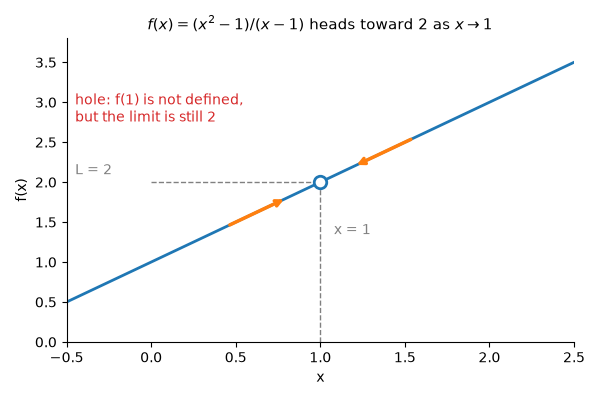
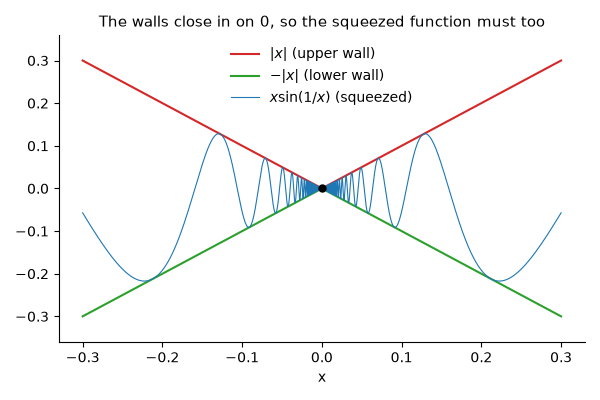
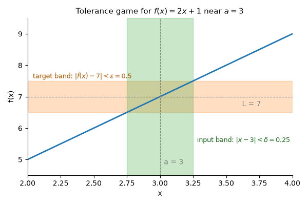
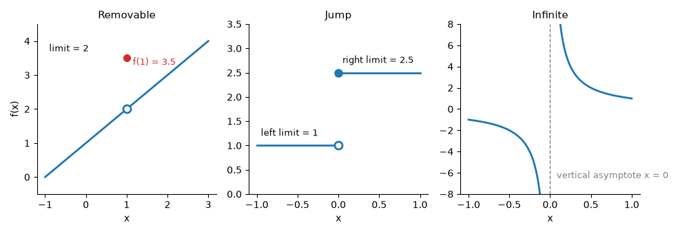
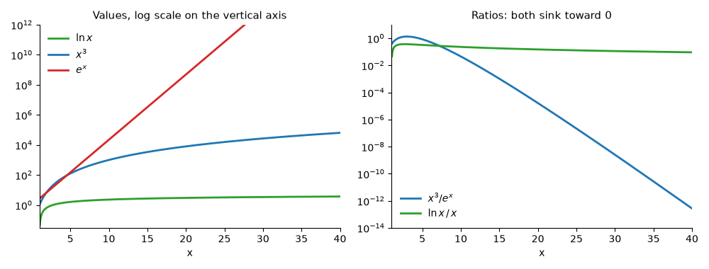

# Limits and Continuity

**Course:** [Calculus and Optimization](../README.md) · **Hands-on:** [notebook.ipynb](notebook.ipynb) · **Practice:** [exercises](exercises/problems.md), [assignment](assignment.md)

Some questions have no answer at the exact spot you ask about, yet a perfectly clear answer right next to it. What is $\frac{0}{0}$? Nothing. But what is the fraction $\frac{x^2-1}{x-1}$ heading toward as $x$ creeps up on $1$? That has a clean answer, and the idea behind it is called a **limit**. Limits are the base layer of calculus: derivatives, integrals, and the claim that a training run has "converged" are all built from them. Along the way you meet **continuity** (functions with no sudden gaps or jumps, which you can trust) and **behavior at infinity** (what a function settles into when the input gets huge, which is what happens when a neuron saturates).

## Learning goals

By the end of this topic you can:

- estimate a limit from a table of values and from a graph, and explain why the value of the function at the point itself does not matter;
- use one-sided limits to decide when a limit does not exist, and name the three ways a limit can fail;
- evaluate limits with the limit laws and with algebra (factor and cancel, rationalize, simplify a fraction), use the squeeze theorem, and describe a limit as a tolerance game (epsilon and delta);
- test continuity with the three-part test, classify discontinuities as removable, jump, or infinite, and repair a removable one;
- use the intermediate value theorem and bisection to trap and find a root;
- find limits at infinity and horizontal and vertical asymptotes, compare how fast $x^k$, $e^x$, and $\ln x$ grow, and see $e$ as the limit of $(1 + 1/n)^n$.

## Prerequisites

- High-school algebra (factoring, fractions, exponents, square roots) and functions and graphs, including a first look at $\sin x$, $\cos x$, $e^x$, and $\ln x$. You need no calculus, and no [linear algebra](../../linear-algebra/README.md).
- Basic Python and NumPy from [Python Basics](../../../getting-started/python-basics/README.md), only for the code blocks and the notebook.

## Outline

- [Notation at a glance](#notation-at-a-glance)
- [1. The idea of a limit](#1-the-idea-of-a-limit)
- [2. One-sided limits and limits that do not exist](#2-one-sided-limits-and-limits-that-do-not-exist)
- [3. Limit laws and 0/0 forms](#3-limit-laws-and-00-forms)
- [4. The squeeze theorem](#4-the-squeeze-theorem)
- [5. The precise idea: a tolerance game](#5-the-precise-idea-a-tolerance-game)
- [6. Continuity and its three-part test](#6-continuity-and-its-three-part-test)
- [7. The intermediate value theorem and bisection](#7-the-intermediate-value-theorem-and-bisection)
- [8. Limits at infinity and infinite limits](#8-limits-at-infinity-and-infinite-limits)
- [9. Growth rates, the number e, and sequences](#9-growth-rates-the-number-e-and-sequences)
- [The same ideas in Python](#the-same-ideas-in-python)
- [Common mistakes](#common-mistakes)
- [Why this matters for AI/ML](#why-this-matters-for-aiml)

> [!NOTE]
> **Concept ownership.** This topic teaches limits, the limit laws, one-sided limits, the squeeze theorem, continuity and the types of discontinuity, the intermediate value theorem, limits at infinity, and asymptotes in full. Later topics recap them and link back (see the [ownership map](../../../docs/design-notes.md)).

**What this topic leaves for later.**

| Question | Where it is answered |
|---|---|
| What is the slope of a curve at a point (a limit of slopes of secant lines), and how do we approximate a function near a point by a polynomial? | [Derivatives and Taylor series](../derivatives-and-taylor-series/README.md) |
| How is the area under a curve a limit of sums? | [Integrals](../integrals/README.md) |
| What does a limit mean when the input is a vector, as in a loss with many weights? | [Multivariable calculus](../multivariable-calculus/README.md) |

## Key intuition

### Notation at a glance

| You see | It means |
|---|---|
| $\lim_{x\to a} f(x) = L$ | $f(x)$ gets as close to $L$ as you like when $x$ is close enough to $a$ (but not equal to $a$) |
| $x \to a^-$, $x \to a^+$ | $x$ approaches $a$ from the left (from smaller values), or from the right (from larger values) |
| $x \to \infty$ | $x$ grows without bound. $\infty$ is a direction of travel, not a number |
| $\varepsilon$, $\delta$ | Greek letters epsilon and delta: a small tolerance for the output, and a small tolerance for the input |

### 1. The idea of a limit

Take $f(x) = \dfrac{x^2-1}{x-1}$. You cannot evaluate it at $x = 1$ (that is $0/0$). But you can ask what happens nearby, and a table of values answers it:

| $x$ | 0.9 | 0.99 | 0.999 | 1 | 1.001 | 1.01 | 1.1 |
|---|---|---|---|---|---|---|---|
| $f(x)$ | 1.9 | 1.99 | 1.999 | undefined | 2.001 | 2.01 | 2.1 |

From both sides the outputs close in on $2$. We say **the limit of $f(x)$ as $x$ approaches $1$ is $2$**, and write $\lim_{x\to 1} f(x) = 2$. The algebra agrees: for $x \neq 1$ we can cancel, $\frac{(x-1)(x+1)}{x-1} = x + 1$, so the graph is the line $y = x+1$ with one point, at $x=1$, missing.



*The graph has a hole at $x = 1$, but the outputs still head to $2$ from both directions.*

**Definition (informal).** $\lim_{x\to a} f(x) = L$ means you can make $f(x)$ as close to $L$ as you want by taking $x$ close enough to $a$, with $x \neq a$. The limit is about where the function is **heading**, not where it is. So $f(a)$ plays no role: if we declared $f(1) = 5$ in the example above, the limit would still be $2$.

**Check yourself**

1. Make a small table for $f(x) = \dfrac{x^2-4}{x-2}$ at $x = 1.9, 1.99, 2.01, 2.1$. What is the limit as $x \to 2$?
2. Let $h(x) = x + 3$ for $x \neq 2$ and $h(2) = 10$. What is $\lim_{x\to2} h(x)$?

<details>
<summary>Answers</summary>

1. The values are $3.9, 3.99, 4.01, 4.1$, so the limit is $4$ (cancel to get $x + 2$).
2. It is $5$. The odd value $h(2) = 10$ is ignored by the limit.

</details>

### 2. One-sided limits and limits that do not exist

Sometimes the answer depends on which side you come from. The **left-hand limit** $\lim_{x\to a^-} f(x)$ only looks at $x < a$, and the **right-hand limit** $\lim_{x\to a^+} f(x)$ only looks at $x > a$. The ordinary (two-sided) limit exists exactly when both one-sided limits exist and are equal.

Take $f(x) = \dfrac{|x|}{x}$. For $x > 0$ it is $x/x = 1$, and for $x < 0$ it is $-x/x = -1$. So the right-hand limit at $0$ is $1$, the left-hand limit is $-1$, and $\lim_{x\to0} f(x)$ **does not exist**. A limit can fail in three ways: the two sides **disagree** (a jump, as above); the function **grows without bound**, like $1/x^2$ near $0$ (section 8); or it **oscillates** forever, like $\sin(1/x)$ near $0$, swinging between $-1$ and $1$ faster and faster without settling.

**Check yourself**

1. Let $f(x) = 2x$ when $x < 3$ and $f(x) = x + 4$ when $x \ge 3$. Find both one-sided limits at $3$. Does the limit exist?
2. For $f(x) = x^2$, what is the left-hand limit at $0$? Does the two-sided limit exist?

<details>
<summary>Answers</summary>

1. From the left, $2x \to 6$. From the right, $x + 4 \to 7$. They differ, so the limit does not exist.
2. It is $0$, and the right-hand limit is also $0$, so the two-sided limit exists and equals $0$.

</details>

### 3. Limit laws and 0/0 forms

You do not want to build a table every time. If $\lim_{x\to a} f(x) = L$ and $\lim_{x\to a} g(x) = M$ both exist (as ordinary numbers), then limits behave the way arithmetic does: the limit of a sum is $L + M$, of a difference $L - M$, of a constant multiple $c\,L$, of a product $L\,M$, of a power $L^n$, and of a quotient $L/M$, **provided $M \neq 0$**.

Example: $\lim_{x\to2}\dfrac{3x^2 - x + 4}{x+1}$. The numerator heads to $3\cdot4 - 2 + 4 = 14$ and the denominator to $3$, which is not $0$, so the limit is $\frac{14}{3}$. For polynomials (and fractions of them with a nonzero denominator) you can just plug in. Section 6 explains why.

The interesting case is when plugging in gives $\frac00$. That is an **indeterminate form**: it does not mean the limit is $0$ or undefined, only that the laws gave no verdict, so you rewrite the expression until they do. Three standard rewrites:

- **Factor and cancel.** $\lim_{x\to3}\dfrac{x^2-9}{x-3} = \lim_{x\to3}(x+3) = 6$.
- **Rationalize** (multiply top and bottom by the conjugate). For $\lim_{x\to0}\dfrac{\sqrt{x+4}-2}{x}$ we get $\dfrac{(x+4)-4}{x\,(\sqrt{x+4}+2)} = \dfrac{1}{\sqrt{x+4}+2} \to \dfrac14$.
- **Simplify a fraction inside a fraction.** For $\lim_{h\to0}\dfrac{\frac{1}{2+h}-\frac12}{h}$, combine the top: $\frac{1}{2+h}-\frac12 = \frac{-h}{2(2+h)}$. Dividing by $h$ leaves $\frac{-1}{2(2+h)} \to -\frac14$.

The last one is not random: it is the slope of $y = 1/x$ at $x = 2$, the first derivative you will compute in the [next topic](../derivatives-and-taylor-series/README.md). Note that a nonzero number over $0$, like $\frac{3}{0}$, is not indeterminate: the fraction blows up (section 8).

**Check yourself**

1. Find $\lim_{x\to-1}\dfrac{x^2+x}{x+1}$.
2. Find $\lim_{x\to0}\dfrac{\sqrt{x+9}-3}{x}$.

<details>
<summary>Answers</summary>

1. Factor the top, $x(x+1)$, and cancel: the limit is $\lim x = -1$.
2. Multiply by the conjugate: $\frac{x}{x(\sqrt{x+9}+3)} = \frac{1}{\sqrt{x+9}+3} \to \frac16$.

</details>

### 4. The squeeze theorem

Sometimes a function is too wild to simplify but is trapped between two tame ones. **Squeeze theorem:** if $g(x) \le f(x) \le h(x)$ for all $x$ near $a$ (except possibly at $a$) and $\lim_{x\to a} g(x) = \lim_{x\to a} h(x) = L$, then $\lim_{x\to a} f(x) = L$ too. If two walls close in on $L$, whatever sits between them has nowhere else to go.

The classic example is $f(x) = x\sin(1/x)$ at $0$. It is not even defined at $0$, and $\sin(1/x)$ wiggles infinitely fast there. But $-1 \le \sin(1/x) \le 1$ always, so multiplying by $|x|$ gives $-|x| \le x\sin(1/x) \le |x|$, and both walls tend to $0$. Hence $\lim_{x\to0} x\sin(1/x) = 0$. The same idea (with a picture of a circle) gives the important limit $\lim_{x\to0}\frac{\sin x}{x} = 1$ for $x$ in radians, which the next topic uses to find the slope of $\sin x$.



*The oscillations shrink as the walls close in on $0$.*

**Check yourself**

1. Use a squeeze to find $\lim_{x\to0} x^2\cos(1/x)$.
2. Why does the squeeze not work for $\sin(1/x)$ itself?

<details>
<summary>Answers</summary>

1. $-x^2 \le x^2\cos(1/x) \le x^2$ and both walls tend to $0$, so the limit is $0$.
2. The walls $-1$ and $1$ never close in; they have different limits, so they trap nothing. (And that limit indeed does not exist.)

</details>

### 5. The precise idea: a tolerance game

"As close as you like" can be made exact with a game. You pick a **tolerance** $\varepsilon > 0$ for the output, say $0.1$: you demand that $f(x)$ be within $0.1$ of $L$. I must reply with a tolerance $\delta > 0$ for the input, so that **every** $x$ within $\delta$ of $a$ (and not equal to $a$) lands in your band. If I can win for every $\varepsilon$ you name, however tiny, the limit is $L$. Written out:

> $\lim_{x\to a} f(x) = L$ means: for every $\varepsilon > 0$ there is a $\delta > 0$ such that $0 < |x - a| < \delta$ implies $|f(x) - L| < \varepsilon$.

Example: $f(x) = 2x + 1$, $a = 3$, $L = 7$. Then $|f(x) - 7| = |2x - 6| = 2|x-3|$. To keep this below $\varepsilon$ I need $|x-3| < \varepsilon/2$, so $\delta = \varepsilon/2$ always wins. If you ask for $\varepsilon = 0.5$ I answer $\delta = 0.25$, and for $\varepsilon = 0.01$ I answer $\delta = 0.005$.



*The smaller the target band, the narrower the input band I must pick. A steeper function forces a smaller $\delta$.*

For a curved function the algebra needs one more step (for $x^2$ near $2$, $\delta = \min(1, \varepsilon/5)$ works), but the game is the same. You will rarely play it by hand. Its job is to make "close" meaningful so that the limit laws can be proved, and it is the same game that defines "converges" in training (section 9 and the ML section).

**Check yourself**

1. For $f(x) = 5x - 2$ at $a = 1$ (so $L = 3$), what $\delta$ answers $\varepsilon = 0.1$?
2. You name $\varepsilon$, I name $\delta$, and you find one $x$ with $|x - a| < \delta$ whose output is outside the band. Did I win?

<details>
<summary>Answers</summary>

1. $|5x - 5| = 5|x-1| < 0.1$ needs $|x-1| < 0.02$, so $\delta = 0.02$ (or smaller).
2. No. My $\delta$ must work for **every** $x$ in the input band, so I need a smaller one.

</details>

### 6. Continuity and its three-part test

A function is **continuous** if you can draw its graph without lifting your pencil. Precisely, $f$ is continuous at $a$ when all three hold: (1) $f(a)$ is defined, (2) $\lim_{x\to a} f(x)$ exists, and (3) $\lim_{x\to a} f(x) = f(a)$. Test the step function that is $0$ for $x < 0$ and $1$ for $x \ge 0$, at $a = 0$. Part 1 passes ($f(0) = 1$). Part 2 fails: the left limit is $0$ and the right limit is $1$. So it is discontinuous at $0$. And $\frac{x^2-1}{x-1}$ at $1$ already fails part 1.

You rarely test by hand. These are continuous everywhere they are defined: polynomials, $e^x$, $\sin x$, $\cos x$, $|x|$, $\sqrt{x}$ (for $x \ge 0$), $\ln x$ (for $x > 0$), and fractions of polynomials (except where the denominator is $0$). Sums, products, quotients (denominator nonzero), and compositions of continuous functions are continuous. That is why plugging in works for them: part 3 says $\lim f = f(a)$.

When continuity fails, it fails in one of three named ways:

| Type | What happens at $a$ | Example |
|---|---|---|
| Removable | the limit exists, but $f(a)$ is missing or different | $\frac{x^2-1}{x-1}$ at $1$ |
| Jump | both one-sided limits exist but differ | $\frac{\lvert x\rvert}{x}$ or the step function at $0$ |
| Infinite | $f$ blows up near $a$ (a cousin is wild oscillation, as in $\sin(1/x)$) | $\frac1x$ at $0$ |



*Removable: patch one point. Jump: the sides cannot be joined. Infinite: the graph escapes.*

**Removing a removable discontinuity.** Define the missing value to be the limit. For $f(x) = \frac{x^2-4}{x-2}$ the limit at $2$ is $4$, so setting $f(2) = 4$ gives a function continuous everywhere (it is just $x + 2$). Jump and infinite discontinuities cannot be repaired this way: no single value joins two different sides or reaches infinity.

**Check yourself**

1. Where is $f(x) = \dfrac{x-3}{x^2-9}$ discontinuous, and of what type at each place?
2. Can you remove a jump discontinuity by redefining $f$ at the jump?

<details>
<summary>Answers</summary>

1. $f(x) = \frac{1}{x+3}$ for $x \neq 3$. At $x = 3$ it is removable (the limit is $\frac16$, so define $f(3) = \frac16$). At $x = -3$ it is an infinite discontinuity.
2. No. One value cannot agree with two different one-sided limits.

</details>

### 7. The intermediate value theorem and bisection

Continuity has a handy consequence. **Intermediate value theorem (IVT):** if $f$ is continuous on the interval $[a, b]$ (every number from $a$ to $b$) and $N$ is any number between $f(a)$ and $f(b)$, then some $c$ in $[a, b]$ has $f(c) = N$. Draw a path from below a line to above it without lifting your pencil and you must cross it. The most useful case is $N = 0$: **if $f(a)$ and $f(b)$ have opposite signs, a continuous $f$ has a root between $a$ and $b$.** The theorem needs continuity: $f(x) = 1/x$ has $f(-1) = -1$ and $f(1) = 1$ yet never equals $0$, because it leaps over the asymptote at $0$.

**Bisection** turns the IVT into an algorithm: look at the middle of the bracket, keep the half whose ends still have opposite signs, and repeat.

```text
bisection(f, a, b, tol):
    require f(a) and f(b) to have opposite signs
    while b - a > tol:
        m = (a + b) / 2
        if f(a) and f(m) have opposite signs (or f(m) = 0): b = m
        else: a = m
    return (a + b) / 2
```

Example: $f(x) = x^3 - x - 2$ has $f(1) = -2$ and $f(2) = 4$, so there is a root in $[1, 2]$. Step 1: $m = 1.5$, $f(m) = -0.125 < 0$, so keep $[1.5, 2]$. Step 2: $m = 1.75$, $f(m) = 1.609 > 0$, so keep $[1.5, 1.75]$. Step 3: $m = 1.625$, $f(m) = 0.666 > 0$, so keep $[1.5, 1.625]$. Step 4: $m = 1.5625$, $f(m) = 0.252 > 0$, so keep $[1.5, 1.5625]$.

Each step halves the bracket, so after $n$ steps its width is $(b-a)/2^n$. Reaching a tolerance of $10^{-6}$ from width $1$ takes $\log_2(10^6) \approx 20$ steps. That is slow next to the methods in [Newton and quasi-Newton methods](../newton-and-quasi-newton-methods/README.md), but it is guaranteed to work.

**Check yourself**

1. Show that $x^2 - 3 = 0$ has a solution in $[1, 2]$.
2. Why can we not use bisection on $1/x$ over $[-1, 1]$?

<details>
<summary>Answers</summary>

1. $f(x) = x^2 - 3$ is continuous, with $f(1) = -2 < 0$ and $f(2) = 1 > 0$. The IVT gives a root in $[1, 2]$ (it is $\sqrt3 \approx 1.732$).
2. $1/x$ is not continuous on $[-1, 1]$ (it is undefined at $0$), so the IVT does not apply and the bracket traps no root.

</details>

### 8. Limits at infinity and infinite limits

Now let $x$ run off to the right (or left) and ask where the output settles. $\lim_{x\to\infty} f(x) = L$ means $f(x)$ gets and stays within any tolerance of $L$ once $x$ is large enough. For example $\frac1x \to 0$, $\frac{1}{x^n} \to 0$, and $e^{-x} \to 0$. If $\lim_{x\to\pm\infty} f(x) = L$, the line $y = L$ is a **horizontal asymptote**: the graph hugs it far from the origin (and may cross it near the origin).

**Polynomials** are ruled by their leading term at the ends: $x^3 - 5x^2 + 7 \to \infty$ as $x \to \infty$ because $x^3$ swamps the rest. For a **rational function** (polynomial over polynomial), divide the top and bottom by the highest power of $x$ in the bottom and use $\frac1x \to 0$: $\dfrac{3x^2 + x}{2x^2 - 5} = \dfrac{3 + 1/x}{2 - 5/x^2} \to \dfrac{3}{2}$. Comparing degrees (highest powers) gives a shortcut: if the top has the smaller degree the limit is $0$ (like $\frac{x}{x^2+1}$), if the degrees are equal it is the ratio of leading coefficients (like $\frac32$ above), and if the top has the bigger degree it is $\pm\infty$ and there is no horizontal asymptote (like $\frac{x^3}{x^2+1}$).

**Infinite limits.** If $f(x)$ grows beyond every bound as $x \to a$, we write $\lim_{x\to a} f(x) = \infty$ (or $-\infty$ if it plunges). Strictly the limit does not exist as a number, and the symbol $\infty$ tells you **how** it fails. For $1/x^2$ both sides shoot up, so the limit at $0$ is $\infty$. For $1/x$ the right side goes to $+\infty$ and the left to $-\infty$, so the two-sided limit just does not exist. A line $x = a$ is a **vertical asymptote** when at least one one-sided limit at $a$ is $\pm\infty$. To find the signs, look at the sign of the small denominator. For $\dfrac{x+1}{x-2}$ near $x = 2$ the top is close to $3$ and the bottom is a tiny positive number on the right ($f \to +\infty$) and a tiny negative one on the left ($f \to -\infty$), so $x = 2$ is a vertical asymptote. Also remember $\ln x \to -\infty$ as $x \to 0^+$.

**Check yourself**

1. Find $\lim_{x\to\infty}\dfrac{5x^3 - x}{2x^3 + 7}$, and the horizontal asymptote of $\dfrac{2x+1}{x-3}$.
2. Does $\dfrac{x^2-1}{x-1}$ have a vertical asymptote at $x = 1$?

<details>
<summary>Answers</summary>

1. The degrees are equal, so the first limit is $\frac52$. For the second, dividing by $x$ gives $\frac{2 + 1/x}{1 - 3/x} \to 2$ in both directions, so the asymptote is $y = 2$.
2. No. It simplifies to $x + 1$, so the discontinuity is removable (a hole), not infinite.

</details>

### 9. Growth rates, the number e, and sequences

Three functions climb forever at very different speeds: $\ln x$, any power $x^k$, and $e^x$ (which tends to $\infty$ as $x \to \infty$ and to $0$ as $x \to -\infty$). The race has a fixed order: $e^x$ beats every power, and every power beats $\ln x$. In limit language, for every $k > 0$: $\lim_{x\to\infty} x^k/e^x = 0$ and $\lim_{x\to\infty} (\ln x)/x^k = 0$. To feel the gap, at $x = 10$ we have $x^3 = 1000$, $e^x \approx 22026$, and $\ln x \approx 2.3$. At $x = 100$ they are $10^6$, about $2.7\times10^{43}$, and $4.6$. The proofs need tools from the next topic, so treat this as a pattern to remember.



*The exponential (a straight line on a log axis) leaves the polynomial behind, and the logarithm barely moves.*

**The number $e$.** Put $1$ unit of money in an account paying $100\%$ a year, compounded $n$ times (each time adding $1/n$ of the current balance). After a year you hold $(1 + \frac1n)^n$. Compounding more often helps, but less and less: $n = 1$ gives $2$, $n = 10$ gives $2.5937$, $n = 100$ gives $2.7048$, $n = 1000$ gives $2.7169$, and $n = 10^6$ gives $2.71828$. The numbers level off, and the value they level off at is the number $e \approx 2.71828$. This is numeric evidence, not a proof, but it is exactly how $e$ is defined.

**Sequences.** A **sequence** $a_1, a_2, a_3, \dots$ is a function whose inputs are $1, 2, 3, \dots$. It **converges** to $L$ if $a_n \to L$ as $n \to \infty$, the same tolerance game with $n$ in place of $x$. So $\frac1n \to 0$, and $(1 + \frac1n)^n \to e$ is a sequence limit. A list of training losses is a sequence too, which is why convergence matters for AI.

**Check yourself**

1. What is $\lim_{x\to\infty} x^2 e^{-x}$, and why?
2. As $x \to 0^+$, what does $\ln x$ do? And what does $e^x$ do as $x \to 0$?

<details>
<summary>Answers</summary>

1. It is $\frac{x^2}{e^x} \to 0$, because the exponential beats every power.
2. $\ln x \to -\infty$. And $e^x \to e^0 = 1$ (the exponential is continuous, so plug in).

</details>

## The same ideas in Python

A table of values approaching a limit from both sides (section 1):

```python
import numpy as np

def f(x):
    return (x**2 - 1) / (x - 1)

for h in [0.1, 0.01, 0.001, 0.0001]:
    print(f"h = {h:<7} f(1-h) = {f(1 - h):.4f}   f(1+h) = {f(1 + h):.4f}")
```

```text
h = 0.1     f(1-h) = 1.9000   f(1+h) = 2.1000
h = 0.01    f(1-h) = 1.9900   f(1+h) = 2.0100
h = 0.001   f(1-h) = 1.9990   f(1+h) = 2.0010
h = 0.0001  f(1-h) = 1.9999   f(1+h) = 2.0001
```

SymPy computes limits exactly, including one-sided ones (it looks from the right unless told otherwise) and limits at infinity (`oo` is its infinity, and `E` is the number $e$):

```python
import sympy as sp
x = sp.symbols("x")
print(sp.limit((x**2 - 9) / (x - 3), x, 3), sp.limit(sp.sin(x) / x, x, 0), sp.limit(1 / x, x, 0, "+"), sp.limit(1 / x, x, 0, "-"))
print(sp.limit((3*x**2 + x) / (2*x**2 - 5), x, sp.oo), sp.limit((1 + 1/x)**x, x, sp.oo))
```

```text
6 1 oo -oo
3/2 E
```

Bisection from scratch (section 7), on $x^3 - x - 2$:

```python
def bisect(func, a, b, tol=1e-6):
    steps = 0                                # assumes func(a), func(b) differ in sign
    while b - a > tol:
        m = (a + b) / 2
        if func(a) * func(m) <= 0:
            b = m
        else:
            a = m
        steps += 1
    return (a + b) / 2, steps

cubic = lambda x: x**3 - x - 2
root, steps = bisect(cubic, 1, 2)
print(root, steps, np.isclose(cubic(root), 0, atol=1e-5))
```

```text
1.5213799476623535 20 True
```

## Common mistakes

- **Confusing the limit with the value.** $\lim_{x\to a} f(x)$ asks where $f$ is heading, and $f(a)$ may be different or missing. Only for continuous functions are the two the same.
- **Reading $\frac00$ as $0$, as $1$, or as "undefined, so no limit".** It is an indeterminate form. Factor, rationalize, or simplify and look again.
- **Treating $\infty$ as a number.** Arithmetic like $\infty - \infty = 0$ is wrong: $x^2 - x$ goes to $\infty$ as $x \to \infty$ even though it looks like $\infty - \infty$.
- **Using a limit law when a limit does not exist.** $\lim (f + g) = L + M$ needs both limits to exist. Two functions can each oscillate while their sum has a perfectly good limit, and the law says nothing then.
- **Calling a function with a hole "continuous because the graph looks fine".** A hole is a (removable) discontinuity, since part 1 of the test needs $f(a)$ to exist.
- **Reversing the IVT.** A sign change forces a root, but no sign change does not rule one out: $x^2$ touches $0$ and never changes sign.

## Why this matters for AI/ML

- **Training runs on a limit.** Gradient descent needs the slope of the loss, and a slope is defined as a limit, $\lim_{h\to0}\frac{f(x+h)-f(x)}{h}$. You computed one by hand in section 3. The [next topic](../derivatives-and-taylor-series/README.md) builds the derivative on it.
- **Continuity decides what gradient descent can use.** ReLU, $\max(0, z)$, is continuous with a corner at $0$ (slope $0$ on the left, $1$ on the right), and libraries simply pick a value there. The step function from section 6 jumps, and its slope is $0$ everywhere else, so it gives gradient descent no direction to follow. Sigmoid and tanh are smooth. This is one reason networks use smooth or nearly smooth activations, and train on a continuous loss such as cross-entropy instead of the jumpy "was the answer right?" score. Continuity does not by itself make a function easy to optimize. It is the minimum. See [neural network basics](../../../deep-learning/neural-network-basics/README.md) and [gradient descent](../gradient-descent-and-its-variants/README.md).
- **Limits at infinity are saturation.** Sigmoid tends to $0$ and $1$, and tanh to $-1$ and $1$, as the input goes to $-\infty$ and $+\infty$. The curves flatten there, so the slope is close to $0$. A softmax with one very large logit tends to a one-hot vector. Flat tails are one ingredient of the vanishing-gradient problem (see [backpropagation](../../../deep-learning/backpropagation/README.md)).
- **Convergence is a limit.** A learning-rate schedule such as $\eta_t = \eta_0/(1 + 0.1\,t)$ decays toward $0$. "The loss has converged" means the sequence of losses approaches some number, and in practice we stop when the change drops below a tolerance $\varepsilon$, as in the game of section 5. See [gradient descent](../gradient-descent-and-its-variants/README.md).

### Finite-difference gradient checks

A derivative is a limit, so you can approximate it with a small step $h$ instead of a true limit, and people use this to check gradients written by hand. Here it is for $\sin x$ at $x = 1$, where the true slope is $\cos 1$. The "centered" version steps on both sides:

```python
x0, true = 1.0, np.cos(1.0)
for h in [1e-2, 1e-5, 1e-8, 1e-11, 1e-14]:
    fwd = (np.sin(x0 + h) - np.sin(x0)) / h
    ctr = (np.sin(x0 + h) - np.sin(x0 - h)) / (2 * h)
    print(f"h = {h:.0e}   forward error {abs(fwd - true):.1e}   centered error {abs(ctr - true):.1e}")
```

```text
h = 1e-02   forward error 4.2e-03   centered error 9.0e-06
h = 1e-05   forward error 4.2e-06   centered error 1.1e-11
h = 1e-08   forward error 3.0e-09   centered error 2.6e-09
h = 1e-11   forward error 1.2e-06   centered error 1.2e-06
h = 1e-14   forward error 3.7e-03   centered error 3.7e-03
```

The error first shrinks with $h$ (the limit at work), reaches a floor, then grows again. At tiny $h$ the values $\sin(x_0+h)$ and $\sin(x_0)$ agree in almost all their digits, so subtracting them cancels the good digits and leaves rounding noise, which dividing by tiny $h$ magnifies. In double precision the best $h$ is near $10^{-8}$ for the forward version and near $10^{-5}$ for the centered one. Do not pick $h$ as small as possible.

### Numerical stability near a limit

Computers round, and limits are where rounding bites: a formula can be right in exact math and useless at a tiny input.

```python
from scipy.special import xlogy

np.seterr(all="ignore")                                      # silence the overflow warnings we provoke
t = 1e-10
print(np.log(1 + t), np.log1p(t))                            # log1p stays accurate for tiny t
t = 1e-8
print((1 - np.cos(t)) / t**2, 2 * np.sin(t / 2)**2 / t**2)   # same limit (0.5); one is garbage
logits = np.array([1000.0, 1001.0]); m = logits.max()
print(np.log(np.sum(np.exp(logits))), m + np.log(np.sum(np.exp(logits - m))))   # log-sum-exp: subtract the max
print(0 * np.log(0.0), xlogy(0.0, 0.0))                      # 0 * (-inf) is nan, but x ln x -> 0
```

```text
1.000000082690371e-10 9.999999999500001e-11
0.0 0.5
inf 1001.3132616875182
nan 0.0
```

The first two lines are $0/0$-style forms fed rounding noise, and `np.log1p` and the rewritten fraction avoid the cancellation. The log-sum-exp trick keeps `exp` from overflowing, which is what stable softmax and cross-entropy code does. The last line uses the limit $x\ln x \to 0$ as $x \to 0^+$, which is why entropy and cross-entropy treat $0 \log 0$ as $0$.

## Summary

- A limit describes where $f(x)$ is heading as $x$ nears $a$, ignoring $f(a)$, and it exists only if both one-sided limits agree. The limit laws split it into pieces. For $0/0$ forms, rewrite first (factor, rationalize, simplify) or trap the function with the squeeze theorem. The epsilon-delta game makes "close" exact.
- $f$ is continuous at $a$ if $f(a)$ exists, the limit exists, and they agree. Discontinuities are removable, jump, or infinite. Continuity gives the intermediate value theorem, and bisection turns it into a root finder that halves the bracket each step.
- Limits at infinity give horizontal asymptotes (compare degrees for rational functions), and infinite limits give vertical asymptotes. Growth order is $\ln x \ll x^k \ll e^x$. $e$ is the limit of $(1+1/n)^n$.
- In AI: derivatives are limits (finite differences approximate them, with a sweet spot for $h$), activations should be continuous, flat tails mean saturation, and "converged" is a limit with a tolerance.

## Further reading

Chapter pointers and free links are in [resources.md](resources.md).

## Practice

- [Notebook](notebook.ipynb): tables approaching limits, a hole and a jump on a graph, one-sided limits with SymPy, the limit laws checked numerically, the squeeze and tolerance pictures, bisection, limits at infinity and growth rates, saturation, a finite-difference sweet spot, and stable `log1p` and log-sum-exp. It follows the lesson:

  | Lesson section | Notebook section |
  |---|---|
  | 1. The idea of a limit to 5. Tolerance game | 1. Tables of values, 2. One-sided limits, 3. Limit laws and 0/0 forms, 4. The squeeze theorem, 5. The tolerance game |
  | 6. Continuity, 7. IVT and bisection | 6. Continuity and its types, 7. Bisection |
  | 8. At infinity, 9. Growth rates and e | 8. Limits at infinity, 9. Growth rates and e |
  | Why this matters for AI/ML | 10. Saturation, 11. Finite differences, 12. Stability |

- [Exercises](exercises/problems.md) (with [solutions](exercises/solutions.md)): ten problems, easy to harder.
- [Assignment](assignment.md): measure how the step size of a finite-difference derivative affects its error, find the sweet spot, and write down what you see.

---

[← Previous: Review and Project](../../linear-algebra/review-and-project/README.md) | [Next: Derivatives and Taylor Series →](../derivatives-and-taylor-series/README.md)
