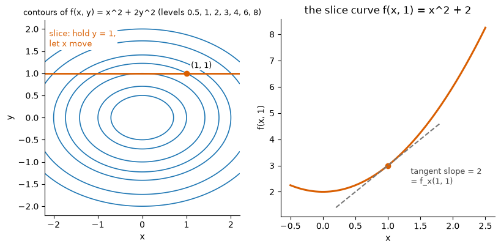
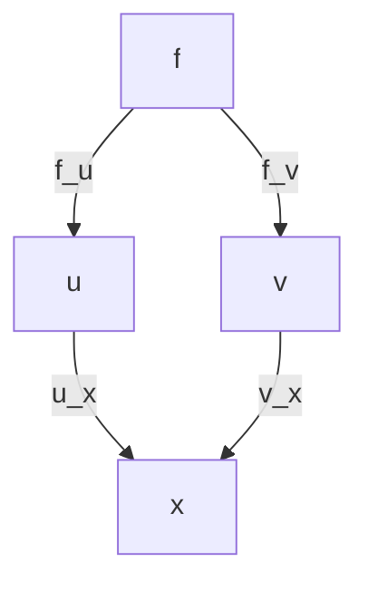
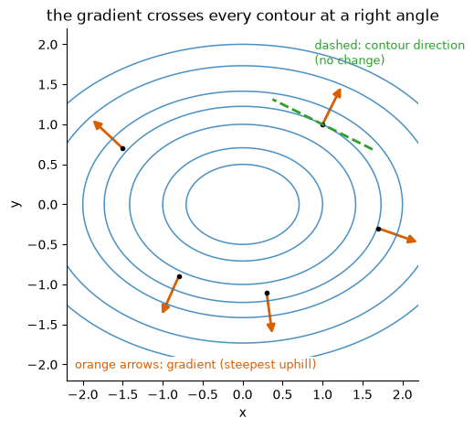
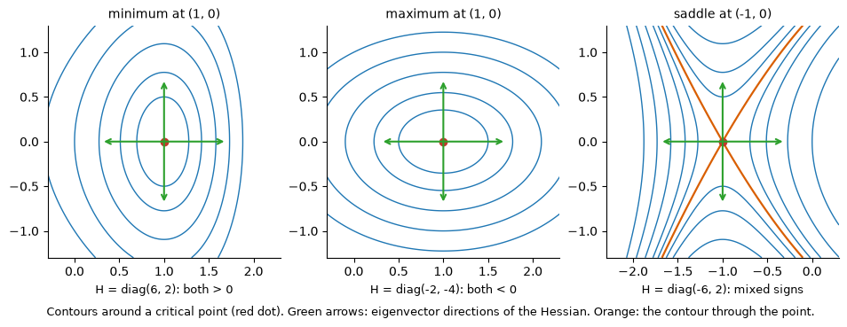
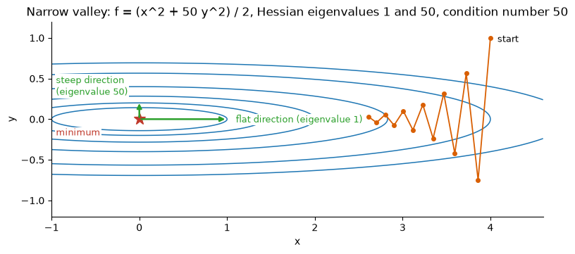
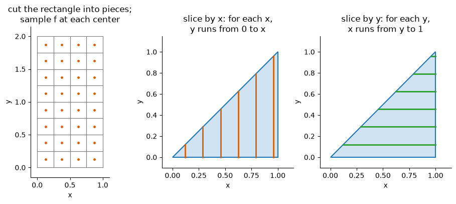
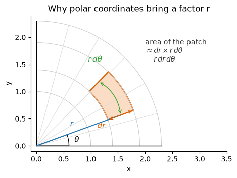

# Multivariable Calculus

**Course:** [Calculus and Optimization](../README.md) · **Hands-on:** [notebook.ipynb](notebook.ipynb) · **Practice:** [exercises](exercises/problems.md), [assignment](assignment.md)

A real model has thousands or billions of dials, and its error depends on all of them at once. One-variable calculus tells you how a function changes when its single input moves. This topic asks the same question for many inputs: which way is downhill, how curved is the ground, and how much is there under a surface? The answers are the **partial derivative**, the **gradient**, the **Jacobian**, the **Hessian**, and the **double integral**. One of them, the chain rule written as a product of Jacobians, is exactly what backpropagation computes when a neural network trains.

## Learning goals

By the end of this topic you can:

- read a function of two variables as a surface and as contour lines, and compute partial derivatives (from the limit definition and by rule), including higher and mixed ones;
- apply the multivariable chain rule along a path and to functions of functions, and draw its tree diagram;
- compute the gradient and directional derivatives, and explain why the gradient points uphill and is perpendicular to the contour lines;
- build the Jacobian of a vector-valued function, use it as a local linear map, and write the chain rule as a product of Jacobians;
- build the Hessian, write the linear and quadratic approximations of a function, and classify critical points with the eigenvalues of the Hessian;
- evaluate double integrals in either order over rectangles and simple regions, change variables with the Jacobian determinant (polar coordinates), and use that to show $\int e^{-x^2}dx = \sqrt{\pi}$.

## Prerequisites

- One-variable derivatives, the chain rule, and Taylor polynomials from [Derivatives and Taylor series](../derivatives-and-taylor-series/README.md), and the basic integral from [Integrals](../integrals/README.md). Each rule is recapped in one line where it is used. Limits come from [Limits and continuity](../limits-and-continuity/README.md).
- From linear algebra: the dot product and the cosine of an angle ([Vectors and matrices](../../linear-algebra/vectors-and-matrices/README.md)), a matrix as a map that stretches and rotates space ([Linear transformations](../../linear-algebra/linear-transformations/README.md)), and eigenvalues of symmetric matrices ([Eigenvalues and eigenvectors](../../linear-algebra/eigenvalues-and-eigenvectors/README.md)).
- Basic Python and NumPy from [Python Basics](../../../getting-started/python-basics/README.md), for the code blocks and the notebook.

## Outline

- [Notation at a glance](#notation-at-a-glance)
- [1. Surfaces, contours, and partial derivatives](#1-surfaces-contours-and-partial-derivatives)
- [2. The chain rule](#2-the-chain-rule)
- [3. The gradient and directional derivatives](#3-the-gradient-and-directional-derivatives)
- [4. The Jacobian](#4-the-jacobian)
- [5. The Hessian, approximations, and critical points](#5-the-hessian-approximations-and-critical-points)
- [6. Double integrals](#6-double-integrals)
- [7. Changing variables, the Gaussian integral, and probability](#7-changing-variables-the-gaussian-integral-and-probability)
- [The same ideas in Python](#the-same-ideas-in-python)
- [Common mistakes](#common-mistakes)
- [Why this matters for AI/ML](#why-this-matters-for-aiml)

> [!NOTE]
> **Concept ownership.** This topic teaches partial derivatives, the multivariable chain rule, the gradient, directional derivatives, the Jacobian, the Hessian, the multivariable Taylor approximation, the second-derivative test, double integrals, and change of variables in full. Later topics recap them and link back (see the [ownership map](../../../docs/design-notes.md)).

**What this topic leaves for later.**

| Question | Where it is answered |
|---|---|
| How do you walk downhill using the gradient, and how big should each step be? | [Gradient descent and its variants](../gradient-descent-and-its-variants/README.md) |
| How can the Hessian be used to jump to the bottom of the quadratic model? | [Newton and quasi-Newton methods](../newton-and-quasi-newton-methods/README.md) |
| How do you optimise while obeying a constraint (Lagrange multipliers)? | [Constrained optimization and KKT](../constrained-optimization-and-kkt/README.md) |
| What are joint densities, marginals, and expectations over several variables? | [Probability distributions](../../probability-and-statistics/probability-distributions/README.md) |

## Key intuition

### Notation at a glance

| You see | It means |
|---|---|
| $\dfrac{\partial f}{\partial x}$, $f_x$ | the partial derivative of $f$ with respect to $x$: the slope in the $x$ direction while every other variable is held fixed. A second partial such as $f_{xy}$ differentiates with respect to $x$, then $y$ |
| $\nabla f$ | "nabla f" or the gradient: the vector of all first partials |
| $D_{\mathbf{u}} f$ | the directional derivative of $f$ in the direction of the unit vector $\mathbf{u}$ |
| $J_F$ | the Jacobian matrix: all first partials of a vector-valued function $F$ |
| $H$ | the Hessian matrix: all second partials of a scalar function |
| $\iint_R f\,dA$ | the double integral of $f$ over the region $R$ of the plane; $dA$ is a tiny piece of area |

### 1. Surfaces, contours, and partial derivatives

A function of two variables takes two numbers and returns one. Take $f(x, y) = x^2 + 2y^2$: put in $x = 1$, $y = 1$ and you get $3$. Picture $(x, y)$ as a point on a map and $f(x, y)$ as the height of the ground above it. The graph is then a **surface** in three dimensions, here a bowl that is steeper in the $y$ direction.

Drawing a surface on paper is awkward, so mapmakers use **contour lines**: the curves where $f$ has one fixed value (all points with $x^2 + 2y^2 = 3$, then $= 4$, and so on). Where contours crowd together the ground is steep, and where they spread out it is flat. For our bowl the contours are ellipses. With more than two inputs we can no longer draw the graph, but everything below still works, and a function of $n$ inputs is written $f(\mathbf{x})$ with $\mathbf{x} = (x_1, \dots, x_n)$. A contour plot of a loss over two of its parameters is the standard picture in optimisation.

**Partial derivatives.** Stand at $(1, 1)$ on the bowl and walk in the $x$ direction only, so $y$ stays frozen at $1$. You trace the **slice curve** $f(x, 1) = x^2 + 2$, an ordinary one-variable function. Its slope at $x = 1$ is the **partial derivative** of $f$ with respect to $x$.


*Cutting the surface along $y = 1$ gives a plain curve, and its slope is the partial derivative.*

**Definition.** $f_x(a, b) = \displaystyle\lim_{h\to 0}\frac{f(a+h, b) - f(a, b)}{h}$, and likewise $f_y(a, b) = \displaystyle\lim_{h\to 0}\frac{f(a, b+h) - f(a, b)}{h}$. The curly $\partial$ (say "partial") is a reminder that other variables are being held fixed. For the bowl at $(1,1)$: $\dfrac{(1+h)^2 + 2 - 3}{h} = \dfrac{2h + h^2}{h} = 2 + h \to 2$.

**In practice** you do not take limits. To get $f_x$, treat every other variable as a constant and use the one-variable rules (power rule, product rule, chain rule). For $f(x, y) = x^2y + 3y^2$:

- $f_x = 2xy$ (the term $3y^2$ is a constant when $x$ moves), and $f_y = x^2 + 6y$.
- At $(2, 1)$: $f_x = 4$ and $f_y = 10$. So a nudge of $0.01$ in $x$ raises $f$ by about $0.04$, and the same nudge in $y$ by about $0.10$. (Check: $f(2.01, 1) = 7.0401$, up from $f(2, 1) = 7$.)

**Higher and mixed partials.** Differentiate again: $f_{xx} = 2y$, $f_{yy} = 6$, and the mixed ones $f_{xy} = \frac{\partial}{\partial y}(f_x) = 2x$ and $f_{yx} = \frac{\partial}{\partial x}(f_y) = 2x$. They agree, and that is no accident. **Clairaut's theorem** says that if the second partials are continuous near a point, the order of differentiation does not matter. A second check with $g = \sin(xy)$: $g_x = y\cos(xy)$, so $g_{xy} = \cos(xy) - xy\sin(xy)$, and $g_y = x\cos(xy)$ gives the same $g_{yx}$. This symmetry is why the Hessian in section 5 is a symmetric matrix. Functions of three or more variables work the same way: one partial per input.

**Check yourself**

1. For $f(x, y) = x^3y^2$ find $f_x$ and $f_y$ at $(1, 2)$. Then find two points on the contour of the bowl $x^2 + 2y^2$ through $(1, 1)$.
2. For $f(x, y) = x^2y^3$ compute $f_{xy}$ and $f_{yx}$ and compare.

<details>
<summary>Answers</summary>

1. $f_x = 3x^2y^2 = 12$ and $f_y = 2x^3y = 4$ at $(1, 2)$. The contour is $x^2 + 2y^2 = 3$, which contains $(\sqrt{3}, 0)$ and $(-1, 1)$.
2. $f_x = 2xy^3$, so $f_{xy} = 6xy^2$. And $f_y = 3x^2y^2$, so $f_{yx} = 6xy^2$. Equal.

</details>

### 2. The chain rule

Recall the one-variable chain rule: $\frac{d}{dt}f(x(t)) = f'(x)\,x'(t)$. Now let $f$ depend on two quantities that both move with time, $x(t)$ and $y(t)$. In a short time $dt$, $x$ changes by about $x'\,dt$ and $y$ by about $y'\,dt$. The change in $f$ is then the $x$ slope times the $x$ step plus the $y$ slope times the $y$ step:

$$\frac{df}{dt} = f_x\,\frac{dx}{dt} + f_y\,\frac{dy}{dt}.$$

*Example.* $f = x^2y$ with $x = t^2$, $y = t^3$. The chain rule gives $2xy\cdot 2t + x^2\cdot 3t^2 = 4t^6 + 3t^6 = 7t^6$. Substituting first gives $f = t^7$, whose derivative is $7t^6$. They agree.

When the inputs are themselves functions of two variables, $f(u, v)$ with $u(x, y)$ and $v(x, y)$, the rule is $\frac{\partial f}{\partial x} = f_u\,u_x + f_v\,v_x$, and the same with $y$. A **tree diagram** keeps it straight: draw $f$ at the top, its inputs below, and their inputs below that, labelling each branch with the partial derivative along it (the sketch shows the branches that lead to $x$). To get $\partial f/\partial x$, multiply the labels along each path that ends at $x$, then add the paths.



*Example.* $f = uv$, $u = x + y$, $v = xy$. Two paths reach $x$ (through $u$ and through $v$): $\frac{\partial f}{\partial x} = v\cdot 1 + u\cdot y = xy + (x+y)y = 2xy + y^2$. Expanding first, $f = x^2y + xy^2$, and its $x$ partial is the same. **Total versus partial.** If $y$ itself depends on $x$, then $\frac{d}{dx}f(x, y(x)) = f_x + f_y\,\frac{dy}{dx}$. This **total derivative** counts the direct effect of $x$ and the indirect effect through $y$, while the partial $f_x$ counts only the direct one. In differential form, $df = f_x\,dx + f_y\,dy$.

**Check yourself**

1. $f = x^2 + y^2$ along $x = \cos t$, $y = \sin t$. Find $df/dt$ and say why the answer makes sense.
2. $f = u^2 + v$ with $u = xy$, $v = x - y$. Find $\partial f/\partial x$.

<details>
<summary>Answers</summary>

1. $df/dt = 2\cos t\,(-\sin t) + 2\sin t\,\cos t = 0$. On the unit circle $f = 1$ never changes.
2. Paths through $u$ and $v$: $2u\cdot y + 1\cdot 1 = 2xy^2 + 1$.

</details>

### 3. The gradient and directional derivatives

Collect all the first partials into one vector, the **gradient**: $\nabla f = (f_x, f_y)$, or $(f_{x_1}, \dots, f_{x_n})$ for $n$ inputs. For the bowl, $\nabla f = (2x, 4y)$, which at $(1, 1)$ is $(2, 4)$.

The partials give the slope along the two axes only. To get the slope in any direction, take a unit vector $\mathbf{u}$ (length $1$) and walk from $\mathbf{a}$ along $\mathbf{a} + h\mathbf{u}$. The **directional derivative** is $D_{\mathbf{u}}f(\mathbf{a}) = \lim_{h\to0}\frac{f(\mathbf{a} + h\mathbf{u}) - f(\mathbf{a})}{h}$. Apply the chain rule from section 2 to this path, where $x$ moves at rate $u_1$ and $y$ at rate $u_2$:

$$D_{\mathbf{u}}f = f_x u_1 + f_y u_2 = \nabla f \cdot \mathbf{u}.$$

*Example.* At $(1, 1)$ walk in direction $\mathbf{u} = (3/5, 4/5)$. Then $D_{\mathbf{u}}f = 2\cdot 0.6 + 4\cdot 0.8 = 4.4$.

Now use what the [dot product](../../linear-algebra/vectors-and-matrices/README.md) knows: $\nabla f\cdot\mathbf{u} = \lVert\nabla f\rVert\cos\theta$, where $\theta$ is the angle between the gradient and your direction. That one line gives the two key facts.

- **The gradient points in the direction of steepest ascent.** The slope is largest when $\cos\theta = 1$, that is, when you walk along $\nabla f$, and then the slope equals $\lVert\nabla f\rVert$ (at $(1,1)$, $\sqrt{20}\approx 4.47$, a bit more than the $4.4$ above). Walking along $-\nabla f$ is the steepest descent.
- **The gradient is perpendicular to the contour lines.** Along a contour $f$ does not change, so $D_{\mathbf{u}}f = 0$ for a direction $\mathbf{u}$ that follows the contour. Then $\nabla f\cdot\mathbf{u} = 0$: the gradient is at a right angle to it (as long as $\nabla f \neq \mathbf{0}$).


*The arrows point uphill and cross the contours at right angles. They point at the minimum only on the symmetric axes.*

**Check yourself**

1. For $f = x^2y$ at $(2, 1)$, compute $\nabla f$ and the slope in the direction of $(3, 4)$.
2. In which directions does $f$ stay unchanged at $(2, 1)$?

<details>
<summary>Answers</summary>

1. $\nabla f = (2xy, x^2) = (4, 4)$. The unit direction is $(0.6, 0.8)$, so the slope is $4\cdot0.6 + 4\cdot0.8 = 5.6$.
2. Perpendicular to $(4, 4)$: along $\pm(1, -1)/\sqrt{2}$.

</details>

### 4. The Jacobian

A **vector-valued function** $F:\mathbb{R}^n \to \mathbb{R}^m$ takes $n$ numbers and returns $m$ numbers, such as $F(x, y) = (x^2 - y,\; xy)$. Its **Jacobian** is the $m\times n$ matrix of all first partials: entry $(i, j)$ is $\partial F_i/\partial x_j$. Row $i$ is the gradient of output $i$ written as a row.

```math
J_F = \begin{pmatrix} 2x & -1 \\ y & x \end{pmatrix}, \qquad J_F(1, 2) = \begin{pmatrix} 2 & -1 \\ 2 & 1 \end{pmatrix}.
```

The Jacobian is the multivariable version of the slope. Near a point $\mathbf{a}$, $F(\mathbf{a} + \boldsymbol{\Delta}) \approx F(\mathbf{a}) + J_F(\mathbf{a})\,\boldsymbol{\Delta}$: close up, a curved map looks like a [linear transformation](../../linear-algebra/linear-transformations/README.md). Check at $\mathbf{a} = (1, 2)$, where $F(\mathbf{a}) = (-1, 2)$, with the step $\boldsymbol{\Delta} = (0.1, -0.05)$. The true value is $F(1.1, 1.95) = (-0.74, 2.145)$, and the linear model gives $(-1, 2) + (0.25, 0.15)\to(-0.75, 2.15)$. Here $\det J_F(1, 2) = 4$, so tiny shapes near $(1, 2)$ have their area multiplied by about $4$ (we use this in section 7).

**The chain rule is a product of Jacobians.** If $G\circ F$ means "apply $F$, then $G$", then

$$J_{G\circ F}(\mathbf{a}) = J_G\big(F(\mathbf{a})\big)\;J_F(\mathbf{a}).$$

The shapes must fit: $G:\mathbb{R}^m\to\mathbb{R}^p$ gives a $p\times m$ matrix, which multiplies the $m\times n$ matrix $J_F$ to leave $p\times n$. Take $G(u, v) = u^2 + v$, a scalar with $J_G = (2u,\; 1)$. At $F(1, 2) = (-1, 2)$ this row is $(-2,\; 1)$, and $`(-2,\; 1)\begin{pmatrix} 2 & -1 \\ 2 & 1 \end{pmatrix} = (-2,\; 3)`$. So the gradient of $G(F(x, y)) = (x^2 - y)^2 + xy$ at $(1, 2)$ is $(-2, 3)$. Differentiating that formula directly gives $2(x^2 - y)(2x) + y = -2$ and $2(x^2-y)(-1) + x = 3$. Same answer. The tree diagram of section 2 is this product written out entry by entry. A scalar function's Jacobian is a single row $(\nabla f)^\top$, so we treat the gradient as a column and the Jacobian as its transpose.

**Check yourself**

1. What shape is the Jacobian of $F:\mathbb{R}^3\to\mathbb{R}^2$? What is the Jacobian of $f(\mathbf{x}) = \mathbf{c}\cdot\mathbf{x}$?
2. Why is the order $J_G\,J_F$ and not $J_F\,J_G$?

<details>
<summary>Answers</summary>

1. It is $2\times 3$. For $f = \mathbf{c}\cdot\mathbf{x}$ it is the row $\mathbf{c}^\top$, so $\nabla f = \mathbf{c}$.
2. $F$ acts first, so its matrix must touch the input vector, on the right. The shapes agree only in the order $J_G\,J_F$.

</details>

### 5. The Hessian, approximations, and critical points

The gradient says how $f$ changes. The **Hessian** says how the gradient changes: it is the $n\times n$ matrix of second partials, $H_{ij} = \frac{\partial^2 f}{\partial x_i\,\partial x_j}$, or in other words the Jacobian of $\nabla f$. By Clairaut's theorem it is symmetric. For $g(x, y) = x^3 + 2xy + y^2$ at $(1, 1)$: $`\nabla g(1,1) = \begin{pmatrix} 5 \\ 4 \end{pmatrix}`$ and $`H(1,1) = \begin{pmatrix} 6x & 2 \\ 2 & 2 \end{pmatrix}_{x=1} = \begin{pmatrix} 6 & 2 \\ 2 & 2 \end{pmatrix}`$.

Two approximations near a point $\mathbf{a}$, for a small step $\boldsymbol{\Delta}$ (the one-variable versions are the tangent line and the parabola $f(a) + f'(a)\Delta + \frac12 f''(a)\Delta^2$):

$$\text{linear: } f(\mathbf{a}) + \nabla f(\mathbf{a})\cdot\boldsymbol{\Delta}, \qquad \text{quadratic: } f(\mathbf{a}) + \nabla f(\mathbf{a})\cdot\boldsymbol{\Delta} + \tfrac12\,\boldsymbol{\Delta}^\top H(\mathbf{a})\,\boldsymbol{\Delta}.$$

The quadratic one is the multivariable **Taylor polynomial of degree 2**. The linear one is the tangent plane. For $g$ with $\boldsymbol{\Delta} = (0.1, 0.1)$: the true value is $g(1.1, 1.1) = 4.961$, the linear model gives $4 + 0.5 + 0.4 = 4.9$, and the quadratic adds $\frac12(6 + 2\cdot2 + 2)(0.01) = 0.06$ to reach $4.96$. The term $\boldsymbol{\Delta}^\top H\boldsymbol{\Delta}$ measures the curvature along the step: for a unit direction $\mathbf{u}$, the number $\mathbf{u}^\top H\mathbf{u}$ is how sharply $f$ bends that way. Halving the step cuts the linear error by about $4$ and the quadratic error by about $8$ (the notebook measures it).

**Critical points.** A **critical point** is a point $\mathbf{a}$ where $\nabla f(\mathbf{a}) = \mathbf{0}$: the ground is flat in every direction. It might be the bottom of a bowl, the top of a hill, or something stranger. Near it the linear term vanishes, so $f \approx f(\mathbf{a}) + \frac12\boldsymbol{\Delta}^\top H\boldsymbol{\Delta}$, and the Hessian decides. Since $H$ is symmetric, it has real eigenvalues and perpendicular eigenvectors ([eigenvalues and eigenvectors](../../linear-algebra/eigenvalues-and-eigenvectors/README.md)). Measure the step along those eigenvectors, as $c_1, \dots, c_n$, and the quadratic becomes $\frac12(\lambda_1c_1^2 + \dots + \lambda_nc_n^2)$. Reading off the signs:

| Eigenvalues of $H$ | Shape near the point | Verdict |
|---|---|---|
| all positive ($H$ positive definite) | a bowl | local minimum |
| all negative | an upside-down bowl | local maximum |
| mixed signs | up in some directions, down in others | saddle point |
| some zero, rest of one sign | flat in some direction | test is inconclusive |

*Worked examples.* Let $h(x, y) = x^3 - 3x + y^2$. Then $\nabla h = (3x^2 - 3,\; 2y) = \mathbf{0}$ at $(1, 0)$ and $(-1, 0)$, and $H = \operatorname{diag}(6x, 2)$. At $(1, 0)$ the eigenvalues are $6, 2$: a **minimum** with value $-2$. At $(-1, 0)$ they are $-6, 2$: a **saddle**. For $k(x, y) = -x^2 + 2x - 2y^2 + 1$, the gradient vanishes at $(1, 0)$ and $H = \operatorname{diag}(-2, -4)$: a **maximum** with value $2$.


*Same recipe, three pictures: contours close into loops around a minimum or maximum, and cross like an X at a saddle.*

Look at the eigenvalues, not the diagonal entries. For $x^2 + 4xy + y^2$ the Hessian is $`\begin{pmatrix}2&4\\4&2\end{pmatrix}`$, whose diagonal is positive, yet the eigenvalues are $6$ and $-2$, so the origin is a saddle.

**Condition number and narrow valleys.** At a minimum, the ratio $\kappa = \lambda_{\max}/\lambda_{\min}$ of the largest to the smallest eigenvalue of $H$ is its **condition number**. If it is near $1$ the bowl is round. If it is large, the bowl is a long narrow valley. Take $f = \frac12(x^2 + 50y^2)$: $H = \operatorname{diag}(1, 50)$ and $\kappa = 50$. The gradient points mostly across the valley, so a path that always follows it bounces from wall to wall while creeping along the floor. We study that behaviour, and the fixes, in [gradient descent](../gradient-descent-and-its-variants/README.md).


*Fixed-size steps along the negative gradient (the idea behind gradient descent) zig-zag across a valley with condition number 50.*

**Check yourself**

1. Use the linear approximation of $f(x, y) = xy$ at $(2, 3)$ to estimate $f(2.1, 2.9)$.
2. Find and classify the critical point of $f = x^2 - 4x + y^2 + 2y$.

<details>
<summary>Answers</summary>

1. $\nabla f = (y, x) = (3, 2)$, so $6 + 3(0.1) + 2(-0.1) = 6.1$. The true value is $6.09$.
2. $\nabla f = (2x - 4,\; 2y + 2) = \mathbf{0}$ at $(2, -1)$, and $H = 2I$, so it is a minimum, with value $-5$.

</details>

### 6. Double integrals

In one variable, the integral is the area under a curve, a limit of sums of thin strips. In two variables, the **double integral** $\iint_R f\,dA$ is the volume under the surface $z = f(x, y)$ above a region $R$. Cut $R$ into tiny rectangles of area $\Delta A = \Delta x\,\Delta y$, build a thin box on each with height $f$ at the rectangle's center, and add up the volumes. The **double Riemann sum** $\sum f(x_i, y_j)\,\Delta A$ settles on the double integral as the pieces shrink.


*Left: a Riemann sum samples every cell. Middle and right: the same triangle sliced two ways.*

To compute it, do two one-variable integrals in a row (an **iterated integral**). **Fubini's theorem** says that for a continuous $f$ on a rectangle, either order gives the same answer. Take $f = x^2 + y$ on $[0, 1]\times[0, 2]$:

- $dx$ first: $\int_0^1 (x^2 + y)\,dx = \frac13 + y$, then $\int_0^2\left(\frac13 + y\right)dy = \frac23 + 2 = \frac83$.
- $dy$ first: $\int_0^2 (x^2 + y)\,dy = 2x^2 + 2$, then $\int_0^1 (2x^2 + 2)\,dx = \frac23 + 2 = \frac83$.

For a region that is not a rectangle, the **inner limits depend on the outer variable**, and the outer limits are plain numbers. Take the triangle $0 \le y \le x \le 1$ and $f = xy$. Slicing by $x$: $\int_0^1\int_0^x xy\,dy\,dx = \int_0^1 \frac{x^3}{2}\,dx = \frac18$. Slicing by $y$ (so $x$ runs from $y$ to $1$): $\int_0^1\int_y^1 xy\,dx\,dy = \int_0^1 \frac{y(1 - y^2)}{2}\,dy = \frac18$. Sketch the region first, then pick the order that gives easier limits. Setting $f = 1$ gives area: the triangle has area $\frac12$.

The **average value** of $f$ over $R$ is $\frac{1}{\text{area}(R)}\iint_R f\,dA$. For the rectangle example it is $\frac{8/3}{2} = \frac43$, and for $f = xy$ on the triangle it is $\frac{1/8}{1/2} = \frac14$.

**Check yourself**

1. Compute $\iint f\,dA$ for $f = xy$ over $[0, 2]\times[0, 3]$.
2. Write an iterated integral for $\iint_T f\,dA$, where $T$ is the triangle with corners $(0,0)$, $(2,0)$, $(0,2)$.

<details>
<summary>Answers</summary>

1. The integrand splits: $\int_0^2 x\,dx\cdot\int_0^3 y\,dy = 2\cdot 4.5 = 9$.
2. The slanted side is $y = 2 - x$, so $\int_0^2\int_0^{2-x} f\,dy\,dx$.

</details>

### 7. Changing variables, the Gaussian integral, and probability

Some regions and formulas are awkward in $x, y$ (discs, and anything with $x^2 + y^2$ in it). The fix is to change to coordinates $(u, v)$ with $x = x(u, v)$, $y = y(u, v)$. A tiny $du \times dv$ rectangle maps to a small patch in the $xy$ plane, and since the Jacobian is the local linear map, the patch's area is $|\det J|\,du\,dv$ (a determinant is an area scale factor, as in [linear transformations](../../linear-algebra/linear-transformations/README.md)). So

$$\iint_R f(x, y)\,dx\,dy = \iint_S f\big(x(u, v),\, y(u, v)\big)\,\lvert\det J\rvert\,du\,dv.$$

Here $`J = \begin{pmatrix} x_u & x_v \\ y_u & y_v \end{pmatrix}`$ holds the partials of $x$ and $y$ with respect to $u$ and $v$. **Polar coordinates**, $x = r\cos\theta$, $y = r\sin\theta$, give $`J = \begin{pmatrix} \cos\theta & -r\sin\theta \\ \sin\theta & r\cos\theta \end{pmatrix}`$ and $\det J = r\cos^2\theta + r\sin^2\theta = r$. So $dA = r\,dr\,d\theta$. The picture explains the factor: a patch at radius $r$ has one side $dr$ and the other side an arc of length $r\,d\theta$.


*Far from the origin, a fixed angle step $d\theta$ sweeps a longer arc, so the patch is bigger.*

*Examples.* The area of a disc of radius $R$ is $\int_0^{2\pi}\int_0^R r\,dr\,d\theta = \pi R^2$. And $\iint_{x^2+y^2\le1}(x^2 + y^2)\,dA = \int_0^{2\pi}\int_0^1 r^2\cdot r\,dr\,d\theta = 2\pi\cdot\frac14 = \frac{\pi}{2}$.

**The Gaussian integral.** The function $e^{-x^2}$ has no elementary antiderivative, yet its total area can be found. Let $I = \int_{-\infty}^{\infty}e^{-x^2}dx$. Multiplying two copies, with the second written in the letter $y$, gives a double integral over the whole plane (Fubini again), and polar coordinates finish it:

$$I^2 = \iint_{\mathbb{R}^2} e^{-(x^2 + y^2)}\,dx\,dy = \int_0^{2\pi}\int_0^\infty e^{-r^2}\,r\,dr\,d\theta = 2\pi\cdot\tfrac12 = \pi.$$

The factor $r$ is what makes the $r$-integral easy: $\int_0^\infty e^{-r^2}r\,dr = \frac12$. Hence $I = \sqrt{\pi}$. Rescaling gives $\int e^{-x^2/2}dx = \sqrt{2\pi}$, which is where the constant $\frac{1}{\sqrt{2\pi}}$ in the normal density comes from.

**Mass and probability.** A plate with density $\rho(x, y)$ has mass $\iint\rho\,dA$. Likewise, a **probability density** $p(x, y) \ge 0$ says how likely points near $(x, y)$ are, and $P(R) = \iint_R p\,dA$. The total over the plane must be $1$, so a density is **normalised** by dividing by its total integral. For the 2D standard Gaussian $p = \frac{1}{2\pi}e^{-(x^2+y^2)/2}$ the polar integral over the plane is $1$, and the probability of landing in the unit disc is $\int_0^{2\pi}\int_0^1\frac{1}{2\pi}e^{-r^2/2}\,r\,dr\,d\theta = 1 - e^{-1/2}\approx 0.39$. Marginals and expectations are in [probability distributions](../../probability-and-statistics/probability-distributions/README.md).

**Check yourself**

1. Use polar coordinates to find $\iint_D 1\,dA$ over the disc $x^2 + y^2 \le 4$.
2. A point is uniform on the unit disc (density $\frac1\pi$). What is the probability it lies within $\frac12$ of the center?

<details>
<summary>Answers</summary>

1. $\int_0^{2\pi}\int_0^2 r\,dr\,d\theta = 2\pi\cdot 2 = 4\pi$, the area of that disc.
2. $\frac1\pi\int_0^{2\pi}\int_0^{1/2}r\,dr\,d\theta = \frac1\pi\cdot2\pi\cdot\frac18 = \frac14$.

</details>

## The same ideas in Python

SymPy does the algebra exactly: partials, the Hessian, the mixed-partials check of section 1, and a Jacobian.

```python
import numpy as np
import sympy as sp

x, y = sp.symbols("x y")
f_expr = x**2 * y + 3 * y**2                       # the example of section 1
print("f_x =", sp.diff(f_expr, x), "  f_y =", sp.diff(f_expr, y), "  Hessian:", sp.hessian(f_expr, (x, y)))
print("mixed partials equal:", sp.simplify(sp.diff(f_expr, x, y) - sp.diff(f_expr, y, x)) == 0)
F_expr = sp.Matrix([x**2 - y, x * y])              # the map of section 4
J_expr = F_expr.jacobian([x, y])
print("Jacobian:", J_expr, "  at (1, 2):", J_expr.subs({x: 1, y: 2}))

def num_grad(func, p, h=1e-5):
    p = np.asarray(p, dtype=float)
    g = np.zeros_like(p)
    for i in range(len(p)):
        e = np.zeros_like(p)
        e[i] = h
        g[i] = (func(p + e) - func(p - e)) / (2 * h)       # centered difference in coordinate i
    return g

bowl = lambda p: p[0]**2 + 2 * p[1]**2            # the bowl of sections 1 and 3
g = num_grad(bowl, [1, 1])
print("gradient at (1, 1):", np.round(g, 4), "  D_u f =", round(float(g @ np.array([3, 4]) / 5), 4))

h_expr = x**3 - 3 * x + y**2                       # the function of section 5
H_h = sp.hessian(h_expr, (x, y))
for c in sp.solve([sp.diff(h_expr, v) for v in (x, y)], [x, y], dict=True):
    eig = np.linalg.eigvalsh(np.array(H_h.subs(c), dtype=float))
    kind = "minimum" if np.all(eig > 0) else "maximum" if np.all(eig < 0) else "saddle"
    print(c, "eigenvalues", eig, "->", kind)
```

Numerically, a centered finite difference estimates each partial (the limit definition with a small $h$, as in [limits](../limits-and-continuity/README.md)). The block also checks the directional derivative of section 3 and classifies the critical points of section 5 by the eigenvalues of the Hessian, using `np.linalg.eigvalsh`, the routine for symmetric matrices.

```text
f_x = 2*x*y   f_y = x**2 + 6*y   Hessian: Matrix([[2*y, 2*x], [2*x, 6]])
mixed partials equal: True
Jacobian: Matrix([[2*x, -1], [y, x]])   at (1, 2): Matrix([[2, -1], [2, 1]])
gradient at (1, 1): [2. 4.]   D_u f = 4.4
{x: -1, y: 0} eigenvalues [-6.  2.] -> saddle
{x: 1, y: 0} eigenvalues [2. 6.] -> minimum
```

Last, the integrals of sections 6 and 7: both orders in SymPy, and `scipy.integrate.dblquad` for the Gaussian over a large square. We compare floats with `np.isclose`, never `==`.

```python
print("rectangle:", sp.integrate(x**2 + y, (x, 0, 1), (y, 0, 2)), "or", sp.integrate(x**2 + y, (y, 0, 2), (x, 0, 1)))
print("triangle, dy first:", sp.integrate(x * y, (y, 0, x), (x, 0, 1)), "  dx first:", sp.integrate(x * y, (x, y, 1), (y, 0, 1)))

from scipy.integrate import dblquad
gauss, _ = dblquad(lambda yy, xx: np.exp(-(xx**2 + yy**2)), -6, 6, -6, 6)
print("integral of exp(-(x^2 + y^2)):", gauss, " close to pi:", np.isclose(gauss, np.pi))
```

```text
rectangle: 8/3 or 8/3
triangle, dy first: 1/8   dx first: 1/8
integral of exp(-(x^2 + y^2)): 3.1415926535897927  close to pi: True
```

## Common mistakes

- **Forgetting to hold the other variables fixed.** For $f = x^2y$, $f_x$ is $2xy$, not $2x$. Treat $y$ as a number while you differentiate in $x$.
- **Multiplying Jacobians in the wrong order.** The chain rule is $J_G\,J_F$, matching "$F$ first, then $G$". The shapes will not even fit the other way.
- **Thinking the gradient points at the minimum.** It points uphill and crosses contours at right angles. It reaches the minimum only when the contours are circles, and in a narrow valley it points mostly sideways.
- **Classifying with the diagonal of the Hessian, or calling every zero gradient a minimum.** Use the eigenvalues: a positive diagonal can hide a negative eigenvalue, a zero gradient may be a maximum or a saddle, and a zero eigenvalue leaves the test undecided.
- **Dropping the $r$ in polar coordinates**, or forgetting the absolute value of the Jacobian determinant. A patch has area $r\,dr\,d\theta$, never just $dr\,d\theta$.
- **Putting variables in the outer limits.** In an iterated integral the outer limits are constants. Only the inner limits may depend on the outer variable.

## Why this matters for AI/ML

- **Training is gradient computation.** A model's loss $L(\mathbf{w})$ is a function of all its parameters, and training needs the gradient $\nabla L$ with respect to them: the direction of fastest increase, which the optimiser reverses ([gradient descent](../gradient-descent-and-its-variants/README.md)). Contour plots of a loss, drawn over two parameters at a time, are the standard way to look at it.
- **Backpropagation is the chain rule.** A network is a composition of layers, so its Jacobian is a product of layer Jacobians, as in section 4 (see [backpropagation](../../../deep-learning/backpropagation/README.md)).
- **Curvature controls how hard training is.** The Hessian eigenvalues of the loss are its curvatures, and a large condition number gives the zig-zag of section 5.
- **Change of variables reappears in generative models.** The Jacobian determinant is how normalising flows keep a density correctly normalised (see [generative models](../../../deep-learning/generative-models/README.md)).

### A tiny network by hand

Take $\mathbf{x}\in\mathbb{R}^2$, then $\mathbf{z}_1 = W_1\mathbf{x} + \mathbf{b}_1\in\mathbb{R}^3$, $\mathbf{h} = \tanh(\mathbf{z}_1)$, $\mathbf{z}_2 = W_2\mathbf{h} + \mathbf{b}_2\in\mathbb{R}^2$, and the loss $L = \frac12\lVert\mathbf{z}_2 - \mathbf{t}\rVert^2$ against a target $\mathbf{t}$. From the loss backwards, the Jacobians are $(\mathbf{z}_2 - \mathbf{t})^\top$ (shape $1\times 2$), $W_2$ ($2\times 3$), and $\operatorname{diag}(1 - \mathbf{h}^2)$ ($3\times 3$). Their product, $\boldsymbol{\delta}_1^\top = (\mathbf{z}_2 - \mathbf{t})^\top W_2\,\operatorname{diag}(1 - \mathbf{h}^2)$, is a $1\times3$ row: the gradient of $L$ with respect to $\mathbf{z}_1$. Weight matrices get outer products, $\partial L/\partial W_2 = (\mathbf{z}_2 - \mathbf{t})\,\mathbf{h}^\top$ and $\partial L/\partial W_1 = \boldsymbol{\delta}_1\,\mathbf{x}^\top$, and each bias gradient is its $\boldsymbol{\delta}$. All $17$ numbers, checked against finite differences with `num_grad` from above (the notebook adds a SymPy check):

```python
W1, b1 = np.array([[0.5, -0.3], [0.2, 0.8], [-0.6, 0.1]]), np.array([0.1, 0.0, -0.1])
W2, b2 = np.array([[0.7, -0.2, 0.4], [-0.5, 0.3, 0.9]]), np.array([0.0, 0.2])
x_in, target = np.array([1.0, -1.0]), np.array([1.0, 0.0])

def loss_of(theta):                                 # all 17 parameters packed in one vector
    W1, b1 = theta[:6].reshape(3, 2), theta[6:9]
    W2, b2 = theta[9:15].reshape(2, 3), theta[15:]
    return 0.5 * np.sum((W2 @ np.tanh(W1 @ x_in + b1) + b2 - target) ** 2)

h = np.tanh(W1 @ x_in + b1)
dz2 = W2 @ h + b2 - target                          # z2 - t: the 1 x 2 Jacobian of L
delta1 = (dz2 @ W2) * (1 - h**2)                    # (1x2)(2x3)(3x3 diagonal) -> 1 x 3
backprop = np.concatenate([np.outer(delta1, x_in).ravel(), delta1, np.outer(dz2, h).ravel(), dz2])
theta = np.concatenate([W1.ravel(), b1, W2.ravel(), b2])
print("parameters:", theta.size, "  backprop matches finite differences:", np.allclose(backprop, num_grad(loss_of, theta), atol=1e-7))
```

```text
parameters: 17   backprop matches finite differences: True
```

Frameworks usually do not build these Jacobians as full matrices. They multiply a vector into them one layer at a time. Doing it from the loss backwards (reverse mode) gives the whole gradient in one sweep, which is why it suits a scalar loss. Pushing a vector forwards gives a Jacobian-vector product, the forward-mode building block.

### Linear regression: the gradient and the normal equations

For data matrix $X$, weights $\mathbf{w}$, and targets $\mathbf{y}$ (the $A$, $\mathbf{x}$, $\mathbf{b}$ of [projections and least squares](../../linear-algebra/projections-and-least-squares/README.md)), the squared-error loss expands to $L = \mathbf{w}^\top X^\top X\mathbf{w} - 2\mathbf{w}^\top X^\top\mathbf{y} + \mathbf{y}^\top\mathbf{y}$, so $\nabla L = 2X^\top(X\mathbf{w} - \mathbf{y})$. Setting it to zero gives $X^\top X\,\mathbf{w} = X^\top\mathbf{y}$, the **normal equations**: the critical point of the loss is the least-squares solution. The Hessian is $2X^\top X$, positive definite when the columns of $X$ are independent, so that point is a minimum. Its condition number is the square of the condition number of $X$, so correlated features make the valley narrow.

The notebook confirms numerically that the solution of the normal equations makes this gradient zero and matches `np.linalg.lstsq`.

### Curvature, saddle points, and gradient checking

A network's Hessian has one row per parameter, so it is rarely formed. Its eigenvalues still explain training: a few huge ones beside many tiny ones is the narrow valley again. Optimisers such as Adam rescale each coordinate's step, which can ease badly scaled directions without replacing Hessian information (see [gradient descent](../gradient-descent-and-its-variants/README.md) and [optimization](../../../deep-learning/optimization/README.md)).

**Saddle points.** A critical point in $n$ variables is a minimum only if all $n$ eigenvalues are positive, which gets less likely as $n$ grows. For models with many parameters, theory and experiments suggest that most critical points are saddles or flat regions. In practice training usually stops long before an exact critical point, so treat it as a hint about the landscape, with no guarantee.

**Gradient checking.** Test a hand-written gradient against centered differences, one coordinate at a time, as `num_grad` does. It costs two loss evaluations per parameter, so use it on a tiny model or a few random coordinates, and switch it off for real training. A relative error $\lVert a - b\rVert/(\lVert a\rVert + \lVert b\rVert)$ near $10^{-7}$ or below, with $h\approx10^{-5}$ in double precision, suggests the code is right. Near $10^{-2}$ it usually points to a bug.

## Summary

- A partial derivative holds the other inputs fixed. The chain rule adds up the effect through every path: $\frac{df}{dt} = f_x x' + f_y y'$.
- The gradient $\nabla f$ collects the partials. Since $D_{\mathbf{u}}f = \nabla f\cdot\mathbf{u}$, it points to steepest ascent and is perpendicular to contours. The Jacobian is the local linear map of a vector function, and the chain rule is a product of Jacobians.
- The Hessian holds second partials. Linear and quadratic approximations use $\nabla f$ and $H$. At a critical point, the eigenvalues of $H$ say minimum, maximum, or saddle, and their ratio (the condition number) says how narrow the valley is.
- A double integral is a limit of sums, computed as an iterated integral in either order. Change of variables multiplies by $\lvert\det J\rvert$, which gives $r\,dr\,d\theta$ and the Gaussian integral $\sqrt{\pi}$.
- In AI: training follows $\nabla L$, backpropagation multiplies Jacobians, the normal equations are $\nabla L = \mathbf{0}$, and curvature explains slow training.

## Further reading

Chapter pointers and free links are in [resources.md](resources.md).

## Practice

- [Notebook](notebook.ipynb): surfaces and contours, slices and partials, mixed partials, the chain rule along a curve, gradient fields and directional derivatives, the Jacobian as a local linear map, Hessian and quadratic models, critical points and a narrow valley, Riemann sums and Fubini, polar coordinates and the Gaussian integral, a two-layer network, linear regression, and a gradient check. It follows the lesson:

  | Lesson section | Notebook section |
  |---|---|
  | 1. Surfaces, contours, partial derivatives; 2. Chain rule | 1. Surface and contours, 2. Partial derivatives, 3. Chain rule along a curve |
  | 3. Gradient; 4. Jacobian | 4. Gradient and directional derivatives, 5. Jacobian and the local linear map |
  | 5. Hessian and critical points | 6. Hessian and approximations, 7. Critical points and conditioning |
  | 6. Double integrals; 7. Change of variables | 8. Double integrals, 9. Polar coordinates and the Gaussian |
  | Why this matters for AI/ML | 10. Two-layer network, 11. Linear regression, 12. Gradient check |

- [Exercises](exercises/problems.md) (with [solutions](exercises/solutions.md)): ten problems, easy to harder.
- [Assignment](assignment.md): derive and code the gradient of a small model's loss, check it, classify its critical point with the Hessian, draw its contours, and compute a probability over a region of an invented density.

---

[← Previous: Integrals](../integrals/README.md) | [Next: Gradient Descent and its Variants →](../gradient-descent-and-its-variants/README.md)
