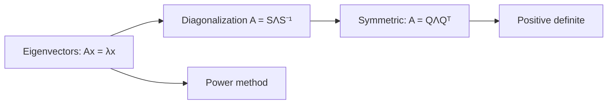
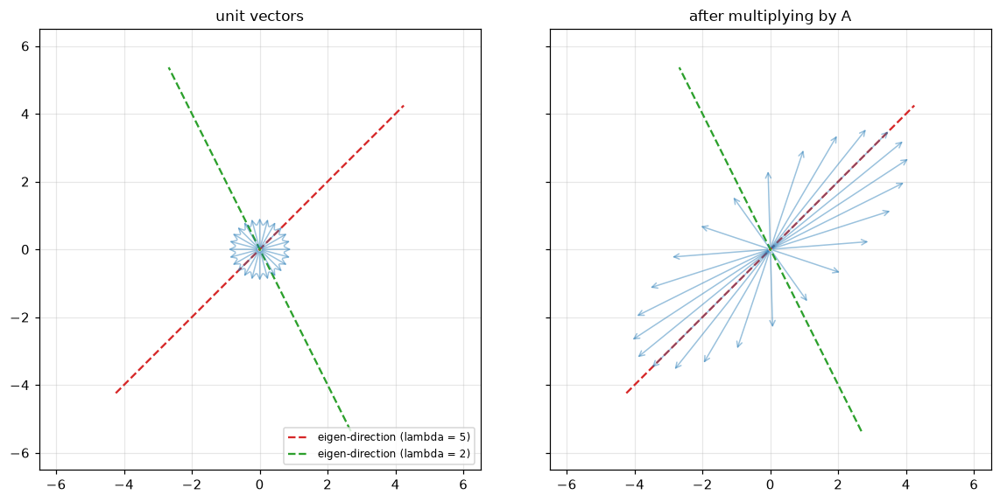
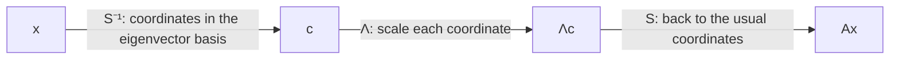
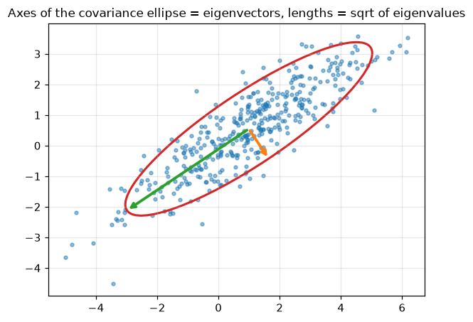
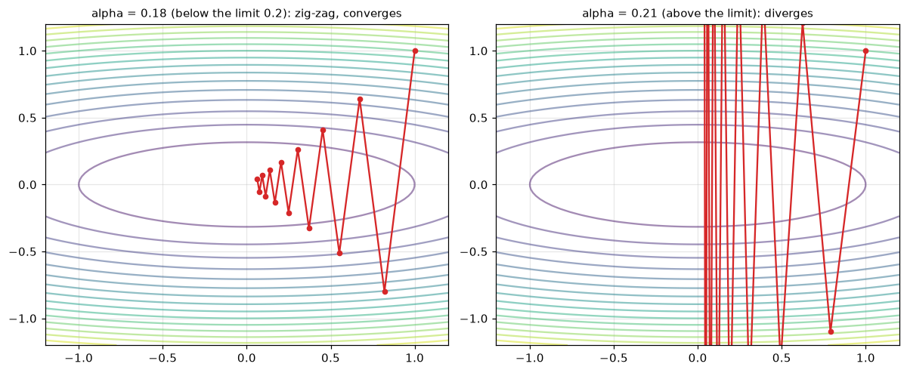

# Eigenvalues and Eigenvectors

**Course:** [Linear Algebra](../README.md) · **Hands-on:** [notebook.ipynb](notebook.ipynb) · **Practice:** [exercises](exercises/problems.md), [assignment](assignment.md)

Multiply a vector by a matrix and, usually, it turns and stretches at the same time. But every square matrix has a few special directions where it does something much simpler: the vector is only stretched, shrunk, or flipped, and stays on its own line. Those directions are the **eigenvectors**, and the stretch factors are the **eigenvalues**. They show how a matrix really behaves. They turn repeated multiplication into a one-line formula, they give the axes of a cloud of data, they decide whether a long chain of multiplications explodes or fades away, and they set the speed limit for gradient descent.

## Learning goals

By the end of this topic you can:

- explain what an eigenvector and an eigenvalue are, and find them for a small matrix from the characteristic equation $\det(A - \lambda I) = 0$;
- check eigenvalues with the trace and the determinant, and say what an eigenvalue of $0$ means;
- diagonalize a matrix, $A = S\Lambda S^{-1}$, compute $A^k$ with it, and recognize a matrix that cannot be diagonalized;
- state the spectral theorem for symmetric matrices and use $A = Q\Lambda Q^\top$;
- recognize a positive definite matrix by its eigenvalues;
- run the power method by hand, and say what controls how fast it converges;
- name where eigenvectors appear in AI/ML: PCA, PageRank, recurrent networks, and the step size of gradient descent.

## Prerequisites

- [Matrix Operations and LU Decomposition](../matrix-operations-and-lu-decomposition/README.md): the determinant, transposes, symmetric matrices, and powers $A^k$.
- [Orthogonality and Gram-Schmidt](../orthogonality-and-gram-schmidt/README.md): orthogonal matrices $Q$ with $Q^\top = Q^{-1}$.
- [Independence, Basis, and Dimension](../independence-basis-and-dimension/README.md) and [Vector Spaces and Subspaces](../vector-spaces-and-subspaces/README.md): independent vectors, bases, and the nullspace.
- [Projections and Least Squares](../projections-and-least-squares/README.md): projection matrices, and the symmetric matrix $A^\top A$.
- Basic Python and NumPy from [Python Basics](../../../getting-started/python-basics/README.md), only for the notebook.

## Outline

- [Notation at a glance](#notation-at-a-glance)
- [1. Eigenvalues and eigenvectors](#1-eigenvalues-and-eigenvectors)
- [2. Diagonalization, symmetric matrices, and positive definiteness](#2-diagonalization-symmetric-matrices-and-positive-definiteness)
- [3. Estimating eigenvalues: the power method](#3-estimating-eigenvalues-the-power-method)
- [The same ideas in NumPy](#the-same-ideas-in-numpy)
- [Common mistakes](#common-mistakes)
- [Why this matters for AI/ML](#why-this-matters-for-aiml)



> [!NOTE]
> **Concept ownership.** This topic teaches eigenvalues, eigenvectors, the characteristic equation, diagonalization, the spectral theorem for symmetric matrices, the basics of positive definiteness, and the power method in full. Later topics recap them and link back (see the [ownership map](../../../docs/design-notes.md)).

**What this topic leaves for later.**

| Question | Where it is answered |
|---|---|
| Why is an eigenvector basis natural, and how does a map look in a different basis? | [Linear transformations](../linear-transformations/README.md) |
| What replaces eigenvalues for matrices that are not square or not symmetric? | [Singular value decomposition](../singular-value-decomposition/README.md) |
| How do eigenvectors describe the long-run behaviour of a Markov chain? | [Markov chains and sampling](../../probability-and-statistics/markov-chains-and-sampling/README.md) |
| How is PCA built from eigenvectors in practice? | [Dimensionality reduction](../../../machine-learning/dimensionality-reduction/README.md) |

## Key intuition

### Notation at a glance

| You see | It means |
|---|---|
| $\lambda$ (lambda) | an eigenvalue: the factor by which an eigenvector is stretched |
| $\mathbf{x}$ with $A\mathbf{x} = \lambda\mathbf{x}$ | an eigenvector, always nonzero |
| $\det(A - \lambda I) = 0$ | the characteristic equation: its roots are the eigenvalues |
| $S$, $\Lambda$ | $S$ has the eigenvectors as columns; $\Lambda$ is the diagonal matrix of eigenvalues |
| $Q$ | orthonormal eigenvectors of a symmetric matrix, so $Q^\top = Q^{-1}$ |
| $\operatorname{tr}(A)$ | the trace: the sum of the diagonal entries |

### 1. Eigenvalues and eigenvectors

An **eigenvector** of a square matrix $A$ is a nonzero vector $\mathbf{x}$ such that $A\mathbf{x}$ is just a multiple of $\mathbf{x}$:

$$
A\mathbf{x} = \lambda\mathbf{x}.
$$

The number $\lambda$ is the **eigenvalue**. If $\lambda = 2$, the vector is doubled; if $\lambda = -1$ it is flipped; if $\lambda = 0$ it is sent to zero. Take $`A = \begin{bmatrix} 4 & 1 \\ 2 & 3 \end{bmatrix}`$. Then $A(1,1) = (5,5) = 5\,(1,1)$, and $A(1,-2) = (2,-4) = 2\,(1,-2)$. So $(1,1)$ is an eigenvector with eigenvalue $5$, and $(1,-2)$ is an eigenvector with eigenvalue $2$. Almost every other vector gets turned: $A(1,0) = (4,2)$ is not a multiple of $(1,0)$.



*Left: unit vectors in every direction. Right: after multiplying by $A$, almost every arrow has turned. The arrows along the red dashed line were multiplied by $5$, and those along the green dashed line by $2$, and they stayed on their lines.*

**Finding eigenvalues: the characteristic equation.** The equation $A\mathbf{x} = \lambda\mathbf{x}$ says $(A - \lambda I)\mathbf{x} = \mathbf{0}$ has a nonzero solution. That happens exactly when $A - \lambda I$ is singular, so

$$
\det(A - \lambda I) = 0.
$$

For the example, $`\det\begin{bmatrix} 4-\lambda & 1 \\ 2 & 3-\lambda \end{bmatrix} = (4-\lambda)(3-\lambda) - 2 = \lambda^2 - 7\lambda + 10 = (\lambda - 5)(\lambda - 2)`$, so $\lambda = 5$ or $\lambda = 2$.

**Finding eigenvectors.** For each eigenvalue, the eigenvectors are the **nullspace** of $A - \lambda I$ (the topic on subspaces comes back here). For $\lambda = 5$, the matrix $A - 5I$ has rows $(-1, 1)$ and $(2, -2)$, whose nullspace is spanned by $(1,1)$. For $\lambda = 2$, the rows of $A - 2I$ are $(2,1)$ and $(2,1)$, with nullspace spanned by $(1,-2)$. Any nonzero multiple of an eigenvector is also an eigenvector.

**A 3 by 3 example.** For a **triangular** matrix, the eigenvalues are the diagonal entries, because $\det(A - \lambda I)$ is the product of the diagonal terms $(a_{ii} - \lambda)$. For example, the matrix with rows $(2,1,4)$, $(0,3,5)$, $(0,0,6)$ has eigenvalues $2$, $3$, $6$. A non-triangular case: let $B$ have rows $(2,1,0)$, $(1,3,1)$, $(0,1,2)$. Expanding the determinant along the first row gives $\det(B - \lambda I) = (2-\lambda)\big[(3-\lambda)(2-\lambda) - 1\big] - (2 - \lambda) = (2-\lambda)(\lambda^2 - 5\lambda + 4) = (2-\lambda)(\lambda-1)(\lambda-4)$. The eigenvalues are $1$, $2$, $4$, with eigenvectors $(1,-1,1)$, $(1,0,-1)$, $(1,2,1)$. Check the last one: $B(1,2,1) = (4, 8, 4) = 4\,(1,2,1)$.

**Two quick checks.** The eigenvalues add up to the **trace** and multiply to the **determinant**:

$$
\lambda_1 + \dots + \lambda_n = a_{11} + \dots + a_{nn}, \qquad \lambda_1\cdots\lambda_n = \det A.
$$

For $A$ above: $5 + 2 = 7 = 4 + 3$ and $5\cdot 2 = 10 = 4\cdot 3 - 1\cdot 2$. For $B$: $1 + 2 + 4 = 7 = 2 + 3 + 2$ and $1\cdot2\cdot4 = 8 = \det B$. These are handy for catching arithmetic slips.

**What the eigenvalues tell you.**

- **Eigenvalue $0$ means singular.** $A\mathbf{x} = 0\cdot\mathbf{x} = \mathbf{0}$ has a nonzero solution, so the nullspace is nontrivial. Equivalently, the determinant (the product of the eigenvalues) is $0$.
- **Related matrices.** If $A\mathbf{x} = \lambda\mathbf{x}$, then $A^k\mathbf{x} = \lambda^k\mathbf{x}$, $A^{-1}\mathbf{x} = \lambda^{-1}\mathbf{x}$ (when $\lambda \ne 0$), and $(A + cI)\mathbf{x} = (\lambda + c)\mathbf{x}$. The eigenvectors stay the same, and only the eigenvalues change.
- **Projections** have eigenvalues $1$ (vectors already in the subspace) and $0$ (vectors perpendicular to it). For the line projection onto $(3,4)$ from the last topic, $(3,4)$ has eigenvalue $1$ and $(-4,3)$ has eigenvalue $0$.
- **Rotations** turn every vector, so no real direction stays put. A rotation by $90^\circ$ has the **complex** eigenvalues $i$ and $-i$ (imaginary numbers appear as conjugate pairs). The eigenvalues of a rotation by angle $\theta$ are $\cos\theta \pm i\sin\theta$, which have absolute value $1$ because rotations keep lengths.
- **Repeated eigenvalues.** The identity matrix has the eigenvalue $1$ twice, and every vector is an eigenvector. The matrix with rows $(2,1)$ and $(0,2)$ also has the eigenvalue $2$ twice, but its only eigenvectors are multiples of $(1,0)$. The number of independent eigenvectors can be smaller than the number of eigenvalues, which matters in the next section.

**Check yourself**

1. A $2 \times 2$ matrix has trace $6$ and determinant $8$. What are its eigenvalues?
2. $A$ has an eigenvector $\mathbf{x}$ with eigenvalue $5$. What are $A^2\mathbf{x}$ and $A^{-1}\mathbf{x}$?

<details>
<summary>Answers</summary>

1. The characteristic equation is $\lambda^2 - 6\lambda + 8 = 0$, so $\lambda = 2$ and $\lambda = 4$.
2. $A^2\mathbf{x} = 25\,\mathbf{x}$ and $A^{-1}\mathbf{x} = \tfrac15\,\mathbf{x}$.

</details>

### 2. Diagonalization, symmetric matrices, and positive definiteness

**Diagonalization.** Put the eigenvectors of $A$ as the columns of a matrix $S$, and the eigenvalues on the diagonal of $\Lambda$. The equations $A\mathbf{x}_i = \lambda_i\mathbf{x}_i$ for all columns at once say $AS = S\Lambda$. If the $n$ eigenvectors are **independent**, $S$ is invertible, and

$$
A = S\Lambda S^{-1}.
$$

Why does this make sense? Read $S\Lambda S^{-1}\mathbf{x}$ from right to left: $S^{-1}$ converts $\mathbf{x}$ to coordinates in the basis of eigenvectors, $\Lambda$ scales each coordinate by its eigenvalue, and $S$ converts back. In the eigenvector basis, $A$ is just a stretch along each axis.



For $`A = \begin{bmatrix} 4 & 1 \\ 2 & 3 \end{bmatrix}`$ we have $`S = \begin{bmatrix} 1 & 1 \\ 1 & -2 \end{bmatrix}`$ (columns $(1,1)$ and $(1,-2)$) and $`\Lambda = \begin{bmatrix} 5 & 0 \\ 0 & 2 \end{bmatrix}`$.

**Powers.** The payoff is that $A^k = S\Lambda S^{-1}S\Lambda S^{-1}\cdots = S\Lambda^k S^{-1}$, and $\Lambda^k$ just raises the diagonal numbers to the power $k$. For $k = 5$ the diagonal is $5^5 = 3125$ and $2^5 = 32$, and multiplying out $S\Lambda^5S^{-1}$ gives

```math
A^5 = \begin{bmatrix} 2094 & 1031 \\ 2062 & 1063 \end{bmatrix}.
```

The long-run behaviour is visible without computing anything: as $k$ grows, $5^k$ dwarfs $2^k$, so $A^k$ is dominated by the eigenvalue $5$. A famous case is the Fibonacci numbers: the pair $(F_{k+1}, F_k)$ is multiplied by the matrix with rows $(1,1)$ and $(1,0)$ at each step. Its eigenvalues are $\varphi = (1+\sqrt5)/2 \approx 1.618$ and $-0.618$, so $F_k$ grows like $\varphi^k/\sqrt5$.

**Distinct eigenvalues give independent eigenvectors.** If $\mathbf{x}_1$ and $\mathbf{x}_2$ have different eigenvalues and $c_1\mathbf{x}_1 + c_2\mathbf{x}_2 = \mathbf{0}$, apply $A$ to get $c_1\lambda_1\mathbf{x}_1 + c_2\lambda_2\mathbf{x}_2 = \mathbf{0}$, and subtract $\lambda_2$ times the first equation: $c_1(\lambda_1 - \lambda_2)\mathbf{x}_1 = \mathbf{0}$. So $c_1 = 0$, and then $c_2 = 0$. Hence a matrix with $n$ different eigenvalues is always diagonalizable.

**When diagonalization fails.** The matrix $D$ with rows $(2,1)$ and $(0,2)$ has $\lambda = 2$ twice. But $D - 2I$ has rows $(0,1)$ and $(0,0)$, with a nullspace of dimension $1$. There is only one independent eigenvector, so there is no invertible $S$. Such a matrix is called **defective**. Software like `np.linalg.eig` still returns two columns, but they are almost parallel, which shows up as a huge condition number for $S$.

**The symmetric case.** Symmetric matrices ($A = A^\top$) are the nicest. Their eigenvalues are real and their eigenvectors can be chosen **orthogonal**. Here is why eigenvectors for different eigenvalues are orthogonal: if $A\mathbf{x} = \lambda\mathbf{x}$ and $A\mathbf{y} = \mu\mathbf{y}$, then $\mathbf{x}^\top A\mathbf{y} = \mu\,\mathbf{x}^\top\mathbf{y}$, and also $\mathbf{x}^\top A\mathbf{y} = (A\mathbf{x})^\top\mathbf{y} = \lambda\,\mathbf{x}^\top\mathbf{y}$ (using $A^\top = A$). So $(\lambda - \mu)\,\mathbf{x}^\top\mathbf{y} = 0$, and $\lambda \ne \mu$ forces $\mathbf{x}^\top\mathbf{y} = 0$. Scale the eigenvectors to length $1$ and you get an orthogonal matrix $Q$. This is the **spectral theorem**:

$$
A = Q\Lambda Q^\top, \qquad Q^\top Q = I.
$$

No inverse is needed, since $Q^{-1} = Q^\top$. For $`C = \begin{bmatrix} 2 & 1 \\ 1 & 2 \end{bmatrix}`$, the eigenvalues are $3$ and $1$ with unit eigenvectors $\mathbf{q}_1 = (1,1)/\sqrt2$ and $\mathbf{q}_2 = (1,-1)/\sqrt2$. Multiplying out gives $C = 3\,\mathbf{q}_1\mathbf{q}_1^\top + 1\,\mathbf{q}_2\mathbf{q}_2^\top$: a symmetric matrix is a sum of projection matrices onto perpendicular lines, each scaled by its eigenvalue.

**Positive definite matrices.** A symmetric matrix is **positive definite** if all its eigenvalues are positive. An equivalent statement is that $\mathbf{x}^\top A\mathbf{x} > 0$ for every nonzero $\mathbf{x}$. (Writing $\mathbf{x} = \sum c_i\mathbf{q}_i$ gives $\mathbf{x}^\top A\mathbf{x} = \sum \lambda_i c_i^2$, which is positive for all $c$ exactly when every $\lambda_i$ is.) If the eigenvalues are only $\ge 0$, the matrix is **positive semidefinite**. For any matrix $M$, the product $M^\top M$ is positive semidefinite, since $\mathbf{x}^\top M^\top M\mathbf{x} = \|M\mathbf{x}\|^2 \ge 0$, and it is positive definite when the columns of $M$ are independent. The example $C$ has eigenvalues $3$ and $1$, so it is positive definite. The matrix with rows $(1,2)$ and $(2,1)$ has eigenvalues $3$ and $-1$, so it is not. These matrices matter in ML because covariance matrices are positive semidefinite, and a loss function whose curvature matrix is positive definite has a bowl-shaped minimum.

**Check yourself**

1. Can $`\begin{bmatrix} 3 & 1 \\ 0 & 3 \end{bmatrix}`$ be diagonalized? Why or why not?
2. A symmetric matrix has eigenvalues $3$ and $-1$. Is it positive definite? Give a vector $\mathbf{x}$ with $\mathbf{x}^\top A\mathbf{x} < 0$.

<details>
<summary>Answers</summary>

1. No. The eigenvalue $3$ is repeated, but the matrix minus $3I$ has rank $1$, so there is only one independent eigenvector: the matrix is defective.
2. No, because one eigenvalue is negative. Take $\mathbf{x}$ to be a unit eigenvector for $-1$: then $\mathbf{x}^\top A\mathbf{x} = -1 < 0$.

</details>

### 3. Estimating eigenvalues: the power method

For large matrices, nobody solves the characteristic equation. A simple alternative is the **power method**: pick a starting vector, multiply by $A$, normalize, and repeat.

```text
v = starting vector (any nonzero vector), scaled to length 1
repeat:
    w = A v
    v = w / length of w          (keep v at length 1)
    estimate = v . (A v)         (the Rayleigh quotient)
until v stops changing
```

**Why it works.** Write the starting vector in the eigenvector basis: $\mathbf{v}_0 = c_1\mathbf{x}_1 + c_2\mathbf{x}_2 + \dots$. After $k$ multiplications, $A^k\mathbf{v}_0 = c_1\lambda_1^k\mathbf{x}_1 + c_2\lambda_2^k\mathbf{x}_2 + \dots$. If $|\lambda_1|$ is the largest eigenvalue (the **dominant** one), its term outgrows the others, and the normalized vector turns toward $\mathbf{x}_1$. Factor out $\lambda_1^k$: the other terms are multiplied by $(\lambda_i/\lambda_1)^k$, so the error shrinks roughly like $|\lambda_2/\lambda_1|^k$. That ratio controls the speed. If it is $0.4$, each step cuts the error by about $60\%$. If it is $0.99$, convergence crawls.

**The assumptions.** The method needs $|\lambda_1| > |\lambda_2|$ (a strictly dominant eigenvalue) and a starting vector with $c_1 \ne 0$, meaning it is not exactly perpendicular to the dominant eigenvector. A random start almost always works.

**Reading off the eigenvalue.** Once $\mathbf{v}$ is close to an eigenvector, $\mathbf{v}^\top A\mathbf{v} \approx \lambda_1\,\mathbf{v}^\top\mathbf{v} = \lambda_1$ for a unit vector. This is the **Rayleigh quotient**. For $`A = \begin{bmatrix} 4 & 1 \\ 2 & 3 \end{bmatrix}`$, the ratio is $2/5 = 0.4$, so a handful of steps gives several correct digits.

Variations, in one sentence each: **inverse iteration** applies the power method to $A^{-1}$ to find the smallest eigenvalue, and **shifts** apply it to $(A - \sigma I)^{-1}$ to find the eigenvalue closest to $\sigma$. Production libraries use the **QR algorithm** (repeated QR factorizations) behind `numpy.linalg.eig`, and `numpy.linalg.eigh` for symmetric matrices. Finding eigenvalues as roots of the characteristic polynomial is not done in practice: there is no general formula for the roots of a polynomial of degree five or more, and the root-finding is numerically unreliable.

**Check yourself**

1. In the power method, what goes wrong if $\mathbf{v}_0$ is exactly an eigenvector for the *second* eigenvalue?
2. With $|\lambda_2/\lambda_1| = 0.4$, about how many steps cut the error by a factor of $1000$?

<details>
<summary>Answers</summary>

1. The component along the dominant eigenvector is zero ($c_1 = 0$), so the iteration stays on the second eigenvector and never finds the dominant one. In practice, rounding errors or a random start usually rescue it.
2. We need $0.4^k \le 10^{-3}$, and $0.4^8 \approx 6.6\times10^{-4}$, so about $8$ steps.

</details>

### The same ideas in NumPy

Eigenvalues and eigenvectors, with the checks:

```python
import numpy as np

A = np.array([[4.0, 1.0],
              [2.0, 3.0]])
eigenvalues, S = np.linalg.eig(A)                # the columns of S are the eigenvectors
print(eigenvalues)
for lam, v in zip(eigenvalues, S.T):
    print(np.allclose(A @ v, lam * v))
print(eigenvalues.sum(), np.trace(A), round(eigenvalues.prod(), 6), round(np.linalg.det(A), 6))
```

```text
[5. 2.]
True
True
7.0 7.0 10.0 10.0
```

Diagonalization and powers, on the `A`, `eigenvalues`, and `S` from the block above:

```python
Lam = np.diag(eigenvalues)
print(np.allclose(S @ Lam @ np.linalg.inv(S), A))
A5 = S @ np.diag(eigenvalues ** 5) @ np.linalg.inv(S)
print(A5.round(6))
print(np.allclose(A5, np.linalg.matrix_power(A, 5)))
```

```text
True
[[2094. 1031.]
 [2062. 1063.]]
True
```

A symmetric matrix with `eigh`:

```python
C = np.array([[2.0, 1.0],
              [1.0, 2.0]])
w, Q = np.linalg.eigh(C)                         # real, ascending eigenvalues; orthonormal eigenvectors
print(w)
print(np.allclose(Q.T @ Q, np.eye(2)), np.allclose(Q @ np.diag(w) @ Q.T, C))
```

```text
[1. 3.]
True True
```

The power method, on the `A` from the first block:

```python
def power_method(A, v0, steps):
    """Multiply by A and normalize, many times. Returns the vector and the Rayleigh estimate."""
    v = v0 / np.linalg.norm(v0)
    for _ in range(steps):
        v = A @ v
        v = v / np.linalg.norm(v)
    return v, v @ A @ v


for steps in (1, 3, 6, 12):
    v, estimate = power_method(A, np.array([1.0, 0.0]), steps)
    print(steps, v.round(4), round(estimate, 6))
```

```text
1 [0.8944 0.4472] 5.0
3 [0.7407 0.6718] 5.041543
6 [0.7093 0.7049] 5.003047
12 [0.7071 0.7071] 5.000013
```

## Common mistakes

- **Allowing the zero vector.** Eigenvectors are nonzero by definition. The zero vector satisfies $A\mathbf{x} = \lambda\mathbf{x}$ for every $\lambda$ and says nothing.
- **Forgetting that eigenvectors are only defined up to scale.** $(1,1)$, $(2,2)$, and $(-3,-3)$ are the same eigenvector. Software normalizes to length $1$, and the sign is arbitrary.
- **Assuming every matrix is diagonalizable.** A repeated eigenvalue can come with too few eigenvectors. Check that you have $n$ independent ones.
- **Using `eig` for symmetric matrices.** Use `eigh`. It is faster, returns real values, sorts them, and gives exactly orthogonal eigenvectors.
- **Expecting real eigenvalues from a rotation, or from any non-symmetric matrix.** Non-symmetric matrices can have complex eigenvalues. Only symmetric matrices are guaranteed real ones.
- **Mixing up the roles of $S$ and $S^{-1}$.** In $A = S\Lambda S^{-1}$ the eigenvector matrix is on the **left**, and $S^{-1}$ on the right.

## Why this matters for AI/ML

- **PCA is an eigen-decomposition.** For data with its mean subtracted, the covariance matrix is symmetric and positive semidefinite. Its eigenvectors are the principal axes of the cloud of data, and its eigenvalues are the variances along them. The picture is an ellipse: the axes point along the eigenvectors, and their lengths are proportional to the square roots of the eigenvalues. Keeping only the top few axes compresses the data. See [dimensionality reduction](../../../machine-learning/dimensionality-reduction/README.md).



*The eigenvectors of the covariance matrix give the axes of the cloud (long arrow: largest eigenvalue). The notebook computes this with `eigh`.*

- **PageRank is the power method.** The "random surfer" matrix of a web of pages has a dominant eigenvalue $1$, and its eigenvector scores each page. Repeated multiplication, the power method, finds it without ever solving a characteristic equation. The notebook runs it on six invented pages.
- **Stability of recurrent networks.** A recurrent network applies the same weight matrix $W$ at every time step. If the largest eigenvalue magnitude of $W$ is above $1$, signals tend to explode over many steps, and if all are below $1$ they fade, which is the exploding and vanishing gradient problem. Real networks have nonlinearities that change the story, so treat the eigenvalues as a guide, not a guarantee. See [recurrent networks](../../../deep-learning/recurrent-networks/README.md).
- **The speed limit of gradient descent.** Near a minimum, a loss looks like a bowl whose curvature is described by a symmetric matrix $H$ (the Hessian). Gradient descent with a fixed step $\alpha$ is stable only when $\alpha < 2/\lambda_{\max}$, and when the eigenvalues are very different (a long, narrow valley), the small-eigenvalue directions converge slowly. The ratio $\lambda_{\max}/\lambda_{\min}$ is the **condition number**. See [multivariable calculus](../../calculus-and-optimization/multivariable-calculus/README.md) and [gradient descent and its variants](../../calculus-and-optimization/gradient-descent-and-its-variants/README.md).



*On a bowl with eigenvalues $1$ and $10$, the limit is $2/10 = 0.2$. A step of $0.18$ zig-zags toward the minimum. A step of $0.21$ makes the iterates grow.*

- **Graphs.** The eigenvectors of a matrix built from a graph (the graph Laplacian) split it into clusters, which is the idea behind spectral clustering and one view of graph neural networks. See [clustering](../../../machine-learning/clustering/README.md) and [graph neural networks](../../../deep-learning/graph-neural-networks/README.md).
- **Markov chains.** The long-run distribution of a Markov chain is an eigenvector with eigenvalue $1$ of its transition matrix, as in [Markov chains and sampling](../../probability-and-statistics/markov-chains-and-sampling/README.md).

### Reading the output of `eig` and `eigh`

A few habits keep eigenvalue code honest. For a symmetric matrix, such as a covariance matrix, use `eigh`: it returns real eigenvalues in ascending order and orthonormal eigenvectors as columns. `eig` makes no promise about the order, may return complex numbers (check the data type), and for a defective matrix returns eigenvectors that are almost parallel, with a huge condition number for `S`. Signs are arbitrary: an eigenvector and its negative are equally valid, so do not compare eigenvectors from two runs without allowing for a sign flip. A short example on a covariance matrix of seeded random data:

```python
rng = np.random.default_rng(0)
data = rng.normal(size=(500, 2)) @ np.array([[2.0, 0.0], [1.2, 0.7]])
cov = np.cov(data.T)                              # symmetric and positive semidefinite
w, V = np.linalg.eigh(cov)
print(w)                                          # variances along the principal axes, ascending
print(np.allclose(V.T @ V, np.eye(2)), bool(np.all(w > 0)))
print(np.allclose(V @ np.diag(w) @ V.T, cov))
```

```text
[0.33092339 5.39280872]
True True
True
```

The eigenvalues are positive, as they must be for a positive definite covariance matrix, and the reconstruction $V\,\mathrm{diag}(w)\,V^\top$ equals the covariance up to rounding. As always, check such identities with `np.allclose`, never `==`.

## Summary

- An eigenvector keeps its direction under $A$: $A\mathbf{x} = \lambda\mathbf{x}$. The eigenvalues solve $\det(A - \lambda I) = 0$, add up to the trace, and multiply to the determinant. The eigenvectors for $\lambda$ are the nullspace of $A - \lambda I$.
- Eigenvalue $0$ means singular. Rotations have complex eigenvalues. Eigenvalues of $A^k$, $A^{-1}$, and $A + cI$ follow from those of $A$.
- If there are $n$ independent eigenvectors, $A = S\Lambda S^{-1}$ and $A^k = S\Lambda^kS^{-1}$. Distinct eigenvalues guarantee diagonalizability; repeated ones may not.
- A symmetric matrix has real eigenvalues and orthogonal eigenvectors, $A = Q\Lambda Q^\top$. It is positive definite when all eigenvalues are positive, and $M^\top M$ is always positive semidefinite.
- The power method finds the dominant eigenvector, at a speed set by $|\lambda_2/\lambda_1|$. Libraries use the QR algorithm instead.

## Further reading

Chapter pointers and free links are in [resources.md](resources.md).

## Practice

- [Notebook](notebook.ipynb): watch a matrix act on a circle of vectors, compute eigenvalues and check the trace and determinant, diagonalize and use it for powers and Fibonacci, meet a defective matrix, verify the spectral theorem, test positive definiteness, write the power method, and see eigenvectors in a covariance ellipse, a tiny PageRank, and gradient descent. It follows the lesson:

  | Lesson section | Notebook section |
  |---|---|
  | 1. Eigenvalues and eigenvectors | 1. A matrix acts on a circle of vectors, 2. The characteristic equation, 3. Eigenvectors are the nullspace of A - lambda I, 4. A rotation has no real eigenvectors |
  | 2. Diagonalization, symmetric matrices, positive definiteness | 5. Diagonalization and powers, 6. When diagonalization fails, 7. The spectral theorem, 8. Positive definite matrices |
  | 3. The power method | 9. The power method |
  | Why this matters for AI/ML | 10. Covariance eigenvectors give the axes of the data, 11. PageRank, 12. Gradient descent on a quadratic |

- [Exercises](exercises/problems.md) (with [solutions](exercises/solutions.md)): ten problems, easy to harder.
- [Assignment](assignment.md): find the principal axes of a small 2D dataset by hand and with `eigh`, and then with the power method.

---

[← Previous: Projections and Least Squares](../projections-and-least-squares/README.md) | [Next: Linear Transformations →](../linear-transformations/README.md)
