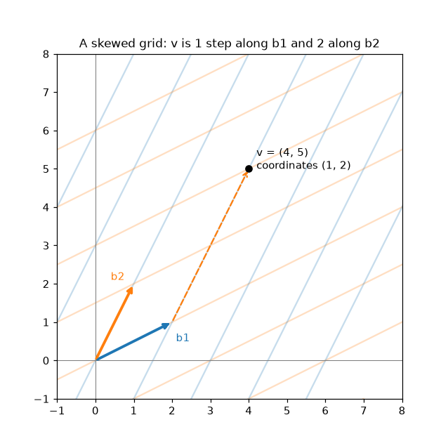
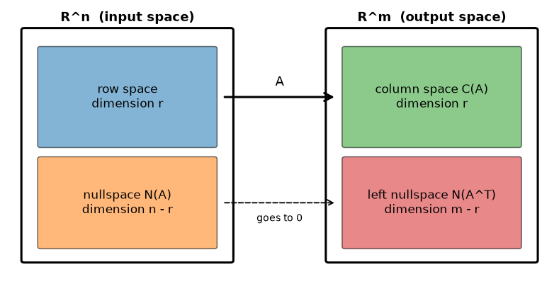

# Independence, Basis, and Dimension

**Course:** [Linear Algebra](../README.md) · **Hands-on:** [notebook.ipynb](notebook.ipynb) · **Practice:** [exercises](exercises/problems.md), [assignment](assignment.md)

A list of vectors can contain more than it needs. Take $(1,0)$, $(0,1)$, and $(3,5)$ in the plane: the third one adds nothing, because it is already a combination of the first two. This topic gives that idea a precise form. **Independence** says no vector in a list is wasted, a **basis** is a list with no waste that still reaches everything, and the **dimension** counts the vectors in a basis. With these three ideas we can finally state the whole structure that every matrix carries: **four subspaces** whose dimensions always add up in the same neat way.

## Learning goals

By the end of this topic you can:

- decide whether a set of vectors is independent, using the definition and the matrix test (rank, or the nullspace);
- describe the span of a set of vectors as a line, a plane, or a whole space, and say why more than $m$ vectors in $\mathbb{R}^m$ are always dependent;
- check that a set is a basis, find the coordinates of a vector relative to a basis, and say what dimension means;
- extract a basis for a column space (and for a span) from the pivot columns;
- name the four fundamental subspaces of a matrix, give their dimensions $r$, $n - r$, $r$, $m - r$, and find a basis for each;
- use rank-nullity, $r + (n - r) = n$, and explain why a narrow bottleneck or a low-rank factor limits a linear map.

## Prerequisites

- [Vector Spaces and Subspaces](../vector-spaces-and-subspaces/README.md): subspaces, the column space $C(A)$, the nullspace $N(A)$, the reduced row echelon form $R$, pivot and free columns, special solutions, and the number of pivots as the rank. We recap these in a line and build on them.
- [Linear Equations and Gaussian Elimination](../linear-equations-and-gaussian-elimination/README.md) and [Matrix Operations and LU Decomposition](../matrix-operations-and-lu-decomposition/README.md): elimination, and the rule $(AB)^\top = B^\top A^\top$.
- Basic Python and NumPy from [Python Basics](../../../getting-started/python-basics/README.md), only for the notebook.

## Outline

- [Notation at a glance](#notation-at-a-glance)
- [1. Independence and span](#1-independence-and-span)
- [2. Basis and dimension](#2-basis-and-dimension)
- [3. Rank and the four fundamental subspaces](#3-rank-and-the-four-fundamental-subspaces)
- [The same ideas in NumPy](#the-same-ideas-in-numpy)
- [Common mistakes](#common-mistakes)
- [Why this matters for AI/ML](#why-this-matters-for-aiml)


> [!NOTE]
> **Concept ownership.** This topic teaches linear independence, span, basis, dimension, rank, the four fundamental subspaces, and rank-nullity in full. Later topics recap them and link back (see the [ownership map](../../../docs/design-notes.md)).

**What this topic leaves for later.**

| Question | Where it is answered |
|---|---|
| When are two subspaces perpendicular, and what is an orthogonal complement? How do we build a nice perpendicular basis? | [Orthogonality and Gram-Schmidt](../orthogonality-and-gram-schmidt/README.md) |
| What is the matrix of a linear map in a basis other than the standard one, and how do coordinates change when the basis changes? | [Linear transformations](../linear-transformations/README.md) |
| What is a basis made of special vectors that a matrix only stretches? | [Eigenvalues and eigenvectors](../eigenvalues-and-eigenvectors/README.md) |
| What bases does the SVD give for the four subspaces? | [Singular value decomposition](../singular-value-decomposition/README.md) |

## Key intuition

### Notation at a glance

| You see | It means |
|---|---|
| $\mathbf{v}_1, \dots, \mathbf{v}_k$ | a list of vectors; $c_1\mathbf{v}_1 + \dots + c_k\mathbf{v}_k$ is a combination of them |
| span | the set of all combinations of the list |
| $\dim S$ | the dimension of a subspace $S$: the number of vectors in any basis of $S$ |
| $r$ | the rank of $A$, now defined precisely as the dimension of the column space |
| $C(A^\top)$ | the **row space**: all combinations of the rows of $A$ |
| $N(A^\top)$ | the **left nullspace**: all $\mathbf{y}$ with $\mathbf{y}^\top A = \mathbf{0}$ |

### 1. Independence and span

Vectors $\mathbf{v}_1, \dots, \mathbf{v}_k$ are **independent** if the only combination that gives the zero vector is the trivial one, with every coefficient $0$:

$$
c_1\mathbf{v}_1 + c_2\mathbf{v}_2 + \dots + c_k\mathbf{v}_k = \mathbf{0} \quad\Longrightarrow\quad c_1 = c_2 = \dots = c_k = 0.
$$

If some nontrivial combination gives $\mathbf{0}$, the vectors are **dependent**, which is the same as saying that one of them is a combination of the others. Examples:

- $(1,0)$ and $(0,1)$ are independent: $c_1(1,0) + c_2(0,1) = (c_1, c_2)$ is zero only when both are zero.
- $(1,2)$ and $(2,4)$ are dependent: $2\,(1,2) - 1\,(2,4) = \mathbf{0}$. They lie on the same line.
- $(1,0,0)$, $(0,1,0)$, and $(1,1,0)$ are dependent: the third is the sum of the first two. All three lie in the $xy$-plane.

**The matrix test.** Put the vectors in the columns of a matrix $A$. A combination of the columns is $A\mathbf{x}$, so the vectors are independent exactly when $A\mathbf{x} = \mathbf{0}$ has only the solution $\mathbf{x} = \mathbf{0}$. In the language of the last topic:

> The columns of $A$ are independent $\iff$ $N(A) = \{\mathbf{0}\}$ $\iff$ there are no free columns $\iff$ the rank equals the number of columns.

For example, take $\mathbf{v}_1 = (1,2,1)$, $\mathbf{v}_2 = (0,1,1)$, $\mathbf{v}_3 = (1,3,2)$ as the columns of
```math
A = \begin{bmatrix} 1 & 0 & 1 \\ 2 & 1 & 3 \\ 1 & 1 & 2 \end{bmatrix}.
```
Row 2 minus $2\times$ row 1 gives $(0,1,1)$, row 3 minus row 1 gives $(0,1,1)$, and row 3 minus row 2 gives zeros. There are two pivots and one free column, so the rank is $2 < 3$ and the columns are dependent. The special solution is $\mathbf{x} = (-1, -1, 1)$, which says $-\mathbf{v}_1 - \mathbf{v}_2 + \mathbf{v}_3 = \mathbf{0}$: indeed $\mathbf{v}_3 = \mathbf{v}_1 + \mathbf{v}_2$.

**Too many vectors.** Suppose you have $k > m$ vectors in $\mathbb{R}^m$. The matrix with those columns is $m \times k$, so its rank is at most $m$, which is less than $k$. There must be a free column, so **more than $m$ vectors in $\mathbb{R}^m$ are always dependent**. Three vectors in the plane can never be independent.

**Span.** The **span** of a list of vectors is the set of all their combinations. It is always a subspace, and for the columns of a matrix it is exactly the column space $C(A)$. One nonzero vector spans a line through the origin, two independent vectors span a plane, and three independent vectors in $\mathbb{R}^3$ span the whole space. A dependent vector adds nothing to the span: $(1,0,0)$, $(0,1,0)$, $(1,1,0)$ span only the $xy$-plane, even though there are three of them.

**Check yourself**

1. Are $(1,3)$ and $(2,5)$ independent? What about $(1,3)$, $(2,5)$, and $(7,1)$?
2. What is the span of $(1,2,3)$ and $(2,4,6)$?

<details>
<summary>Answers</summary>

1. The first pair is independent: the matrix with these columns has rows $(1,2)$ and $(3,5)$, and row 2 minus $3\times$ row 1 gives $(0,-1)$, so there are two pivots. The triple is dependent, because three vectors in $\mathbb{R}^2$ always are.
2. The second vector is twice the first, so the span is just the line through the origin in the direction $(1,2,3)$.

</details>

### 2. Basis and dimension

A **basis** for a space is a list of vectors that is **independent** and **spans** the space. Independence means nothing is wasted, and spanning means nothing is missing. The standard basis of $\mathbb{R}^3$ is $(1,0,0)$, $(0,1,0)$, $(0,0,1)$, but there are many others. A basis of $\mathbb{R}^2$ is any two independent vectors, such as $(1,1)$ and $(1,-1)$.

**Coordinates.** Relative to a basis, every vector has **exactly one** set of coordinates, the combination that builds it. With the basis $\mathbf{b}_1 = (1,1)$, $\mathbf{b}_2 = (1,-1)$ and the vector $\mathbf{v} = (5,1)$, solve $c_1\mathbf{b}_1 + c_2\mathbf{b}_2 = \mathbf{v}$:
$c_1 + c_2 = 5$ and $c_1 - c_2 = 1$, so $c_1 = 3$ and $c_2 = 2$. The same point has coordinates $(5,1)$ in the standard basis and $(3,2)$ in this one: a different grid, the same point. In matrix form, with the basis vectors as the columns of $B$, the coordinates solve $B\mathbf{c} = \mathbf{v}$, which has exactly one solution because the columns are independent and the matrix is square. How coordinates and matrices change when the basis changes is the subject of [linear transformations](../linear-transformations/README.md).

**Dimension.** All bases of a space contain the same number of vectors, and that number is the space's **dimension**. The intuition: if one basis has $k$ vectors, every vector in the space is described by $k$ coordinates, so any list of more than $k$ vectors from the space becomes a list of more than $k$ vectors in $\mathbb{R}^k$, which must be dependent, so it cannot be a basis. Examples: $\dim \mathbb{R}^n = n$, a line through the origin has dimension $1$, a plane has dimension $2$, and the zero space has dimension $0$.

Dimension is **not** the number of entries in a vector. The plane $z = x + y$ in $\mathbb{R}^3$ is made of vectors with three entries, but its dimension is $2$: it has two free directions, for example $(1,0,1)$ and $(0,1,1)$.

**Finding a basis.** To get a basis for the span of some vectors, make them the columns of a matrix and row reduce. **The pivot columns of the original matrix** form a basis for the column space. (The pivot columns of $R$ do not, since row operations change the columns. What row operations preserve is which columns depend on which.) Here is a worked example. Four vectors in $\mathbb{R}^3$:
$\mathbf{v}_1 = (1,2,1)$, $\mathbf{v}_2 = (2,4,2)$, $\mathbf{v}_3 = (0,1,1)$, $\mathbf{v}_4 = (1,3,2)$. As columns, row reduction gives

```math
\begin{bmatrix} 1 & 2 & 0 & 1 \\ 2 & 4 & 1 & 3 \\ 1 & 2 & 1 & 2 \end{bmatrix}
\;\longrightarrow\;
R = \begin{bmatrix} 1 & 2 & 0 & 1 \\ 0 & 0 & 1 & 1 \\ 0 & 0 & 0 & 0 \end{bmatrix}.
```

The pivot columns are columns $1$ and $3$, so $\mathbf{v}_1$ and $\mathbf{v}_3$ form a basis for the span, which has dimension $2$. The free columns of $R$ give the recipes for the other two vectors: column 2 of $R$ is $2$ times column 1, so $\mathbf{v}_2 = 2\mathbf{v}_1$, and column 4 is column 1 plus column 3, so $\mathbf{v}_4 = \mathbf{v}_1 + \mathbf{v}_3$. Check: $(1,2,1) + (0,1,1) = (1,3,2)$. The four vectors lie in a plane, and two of them are enough to describe it.

**A basis from equations.** Sometimes a subspace is described by an equation rather than by vectors. The plane $x + y + z = 0$ in $\mathbb{R}^3$ is the nullspace of the $1 \times 3$ matrix $[\,1\ 1\ 1\,]$. That matrix has one pivot (column 1) and two free columns, so there are two special solutions, $(-1, 1, 0)$ and $(-1, 0, 1)$. They are independent and span the plane, so they are a basis, and the dimension is $3 - 1 = 2$.



*The basis $(2,1)$, $(1,2)$ draws a skewed grid. The point $(4,5)$ sits one step along the first basis vector and two along the second, so its coordinates in this basis are $(1,2)$.*

**Check yourself**

1. Is $(1,1)$, $(2,2)$ a basis of $\mathbb{R}^2$? Is $(1,1)$, $(1,2)$?
2. A subspace of $\mathbb{R}^5$ has a basis with 3 vectors. What is its dimension, and can a list of 4 vectors from it be independent?

<details>
<summary>Answers</summary>

1. No for the first: $(2,2)$ is twice $(1,1)$, so they are dependent and span only a line. Yes for the second: neither is a multiple of the other, so they are independent, and two independent vectors span $\mathbb{R}^2$.
2. The dimension is $3$ (the size of any basis). No: any $4$ vectors from a $3$-dimensional space are dependent.

</details>

### 3. Rank and the four fundamental subspaces

Every $m \times n$ matrix $A$ carries four subspaces. Two you know. Two come from the transpose: the **row space** $C(A^\top)$ is all combinations of the rows, and the **left nullspace** $N(A^\top)$ is all $\mathbf{y}$ with $\mathbf{y}^\top A = \mathbf{0}$ (so called because $\mathbf{y}$ multiplies $A$ from the left). The **rank** $r$ is now defined as the dimension of the column space, which equals the number of pivots.

| Subspace | Lives in | Dimension | A basis comes from |
|---|---|---|---|
| column space $C(A)$ | $\mathbb{R}^m$ | $r$ | the pivot columns of $A$ |
| row space $C(A^\top)$ | $\mathbb{R}^n$ | $r$ | the nonzero rows of $R$ |
| nullspace $N(A)$ | $\mathbb{R}^n$ | $n - r$ | the special solutions |
| left nullspace $N(A^\top)$ | $\mathbb{R}^m$ | $m - r$ | the row combinations that produce zero rows (below) |

**Rank-nullity.** Each of the $n$ columns is either a pivot column or a free column. There are $r$ of the first kind and $n - r$ of the second, so $\dim C(A) + \dim N(A) = r + (n - r) = n$. The same count for $A^\top$, which is $n \times m$ with the same rank, gives $r + (m - r) = m$.

**Column rank equals row rank.** The column space and the row space of the same matrix both have dimension $r$, even though they live in different spaces and look different. Why: row operations do not change the row space (each row of the new matrix is a combination of old rows and vice versa), and the nonzero rows of $R$ are independent because each has its own pivot. So the row space has dimension equal to the number of pivots, $r$. The column space has dimension equal to the number of pivot columns, which is also $r$.

**An example, all four at once.** Use the $3 \times 4$ matrix from the last topic, with $m = 3$, $n = 4$, and $r = 2$:

```math
A = \begin{bmatrix} 1 & 2 & 1 & 3 \\ 2 & 4 & 3 & 8 \\ 3 & 6 & 4 & 11 \end{bmatrix}, \qquad
R = \begin{bmatrix} 1 & 2 & 0 & 1 \\ 0 & 0 & 1 & 2 \\ 0 & 0 & 0 & 0 \end{bmatrix}.
```

- **Column space** (dimension $2$, in $\mathbb{R}^3$): the pivot columns of $A$, which are columns $1$ and $3$: $(1,2,3)$ and $(1,3,4)$.
- **Row space** (dimension $2$, in $\mathbb{R}^4$): the nonzero rows of $R$: $(1,2,0,1)$ and $(0,0,1,2)$.
- **Nullspace** (dimension $4 - 2 = 2$, in $\mathbb{R}^4$): the special solutions $(-2,1,0,0)$ and $(-1,0,-2,1)$.
- **Left nullspace** (dimension $3 - 2 = 1$, in $\mathbb{R}^3$): the row operations turned row 3 into zero, so some combination of rows of $A$ is zero. Row 3 equals row 1 plus row 2, so $\mathbf{y} = (1, 1, -1)$ works: $1\cdot\text{row}_1 + 1\cdot\text{row}_2 - 1\cdot\text{row}_3 = \mathbf{0}$. To find it mechanically, row reduce $[A \mid I]$ and read the right half of every row whose left half became zero.

The dimensions add up as promised: $2 + 2 = 4 = n$ and $2 + 1 = 3 = m$.

**Link to solvability.** The four cases of the last topic are statements about rank. If $r = n$ the columns are independent and $N(A) = \{\mathbf{0}\}$, so a solution, if there is one, is unique. If $r = m$ the column space is all of $\mathbb{R}^m$ and the left nullspace is $\{\mathbf{0}\}$, so $A\mathbf{x} = \mathbf{b}$ is solvable for every $\mathbf{b}$. If both hold, the matrix is square and invertible.

**A preview of right angles.** The equation $A\mathbf{x} = \mathbf{0}$ says that every row of $A$ has dot product $0$ with $\mathbf{x}$. So every vector in the nullspace is perpendicular to every row, and hence to the whole row space. In the same way, $\mathbf{y}^\top A = \mathbf{0}$ says $\mathbf{y}$ is perpendicular to every column, so the left nullspace is perpendicular to the column space. Check with the example: $(1,2,0,1)\cdot(-2,1,0,0) = 0$. The full story of perpendicular subspaces and orthogonal complements is the topic [orthogonality and Gram-Schmidt](../orthogonality-and-gram-schmidt/README.md).



*The four subspaces of an $m \times n$ matrix. On the left, $\mathbb{R}^n$ splits into the row space and the nullspace; on the right, $\mathbb{R}^m$ splits into the column space and the left nullspace. The dimensions are $r$, $n-r$, $r$, $m-r$.*

**Check yourself**

1. A $4 \times 7$ matrix has rank $3$. Give the dimension of each of the four subspaces and the space each lives in.
2. Can a $5 \times 3$ matrix have independent columns and also have $A\mathbf{x} = \mathbf{b}$ solvable for every $\mathbf{b}$?

<details>
<summary>Answers</summary>

1. Column space: $3$, in $\mathbb{R}^4$. Row space: $3$, in $\mathbb{R}^7$. Nullspace: $7 - 3 = 4$, in $\mathbb{R}^7$. Left nullspace: $4 - 3 = 1$, in $\mathbb{R}^4$.
2. No. Independent columns need rank $3$. Solvable for every $\mathbf{b}$ needs the column space to be all of $\mathbb{R}^5$, so rank $5$. The rank cannot be both $3$ and $5$.

</details>

### The same ideas in NumPy

Independence by rank, and the relation from the nullspace:

```python
import numpy as np
import scipy.linalg as sla

A = np.array([[1, 0, 1],
              [2, 1, 3],
              [1, 1, 2]])
print(np.linalg.matrix_rank(A), "independent columns?", np.linalg.matrix_rank(A) == A.shape[1])
print(sla.null_space(A).round(3).ravel())
```

```text
2 independent columns? False
[-0.577 -0.577  0.577]
```

A basis from the pivot columns, with SymPy (it counts columns from $0$):

```python
import sympy as sp

V = np.array([[1, 2, 0, 1],
              [2, 4, 1, 3],
              [1, 2, 1, 2]])
R, pivots = sp.Matrix(V).rref()
print(pivots)
print(V[:, list(pivots)])
```

```text
(0, 2)
[[1 0]
 [2 1]
 [1 1]]
```

The four subspaces of the $3 \times 4$ example, by dimension:

```python
A = np.array([[1, 2, 1, 3],
              [2, 4, 3, 8],
              [3, 6, 4, 11]])
m, n = A.shape
r = np.linalg.matrix_rank(A)
print("rank", r, "| column space", r, "| nullspace", sla.null_space(A).shape[1],
      "| row space", sla.orth(A.T).shape[1], "| left nullspace", sla.null_space(A.T).shape[1])
print("y^T A =", np.array([1, 1, -1]) @ A)
```

```text
rank 2 | column space 2 | nullspace 2 | row space 2 | left nullspace 1
y^T A = [0 0 0 0]
```

Coordinates in a basis, by solving $B\mathbf{c} = \mathbf{v}$:

```python
B = np.array([[1, 1],
              [1, -1]])          # basis vectors as columns
print(np.linalg.solve(B, [5, 1]))
```

```text
[3. 2.]
```

## Common mistakes

- **Taking the pivot columns of $R$ as the basis.** Use the pivot columns of the *original* $A$. Row reduction changes the columns, and only their dependence pattern survives.
- **Calling the number of entries the dimension.** The plane $z = x + y$ in $\mathbb{R}^3$ has dimension $2$.
- **Forgetting that independence needs *all* the coefficients to be zero.** Two vectors can have a nonzero combination that is zero. One zero coefficient is not a test.
- **Mixing up the spaces.** For an $m \times n$ matrix, the row space and nullspace live in $\mathbb{R}^n$, while the column space and the left nullspace live in $\mathbb{R}^m$.
- **Counting a list of dependent vectors as the dimension.** Three vectors that span only a plane give dimension $2$, not $3$.

## Why this matters for AI/ML

- **Redundant features show up as lost rank.** If the columns of a data matrix $X$ are dependent, one feature is a combination of others, $X^\top X$ is singular, and a linear model's weights are not unique. Checking the rank of $X$ is a quick audit of the features. See [linear regression](../../../machine-learning/linear-regression/README.md). Dropping the dependent columns compresses the data without losing information.
- **Intrinsic dimension versus raw features.** A table may have hundreds of columns while the data effectively varies along far fewer directions. Embeddings with $768$ entries are commonly found to occupy a much smaller effective subspace, but how small depends on the model and on how you measure it, so treat any single number with caution. The [SVD](../singular-value-decomposition/README.md) is the tool that measures it.
- **A basis is a coordinate system for data.** The same data can be described in many bases. Choosing a better one, such as the directions of largest variation, is the idea behind [PCA](../../../machine-learning/dimensionality-reduction/README.md).
- **Rank limits what a product can do.** The columns of $AB$ are combinations of the columns of $A$, and the rows of $AB$ are combinations of the rows of $B$, so $\operatorname{rank}(AB) \le \min(\operatorname{rank} A, \operatorname{rank} B)$. In a linear network $W_2W_1$ with a narrow hidden layer of $k$ units, the whole map has rank at most $k$: all outputs lie in a $k$-dimensional subspace, however wide the other layers are.
- **Low-rank factors save numbers.** A matrix of rank $r$ can be written $W = BA$, with $B$ of size $d \times r$ and $A$ of size $r \times k$, which stores $r(d + k)$ numbers instead of $dk$. For an illustrative $4096 \times 4096$ weight matrix and $r = 8$, that is $65{,}536$ numbers instead of about $16.8$ million. Low-rank adapters (LoRA) fine-tune a large model by training only such a small update, $W = W_0 + BA$. See [GPT and efficient LLMs](../../../deep-learning/gpt-and-efficient-llms/README.md).

### Near-dependence in real data

Real columns are rarely *exactly* dependent. Add a tiny change to the third column of the collinear example from the last topic, and the rank computed by software depends on a tolerance for what counts as zero:

```python
X = np.array([[1, 2, 3],
              [2, 0, 2],
              [0, 1, 1],
              [3, 1, 4.]])                 # third column = first + second
X_near = X.copy()
X_near[:, 2] += 1e-6 * np.array([1, -1, 1, 0])

print(np.linalg.matrix_rank(X), np.linalg.matrix_rank(X_near), np.linalg.matrix_rank(X_near, tol=1e-4))
print(f"{np.linalg.cond(X_near.T @ X_near):.1e}")
```

```text
2 3 2
5.4e+14
```

The exact matrix has rank $2$. The perturbed one is nominally rank $3$, but a tolerance of $10^{-4}$ treats it as rank $2$ again. The huge condition number (a measure of how much a solve can magnify errors) is the warning light. Solving with such a matrix may raise an error, or it may return absurdly large or arbitrary-looking numbers with no error at all, so check the rank and the condition number before trusting the weights.

## Summary

- Vectors are independent when only the zero combination gives zero. For the columns of a matrix this means $N(A) = \{\mathbf{0}\}$, no free columns, and rank equal to the number of columns. More than $m$ vectors in $\mathbb{R}^m$ are always dependent.
- The span is the set of all combinations. A basis is independent and spans, and gives every vector exactly one set of coordinates.
- The dimension is the number of vectors in any basis. A basis for $C(A)$ is the set of pivot columns of $A$.
- The four subspaces have dimensions $r$, $n - r$, $r$, $m - r$, and rank-nullity says $r + (n - r) = n$. Column rank equals row rank.
- Rank limits products: $\operatorname{rank}(AB) \le \min(\operatorname{rank} A, \operatorname{rank} B)$. That is why bottlenecks limit linear networks and why low-rank factors need far fewer numbers.

## Further reading

Chapter pointers and free links are in [resources.md](resources.md).

## Practice

- [Notebook](notebook.ipynb): test sets for independence, draw spans in 3D, find coordinates on a skewed grid, pull a basis from the pivot columns, build the four subspaces, and see rank limit a layer. It follows the lesson:

  | Lesson section | Notebook section |
  |---|---|
  | 1. Independence and span | 1. Independence checker |
  | 2. Basis and dimension | 2. Coordinates in a basis, 3. A basis from the pivot columns |
  | 3. Rank and the four fundamental subspaces | 4. The four fundamental subspaces |
  | Why this matters for AI/ML | 5. Rank of a product and a bottleneck layer, 6. Low-rank factorization, 7. Nearly dependent columns |

- [Exercises](exercises/problems.md) (with [solutions](exercises/solutions.md)): ten problems, easy to harder.
- [Assignment](assignment.md): find how many independent signals hide in a table of sensor readings.

---

[← Previous: Vector Spaces and Subspaces](../vector-spaces-and-subspaces/README.md) | [Next: Orthogonality and Gram-Schmidt →](../orthogonality-and-gram-schmidt/README.md)
