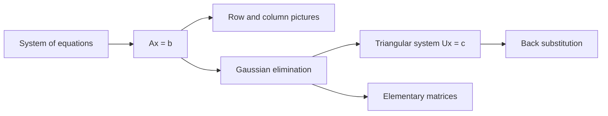
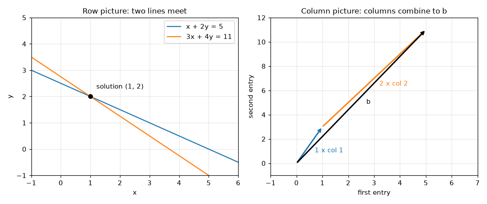
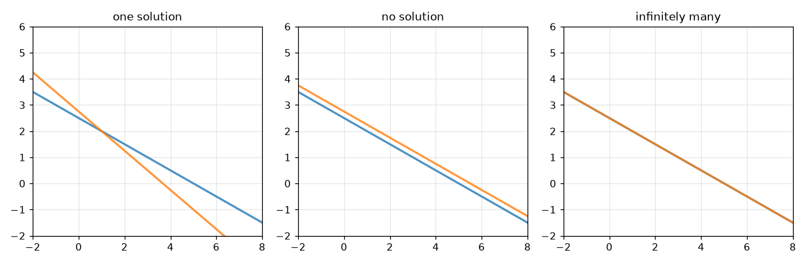

# Linear Equations and Gaussian Elimination

**Course:** [Linear Algebra](../README.md) · **Hands-on:** [notebook.ipynb](notebook.ipynb) · **Practice:** [exercises](exercises/problems.md), [assignment](assignment.md)

Sooner or later every modelling problem asks the same question: which unknown numbers make a set of equations true? Fitting a line, finding the weights of a model, balancing a mixture all lead to a **system of linear equations**. This topic shows how to write such a system as a single matrix equation, how to see its solution as a picture, and how **Gaussian elimination** solves it, which is the method computers use. We work every step with small numbers.

## Learning goals

By the end of this topic you can:

- write a system of linear equations as $A\mathbf{x} = \mathbf{b}$, and describe its solution with the row picture and the column picture;
- tell, for a small system, whether it has one solution, no solution, or infinitely many;
- carry out Gaussian elimination by hand: find the pivots, subtract multiples of rows, and finish with back substitution;
- say what happens when a pivot is zero, and when elimination cannot continue at all;
- express each elimination step as multiplication by an elementary matrix, and a row exchange as a permutation matrix;
- explain why libraries call `numpy.linalg.solve` instead of computing an inverse, and give a rough idea of how the cost grows.

## Prerequisites

- [Vectors and Matrices](../vectors-and-matrices/README.md): linear combinations, matrix-vector multiplication (the column view and the row view), matrix-matrix products, and shapes. We use them without re-teaching them.
- Basic Python and NumPy from [Python Basics](../../../getting-started/python-basics/README.md), only for the notebook.

## Outline

- [Notation at a glance](#notation-at-a-glance)
- [1. Systems of equations as Ax = b](#1-systems-of-equations-as-ax--b)
- [2. Gaussian elimination](#2-gaussian-elimination)
- [3. Row exchanges, failure, and cost](#3-row-exchanges-failure-and-cost)
- [4. Elimination with matrices](#4-elimination-with-matrices)
- [The same ideas in NumPy](#the-same-ideas-in-numpy)
- [Common mistakes](#common-mistakes)
- [Why this matters for AI/ML](#why-this-matters-for-aiml)



> [!NOTE]
> **Concept ownership.** This topic teaches Gaussian elimination, pivots, back substitution, and elementary matrices in full. Later topics recap them and link back here (see the [ownership map](../../../docs/design-notes.md)).

**What this topic leaves for later.**

| Question | Where it is answered |
|---|---|
| How do I store all the elimination steps as one factorization $A = LU$? What is an inverse, and what is Gauss-Jordan elimination? What are determinants and transposes? | [Matrix operations and LU decomposition](../matrix-operations-and-lu-decomposition/README.md) |
| When there are free variables, what do all the solutions look like? What is the nullspace? | [Vector spaces and subspaces](../vector-spaces-and-subspaces/README.md) |
| What do I do when there are more equations than unknowns? | [Projections and least squares](../projections-and-least-squares/README.md) |

## Key intuition

### Notation at a glance

| You see | It means |
|---|---|
| $A\mathbf{x} = \mathbf{b}$ | a whole system of equations: $A$ holds the coefficients, $\mathbf{x}$ the unknowns, $\mathbf{b}$ the right-hand sides |
| **pivot** | the number we divide by at each step of elimination, on the diagonal |
| $\ell_{ij}$ | a **multiplier**: how many copies of row $j$ we subtract from row $i$ |
| $U$, $\mathbf{c}$ | the triangular system $U\mathbf{x} = \mathbf{c}$ that elimination produces ("upper triangular": all zeros below the diagonal) |
| $E_{ij}$ | an elementary matrix that does one elimination step on row $i$ using row $j$ |
| $P_{ij}$ | a permutation matrix that swaps rows $i$ and $j$ |
| $[A \mid \mathbf{b}]$ | the **augmented matrix**: $A$ with $\mathbf{b}$ attached as an extra column |

### 1. Systems of equations as Ax = b

Here is a small system with two unknowns:

```math
\begin{aligned}
x + 2y &= 5 \\
3x + 4y &= 11
\end{aligned}
```

Collect the coefficients into a matrix, the unknowns into a vector, and the right-hand sides into another vector:

```math
\begin{bmatrix} 1 & 2 \\ 3 & 4 \end{bmatrix}
\begin{bmatrix} x \\ y \end{bmatrix}
=
\begin{bmatrix} 5 \\ 11 \end{bmatrix}
\qquad\text{that is,}\qquad A\mathbf{x} = \mathbf{b}.
```

Multiply out the left side (the row view of a matrix-vector product) and you recover the two original equations. The system has become one equation about one unknown vector. Everything below works the same for any number of unknowns.

**Two pictures of the same system.**

- **Row picture.** Each equation is a line in the plane (a plane in 3D). A solution is a point on every line at once, so it is where the lines meet.
- **Column picture.** Use the column view of $A\mathbf{x}$: the system asks for numbers $x$ and $y$ with
```math
x \begin{bmatrix} 1 \\ 3 \end{bmatrix} + y \begin{bmatrix} 2 \\ 4 \end{bmatrix} = \begin{bmatrix} 5 \\ 11 \end{bmatrix}.
```
That is, how much of each column of $A$ must we mix to produce $\mathbf{b}$? It is a linear combination question.



*Both pictures give $x = 1$, $y = 2$. Left: where the lines cross. Right: one copy of the first column plus two copies of the second reach $\mathbf{b}$.*

Check: $1\cdot(1,3) + 2\cdot(2,4) = (1+4,\ 3+8) = (5, 11)$.

**Three possible outcomes.** A system has exactly one of these:

| Outcome | Row picture | Example |
|---|---|---|
| exactly one solution | the lines cross at one point | the system above |
| no solution | the lines are parallel and never meet | $x + 2y = 5$ and $2x + 4y = 11$ |
| infinitely many solutions | the lines are the same line | $x + 2y = 5$ and $2x + 4y = 10$ |



*In the right panel the second line lies exactly on top of the first.*

In the middle example, the second equation says $2x + 4y = 11$, but doubling the first says $2x + 4y = 10$. Both cannot hold. In the last example the second equation is just the first one doubled, so it adds no new information, and every point of the line is a solution, for instance $(5, 0)$ and $(1, 2)$. In the column picture the failure shows up too: the columns $(1,2)$ and $(2,4)$ point along the same line, so mixing them reaches only that line, and $\mathbf{b} = (5, 11)$ lies off it.

With three unknowns the equations are planes. Three planes usually meet at one point, like two walls and the floor meeting at a corner. They can also fail in the same ways: no common point (for example, two parallel planes), or a whole line or plane in common. The rest of this topic gives a method that settles which case you are in.

**Check yourself**

1. Write $x - y = 1$, $2x + y = 8$ as $A\mathbf{x} = \mathbf{b}$, and check that $(3, 2)$ is a solution.
2. The system $x + y = 2$, $2x + 2y = 5$ has how many solutions?

<details>
<summary>Answers</summary>

1. $A$ has rows $(1, -1)$ and $(2, 1)$, and $\mathbf{b} = (1, 8)$. Check: $3 - 2 = 1$ and $6 + 2 = 8$, so $(3, 2)$ works.
2. None. Doubling the first equation gives $2x + 2y = 4$, which contradicts $2x + 2y = 5$. The lines are parallel.

</details>

### 2. Gaussian elimination

The method is the one you may know from school: use one equation to remove an unknown from the others. **Gaussian elimination** does this in an orderly way, and it works for any number of equations.

**The idea in a 2 by 2 case.** Take the system above:

```math
\begin{aligned}
x + 2y &= 5 \\
3x + 4y &= 11
\end{aligned}
```

Subtract 3 times the first equation from the second. The $x$ terms cancel: $(3x + 4y) - 3(x + 2y) = 11 - 3\cdot5$ gives $-2y = -4$. The system is now **triangular**:

```math
\begin{aligned}
x + 2y &= 5 \\
-2y &= -4
\end{aligned}
```

The last equation has one unknown, so $y = 2$. Put that into the first equation: $x + 4 = 5$, so $x = 1$. Solving from the bottom up like this is called **back substitution**.

The number we divided by to find the multiplier is the **pivot**: the first coefficient of the equation that is doing the subtracting. Here the first pivot is $1$ (the multiplier was $3/1$), and the second pivot is $-2$.

**A 3 by 3 example.** Solve

```math
\begin{aligned}
2x + y - z &= 3 \\
4x + 3y + z &= 11 \\
-2x + 2y + 5z &= 7
\end{aligned}
```

Work with the right-hand side attached, and go column by column. In column 1 the pivot is $2$.

1. Row 2 minus $2\times$ row 1 (multiplier $4/2 = 2$): $(4,3,1\mid 11) - 2\,(2,1,-1\mid 3) = (0, 1, 3 \mid 5)$.
2. Row 3 minus $(-1)\times$ row 1 (multiplier $-2/2 = -1$), which means adding row 1: $(-2,2,5\mid 7) + (2,1,-1\mid 3) = (0, 3, 4 \mid 10)$.

Now column 1 is clear below the pivot. In column 2 the pivot is $1$ (from the new row 2).

3. Row 3 minus $3\times$ row 2 (multiplier $3/1 = 3$): $(0,3,4\mid 10) - 3\,(0,1,3\mid 5) = (0, 0, -5 \mid -5)$.

The system is now upper triangular, with pivots $2$, $1$, and $-5$:

```math
\begin{aligned}
2x + y - z &= 3 \\
y + 3z &= 5 \\
-5z &= -5
\end{aligned}
```

Back substitution, from the bottom: $z = 1$. Then $y = 5 - 3z = 2$. Then $2x = 3 - y + z = 2$, so $x = 1$. The solution is $(x, y, z) = (1, 2, 1)$, and you can check it in the original equations: $2 + 2 - 1 = 3$, $4 + 6 + 1 = 11$, $-2 + 4 + 5 = 7$.

The general recipe has just two phases. **Forward elimination** clears the entries below each pivot, column by column, using multiples of the pivot row. **Back substitution** then solves from the last equation upward. Any operation done to the left side must also be done to the right side, so we always carry $\mathbf{b}$ along.

**Check yourself**

1. Eliminate the system $2x + y = 5$, $6x + 4y = 18$ and solve it. What are the pivots?
2. Why must a row operation be applied to the right-hand side as well?

<details>
<summary>Answers</summary>

1. Multiplier $6/2 = 3$. Row 2 minus $3\times$ row 1 gives $(4 - 3)y = 18 - 15$, so $y = 3$. Back substitution: $2x + 3 = 5$, so $x = 1$. The pivots are $2$ and $1$.
2. Each equation is a statement that left side equals right side. Subtracting something from only one side would make a different equation and change the solution.

</details>

### 3. Row exchanges, failure, and cost

**A zero pivot is not the end.** Elimination divides by the pivot, so a pivot of zero is a problem. Often it is fixable. Look at

```math
\begin{aligned}
2y + z &= 5 \\
x + y + z &= 4 \\
2x + y + 3z &= 7
\end{aligned}
```

The first equation has no $x$, so there is no pivot in position 1. But the second equation does, so swap the first two equations. Swapping equations never changes the solution; it only changes the order they are written in. After the swap, subtract $2\times$ row 1 from row 3 to get $(0, -1, 1 \mid -1)$. The second pivot is $2$, and adding $\tfrac12\times$ row 2 to row 3 gives $(0, 0, \tfrac32 \mid \tfrac32)$. So $z = 1$, then $2y + 1 = 5$ gives $y = 2$, then $x + 2 + 1 = 4$ gives $x = 1$.

**When it cannot be fixed.** Sometimes every candidate for a pivot is zero. Consider the matrix whose third row is the sum of the first two:

```math
\begin{aligned}
x + y + z &= 3 \\
x + 2y + 3z &= 6 \\
2x + 3y + 4z &= b_3
\end{aligned}
```

Subtract row 1 from row 2, and $2\times$ row 1 from row 3. Rows 2 and 3 become $(0, 1, 2 \mid 3)$ and $(0, 1, 2 \mid b_3 - 6)$. The next step subtracts row 2 from row 3, and the third row becomes

$$
0x + 0y + 0z = b_3 - 9.
$$

There is no pivot in column 3. What this means depends on $b_3$:

- If $b_3 = 9$, the last equation reads $0 = 0$. It carries no information, and there are infinitely many solutions (the unknown $z$ can be anything, and $x$ and $y$ follow from it: $(z,\ 3 - 2z,\ z)$).
- If $b_3 = 10$, the last equation reads $0 = 1$. That is impossible, so there is no solution.

So a missing pivot signals that the matrix is **singular**: the equations are not independent of each other, as in the singular examples of section 1. Which of the two cases you are in is decided by the right-hand side. Describing all the solutions in the first case properly, with free variables and the nullspace, is the business of [vector spaces and subspaces](../vector-spaces-and-subspaces/README.md). For now, remember that a missing pivot is a warning, and not a bug in your arithmetic.

**Cost, in plain words.** For $n$ equations in $n$ unknowns, forward elimination takes about $n^3/3$ multiplications, and back substitution only about $n^2/2$, which is small by comparison. The $n^3$ is the important part: doubling $n$ multiplies the work by about 8. For $n = 100$ it is roughly $333{,}000$ multiplications, and for $n = 1000$ about $333$ million. That is quick for a computer, but it is why very large systems need special structure or different methods. The notebook counts the operations and checks the $n^3/3$ rule.

**Check yourself**

1. In the system $0x + y = 1$, $x + y = 2$, what single step lets elimination proceed, and what is the solution?
2. Roughly how much longer does elimination take for a $400 \times 400$ system than for a $200 \times 200$ one?

<details>
<summary>Answers</summary>

1. Swap the two equations: $x + y = 2$, then $y = 1$. Back substitution gives $y = 1$ and $x = 1$.
2. About 8 times longer, because the cost grows like $n^3$ and $2^3 = 8$.

</details>

### 4. Elimination with matrices

Each step of elimination is a matrix multiplication. This connects the new idea to what you already know from [matrix products](../vectors-and-matrices/README.md#4-multiplying-two-matrices).

Take the 3 by 3 example from section 2. The first step was "row 2 minus $2\times$ row 1". The matrix that does this is the identity matrix with one extra entry, $-2$, in row 2, column 1. It is the **elementary matrix** $E_{21}$:

```math
E_{21} = \begin{bmatrix} 1 & 0 & 0 \\ -2 & 1 & 0 \\ 0 & 0 & 1 \end{bmatrix},
\qquad
E_{21} A = \begin{bmatrix} 1 & 0 & 0 \\ -2 & 1 & 0 \\ 0 & 0 & 1 \end{bmatrix}
\begin{bmatrix} 2 & 1 & -1 \\ 4 & 3 & 1 \\ -2 & 2 & 5 \end{bmatrix}
=
\begin{bmatrix} 2 & 1 & -1 \\ 0 & 1 & 3 \\ -2 & 2 & 5 \end{bmatrix}.
```

Why does it work? Use the row view of a product: each row of $E_{21}A$ is a combination of the rows of $A$, with the coefficients taken from the matching row of $E_{21}$. Row 2 of $E_{21}$ is $(-2, 1, 0)$, so row 2 of the result is $-2\,(\text{row 1}) + 1\,(\text{row 2}) + 0\,(\text{row 3})$. Rows 1 and 3 have coefficients $(1,0,0)$ and $(0,0,1)$, so they are copied unchanged.

The other two steps are $E_{31}$, which has $+1$ in row 3, column 1 (adding row 1 to row 3), and $E_{32}$, which has $-3$ in row 3, column 2. Apply all three in order:

```math
E_{32}\,E_{31}\,E_{21}\,A = U = \begin{bmatrix} 2 & 1 & -1 \\ 0 & 1 & 3 \\ 0 & 0 & -5 \end{bmatrix}.
```

The product of the three $E$'s is one matrix that carries $A$ all the way to the triangular $U$. The same product applied to $\mathbf{b}$ gives $\mathbf{c} = (3, 5, -5)$, the right-hand side we found by hand. Writing the steps with matrices is the key to the next topic, where they become a factorization.

The order of the matrices is the order of the steps, with the first step nearest $A$. It matters, for the same reason $AB \ne BA$.

**Row exchanges are matrices too.** A **permutation matrix** is the identity with some rows swapped. Swapping rows 1 and 2 of a 3 by 3 matrix is

```math
P_{12} = \begin{bmatrix} 0 & 1 & 0 \\ 1 & 0 & 0 \\ 0 & 0 & 1 \end{bmatrix}.
```

Multiplying by $P_{12}$ on the left exchanges the first two rows of whatever follows.

**The augmented matrix.** Since every step has to be applied to $\mathbf{b}$ too, it is common to write $A$ and $\mathbf{b}$ side by side as one grid, $[A \mid \mathbf{b}]$. Multiplying this grid by $E_{21}$ updates both the left and the right side in one go. In the hand work above, the numbers after the bar were exactly this.

**Check yourself**

1. What matrix subtracts $4\times$ row 1 from row 3 in a 3 by 3 system?
2. Is $E_{21} E_{31}$ the same as $E_{31} E_{21}$ for the example above?

<details>
<summary>Answers</summary>

1. The identity with $-4$ in row 3, column 1: its rows are $(1,0,0)$, $(0,1,0)$, $(-4,0,1)$.
2. Yes, for these two. Both products equal the matrix with rows $(1,0,0)$, $(-2,1,0)$, $(1,0,1)$, because the two steps change different rows and both use only row 1. In general the order of elementary matrices does matter, so keep the order of the steps.

</details>

### The same ideas in NumPy

`numpy.linalg.solve` solves $A\mathbf{x} = \mathbf{b}$ directly. Here it is on the 3 by 3 example, followed by the elementary matrices from section 4.

```python
import numpy as np

A = np.array([[ 2, 1, -1],
              [ 4, 3,  1],
              [-2, 2,  5]])
b = np.array([3, 11, 7])

x = np.linalg.solve(A, b)
print(x)
print(A @ x)
```

```text
[1. 2. 1.]
[ 3. 11.  7.]
```

```python
E21 = np.array([[1, 0, 0], [-2, 1, 0], [0, 0, 1]])
E31 = np.array([[1, 0, 0], [0, 1, 0], [1, 0, 1]])
E32 = np.array([[1, 0, 0], [0, 1, 0], [0, -3, 1]])

print(E32 @ E31 @ E21 @ A)       # the triangular U
print(E32 @ E31 @ E21 @ b)       # the matching right-hand side c
```

```text
[[ 2  1 -1]
 [ 0  1  3]
 [ 0  0 -5]]
[ 3  5 -5]
```

A singular system makes NumPy raise an error, and a Vandermonde-style system (see below) is just another matrix:

```python
A_sing = np.array([[1, 1, 1],
                   [1, 2, 3],
                   [2, 3, 4]])
try:
    np.linalg.solve(A_sing, np.array([3, 6, 9]))
except np.linalg.LinAlgError as error:
    print("LinAlgError:", error)

V = np.vander([0, 1, 2], increasing=True)    # rows (1, t, t^2) for t = 0, 1, 2
print(V)
print(np.linalg.solve(V, [1, 4, 11]))
```

```text
LinAlgError: Singular matrix
[[1 0 0]
 [1 1 1]
 [1 2 4]]
[1. 1. 2.]
```

The notebook goes further: it writes elimination from scratch with a printed trace, checks that `E @ A` reproduces each step, and compares with `np.linalg.solve`.

## Common mistakes

- **Forgetting the right-hand side.** Every row operation on $A$ must be done to $\mathbf{b}$ too. Using the augmented matrix avoids this.
- **Sign errors in the multiplier.** The step is "row $i$ minus $\ell$ times row $j$", where $\ell = (\text{entry to remove}) / \text{pivot}$. When the entry is negative, subtracting a negative multiple means adding. Check your row against one original equation.
- **Dividing by a zero pivot.** If the pivot is zero, look below it for a nonzero entry and swap rows. If there is none, stop: the matrix is singular.
- **Mixing up the position in $E_{ij}$.** The extra entry $-\ell_{ij}$ goes in row $i$ (the row being changed) and column $j$ (the pivot row).
- **Thinking a row swap changes the answer.** It does not. The solution of the system is the same; only the order of the equations changed.
- **Computing the inverse to solve a system.** Writing $\mathbf{x} = A^{-1}\mathbf{b}$ is a fine formula, but it is slower and usually less accurate than elimination, as the next section explains.

## Why this matters for AI/ML

- **Unknown weights are a linear system.** Many models have unknown numbers (weights) that must satisfy equations built from data. When each equation is linear in the unknowns, finding the weights is solving $A\mathbf{x} = \mathbf{b}$.
- **Fitting a polynomial through points.** To find a quadratic $a + bt + ct^2$ through the points $(0, 1)$, $(1, 4)$, $(2, 11)$, each point gives one linear equation in the unknowns $a$, $b$, $c$. The coefficient matrix has rows $(1, t, t^2)$ (a **Vandermonde matrix**), and the NumPy block above solves it: $a = 1$, $b = 1$, $c = 2$.
- **More equations than unknowns.** Real data gives many equations (one per example) and few unknowns (the weights). Usually no exact solution exists, so we ask for the best compromise. The standard answer, **least squares**, leads to a smaller square system called the *normal equations*, $A^\top A\,\hat{\mathbf{x}} = A^\top \mathbf{b}$ (the small $\top$ is the transpose, covered in the next topic). Solving that system is exactly the elimination of this page. See [projections and least squares](../projections-and-least-squares/README.md) and [linear regression](../../../machine-learning/linear-regression/README.md).
- **Why libraries do not form the inverse.** The formula $\mathbf{x} = A^{-1}\mathbf{b}$ looks neat, but finding $A^{-1}$ takes extra work and usually gains nothing in accuracy. Routines such as `numpy.linalg.solve` run elimination with row exchanges and never build the inverse. Use `solve` unless you truly need $A^{-1}$ itself.
- **A building block under bigger routines.** Elimination-style solvers sit inside least-squares fitting, and inside methods such as Gaussian processes, which have to solve a large linear system built from the data. You will not write these solvers yourself, but you will rely on them, and knowing what they do helps you read their error messages.

### A word on numerical stability

Computers store numbers with limited precision. If a pivot is nonzero but tiny, the multiplier becomes huge and rounding errors can swamp the answer. For the system $10^{-20}x + y = 1$, $x + y = 2$ (true solution $x \approx 1$, $y \approx 1$), elimination without swapping rows gives $x = 0$, which is wrong, while NumPy gives the right answer:

```python
A = np.array([[1e-20, 1.0],
              [1.0,   1.0]])
b = np.array([1.0, 2.0])

multiplier = A[1, 0] / A[0, 0]               # about 1e20
u22 = A[1, 1] - multiplier * A[0, 1]
c2 = b[1] - multiplier * b[0]
y = c2 / u22
x = (b[0] - A[0, 1] * y) / A[0, 0]
print("without swapping:", x, y)
print("numpy.linalg.solve:", np.linalg.solve(A, b))
```

```text
without swapping: 0.0 1.0
numpy.linalg.solve: [1. 1.]
```

The cure is **partial pivoting**: before each step, swap in the row whose entry in the current column is largest in size. Libraries do this by default, which is another reason to prefer them over hand-written elimination for real work. Some systems are inherently sensitive, so small changes in the data move the answer a lot (they are called *ill-conditioned*). Polynomial fits through many evenly spaced points are a classic example, and the assignment lets you see it.

## Summary

- A system of linear equations is one equation $A\mathbf{x} = \mathbf{b}$. The row picture shows lines or planes meeting. The column picture asks for a linear combination of the columns that equals $\mathbf{b}$.
- There are three outcomes: one solution, none, or infinitely many.
- Gaussian elimination subtracts multiples of pivot rows to reach a triangular system, then back substitution finishes the job. A zero pivot is fixed by a row exchange when a nonzero entry exists below. If none exists, the matrix is singular.
- Each elimination step is multiplication by an elementary matrix, and a row exchange is multiplication by a permutation matrix. The product of the steps turns $A$ into the triangular $U$.
- Elimination costs about $n^3/3$ multiplications. Libraries solve systems with row exchanges for accuracy, not with inverses.

## Further reading

Chapter pointers and free links are in [resources.md](resources.md).

## Practice

- [Notebook](notebook.ipynb): draw both pictures, write elimination from scratch with a trace, redo it with elementary matrices, meet a singular system, and count the cost. It follows the lesson:

  | Lesson section | Notebook section |
  |---|---|
  | 1. Systems of equations as Ax = b | 1. A system of equations is one equation |
  | 2. Gaussian elimination | 2. Gaussian elimination from scratch |
  | 3. Row exchanges, failure, and cost | 4. Row exchanges, 5. When elimination fails, 8. How the cost grows |
  | 4. Elimination with matrices | 3. Elimination with matrices |
  | Why this matters for AI/ML | 6. Why real solvers pick the biggest pivot, 7. Compare with NumPy |

- [Exercises](exercises/problems.md) (with [solutions](exercises/solutions.md)): ten problems, easy to harder.
- [Assignment](assignment.md): recover a polynomial from measurements with your own elimination code.

---

[← Previous: Vectors and Matrices](../vectors-and-matrices/README.md) | [Next: Matrix Operations and LU Decomposition →](../matrix-operations-and-lu-decomposition/README.md)
