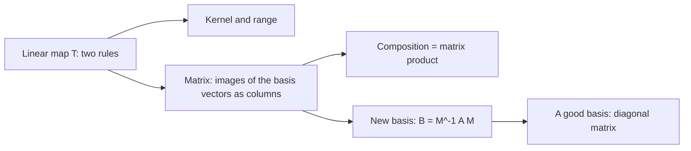
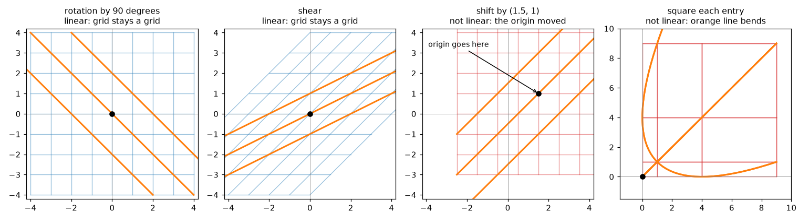
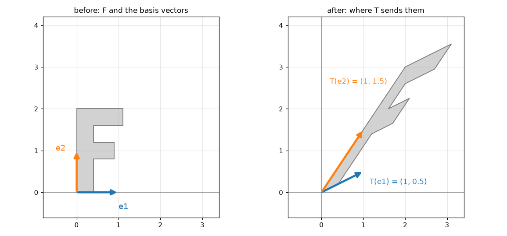
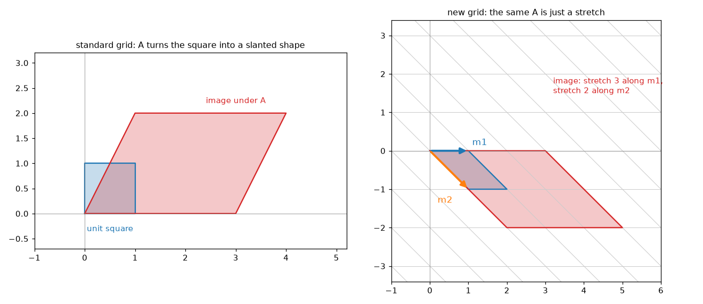

# Linear Transformations

**Course:** [Linear Algebra](../README.md) · **Hands-on:** [notebook.ipynb](notebook.ipynb) · **Practice:** [exercises](exercises/problems.md), [assignment](assignment.md)

Since the first topic you have been using matrices as machines: put a vector in, get a vector out. This topic turns that picture around and asks which machines deserve the name **linear**. A linear transformation is a rule that keeps straight lines straight and keeps the origin where it is, and the surprise is that such a rule is completely described by a handful of numbers, one column for each basis vector. That makes every rotation, reflection, shear, and projection a matrix, makes "do one, then the other" into matrix multiplication, and shows that the same transformation can wear different matrices depending on the basis you describe it in. Picking a basis that makes the matrix simple is the idea behind diagonalization, the SVD, and PCA.

## Learning goals

By the end of this topic you can:

- test whether a rule is a linear transformation using the two rules $T(\mathbf{u}+\mathbf{v}) = T(\mathbf{u})+T(\mathbf{v})$ and $T(c\mathbf{v}) = cT(\mathbf{v})$, and name examples and non-examples (including the derivative of a polynomial);
- find the kernel and range of a transformation, identify them with the nullspace and column space of its matrix, and say what a non-invertible transformation loses;
- build the matrix of a transformation by applying it to the basis vectors and writing the results as columns, for rotations, reflections, projections, shears, and the derivative;
- explain why composing transformations is multiplying matrices, why the order reads right to left, and why $AB \ne BA$ means "order matters";
- change basis: convert coordinates with $M$, rewrite a matrix as $B = M^{-1}AM$, and explain what similar matrices and the formula $A = S\Lambda S^{-1}$ mean;
- use one extra coordinate (homogeneous coordinates) to write a translation as a matrix.

## Prerequisites

- [Vectors and Matrices](../vectors-and-matrices/README.md): the matrix as a machine, and the matrix-vector product.
- [Matrix Operations and LU Decomposition](../matrix-operations-and-lu-decomposition/README.md): products, inverses, the determinant, and why $AB \ne BA$.
- [Vector Spaces and Subspaces](../vector-spaces-and-subspaces/README.md) and [Independence, Basis, and Dimension](../independence-basis-and-dimension/README.md): the column space and nullspace, bases, coordinates, and rank-nullity.
- [Orthogonality and Gram-Schmidt](../orthogonality-and-gram-schmidt/README.md): rotations and reflections as orthogonal matrices, and [Projections and Least Squares](../projections-and-least-squares/README.md): projection matrices.
- Helpful, not required: [Eigenvalues and Eigenvectors](../eigenvalues-and-eigenvectors/README.md). We say what we need in one sentence below: eigenvectors are special directions that a matrix only stretches.
- Basic Python and NumPy from [Python Basics](../../../getting-started/python-basics/README.md), only for the notebook.

## Outline

- [Notation at a glance](#notation-at-a-glance)
- [1. What makes a map linear](#1-what-makes-a-map-linear)
- [2. Kernel, range, and invertibility](#2-kernel-range-and-invertibility)
- [3. The matrix of a linear transformation](#3-the-matrix-of-a-linear-transformation)
- [4. Changing the basis](#4-changing-the-basis)
- [5. Shifts and homogeneous coordinates](#5-shifts-and-homogeneous-coordinates)
- [The same ideas in NumPy](#the-same-ideas-in-numpy)
- [Common mistakes](#common-mistakes)
- [Why this matters for AI/ML](#why-this-matters-for-aiml)



> [!NOTE]
> **Concept ownership.** This topic teaches linear transformations, kernel and range for maps, the matrix of a transformation, change of basis, and similar matrices in full. Later topics recap them and link back (see the [ownership map](../../../docs/design-notes.md)).

**What this topic leaves for later.**

| Question | Where it is answered |
|---|---|
| Which pair of bases (one for inputs, one for outputs) makes any matrix as simple as possible? | [Singular value decomposition](../singular-value-decomposition/README.md) |
| How do we study eigenvectors and eigenbases in detail: finding them, and when they exist? | [Eigenvalues and eigenvectors](../eigenvalues-and-eigenvectors/README.md) |
| What is the best linear approximation of a curved function near a point (the Jacobian)? | [Multivariable calculus](../../calculus-and-optimization/multivariable-calculus/README.md) |
| Why do rotations and reflections preserve lengths? (a recap only here) | [Orthogonality and Gram-Schmidt](../orthogonality-and-gram-schmidt/README.md) |

## Key intuition

### Notation at a glance

| You see | It means |
|---|---|
| $T:\mathbb{R}^n \to \mathbb{R}^m$ | a **transformation** (a function) that takes a vector with $n$ entries and returns a vector with $m$ entries |
| $T(\mathbf{v})$ | the output of $T$ for the input $\mathbf{v}$, also called the **image** of $\mathbf{v}$ |
| $\mathbf{e}_j$ | the $j$-th standard basis vector: a $1$ in position $j$ and $0$ elsewhere |
| $\ker T$ | the **kernel** of $T$: all inputs that $T$ sends to $\mathbf{0}$ |
| $\operatorname{range} T$ | the **range** of $T$: all outputs $T(\mathbf{v})$ |
| $\mathcal{P}_3$ | the vector space of polynomials of degree at most 3 |
| $M$ | a matrix whose columns are a new basis, written in the old coordinates |
| $B = M^{-1}AM$ | the matrix of the same transformation in the new basis; $A$ and $B$ are called **similar** |

### 1. What makes a map linear

Think of the plane as a sheet of graph paper. A transformation moves every point of the sheet somewhere. Most rules tear, bend, or fold the sheet. A **linear transformation** is the well-behaved kind: grid lines stay straight, parallel lines stay parallel, equal spacing stays equal, and the origin does not move. Rotations, stretches, shears, mirror flips, and squashing onto a line all qualify.



*The first two maps keep straight lines straight and the origin fixed. The shift moves the origin, and squaring bends the orange line.*

That picture has an exact form. A transformation $T$ is **linear** if it obeys two rules for all vectors $\mathbf{u}, \mathbf{v}$ and all numbers $c$:

$$
T(\mathbf{u} + \mathbf{v}) = T(\mathbf{u}) + T(\mathbf{v}), \qquad T(c\,\mathbf{v}) = c\,T(\mathbf{v}).
$$

In words: adding first and transforming, or transforming first and adding, give the same answer; and scaling first or transforming first give the same answer. The two rules combine into one that you will use constantly. Linear maps carry combinations to combinations:

$$
T(c_1\mathbf{v}_1 + \dots + c_k\mathbf{v}_k) = c_1T(\mathbf{v}_1) + \dots + c_kT(\mathbf{v}_k).
$$

Two consequences follow at once. Take $c = 0$ in the second rule: $T(\mathbf{0}) = T(0\cdot\mathbf{v}) = 0\cdot T(\mathbf{v}) = \mathbf{0}$, so **a linear map always sends the origin to the origin**. And a straight line $\mathbf{p} + t\mathbf{d}$ goes to the straight line $T(\mathbf{p}) + t\,T(\mathbf{d})$, which is why grid lines stay straight (the image is a line, or a single point if $T(\mathbf{d}) = \mathbf{0}$).

**A numeric check.** Let $T(x, y) = (2x + y,\ x - 3y)$. Take $\mathbf{u} = (1, 2)$ and $\mathbf{v} = (3, -1)$. Then $T(\mathbf{u}) = (4, -5)$ and $T(\mathbf{v}) = (5, 6)$, so $T(\mathbf{u}) + T(\mathbf{v}) = (9, 1)$. Adding first: $\mathbf{u} + \mathbf{v} = (4, 1)$ and $T(4, 1) = (9, 1)$. The same. For scaling, $T(2\mathbf{u}) = T(2, 4) = (8, -10) = 2\,T(\mathbf{u})$. A few numbers are only evidence, not a proof. To prove linearity you check the rules for general $\mathbf{u}$, $\mathbf{v}$, $c$, and here the formula $T = $ "multiply by a matrix" does it (see below).

**Non-examples.** One failure is enough to disqualify a rule.

- **A shift** $T(\mathbf{v}) = \mathbf{v} + \mathbf{b}$ with $\mathbf{b} \ne \mathbf{0}$ moves the origin: $T(\mathbf{0}) = \mathbf{b} \ne \mathbf{0}$. The same goes for any rule that adds a constant. This is why the high-school "linear function" $y = 3x + 1$ is not linear in our sense: $T(0) = 1$. It is called **affine**, and section 5 shows how to handle it.
- **Squaring the entries**, $T(x, y) = (x^2, y^2)$, passes $T(\mathbf{0}) = \mathbf{0}$ but fails scaling: $T(2, 2) = (4, 4)$ while $2\,T(1, 1) = (2, 2)$. So $T(\mathbf{0}) = \mathbf{0}$ is necessary, never sufficient.

**Every matrix is a linear map.** For a matrix $A$, define $T(\mathbf{v}) = A\mathbf{v}$. The rules $A(\mathbf{u} + \mathbf{v}) = A\mathbf{u} + A\mathbf{v}$ and $A(c\mathbf{v}) = cA\mathbf{v}$ are the distributive law of matrix algebra. The $T$ above is $A\mathbf{v}$ with $A$ having rows $(2, 1)$ and $(1, -3)$, so it was linear all along. Section 3 shows the converse: every linear map from $\mathbb{R}^n$ to $\mathbb{R}^m$ is a matrix.

**Vectors that are not columns.** The two rules only need addition and scaling, so they work in any vector space. Let $\mathcal{P}_3$ be the polynomials of degree at most 3, like $2 + 5x - x^2 + 4x^3$. You can add them and scale them, so they are vectors, and the list $1, x, x^2, x^3$ is a basis, so the dimension is 4. The derivative $D$ is a linear map from $\mathcal{P}_3$ to itself, because $(p + q)' = p' + q'$ and $(cp)' = c\,p'$. For $p = 2 + 5x - x^2 + 4x^3$ we get $D(p) = 5 - 2x + 12x^2$. With $q = x^3 - 3$: $D(p + q) = D(-1 + 5x - x^2 + 5x^3) = 5 - 2x + 15x^2$, and $D(p) + D(q) = (5 - 2x + 12x^2) + 3x^2$ is the same.

**Check yourself**

1. Is $T(x, y) = (x + y,\ 2)$ linear? What about $T(x, y) = (3y,\ -x)$?
2. A linear map has $T(1, 0) = (2, 1)$. Can you say what $T(0, 0)$ is? Can you say what $T(3, 0)$ is?

<details>
<summary>Answers</summary>

1. The first is not linear: $T(0, 0) = (0, 2) \ne (0, 0)$. The second is: it is multiplication by the matrix with rows $(0, 3)$ and $(-1, 0)$.
2. $T(0, 0) = (0, 0)$ always. And $T(3, 0) = 3\,T(1, 0) = (6, 3)$ by the scaling rule.

</details>

### 2. Kernel, range, and invertibility

Two questions describe what a linear map does to space. Which inputs get crushed to zero? And which outputs can be reached at all? The set of inputs sent to $\mathbf{0}$ is the **kernel**, $\ker T = \{\mathbf{v} : T(\mathbf{v}) = \mathbf{0}\}$. The set of all outputs is the **range**, $\operatorname{range} T = \{T(\mathbf{v})\}$. The kernel lives in the input space and the range lives in the output space, so never mix them up. Both are subspaces: if $T(\mathbf{u}) = T(\mathbf{v}) = \mathbf{0}$ then $T(\mathbf{u} + \mathbf{v}) = \mathbf{0}$ and $T(c\mathbf{u}) = \mathbf{0}$, and the range is closed under addition and scaling for the same reason.

**You already know these.** For the map $T(\mathbf{v}) = A\mathbf{v}$, solving $A\mathbf{v} = \mathbf{0}$ is finding the nullspace, and $A\mathbf{v}$ is always a combination of the columns of $A$:

$$
\ker T = N(A), \qquad \operatorname{range} T = C(A).
$$

The dimension counts carry over unchanged, so rank-nullity reads $\dim\ker T + \dim\operatorname{range} T = \dim(\text{input space})$.

**Worked example.** Take $T(\mathbf{v}) = A\mathbf{v}$ with $A$ having rows $(1, 2)$ and $(2, 4)$. The second column is twice the first, so the range is the line through $(1, 2)$: every output is a multiple of it. The kernel is the line through $(2, -1)$, since $A(2, -1) = (2 - 2,\ 4 - 4) = (0, 0)$. The dimensions are $1 + 1 = 2$. This map loses information: $A(1, 0) = (1, 2)$ and $A(-1, 1) = (-1 + 2,\ -2 + 4) = (1, 2)$, two different inputs with one output. In general $T(\mathbf{u}) = T(\mathbf{v})$ exactly when $\mathbf{u} - \mathbf{v}$ is in the kernel, here a multiple of $(2, -1)$. So the kernel is the list of directions the map cannot see.

**The derivative again.** $D$ sends every constant to $0$, and only constants, so $\ker D$ is the constants, of dimension 1. Its range is all polynomials of degree at most 2, of dimension 3 (every such polynomial is the derivative of something). Check: $1 + 3 = 4 = \dim \mathcal{P}_3$.

**Invertible transformations.** $T$ is **invertible** if some map $T^{-1}$ undoes it: $T^{-1}(T(\mathbf{v})) = \mathbf{v}$ for every $\mathbf{v}$. That needs every output to come from exactly one input, which means two things: the kernel is only $\{\mathbf{0}\}$ (nothing is crushed, so no two inputs collide) and the range is the whole output space (nothing is missed). For a map from $\mathbb{R}^n$ to $\mathbb{R}^n$ the matrix has $n$ pivots, its determinant is not zero, and the matrix of $T^{-1}$ is $A^{-1}$.

- A rotation is invertible: rotate back by the opposite angle. So is a shear (shear the other way) and any reflection (reflect again).
- A projection onto a line is not: the direction perpendicular to the line is crushed to $\mathbf{0}$, and after the fact you cannot tell where a point came from.
- The derivative is not: $D(x^2 + 5) = D(x^2)$, so from the derivative alone you cannot recover the constant.

A non-invertible map loses exactly $\dim\ker T$ dimensions of information, and its range is smaller than the output space by the same amount in the square case.

**Check yourself**

1. Find the kernel and range of the projection onto the $x$-axis in the plane, $T(x, y) = (x, 0)$.
2. A linear map $T:\mathbb{R}^5 \to \mathbb{R}^3$ has a matrix of rank 3. What is $\dim\ker T$? Could $T$ be invertible?

<details>
<summary>Answers</summary>

1. The kernel is the $y$-axis (those points go to $(0, 0)$) and the range is the $x$-axis. Dimensions $1 + 1 = 2$.
2. The matrix is $3 \times 5$ and the input space has dimension 5, so $\dim\ker T = 5 - 3 = 2$. It cannot be invertible: with a nonzero kernel, different inputs collide (and the spaces have different dimensions).

</details>

### 3. The matrix of a linear transformation

**A linear map is completely decided by what it does to the basis vectors.** Any $\mathbf{v} = (x_1, x_2)$ equals $x_1\mathbf{e}_1 + x_2\mathbf{e}_2$, so by the combination rule

$$
T(\mathbf{v}) = x_1\,T(\mathbf{e}_1) + x_2\,T(\mathbf{e}_2).
$$

That is a combination of two known vectors, and a matrix-vector product is exactly such a combination of columns. So put the images of the basis vectors in the columns:

$$
A = \begin{bmatrix} T(\mathbf{e}_1) & T(\mathbf{e}_2) & \cdots & T(\mathbf{e}_n) \end{bmatrix}, \qquad T(\mathbf{v}) = A\mathbf{v}.
$$

If $T$ goes from $\mathbb{R}^n$ to $\mathbb{R}^m$, there are $n$ columns (one per input basis vector) and each has $m$ entries (an output vector), so $A$ is $m \times n$. This is also the proof that every linear map between spaces of columns is a matrix.



*Follow the two arrows. Where the basis vectors land tells you the matrix, and the whole letter follows because every point is a combination of them.*

For the map in the picture, $T(\mathbf{e}_1) = (1, 0.5)$ and $T(\mathbf{e}_2) = (1, 1.5)$. Then $T(2, 3) = 2\,(1, 0.5) + 3\,(1, 1.5) = (5, 5.5)$, and nothing else about $T$ was needed.

**A catalogue for the plane.** To write the matrix of a familiar map, ask where the two basis vectors go:

| Map | $T(\mathbf{e}_1)$ | $T(\mathbf{e}_2)$ |
|---|---|---|
| rotation by angle $\theta$ | $(\cos\theta,\ \sin\theta)$ | $(-\sin\theta,\ \cos\theta)$ |
| reflection in the $x$-axis | $(1, 0)$ | $(0, -1)$ |
| reflection in the line $y = x$ | $(0, 1)$ | $(1, 0)$ |
| projection onto the $x$-axis | $(1, 0)$ | $(0, 0)$ |
| projection onto the line through $(3, 4)$ | $(0.36, 0.48)$ | $(0.48, 0.64)$ |
| shear (slide each point right by its height) | $(1, 0)$ | $(1, 1)$ |
| stretch by 2 in $x$ and 3 in $y$ | $(2, 0)$ | $(0, 3)$ |

Writing the columns side by side gives the matrices:

```math
R_\theta = \begin{bmatrix} \cos\theta & -\sin\theta \\ \sin\theta & \cos\theta \end{bmatrix}, \quad
\text{reflection} = \begin{bmatrix} 1 & 0 \\ 0 & -1 \end{bmatrix}, \quad
\text{shear} = \begin{bmatrix} 1 & 1 \\ 0 & 1 \end{bmatrix}, \quad
P = \begin{bmatrix} 0.36 & 0.48 \\ 0.48 & 0.64 \end{bmatrix}.
```

For $\theta = 90^\circ$ the columns are $(0, 1)$ and $(-1, 0)$, so a quarter turn sends $(3, 4)$ to $3\,(0, 1) + 4\,(-1, 0) = (-4, 3)$, as in the orthogonality topic. That topic explained why rotations and reflections keep lengths and angles; here we only note that they are linear maps. The projection matrix is the one from the projections topic, found there with a formula and found here by asking where $\mathbf{e}_1$ and $\mathbf{e}_2$ land. A map between different dimensions works the same way: $T(x, y, z) = (x + y,\ y + z)$ sends $\mathbf{e}_1, \mathbf{e}_2, \mathbf{e}_3$ to $(1, 0), (1, 1), (0, 1)$, so its matrix is $2 \times 3$.

**Composition is matrix multiplication.** Do $S$ first and then $T$, with matrices $A$ (for $S$) and $B$ (for $T$). A vector $\mathbf{v}$ becomes $A\mathbf{v}$, then $B(A\mathbf{v}) = (BA)\mathbf{v}$. So the matrix of "$S$ then $T$" is the product $BA$, with the **first** map **nearest the vector**. Products are read right to left, like function notation $T(S(\mathbf{v}))$. Column $j$ of $BA$ says: take $\mathbf{e}_j$, send it through $A$, then send that through $B$. This is why matrix multiplication is defined the way it is.

Order matters because the two maps need not commute. Let $A$ be the shear and $B$ the quarter turn $R_{90^\circ}$. Then

```math
BA = \begin{bmatrix} 0 & -1 \\ 1 & 0 \end{bmatrix}\begin{bmatrix} 1 & 1 \\ 0 & 1 \end{bmatrix} = \begin{bmatrix} 0 & -1 \\ 1 & 1 \end{bmatrix} \quad\text{(shear, then turn)}, \qquad
AB = \begin{bmatrix} 1 & 1 \\ 0 & 1 \end{bmatrix}\begin{bmatrix} 0 & -1 \\ 1 & 0 \end{bmatrix} = \begin{bmatrix} 1 & -1 \\ 1 & 0 \end{bmatrix} \quad\text{(turn, then shear)}.
```

Follow $\mathbf{e}_1 = (1, 0)$: the shear leaves it alone and the turn sends it to $(0, 1)$, which is column 1 of $BA$. In the other order the turn sends it to $(0, 1)$ and the shear sends that to $(1, 1)$, which is column 1 of $AB$. Different answers, so $AB \ne BA$. You saw the same effect on the letter F in the [matrix operations topic](../matrix-operations-and-lu-decomposition/README.md). Rotations in the plane are a lucky exception: turning by $\beta$ and then by $\alpha$ is the same as turning by $\alpha + \beta$, in either order.

**The derivative as a matrix.** Use the basis $1, x, x^2, x^3$ of $\mathcal{P}_3$, so a polynomial $a + bx + cx^2 + dx^3$ has coordinates $(a, b, c, d)$. Apply $D$ to each basis vector: $D(1) = 0$, $D(x) = 1$, $D(x^2) = 2x$, $D(x^3) = 3x^2$. Write those results in coordinates as the columns:

```math
D = \begin{bmatrix} 0 & 1 & 0 & 0 \\ 0 & 0 & 2 & 0 \\ 0 & 0 & 0 & 3 \\ 0 & 0 & 0 & 0 \end{bmatrix}, \qquad
D\begin{bmatrix} 2 \\ 5 \\ -1 \\ 4 \end{bmatrix} = \begin{bmatrix} 5 \\ -2 \\ 12 \\ 0 \end{bmatrix}.
```

The output is $5 - 2x + 12x^2$, the derivative of $2 + 5x - x^2 + 4x^3$ computed before. The first column is zero, which is the kernel (the constants), and there are three pivots, which is the dimension of the range. Applying $D$ four times gives the zero matrix: four derivatives kill every cubic.

**Check yourself**

1. A linear map has $T(\mathbf{e}_1) = (2, 1)$ and $T(\mathbf{e}_2) = (-1, 3)$. Find its matrix and $T(4, 1)$.
2. What is the matrix of "rotate by $180^\circ$"? What is its square, and why?

<details>
<summary>Answers</summary>

1. The matrix has columns $(2, 1)$ and $(-1, 3)$. Then $T(4, 1) = 4\,(2, 1) + 1\,(-1, 3) = (7, 7)$.
2. Both basis vectors flip direction, so the columns are $(-1, 0)$ and $(0, -1)$ and the matrix is $-I$. Its square is $I$: two half turns make a full turn, which does nothing.

</details>

### 4. Changing the basis

A matrix describes a transformation in one particular basis. When you write the vector $(5, 1)$ you are really saying "$5\,\mathbf{e}_1 + 1\,\mathbf{e}_2$", with the standard basis as the unit of measure. Choose another basis and the same arrow gets different coordinates, as in the [independence topic](../independence-basis-and-dimension/README.md). The same happens to a transformation: its matrix depends on the basis, and a clever basis can make it very simple.

**Converting coordinates.** Let the columns of $M$ be a new basis $\mathbf{m}_1, \mathbf{m}_2$ (written in standard coordinates). A vector with new coordinates $\mathbf{c} = (c_1, c_2)$ is $\mathbf{v} = c_1\mathbf{m}_1 + c_2\mathbf{m}_2 = M\mathbf{c}$. So $M$ turns new coordinates into old ones, and $\mathbf{c} = M^{-1}\mathbf{v}$ goes the other way. $M$ is invertible because its columns are a basis.

**The matrix in the new basis.** Let $T$ have matrix $A$ in standard coordinates. We want the matrix $B$ that takes the new coordinates of $\mathbf{v}$ to the new coordinates of $T(\mathbf{v})$. Three steps: new coordinates $\mathbf{c}$ become a standard vector $M\mathbf{c}$, then $A$ acts, then $M^{-1}$ converts the result back to new coordinates. Read right to left, that is one matrix:

$$
B = M^{-1}AM.
$$

Two matrices related like this are called **similar**. They describe the same transformation in two bases.

**Worked example.** Take $A$ with rows $(3, 1)$ and $(0, 2)$, and the new basis $\mathbf{m}_1 = (1, 0)$, $\mathbf{m}_2 = (1, -1)$, so $M$ has rows $(1, 1)$ and $(0, -1)$. A short calculation shows $M^{-1} = M$ here. Then

```math
AM = \begin{bmatrix} 3 & 1 \\ 0 & 2 \end{bmatrix}\begin{bmatrix} 1 & 1 \\ 0 & -1 \end{bmatrix} = \begin{bmatrix} 3 & 2 \\ 0 & -2 \end{bmatrix}, \qquad
B = M^{-1}(AM) = \begin{bmatrix} 1 & 1 \\ 0 & -1 \end{bmatrix}\begin{bmatrix} 3 & 2 \\ 0 & -2 \end{bmatrix} = \begin{bmatrix} 3 & 0 \\ 0 & 2 \end{bmatrix}.
```

$B$ is diagonal. The reason is visible in the columns of $M$: $A\mathbf{m}_1 = (3, 0) = 3\,\mathbf{m}_1$ and $A\mathbf{m}_2 = (3 - 1,\ -2) = (2, -2) = 2\,\mathbf{m}_2$. In the new basis, $A$ just stretches the first coordinate by 3 and the second by 2.

A numeric spot check: take $\mathbf{v} = (2, 5)$. Then $A\mathbf{v} = (11, 10)$. In the new basis $\mathbf{c} = M^{-1}\mathbf{v} = (7, -5)$, then $B\mathbf{c} = (21, -10)$, and converting back, $M\,(21, -10) = (11, 10)$. It matches.



*Same transformation, two views. On the skewed grid made from $\mathbf{m}_1$ and $\mathbf{m}_2$, $A$ is a plain stretch.*

**What similar matrices share.** Since $A$ and $B$ are the same map seen in different coordinates, anything that belongs to the map and not to the coordinates is the same. The rank is the same, and so is the determinant: $\det B = \det(M^{-1})\det A\,\det M = \det A$. The eigenvalues are the same too, and so is the trace (the sum of the diagonal entries), facts we use in the next topics. In the example both determinants are 6.

**This is what diagonalization means.** Eigenvectors are the special directions that a matrix only stretches, never turns. If you can find a whole basis of them, put them in the columns of $S$. In that basis the matrix is diagonal, $S^{-1}AS = \Lambda$, which is the same as

$$
A = S\Lambda S^{-1}.
$$

Read right to left: switch to the eigenvector basis ($S^{-1}$), stretch each coordinate ($\Lambda$), and switch back ($S$). Our example is exactly this with $M = S$ and $\Lambda = \operatorname{diag}(3, 2)$. The payoff is that powers become easy, since $A^k = S\Lambda^kS^{-1}$ and a diagonal matrix is raised to a power entry by entry. For example, $A^5 = S\,\operatorname{diag}(3^5, 2^5)\,S^{-1}$ has rows $(243, 211)$ and $(0, 32)$. The [next-door topic on eigenvalues and eigenvectors](../eigenvalues-and-eigenvectors/README.md) shows how to find such a basis and when it exists.

**A good basis makes the matrix simple.** The projection onto the line through $(1, 1)$ becomes $\operatorname{diag}(1, 0)$ in the basis $(1, 1), (1, -1)$: keep the first coordinate, kill the second. Eigenvectors are one good choice. Another is to use one basis for the inputs and a different one for the outputs, which gives $B = N^{-1}AM$ and leads to the SVD in the [singular value decomposition topic](../singular-value-decomposition/README.md).

**Check yourself**

1. The projection onto the line through $(1, 1)$ has $P\mathbf{m}_1 = \mathbf{m}_1$ for $\mathbf{m}_1 = (1, 1)$ and $P\mathbf{m}_2 = \mathbf{0}$ for $\mathbf{m}_2 = (1, -1)$. What is $M^{-1}PM$?
2. $\det A = 6$. What is the determinant of any matrix similar to $A$?

<details>
<summary>Answers</summary>

1. The first column of $B$ holds the new coordinates of $P\mathbf{m}_1 = 1\cdot\mathbf{m}_1 + 0\cdot\mathbf{m}_2$, so $(1, 0)$. The second column is the coordinates of $\mathbf{0}$, so $(0, 0)$. Thus $B = \operatorname{diag}(1, 0)$.
2. Also 6, because $\det(M^{-1}AM) = \det A$.

</details>

### 5. Shifts and homogeneous coordinates

A shift $\mathbf{x} \mapsto \mathbf{x} + \mathbf{b}$ is not linear, yet graphics and robotics need shifts constantly, usually mixed with rotations. A map $\mathbf{x} \mapsto A\mathbf{x} + \mathbf{b}$ is called **affine**. The trick is to step up one dimension: write a point $(x, y)$ as $(x, y, 1)$. Then

```math
\begin{bmatrix} A & \mathbf{b} \\ \mathbf{0}^\top & 1 \end{bmatrix}\begin{bmatrix} \mathbf{x} \\ 1 \end{bmatrix} = \begin{bmatrix} A\mathbf{x} + \mathbf{b} \\ 1 \end{bmatrix}.
```

A $3 \times 3$ matrix acts on the plane, and a shift has become a genuine matrix product. These extra-coordinate points are called **homogeneous coordinates**. For example, a quarter turn followed by a shift of $(2, 1)$ is

```math
H = \begin{bmatrix} 0 & -1 & 2 \\ 1 & 0 & 1 \\ 0 & 0 & 1 \end{bmatrix}, \qquad H\begin{bmatrix} 3 \\ 4 \\ 1 \end{bmatrix} = \begin{bmatrix} -4 + 2 \\ 3 + 1 \\ 1 \end{bmatrix} = \begin{bmatrix} -2 \\ 4 \\ 1 \end{bmatrix}.
```

The turn takes $(3, 4)$ to $(-4, 3)$ and the shift moves it to $(-2, 4)$. The last coordinate stays 1. Since each step is now a matrix, a whole chain of turns, scalings, and shifts multiplies into one matrix, again with the first step nearest the point. Geometrically, a shift of the plane is a **shear** of the 3D space that slides the flat sheet $z = 1$ sideways and leaves the origin alone, so it is linear after all, one dimension up. Three-dimensional graphics and robot arms use the same idea with $4 \times 4$ matrices.

**Check yourself**

1. Write the $3 \times 3$ matrix that shifts the plane by $(2, 1)$ and does nothing else, and apply it to $(3, 4)$.
2. A shift and a rotation: do they commute (does the order matter)?

<details>
<summary>Answers</summary>

1. The matrix has rows $(1, 0, 2)$, $(0, 1, 1)$, $(0, 0, 1)$. Applied to $(3, 4, 1)$ it gives $(5, 5, 1)$, the point $(5, 5)$.
2. No, in general. Rotating $(1, 0)$ by $90^\circ$ and then shifting by $(2, 1)$ gives $(2, 2)$, but shifting first gives $(3, 1)$ and then rotating gives $(-1, 3)$.

</details>

### The same ideas in NumPy

Testing the two rules on random vectors. A failure proves a map is not linear. A pass is evidence only:

```python
import numpy as np

rng = np.random.default_rng(0)

def looks_linear(T, trials=100):
    for _ in range(trials):
        u, v = rng.normal(size=2), rng.normal(size=2)
        c = rng.normal()
        if not (np.allclose(T(u + v), T(u) + T(v)) and np.allclose(T(c * v), c * T(v))):
            return False
    return True

candidates = {
    "rotation by 90 degrees": lambda v: np.array([-v[1], v[0]]),
    "shear":                  lambda v: np.array([v[0] + v[1], v[1]]),
    "projection on x-axis":   lambda v: np.array([v[0], 0.0]),
    "shift by (1, 0)":        lambda v: v + np.array([1.0, 0.0]),
    "square each entry":      lambda v: v ** 2,
}
for name, T in candidates.items():
    print(f"{name:24s} linear? {looks_linear(T)}")
```

```text
rotation by 90 degrees   linear? True
shear                    linear? True
projection on x-axis     linear? True
shift by (1, 0)          linear? False
square each entry        linear? False
```

Building the matrix from the images of the basis vectors, then composing (the `T` is the shear from the block above):

```python
T = candidates["shear"]
e1, e2 = np.eye(2)
A = np.column_stack([T(e1), T(e2)])      # images of e1, e2 as columns
v = np.array([3.0, 4.0])
print(A)
print(A @ v, T(v))

S = A                                    # the shear
R = np.array([[0.0, -1.0], [1.0, 0.0]])  # a quarter turn
print("shear first, then turn:\n", R @ S)
print("turn first, then shear:\n", S @ R)
print(np.allclose(R @ S, S @ R))
```

```text
[[1. 1.]
 [0. 1.]]
[7. 4.] [7. 4.]
shear first, then turn:
 [[ 0. -1.]
 [ 1.  1.]]
turn first, then shear:
 [[ 1. -1.]
 [ 1.  0.]]
False
```

Change of basis with a new `A`, and the homogeneous shift:

```python
A = np.array([[3.0, 1.0],
              [0.0, 2.0]])               # a new A
M = np.array([[1.0, 1.0],
              [0.0, -1.0]])              # columns: the new basis vectors
B = np.linalg.inv(M) @ A @ M
print(B)
x = np.array([2.0, 5.0])
c = np.linalg.solve(M, x)                # coordinates of x in the new basis
print(c, np.allclose(M @ (B @ c), A @ x))
print(np.linalg.det(A), np.linalg.det(B))

H = np.array([[0.0, -1.0, 2.0],
              [1.0, 0.0, 1.0],
              [0.0, 0.0, 1.0]])          # quarter turn, then shift by (2, 1)
print(H @ np.array([3.0, 4.0, 1.0]))
```

```text
[[3. 0.]
 [0. 2.]]
[ 7. -5.] True
6.0 6.0
[-2.  4.  1.]
```

## Common mistakes

- **Calling a shift linear.** $\mathbf{x} + \mathbf{b}$ and "$3x + 1$" move the origin. Check $T(\mathbf{0}) = \mathbf{0}$ first, then remember that it passes squaring too, so also test the two rules.
- **Writing the images as rows.** The image of $\mathbf{e}_j$ is **column** $j$ of the matrix. With rows you get the transpose, which is usually a different map.
- **Reading a product left to right.** In $BA\mathbf{v}$ the matrix $A$ acts first. "Shear, then turn" is $R S$, not $S R$.
- **Mixing up kernel and range.** The kernel is a set of inputs and lives in the input space. The range is a set of outputs and lives in the output space. They can even have different numbers of entries per vector.
- **Putting the inverse on the wrong side.** If the columns of $M$ are the new basis, then $M\mathbf{c}$ converts new to standard and the formula is $M^{-1}AM$. $MAM^{-1}$ converts in the wrong direction and gives a different matrix.
- **Thinking the matrix is the map.** The same transformation has a different matrix in every basis. $A$ and $B = M^{-1}AM$ look different and describe one map, and only some of their properties (determinant, rank, eigenvalues) are shared.

## Why this matters for AI/ML

- **A dense layer is a linear map plus two extras.** A layer computes $\mathbf{y} = \sigma(W\mathbf{x} + \mathbf{b})$. The matrix $W$ is a linear map: for 784 input pixels and 128 units it is $128 \times 784$, a map from $\mathbb{R}^{784}$ to $\mathbb{R}^{128}$ with about 100,000 numbers to learn. The bias $\mathbf{b}$ makes the whole thing affine, which is the homogeneous trick of section 5 with the bias as the extra column. The nonlinearity $\sigma$ is what keeps layers from collapsing, as the code below shows. See [neural network basics](../../../deep-learning/neural-network-basics/README.md).
- **Convolution is a linear map with shared weights.** A 1D convolution with a kernel $(w_0, w_1, w_2)$ is a banded matrix whose rows are shifted copies of the kernel (a Toeplitz-like matrix). For an input of length 5 and the "valid" part, the matrix is $3 \times 5$ with rows $(w_2, w_1, w_0, 0, 0)$, $(0, w_2, w_1, w_0, 0)$, $(0, 0, w_2, w_1, w_0)$. The same three numbers repeat in every row, which is what "weight sharing" means. A $3\times 3$ kernel on a $28 \times 28$ image is a $676 \times 784$ matrix with only 9 free numbers. Deep-learning libraries usually skip the kernel flip, which just reverses the order of the kernel entries. See [convolutional networks](../../../deep-learning/convolutional-networks/README.md).
- **Attention uses learned linear maps.** Each token embedding $\mathbf{x}$ is multiplied by three learned matrices to give a query, a key, and a value: $W_Q\mathbf{x}$, $W_K\mathbf{x}$, $W_V\mathbf{x}$. With a model width of 512 and 64 numbers per head, each is a $64 \times 512$ matrix, a linear map from $\mathbb{R}^{512}$ to $\mathbb{R}^{64}$. See [attention and seq2seq](../../../deep-learning/attention-and-seq2seq/README.md) and [transformers](../../../deep-learning/transformers/README.md).
- **Image augmentation applies linear maps to pixel coordinates.** Rotating, scaling, and shearing an image are $2 \times 2$ matrices acting on the $(x, y)$ position of each pixel, with a shift added through homogeneous coordinates. Libraries typically compute, for each output pixel, where it came from using the inverse matrix, then interpolate. See [regularization](../../../deep-learning/regularization/README.md) for augmentation as a way to reduce overfitting. Whether a given augmentation helps depends on the task.
- **Maps between embedding spaces.** Two embedding spaces trained separately (for example, for two languages) are sometimes aligned by learning one matrix $W$ that sends vectors from one space close to their partners in the other, which is a least-squares problem like the one in the [projections topic](../projections-and-least-squares/README.md). A related popular remark is that some "directions" in an embedding space correspond to concepts, so that a linear map sends such a direction to a matching direction. This holds only roughly, and results differ by model and data.
- **The Jacobian is the local linear map.** Near a point, a smooth function looks like a linear map, and the matrix of that map is the **Jacobian** (partial derivatives arranged in a grid). A network is a composition of layers, and the matrix of a composition is the product of the matrices, so the Jacobian of the whole network is a product of the layers' Jacobians. Backpropagation multiplies such Jacobians from the output backward. See [multivariable calculus](../../calculus-and-optimization/multivariable-calculus/README.md) and [backpropagation](../../../deep-learning/backpropagation/README.md).
- **PCA is a change of basis.** Principal component analysis picks a new orthogonal basis aligned with the directions of largest spread in the data, expresses each point (after subtracting the mean) in it ($\mathbf{c} = M^{-1}\mathbf{x}$, which is $M^\top\mathbf{x}$ for orthonormal $M$), and keeps only the first few coordinates. See [dimensionality reduction](../../../machine-learning/dimensionality-reduction/README.md).
- **Homogeneous coordinates in vision and robotics.** Camera models, 3D graphics, and robot kinematics write rotations and translations as one $4 \times 4$ matrix so that chains of motions become products.

### Two linear layers collapse into one, and convolution as a matrix

Without a nonlinearity, two stacked layers are one layer. With sizes $784 \to 256 \to 10$, the product $W_2W_1$ is a single $10 \times 784$ matrix that does the same job with far fewer numbers:

```python
rng = np.random.default_rng(1)
W1 = rng.normal(size=(256, 784))
W2 = rng.normal(size=(10, 256))
x = rng.normal(size=784)

W = W2 @ W1
print(W.shape, np.allclose(W2 @ (W1 @ x), W @ x))
print(W1.size + W2.size, W.size)
relu = lambda z: np.maximum(z, 0)
print(np.allclose(W2 @ relu(W1 @ x), W @ x))      # a ReLU in between breaks the collapse
```

```text
(10, 784) True
203264 7840
False
```

Two linear layers are exactly one, whatever the sizes, so depth adds power only through the nonlinearities between the layers. The convolution matrix from the bullet above is checked against `np.convolve` in the notebook.

## Summary

- A transformation is linear if $T(\mathbf{u}+\mathbf{v}) = T(\mathbf{u})+T(\mathbf{v})$ and $T(c\mathbf{v}) = cT(\mathbf{v})$. Then $T(\mathbf{0}) = \mathbf{0}$, lines stay straight, and combinations go to combinations. Every matrix is linear, and so is the derivative on polynomials. Shifts and squaring are not.
- The kernel (inputs sent to $\mathbf{0}$) is the nullspace and the range (all outputs) is the column space. $\dim\ker T + \dim\operatorname{range} T$ equals the input dimension. A map is invertible exactly when it crushes nothing and misses nothing.
- The matrix of a linear map has the images $T(\mathbf{e}_1), \dots, T(\mathbf{e}_n)$ as its columns. Composition is multiplication, read right to left, and $AB \ne BA$ means that order matters.
- In a new basis with matrix $M$, the same map has the matrix $B = M^{-1}AM$. Similar matrices share determinant, rank, trace, and eigenvalues. Diagonalization $A = S\Lambda S^{-1}$ is the choice of a basis that makes the matrix diagonal.
- Homogeneous coordinates make shifts into matrices, so chains of rotations, scalings, and shifts become one product.
- Dense layers, convolutions, and attention projections are linear maps. Stacking them without nonlinearities collapses to one, and the Jacobian is the linear map that backpropagation multiplies.

## Further reading

Chapter pointers and free links are in [resources.md](resources.md).

## Practice

- [Notebook](notebook.ipynb): test the two rules, push a shape through the basic maps, build matrices from basis images, draw $AB$ against $BA$, see a kernel and range, differentiate polynomials with a matrix, change basis, shift with homogeneous coordinates, write a convolution as a matrix, and collapse two layers. It follows the lesson:

  | Lesson section | Notebook section |
  |---|---|
  | 1. What makes a map linear | 1. Testing the two rules |
  | 2. Kernel, range, and invertibility | 5. Kernel and range of a singular matrix |
  | 3. The matrix of a linear transformation | 2. A shape through the basic maps, 3. The matrix from the basis vectors, 4. Composition: $AB$ against $BA$, 6. The derivative as a matrix |
  | 4. Changing the basis | 7. Change of basis, 8. A diagonalizing basis |
  | 5. Shifts and homogeneous coordinates | 9. Translation with an extra coordinate |
  | Why this matters for AI/ML | 10. An image warped by a linear map, 11. Convolution as a matrix, 12. Two linear layers collapse |

- [Exercises](exercises/problems.md) (with [solutions](exercises/solutions.md)): ten problems, easy to harder.
- [Assignment](assignment.md): recover an unknown transformation from before-and-after points, compose it with a second one, and use it to move a small shape.

---

[← Previous: Eigenvalues and Eigenvectors](../eigenvalues-and-eigenvectors/README.md) | [Next: Singular Value Decomposition →](../singular-value-decomposition/README.md)
