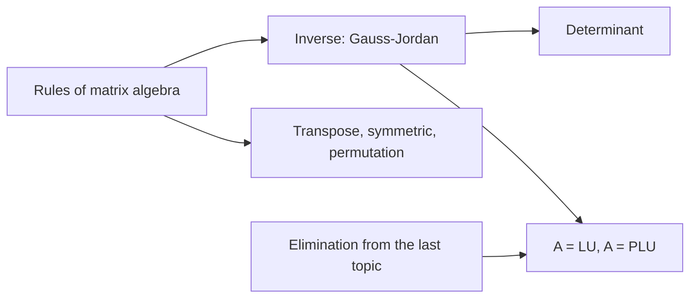
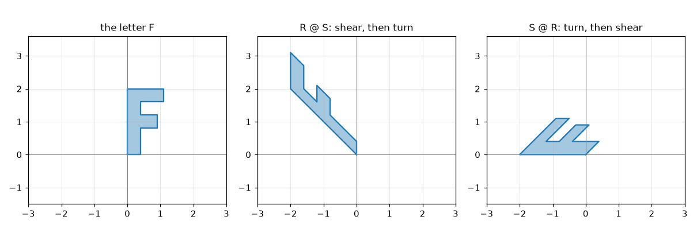
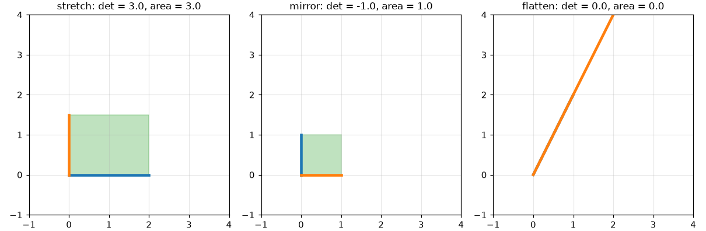

# Matrix Operations and LU Decomposition

**Course:** [Linear Algebra](../README.md) · **Hands-on:** [notebook.ipynb](notebook.ipynb) · **Practice:** [exercises](exercises/problems.md), [assignment](assignment.md)

You can already multiply matrices and run Gaussian elimination. This topic turns those skills into a small toolkit: the **rules** that matrix arithmetic obeys (and the one that fails), the **inverse** and the **determinant**, the **LU decomposition**, which records elimination so that you never repeat it, and the **transpose**. Nearly every later topic, and every machine-learning library, uses these tools, so we work each one with small numbers before generalizing.

## Learning goals

By the end of this topic you can:

- use the laws of matrix arithmetic, and give a quick example showing that $AB \ne BA$;
- compute a product in four ways: entry by entry, column by column, row by row, and as a sum of column-times-row pieces;
- decide when a square matrix has an inverse, find it by Gauss-Jordan elimination on $[A \mid I]$, and use $(AB)^{-1} = B^{-1}A^{-1}$;
- compute a determinant of size 2 by formula and larger ones from the pivots, and say what it measures;
- write elimination as $A = LU$, read the multipliers off $L$, and solve $A\mathbf{x} = \mathbf{b}$ with two triangular solves (and $A = PLU$ when rows are exchanged);
- use transposes, symmetric matrices, and permutation matrices, and name the rules that connect them.

## Prerequisites

- [Vectors and Matrices](../vectors-and-matrices/README.md): matrix-vector and matrix-matrix products, shapes, and the row and column views.
- [Linear Equations and Gaussian Elimination](../linear-equations-and-gaussian-elimination/README.md): $A\mathbf{x} = \mathbf{b}$, pivots, back substitution, elementary matrices, permutation matrices, and the augmented matrix. We build directly on all of these.
- Basic Python and NumPy from [Python Basics](../../../getting-started/python-basics/README.md), only for the notebook.

## Outline

- [Notation at a glance](#notation-at-a-glance)
- [1. Rules for matrix operations](#1-rules-for-matrix-operations)
- [2. Inverse matrices](#2-inverse-matrices)
- [3. The determinant](#3-the-determinant)
- [4. LU decomposition](#4-lu-decomposition)
- [5. Transposes, symmetric matrices, and permutations](#5-transposes-symmetric-matrices-and-permutations)
- [The same ideas in NumPy](#the-same-ideas-in-numpy)
- [Common mistakes](#common-mistakes)
- [Why this matters for AI/ML](#why-this-matters-for-aiml)



> [!NOTE]
> **Concept ownership.** This topic teaches matrix algebra, the inverse, Gauss-Jordan elimination, the basic determinant, LU and PLU, the transpose, and symmetric and permutation matrices in full. Later topics recap them and link back (see the [ownership map](../../../docs/design-notes.md)).

**What this topic leaves for later.**

| Question | Where it is answered |
|---|---|
| What are the column space and nullspace of a matrix, and what is a vector space? | [Vector spaces and subspaces](../vector-spaces-and-subspaces/README.md) |
| What are rank, independence, and dimension? | [Independence, basis, and dimension](../independence-basis-and-dimension/README.md) |
| What are orthogonal matrices, and what is the determinant in terms of eigenvalues? | [Orthogonality and Gram-Schmidt](../orthogonality-and-gram-schmidt/README.md), [eigenvalues and eigenvectors](../eigenvalues-and-eigenvectors/README.md) |

## Key intuition

### Notation at a glance

| You see | It means |
|---|---|
| $I$ | the identity matrix: ones on the diagonal, zeros elsewhere; $IA = AI = A$ |
| $A^k$ | $A$ multiplied by itself $k$ times (for square $A$); $A^0 = I$ |
| $A^{-1}$ | the inverse of $A$, if it exists |
| $\det A$ | the determinant of $A$, a single number |
| $L$, $U$ | lower and upper triangular matrices, with $A = LU$ |
| $P$ | a permutation matrix (rows of $I$ in a different order) |
| $A^\top$ | the transpose of $A$: rows become columns |

### 1. Rules for matrix operations

Adding matrices of the same shape, and multiplying a matrix by a number, work entry by entry, as for vectors. Multiplication has more structure. These laws hold for any matrices whose shapes fit:

- **Associative:** $(AB)C = A(BC)$. Both mean "apply $C$ first, then $B$, then $A$", so you may group the product as you like.
- **Distributive:** $A(B + C) = AB + AC$ and $(A + B)C = AC + BC$.
- **Identity:** $AI = IA = A$.
- **Powers:** for a square matrix, $A^2 = AA$, $A^3 = AAA$, and $A^pA^q = A^{p+q}$.

One law does not hold: $AB$ is usually different from $BA$. A small example:

```math
\begin{bmatrix} 1 & 1 \\ 0 & 1 \end{bmatrix}
\begin{bmatrix} 1 & 0 \\ 1 & 1 \end{bmatrix}
=
\begin{bmatrix} 2 & 1 \\ 1 & 1 \end{bmatrix}
\quad\text{but}\quad
\begin{bmatrix} 1 & 0 \\ 1 & 1 \end{bmatrix}
\begin{bmatrix} 1 & 1 \\ 0 & 1 \end{bmatrix}
=
\begin{bmatrix} 1 & 1 \\ 1 & 2 \end{bmatrix}.
```

A consequence: $(A + B)^2 = A^2 + AB + BA + B^2$, which is not $A^2 + 2AB + B^2$. Another surprise: $AB$ can be the zero matrix even when neither $A$ nor $B$ is zero. Take $A$ with a single $1$ in the top-left corner and $B$ with a single $1$ in the bottom-right corner, and every product of an entry of $A$ with an entry of $B$ meets a zero.



*Shear then turn gives a different shape from turn then shear, so $RS \ne SR$. The matrix nearest the shape acts first.*

**Four ways to see one product.** Take $`A = \begin{bmatrix}1&2\\3&4\end{bmatrix}`$ and $`B = \begin{bmatrix}5&6\\7&8\end{bmatrix}`$. All four recipes give the same $AB$:

1. **Entries.** Each entry is a dot product of a row of $A$ with a column of $B$: $(AB)_{11} = 1\cdot5 + 2\cdot7 = 19$.
2. **Columns.** Each column of $AB$ is $A$ times a column of $B$: the first column is $A\,(5,7) = 5\,(1,3) + 7\,(2,4) = (19, 43)$.
3. **Rows.** Each row of $AB$ is a row of $A$ times $B$: the first row is $(1,2)\,B = 1\,(5,6) + 2\,(7,8) = (19, 22)$.
4. **Column times row.** Add up (column $k$ of $A$) times (row $k$ of $B$), each of which is a whole grid:

```math
\begin{bmatrix} 1 \\ 3 \end{bmatrix}\begin{bmatrix} 5 & 6 \end{bmatrix}
+ \begin{bmatrix} 2 \\ 4 \end{bmatrix}\begin{bmatrix} 7 & 8 \end{bmatrix}
= \begin{bmatrix} 5 & 6 \\ 15 & 18 \end{bmatrix} + \begin{bmatrix} 14 & 16 \\ 28 & 32 \end{bmatrix}
= \begin{bmatrix} 19 & 22 \\ 43 & 50 \end{bmatrix}.
```

The last view is **block multiplication** in disguise. You may cut matrices into blocks and multiply the blocks like single entries, as long as the block shapes fit. If $A$ is cut into a left part $A_1$ and a right part $A_2$, and $B$ into a top part $B_1$ and a bottom part $B_2$, then $AB = A_1B_1 + A_2B_2$.

**Check yourself**

1. Compute $AB$ and $BA$ for $`A = \begin{bmatrix} 0 & 1 \\ 0 & 0 \end{bmatrix}`$ and $`B = \begin{bmatrix} 1 & 0 \\ 0 & 0 \end{bmatrix}`$. (Rows are $(0,1),(0,0)$ and $(1,0),(0,0)$.)
2. If $A$ is $3 \times 2$ and $B$ is $2 \times 5$, what are the shapes of $AB$ and of each column-times-row piece?

<details>
<summary>Answers</summary>

1. $AB$ is the zero matrix, and $BA$ has a single $1$ in the top-right corner. So $AB \ne BA$, and a product can be zero with nonzero factors.
2. $AB$ is $3 \times 5$. There are two pieces (one per inner index), and each is a $3 \times 1$ column times a $1 \times 5$ row, a full $3 \times 5$ grid. They add up to $AB$.

</details>

### 2. Inverse matrices

The **inverse** of a square matrix $A$, if it exists, is the matrix $A^{-1}$ that undoes $A$:

$$
A^{-1}A = I \qquad\text{and}\qquad AA^{-1} = I.
$$

If $A$ turns a vector $\mathbf{x}$ into $\mathbf{y}$, then $A^{-1}$ turns $\mathbf{y}$ back into $\mathbf{x}$. For example, $`A = \begin{bmatrix} 1 & 2 \\ 3 & 7 \end{bmatrix}`$ has the inverse $`A^{-1} = \begin{bmatrix} 7 & -2 \\ -3 & 1 \end{bmatrix}`$. Check by multiplying:

```math
\begin{bmatrix} 1 & 2 \\ 3 & 7 \end{bmatrix}
\begin{bmatrix} 7 & -2 \\ -3 & 1 \end{bmatrix}
=
\begin{bmatrix} 7 - 6 & -2 + 2 \\ 21 - 21 & -6 + 7 \end{bmatrix}
=
\begin{bmatrix} 1 & 0 \\ 0 & 1 \end{bmatrix}.
```

**When does the inverse exist?** Only square matrices have one, and not all of them. The test comes straight from elimination: $A$ has an inverse exactly when elimination finds a **full set of pivots** ($n$ of them for an $n \times n$ matrix, using row exchanges if needed). With all pivots present, back substitution solves $A\mathbf{x} = \mathbf{b}$ for every $\mathbf{b}$, and in particular for the columns of $I$, and those solutions are the columns of $A^{-1}$. If a pivot is missing, the matrix is singular (last topic), some right-hand sides have no solution, and no inverse exists.

**Finding it: Gauss-Jordan elimination.** Write $A$ next to $I$ as $[A \mid I]$ and do row operations until the left half becomes $I$. The right half is then $A^{-1}$. Here it is for $`A = \begin{bmatrix} 1 & 2 \\ 3 & 7 \end{bmatrix}`$:

```math
\left[\begin{array}{cc|cc} 1 & 2 & 1 & 0 \\ 3 & 7 & 0 & 1 \end{array}\right]
\xrightarrow{R_2 - 3R_1}
\left[\begin{array}{cc|cc} 1 & 2 & 1 & 0 \\ 0 & 1 & -3 & 1 \end{array}\right]
\xrightarrow{R_1 - 2R_2}
\left[\begin{array}{cc|cc} 1 & 0 & 7 & -2 \\ 0 & 1 & -3 & 1 \end{array}\right]
```

The first step is ordinary elimination. The second clears the entry above the second pivot (that "going upward" is the new part). When a pivot is not already $1$, divide its row by it. Why does this work? Every row operation is multiplication by an elementary matrix. If the product of all of them is $E$, then $EA = I$, so $E = A^{-1}$. The right half started as $I$ and received the same operations, so it ends as $EI = A^{-1}$.

**Inverse of a product.** $(AB)^{-1} = B^{-1}A^{-1}$, with the order reversed. Think of socks and shoes: you put on socks and then shoes, so to undo it you remove shoes first. Check: $(AB)(B^{-1}A^{-1}) = A(BB^{-1})A^{-1} = AA^{-1} = I$.

> [!WARNING]
> **Do not compute an inverse just to solve $A\mathbf{x} = \mathbf{b}$.** The formula $\mathbf{x} = A^{-1}\mathbf{b}$ is correct, but a solver that goes straight to $\mathbf{x}$ (as in the [previous topic](../linear-equations-and-gaussian-elimination/README.md)) does less work and is usually more accurate. Use the inverse for understanding, and `solve` for computing.

**Check yourself**

1. Which of $`\begin{bmatrix} 1 & 2 \\ 2 & 4 \end{bmatrix}`$ and $`\begin{bmatrix} 1 & 2 \\ 2 & 5 \end{bmatrix}`$ has an inverse? (Look for a full set of pivots.)
2. If $A$ and $B$ are invertible, what is $(ABC)^{-1}$ in terms of $A^{-1}$, $B^{-1}$, $C^{-1}$?

<details>
<summary>Answers</summary>

1. The second. Elimination on the first gives $R_2 - 2R_1 = (0, 0)$: no second pivot. For the second, $R_2 - 2R_1 = (0, 1)$, so the pivots are $1$ and $1$.
2. $C^{-1}B^{-1}A^{-1}$: the reverse order, each factor inverted.

</details>

### 3. The determinant

The **determinant** of a square matrix is a single number that answers two questions: how much does the matrix scale areas (or volumes), and is the matrix invertible?

For a $2 \times 2$ matrix there is a formula:

```math
\det \begin{bmatrix} a & b \\ c & d \end{bmatrix} = ad - bc.
```

For $`A = \begin{bmatrix} 1 & 2 \\ 3 & 7 \end{bmatrix}`$ this is $1\cdot7 - 2\cdot3 = 1$.

**What it measures.** Apply the matrix to the unit square. The square becomes a parallelogram, and its area is $|\det A|$. A determinant of $3$ stretches areas threefold. A **negative** determinant means the picture is flipped over, like its mirror image. A determinant of $0$ means the square is squashed flat onto a line, with area zero. In 3D, the determinant is the factor by which volumes scale.



*The blue edge is the image of the square's bottom side and the orange edge is the image of its left side. The mirror swaps them, which is the flip a negative determinant signals. The flattening collapses everything onto one line.*

**Computing larger ones.** Elimination gives a practical method: the determinant is the **product of the pivots**, times $-1$ for every row exchange. For the $3 \times 3$ matrix of the last topic, with $2,\ 1,\ -5$ as pivots and no exchanges, $\det A = 2\cdot1\cdot(-5) = -10$. A matrix that needs one exchange and has pivots $1,\ 2,\ \tfrac32$ has determinant $-(1\cdot2\cdot\tfrac32) = -3$. (There is also a formula built from smaller determinants called cofactors. It is useful for small cases but slow in general, so we skip it.)

**Rules to remember.**

- $\det(AB) = \det A \cdot \det B$. Scaling areas by $A$ and then by $B$ scales them by the product.
- $\det(A^{-1}) = 1/\det A$.
- $\det A = 0$ exactly when $A$ is singular. A missing pivot makes the product of pivots zero.
- Exchanging two rows flips the sign of the determinant.

The determinant also equals the product of the eigenvalues of $A$, which we meet in [eigenvalues and eigenvectors](../eigenvalues-and-eigenvectors/README.md).

**Check yourself**

1. Find $`\det \begin{bmatrix} 3 & 1 \\ 2 & 4 \end{bmatrix}`$. Does the matrix have an inverse?
2. A $3 \times 3$ matrix has pivots $3,\ -2,\ 4$ and needed one row exchange. What is its determinant?

<details>
<summary>Answers</summary>

1. $3\cdot4 - 1\cdot2 = 10$. It is not zero, so yes, an inverse exists.
2. The pivot product is $3\cdot(-2)\cdot4 = -24$, and one exchange flips the sign, so $\det = 24$.

</details>

### 4. LU decomposition

Gaussian elimination turns $A$ into an upper triangular matrix $U$. The **LU decomposition** keeps a record of how, so that the work can be reused. It writes

$$
A = LU,
$$

where $U$ is the upper triangular result of elimination and $L$ is a **lower** triangular matrix (zeros above the diagonal, ones on the diagonal) that holds the multipliers.

**Where $L$ comes from.** In the last topic, three elementary matrices did the elimination: $E_{32}E_{31}E_{21}A = U$. Move them to the other side by inverting. Each $E^{-1}$ simply *adds back* what $E$ subtracted, so $A = E_{21}^{-1}E_{31}^{-1}E_{32}^{-1}\,U$, and the matrix in front is $L$. For that example the multipliers were $\ell_{21} = 2$, $\ell_{31} = -1$, $\ell_{32} = 3$:

```math
A = \begin{bmatrix} 2 & 1 & -1 \\ 4 & 3 & 1 \\ -2 & 2 & 5 \end{bmatrix}
= \underbrace{\begin{bmatrix} 1 & 0 & 0 \\ 2 & 1 & 0 \\ -1 & 3 & 1 \end{bmatrix}}_{L}
\underbrace{\begin{bmatrix} 2 & 1 & -1 \\ 0 & 1 & 3 \\ 0 & 0 & -5 \end{bmatrix}}_{U}.
```

The multipliers sit in $L$ exactly as they were used, with no extra arithmetic. Why? In the product $E_{32}E_{31}E_{21}$ the entries mix (the combined matrix has a $7$ in the bottom-left corner, which is not a multiplier). But the *inverses*, taken in the order $E_{21}^{-1}E_{31}^{-1}E_{32}^{-1}$, do not interfere with each other, so each multiplier lands untouched in its own position. Check one row: row 3 of $LU$ is $-1\cdot(2,1,-1) + 3\cdot(0,1,3) + 1\cdot(0,0,-5) = (-2, 2, 5)$, the third row of $A$.

**Solving with $L$ and $U$.** Since $A\mathbf{x} = LU\mathbf{x} = \mathbf{b}$, solve in two easy steps. First solve $L\mathbf{c} = \mathbf{b}$ from the top down (**forward substitution**), then $U\mathbf{x} = \mathbf{c}$ from the bottom up (back substitution). With $\mathbf{b} = (3, 11, 7)$:

- forward: $c_1 = 3$, then $c_2 = 11 - 2\cdot3 = 5$, then $c_3 = 7 + 3 - 3\cdot5 = -5$;
- back: $-5z = -5$ gives $z = 1$, then $y = 5 - 3z = 2$, then $2x = 3 - y + z$ gives $x = 1$.

The vector $\mathbf{c}$ is the same $\mathbf{c} = (3, 5, -5)$ that elimination produced last time.

**Why bother?** Factoring costs about $n^3/3$ multiplications. Each triangular solve then costs only about $n^2$ in total. For $n = 1000$, that is roughly $333$ million once and about a million for every further right-hand side, so with many right-hand sides sharing one $A$ you factor once and solve cheaply many times. The notebook times this.

**Row exchanges: $A = PLU$.** If a pivot is zero (or, for safety, small), rows are swapped. The swaps collect into a permutation matrix and the factorization becomes $A = PLU$. SciPy's `scipy.linalg.lu` returns exactly this triple $P, L, U$. (Many textbooks write the same thing as $PA = LU$ with the permutation on the other side; since $P^{-1} = P^\top$ the two are equivalent, as section 5 explains.)

**Check yourself**

1. Given $`L = \begin{bmatrix} 1 & 0 \\ 3 & 1 \end{bmatrix}`$ and $`U = \begin{bmatrix} 2 & 1 \\ 0 & 3 \end{bmatrix}`$, find $A = LU$ and solve $A\mathbf{x} = (4, 18)$ by the two triangular solves.
2. Why is $A = LU$ especially helpful when you must solve with the same $A$ and a hundred different right-hand sides?

<details>
<summary>Answers</summary>

1. $`A = \begin{bmatrix} 2 & 1 \\ 6 & 6 \end{bmatrix}`$ (row 2 is $3\,(2,1) + (0,3)$). Forward: $c_1 = 4$, $c_2 = 18 - 3\cdot4 = 6$. Back: $3y = 6$ gives $y = 2$, then $2x + 2 = 4$ gives $x = 1$. So $\mathbf{x} = (1, 2)$.
2. The expensive elimination happens once. Each new right-hand side then needs only a forward and a back substitution, which cost about $n^2$ instead of about $n^3/3$.

</details>

### 5. Transposes, symmetric matrices, and permutations

The **transpose** $A^\top$ swaps rows and columns: entry $(i, j)$ of $A^\top$ is entry $(j, i)$ of $A$. A $2 \times 3$ matrix becomes $3 \times 2$:

```math
A = \begin{bmatrix} 1 & 2 & 3 \\ 4 & 5 & 6 \end{bmatrix}, \qquad
A^\top = \begin{bmatrix} 1 & 4 \\ 2 & 5 \\ 3 & 6 \end{bmatrix}.
```

For vectors, $\mathbf{v}\cdot\mathbf{w} = \mathbf{v}^\top\mathbf{w}$: a row times a column. The rules to know:

- $(AB)^\top = B^\top A^\top$, with the order reversed, just like the inverse of a product.
- $(A^{-1})^\top = (A^\top)^{-1}$.

A matrix is **symmetric** if $S = S^\top$: it mirrors across the diagonal, like $`\begin{bmatrix} 4 & 2 \\ 2 & 3 \end{bmatrix}`$. For any matrix $A$, the product $A^\top A$ is symmetric: by the rule above, $(A^\top A)^\top = A^\top (A^\top)^\top = A^\top A$. For $A$ with rows $(1,2),(3,4),(5,6)$, it gives $`\begin{bmatrix} 35 & 44 \\ 44 & 56 \end{bmatrix}`$.

A **permutation matrix** is the identity with its rows in a different order. It reorders the rows of whatever it multiplies. Its columns are a rearrangement of the columns of $I$, which makes $P^\top P = I$, so

$$
P^{-1} = P^\top.
$$

A symmetric matrix with a full set of pivots also factors in a symmetric way, $S = LDL^\top$, where $D$ is a diagonal matrix holding the pivots. For $`S = \begin{bmatrix} 4 & 2 \\ 2 & 3 \end{bmatrix}`$ that is $`L = \begin{bmatrix} 1 & 0 \\ \tfrac12 & 1 \end{bmatrix}`$ and $D$ with diagonal $4,\ 2$. We only name this idea here; it has a close cousin, the Cholesky factorization, which later topics meet.

**Check yourself**

1. $A$ is $2 \times 3$ and $B$ is $3 \times 4$. What are the shapes of $(AB)^\top$, $B^\top$, and $A^\top$, and which product of the last two equals $(AB)^\top$?
2. Is $A^\top A$ symmetric when $A$ is $5 \times 2$? What size is it?

<details>
<summary>Answers</summary>

1. $(AB)^\top$ is $4 \times 2$, $B^\top$ is $4 \times 3$, and $A^\top$ is $3 \times 2$. The product $B^\top A^\top$ is $4 \times 2$ and equals $(AB)^\top$.
2. Yes, always. It is $2 \times 2$ (rows of $A^\top$ times columns of $A$).

</details>

### The same ideas in NumPy

```python
import numpy as np

A = np.array([[1, 2], [3, 4]])
B = np.array([[5, 6], [7, 8]])
print(A @ B)                                     # the product
print(sum(np.outer(A[:, k], B[k]) for k in range(2)))   # column-times-row view
print(np.array_equal(A @ B, B @ A))              # order matters
```

```text
[[19 22]
 [43 50]]
[[19 22]
 [43 50]]
False
```

```python
M = np.array([[1, 2], [3, 7]])
print(np.linalg.inv(M))
print(round(np.linalg.det(M), 6))
b = np.array([5, 17])
print(np.linalg.solve(M, b))                     # solve directly, no inverse
```

```text
[[ 7. -2.]
 [-3.  1.]]
1.0
[1. 2.]
```

```python
import scipy.linalg as sla

A3 = np.array([[2, 1, -1],
               [4, 3,  1],
               [-2, 2, 5]])
P, L, U = sla.lu(A3)                             # SciPy swaps rows for safety
print(np.allclose(P @ L @ U, A3))
print(L)

lu_piv = sla.lu_factor(A3)                       # factor once ...
print(sla.lu_solve(lu_piv, [3, 11, 7]))          # ... then solve cheaply
print(sla.lu_solve(lu_piv, [1, 0, 0]))
```

```text
True
[[ 1.          0.          0.        ]
 [-0.5         1.          0.        ]
 [ 0.5        -0.14285714  1.        ]]
[1. 2. 1.]
[-1.3  2.2 -1.4]
```

SciPy chooses the largest available pivot, so its $L$ and $U$ differ from the hand example, but $A = PLU$ still holds. The last two lines solve for two different right-hand sides with one factorization.

```python
S = np.array([[4, 2], [2, 3]])
G = np.array([[1, 2], [3, 4], [5, 6]])
print(np.allclose((A @ B).T, B.T @ A.T))
print(G.T @ G)                                   # always symmetric
print(np.allclose(S, S.T))
```

```text
True
[[35 44]
 [44 56]]
True
```

The notebook builds the inverse and the LU factorization from scratch and compares them with these library calls.

## Common mistakes

- **Assuming $AB = BA$.** Keep the order. This also breaks the "binomial" shortcuts such as $(A+B)^2 = A^2 + 2AB + B^2$.
- **Forgetting to reverse the order.** $(AB)^{-1} = B^{-1}A^{-1}$ and $(AB)^\top = B^\top A^\top$. The factors flip in both rules.
- **Trying to invert a singular matrix.** No full set of pivots means no inverse, and a determinant of zero says the same.
- **Mixing up the sign of the multiplier in $L$.** Elimination subtracts $\ell$ times a row, but $L$ stores $+\ell$.
- **Using the inverse to solve a system.** Prefer `solve`, or a factorization you reuse.

## Why this matters for AI/ML

- **The inverse appears in formulas, but is rarely formed.** The normal equations of least squares and the formulas for Gaussian models contain an inverse such as $(A^\top A)^{-1}$. Software solves the corresponding system with a factorization instead. See [projections and least squares](../projections-and-least-squares/README.md).
- **Factorizations sit under the solvers.** NumPy's and SciPy's solvers call LU-style routines (and Cholesky for symmetric matrices of the right kind), written in the LAPACK library. When a library says it "solves a linear system", this is what runs.
- **The determinant appears in Gaussian densities.** The bell-curve formula for several variables contains $\det\Sigma$ of the covariance matrix $\Sigma$, usually as a *log-determinant* for numerical safety (`numpy.linalg.slogdet`). See [probability distributions](../../probability-and-statistics/probability-distributions/README.md). Models called normalizing flows are built around determinants too, which we only name here.
- **Transposes and symmetric matrices are everywhere.** For a data matrix $X$ whose rows are examples, $X^\top X$ is a symmetric matrix of sums of products, and the covariance matrix is built from it. A Gram matrix $E E^\top$ of embeddings holds every pairwise dot product at once. In a Transformer, the attention scores are $QK^\top$, one matrix product of query vectors with key vectors.
- **Layers collapse without activations.** Two layers with no non-linear step between them compute $W_2(W_1\mathbf{x}) = (W_2W_1)\mathbf{x}$: one matrix. A network of any depth without activations is as limited as a single layer, which is why activation functions matter. See [neural network basics](../../../deep-learning/neural-network-basics/README.md).

### Reordering products: a concrete cost

Associativity lets frameworks choose the cheapest way to compute a chain of products. Let $A$ and $B$ be $1000 \times 1000$ matrices and $\mathbf{x}$ a vector with 1000 entries. The two groupings give the same answer, $(AB)\mathbf{x} = A(B\mathbf{x})$, but not the same work:

- $(AB)\mathbf{x}$: forming $AB$ takes about $1000^3 = 10^9$ multiplications, then one more product with $\mathbf{x}$.
- $A(B\mathbf{x})$: two matrix-vector products, about $2 \times 1000^2 = 2\times10^6$ multiplications.

The second is roughly 500 times cheaper. The same idea explains why a batch of examples is pushed through a network as matrix products, one layer after another, rather than by building big combined matrices. The notebook times it.

## Summary

- Matrix multiplication is associative and distributive, has an identity, and has powers, but $AB \ne BA$ in general. A product can be seen by entries, columns, rows, or as a sum of column-times-row grids.
- The inverse undoes a matrix. It exists exactly when elimination finds a full set of pivots, is found by Gauss-Jordan elimination on $[A \mid I]$, and reverses the order for products.
- The determinant scales areas and volumes, is the product of the pivots up to the sign from row exchanges, multiplies for products, and is zero exactly for singular matrices.
- $A = LU$ records elimination, with the multipliers in $L$. Two triangular solves then give $\mathbf{x}$ cheaply for each right-hand side. Row exchanges give $A = PLU$.
- $(AB)^\top = B^\top A^\top$, $A^\top A$ is symmetric, and $P^{-1} = P^\top$ for permutation matrices.

## Further reading

Chapter pointers and free links are in [resources.md](resources.md).

## Practice

- [Notebook](notebook.ipynb): see the effect of order on shapes, check the laws, build the inverse and LU from scratch, draw determinants as area factors, and time the savings. It follows the lesson:

  | Lesson section | Notebook section |
  |---|---|
  | 1. Rules for matrix operations | 1. Rules for matrix operations |
  | 2. Inverse matrices | 2. Inverse matrices and Gauss-Jordan |
  | 3. The determinant | 3. The determinant as an area-scaling factor |
  | 4. LU decomposition | 4. LU decomposition |
  | 5. Transposes, symmetric matrices, and permutations | 5. Transposes, symmetric matrices, and permutations |
  | Why this matters for AI/ML | the cost demo and layer collapse in section 1, and the many-right-hand-sides demo in section 4 |

- [Exercises](exercises/problems.md) (with [solutions](exercises/solutions.md)): ten problems, easy to harder.
- [Assignment](assignment.md): factor one matrix once and use it to solve many heat-source scenarios.

---

[← Previous: Linear Equations and Gaussian Elimination](../linear-equations-and-gaussian-elimination/README.md) | [Next: Vector Spaces and Subspaces →](../vector-spaces-and-subspaces/README.md)
