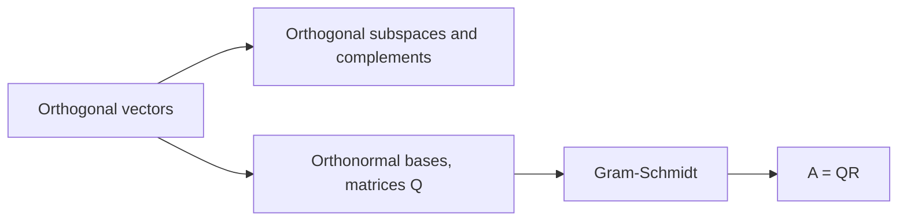
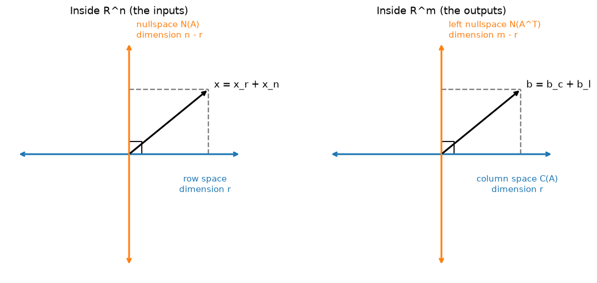
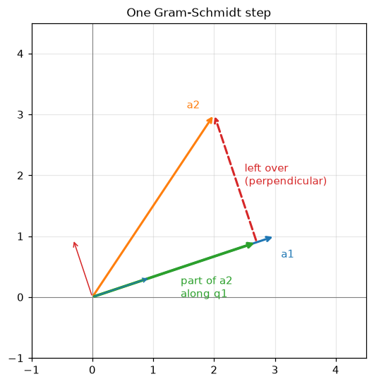
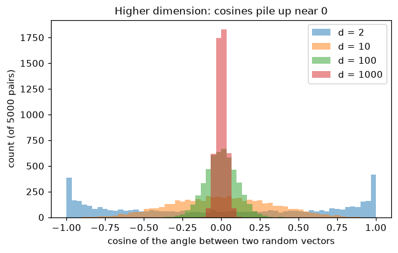

# Orthogonality and Gram-Schmidt

**Course:** [Linear Algebra](../README.md) · **Hands-on:** [notebook.ipynb](notebook.ipynb) · **Practice:** [exercises](exercises/problems.md), [assignment](assignment.md)

Perpendicular directions are the easiest to work with. If two arrows meet at a right angle, neither one has any part along the other, so you can handle them separately. This topic uses that idea twice. First, it shows that the four subspaces of a matrix come in perpendicular pairs, which completes the picture from the last topic. Second, it shows how to turn any set of independent vectors into a perpendicular set of unit vectors (the **Gram-Schmidt process**), which makes coordinates trivial to compute and leads to the **QR factorization** that numerical software relies on.

## Learning goals

By the end of this topic you can:

- test vectors for orthogonality with the dot product, and use Pythagoras for orthogonal vectors;
- explain why the row space is orthogonal to the nullspace and the column space to the left nullspace, and describe the orthogonal complement of a subspace;
- say what an orthonormal basis and an orthogonal matrix are, and compute coordinates in an orthonormal basis with dot products;
- show that an orthogonal matrix keeps lengths and angles, and give rotations and reflections as examples;
- run the Gram-Schmidt process by hand on three vectors, read the factorization $A = QR$ from it, and say what a zero vector in the process means;
- explain, in a paragraph, why orthogonality only holds up to rounding on a computer and why libraries use Householder QR.

## Prerequisites

- [Vectors and Matrices](../vectors-and-matrices/README.md): the dot product, length, and the angle formula.
- [Independence, Basis, and Dimension](../independence-basis-and-dimension/README.md): bases, rank, and the four fundamental subspaces, including the short orthogonality preview at its end. This topic gives the full story.
- [Vector Spaces and Subspaces](../vector-spaces-and-subspaces/README.md): subspaces, the nullspace, and the column space.
- Basic Python and NumPy from [Python Basics](../../../getting-started/python-basics/README.md), only for the notebook.

## Outline

- [Notation at a glance](#notation-at-a-glance)
- [1. Orthogonal vectors and subspaces](#1-orthogonal-vectors-and-subspaces)
- [2. Orthonormal bases and orthogonal matrices](#2-orthonormal-bases-and-orthogonal-matrices)
- [3. The Gram-Schmidt process and QR](#3-the-gram-schmidt-process-and-qr)
- [The same ideas in NumPy](#the-same-ideas-in-numpy)
- [Common mistakes](#common-mistakes)
- [Why this matters for AI/ML](#why-this-matters-for-aiml)



> [!NOTE]
> **Concept ownership.** This topic teaches orthogonality of vectors and subspaces, orthogonal complements, orthonormal bases, orthogonal matrices, Gram-Schmidt, and the QR factorization in full. Later topics recap them and link back (see the [ownership map](../../../docs/design-notes.md)).

**What this topic leaves for later.**

| Question | Where it is answered |
|---|---|
| How do we project a vector onto a subspace, and what is least squares? | [Projections and least squares](../projections-and-least-squares/README.md) |
| Why are the eigenvectors of a symmetric matrix orthogonal? | [Eigenvalues and eigenvectors](../eigenvalues-and-eigenvectors/README.md) |
| What are rotations and reflections as linear transformations in general? | [Linear transformations](../linear-transformations/README.md) |
| How do the singular vectors give orthonormal bases for the four subspaces? | [Singular value decomposition](../singular-value-decomposition/README.md) |

## Key intuition

### Notation at a glance

| You see | It means |
|---|---|
| $\mathbf{v} \perp \mathbf{w}$ | $\mathbf{v}$ and $\mathbf{w}$ are orthogonal: $\mathbf{v}\cdot\mathbf{w} = 0$ |
| $V^\perp$ | the **orthogonal complement** of a subspace $V$: all vectors perpendicular to every vector in $V$ (read "V perp") |
| $\mathbf{q}_1, \mathbf{q}_2, \dots$ | orthonormal vectors: perpendicular to each other and each of length $1$ |
| $Q$ | a matrix whose columns are orthonormal, so $Q^\top Q = I$ |
| $R$ | an upper triangular matrix, in the factorization $A = QR$ |

### 1. Orthogonal vectors and subspaces

Two vectors are **orthogonal** (perpendicular) when their dot product is $0$. For example, $(3,4)\cdot(-4,3) = -12 + 12 = 0$. The zero vector is orthogonal to everything. Orthogonal vectors obey Pythagoras, and in fact only they do. Expanding the squared length of a sum gives

$$
\|\mathbf{v} + \mathbf{w}\|^2 = \|\mathbf{v}\|^2 + 2\,\mathbf{v}\cdot\mathbf{w} + \|\mathbf{w}\|^2,
$$

so $\|\mathbf{v} + \mathbf{w}\|^2 = \|\mathbf{v}\|^2 + \|\mathbf{w}\|^2$ exactly when $\mathbf{v}\cdot\mathbf{w} = 0$. Check with the example: $\mathbf{v} + \mathbf{w} = (-1, 7)$ has squared length $50$, and $25 + 25 = 50$.

**Orthogonal subspaces.** Two subspaces $V$ and $W$ are orthogonal if **every** vector in $V$ is orthogonal to **every** vector in $W$. The $xy$-plane and the $z$-axis in $\mathbb{R}^3$ are orthogonal. Two planes through the origin in $\mathbb{R}^3$ never are, because they meet in a line, and a nonzero vector on that line would have to be orthogonal to itself. Orthogonal subspaces can share only the zero vector.

**The four subspaces come in perpendicular pairs.** Here is the proof, and it is short.

- **Row space $\perp$ nullspace.** If $A\mathbf{x} = \mathbf{0}$, then each row of $A$ has dot product $0$ with $\mathbf{x}$. A vector in the row space is a combination $c_1\,\text{row}_1 + c_2\,\text{row}_2 + \dots$, so its dot product with $\mathbf{x}$ is $c_1\cdot 0 + c_2\cdot 0 + \dots = 0$.
- **Column space $\perp$ left nullspace.** If $\mathbf{y}^\top A = \mathbf{0}$, then $\mathbf{y}$ has dot product $0$ with every column of $A$, and so with every combination of the columns.

**Orthogonal complements.** The **orthogonal complement** $V^\perp$ of a subspace $V$ is the set of all vectors orthogonal to every vector in $V$. It is a subspace, and for $V$ inside $\mathbb{R}^n$,

$$
\dim V + \dim V^\perp = n.
$$

For example, if $V$ is the $z$-axis in $\mathbb{R}^3$, then $V^\perp$ is the $xy$-plane, and $1 + 2 = 3$. Each orthogonal pair above is a pair of complements, which is stronger than merely being orthogonal:

> The nullspace is **exactly** the orthogonal complement of the row space, and the left nullspace is exactly the orthogonal complement of the column space.

Why "exactly"? Suppose $\mathbf{x}$ is orthogonal to the whole row space. Then it is orthogonal to each row, so every row gives $\text{row}_i\cdot\mathbf{x} = 0$, which is the statement $A\mathbf{x} = \mathbf{0}$. So $\mathbf{x}$ is in the nullspace. (The dimensions agree too: $r + (n - r) = n$.) The consequence is a clean splitting: every $\mathbf{x}$ in $\mathbb{R}^n$ is a sum of a row-space part and a nullspace part, $\mathbf{x} = \mathbf{x}_r + \mathbf{x}_n$, and every $\mathbf{b}$ in $\mathbb{R}^m$ is a sum of a column-space part and a left-nullspace part.



*Each space splits into a pair of perpendicular subspaces whose dimensions add up to the dimension of the whole space. A vector is the sum of its two perpendicular parts.*

A small example. Take the $2 \times 3$ matrix $B$ with rows $(1,1,1)$ and $(1,2,3)$. Its row space is a plane in $\mathbb{R}^3$, and its nullspace is the line through $(1,-2,1)$. Check: $(1,1,1)\cdot(1,-2,1) = 0$ and $(1,2,3)\cdot(1,-2,1) = 1 - 4 + 3 = 0$. The vector $\mathbf{x} = (2, 0, 1)$ splits as $\mathbf{x}_r = (1.5, 1, 0.5)$ in the row space (it equals $2\,(1,1,1) - 0.5\,(1,2,3)$) plus $\mathbf{x}_n = (0.5, -1, 0.5)$ in the nullspace, and the two parts are orthogonal: $0.75 - 1 + 0.25 = 0$. How to find such a split is the subject of the [next topic](../projections-and-least-squares/README.md).

**Check yourself**

1. Are $(1,2,3)$ and $(3,0,-1)$ orthogonal? What is the orthogonal complement of the $z$-axis in $\mathbb{R}^3$, and what are the dimensions?
2. A $4 \times 6$ matrix has rank $3$. What are the dimensions of the nullspace and of the row space, and how do they relate?

<details>
<summary>Answers</summary>

1. $1\cdot3 + 2\cdot0 + 3\cdot(-1) = 0$, so yes. The complement of the $z$-axis is the $xy$-plane: dimensions $1$ and $2$, adding to $3$.
2. The row space has dimension $3$ and the nullspace has dimension $6 - 3 = 3$. They are orthogonal complements inside $\mathbb{R}^6$, and $3 + 3 = 6$.

</details>

### 2. Orthonormal bases and orthogonal matrices

Vectors $\mathbf{q}_1, \dots, \mathbf{q}_k$ are **orthonormal** if they are perpendicular to each other and each has length $1$:
$\mathbf{q}_i\cdot\mathbf{q}_j = 0$ for $i \ne j$, and $\mathbf{q}_i\cdot\mathbf{q}_i = 1$. Put them as the columns of a matrix $Q$. The entries of $Q^\top Q$ are exactly these dot products, so

$$
Q^\top Q = I.
$$

Orthonormal vectors are automatically independent, so $k$ of them in $\mathbb{R}^k$ form an **orthonormal basis**.

**Coordinates become dot products.** In a general basis, finding the coordinates of $\mathbf{v}$ meant solving a system. In an orthonormal basis it is one dot product each. If $\mathbf{v} = c_1\mathbf{q}_1 + \dots + c_n\mathbf{q}_n$, take the dot product with $\mathbf{q}_i$: every term vanishes except $c_i\,\mathbf{q}_i\cdot\mathbf{q}_i = c_i$. So

$$
c_i = \mathbf{q}_i \cdot \mathbf{v}, \qquad \mathbf{v} = (\mathbf{q}_1\cdot\mathbf{v})\,\mathbf{q}_1 + \dots + (\mathbf{q}_n\cdot\mathbf{v})\,\mathbf{q}_n.
$$

Example: $\mathbf{q}_1 = (0.6, 0.8)$ and $\mathbf{q}_2 = (-0.8, 0.6)$ are orthonormal ($0.6\cdot(-0.8) + 0.8\cdot0.6 = 0$, and $0.36 + 0.64 = 1$). For $\mathbf{v} = (7, 1)$: $c_1 = 4.2 + 0.8 = 5$ and $c_2 = -5.6 + 0.6 = -5$. Check: $5\,(0.6, 0.8) - 5\,(-0.8, 0.6) = (3 + 4,\ 4 - 3) = (7, 1)$.

**Orthogonal matrices.** A **square** matrix $Q$ with orthonormal columns is called an **orthogonal matrix**. Then $Q^\top Q = I$ says that the transpose is the inverse:

$$
Q^{-1} = Q^\top, \qquad\text{so also } QQ^\top = I.
$$

Inverting such a matrix costs nothing: just transpose it. And $Q$ preserves length and angle, because for any $\mathbf{x}$ and $\mathbf{y}$,

$$
(Q\mathbf{x})\cdot(Q\mathbf{y}) = \mathbf{x}^\top Q^\top Q\,\mathbf{y} = \mathbf{x}\cdot\mathbf{y}.
$$

Taking $\mathbf{y} = \mathbf{x}$ gives $\|Q\mathbf{x}\| = \|\mathbf{x}\|$, and equal dot products with equal lengths mean equal angles. Examples:

- A **rotation** by angle $\theta$:
```math
Q = \begin{bmatrix} \cos\theta & -\sin\theta \\ \sin\theta & \cos\theta \end{bmatrix}.
```
For $\theta = 90^\circ$ this is the matrix with rows $(0,-1)$ and $(1,0)$, which sends $(3,4)$ to $(-4,3)$. Both have length $5$.
- A **reflection**, such as the matrix with rows $(1,0)$ and $(0,-1)$, which mirrors the plane in the $x$-axis.
- A **permutation matrix** from the earlier topics, which only reorders entries.

The product of two orthogonal matrices is orthogonal: $(Q_1Q_2)^\top(Q_1Q_2) = Q_2^\top Q_1^\top Q_1Q_2 = Q_2^\top Q_2 = I$. Orthogonal matrices have determinant $+1$ (rotations) or $-1$ (reflections). If $Q$ is not square, say $m \times n$ with $n < m$, then $Q^\top Q = I$ still holds, but $QQ^\top$ is not $I$. It is a matrix that projects onto the column space of $Q$, which is the next topic.

**Check yourself**

1. Is $`\begin{bmatrix} 0.6 & 0.8 \\ -0.8 & 0.6 \end{bmatrix}`$ orthogonal? (Columns: $(0.6,-0.8)$ and $(0.8, 0.6)$.)
2. An orthogonal matrix $Q$ sends $\mathbf{x}$ to a vector of length $13$. What was the length of $\mathbf{x}$, and what is $Q^{-1}$?

<details>
<summary>Answers</summary>

1. Yes. The columns have lengths $\sqrt{0.36 + 0.64} = 1$, and their dot product is $0.48 - 0.48 = 0$.
2. The length was $13$, because $Q$ preserves length. $Q^{-1} = Q^\top$.

</details>

### 3. The Gram-Schmidt process and QR

Suppose you have independent vectors $\mathbf{a}_1, \mathbf{a}_2, \mathbf{a}_3$ that are not perpendicular. **Gram-Schmidt** produces orthonormal $\mathbf{q}_1, \mathbf{q}_2, \mathbf{q}_3$ that span the same space, one vector at a time:

1. $\mathbf{q}_1$ is $\mathbf{a}_1$ scaled to length $1$.
2. Take $\mathbf{a}_2$ and subtract its part along $\mathbf{q}_1$, which is $(\mathbf{q}_1\cdot\mathbf{a}_2)\,\mathbf{q}_1$. What is left is perpendicular to $\mathbf{q}_1$. Scale it to length $1$ to get $\mathbf{q}_2$.
3. Take $\mathbf{a}_3$ and subtract its parts along $\mathbf{q}_1$ **and** $\mathbf{q}_2$. Scale what is left to get $\mathbf{q}_3$.

In general: for each $j$, subtract from $\mathbf{a}_j$ its component along every $\mathbf{q}$ already found, then normalize.

```text
for j = 1 to n:
    v = a_j
    for i = 1 to j - 1:
        r_ij = q_i . a_j          (component of a_j along q_i)
        v = v - r_ij * q_i        (remove it)
    r_jj = length of v
    q_j = v / r_jj
```



*One step: the green piece is the part of $\mathbf{a}_2$ along $\mathbf{q}_1$. Subtracting it leaves the red piece, perpendicular to $\mathbf{q}_1$.*

**A worked example.** Take $\mathbf{a}_1 = (1,1,0)$, $\mathbf{a}_2 = (1,0,1)$, $\mathbf{a}_3 = (0,1,1)$.

- $\mathbf{q}_1 = (1,1,0)/\sqrt2 \approx (0.707, 0.707, 0)$.
- $\mathbf{q}_1\cdot\mathbf{a}_2 = 1/\sqrt2$. Subtract: $(1,0,1) - \tfrac{1}{\sqrt2}\mathbf{q}_1 = (1,0,1) - (\tfrac12,\tfrac12,0) = (\tfrac12,-\tfrac12,1)$. Its length is $\sqrt{1.5} \approx 1.225$, so $\mathbf{q}_2 = (1,-1,2)/\sqrt6 \approx (0.408,-0.408,0.816)$.
- $\mathbf{q}_1\cdot\mathbf{a}_3 = 1/\sqrt2$ and $\mathbf{q}_2\cdot\mathbf{a}_3 = 1/\sqrt6$. Subtract both: $(0,1,1) - (\tfrac12,\tfrac12,0) - \tfrac16(1,-1,2) = (-\tfrac23,\tfrac23,\tfrac23)$. Its length is $2/\sqrt3 \approx 1.155$, so $\mathbf{q}_3 = (-1,1,1)/\sqrt3$.

Check: $\mathbf{q}_2\cdot\mathbf{q}_3 = (-1 - 1 + 2)/\sqrt{18} = 0$ and $\mathbf{q}_1\cdot\mathbf{q}_3 = (-1 + 1 + 0)/\sqrt6 = 0$.

**What if the input is dependent?** If $\mathbf{a}_3$ were a combination of $\mathbf{a}_1$ and $\mathbf{a}_2$, subtracting its components along $\mathbf{q}_1$ and $\mathbf{q}_2$ would leave **the zero vector**, which cannot be scaled to length $1$. A zero vector in the process is the signal that the columns are dependent.

**The QR factorization.** Every number we computed has a home. Since $\mathbf{a}_j$ equals its parts along $\mathbf{q}_1, \dots, \mathbf{q}_j$, it is a combination of only the first $j$ of the $\mathbf{q}$'s:

$$
A = QR, \qquad r_{ij} = \mathbf{q}_i\cdot\mathbf{a}_j \ \ (i < j), \qquad r_{jj} = \text{the length of what was left}.
$$

$Q$ has orthonormal columns, and $R$ is **upper triangular** (the entry $r_{ij}$ is zero for $i > j$, since $\mathbf{a}_j$ never involves later $\mathbf{q}$'s). For the example,

```math
R = \begin{bmatrix} \sqrt2 & 1/\sqrt2 & 1/\sqrt2 \\ 0 & \sqrt{3/2} & 1/\sqrt6 \\ 0 & 0 & 2/\sqrt3 \end{bmatrix}
\approx \begin{bmatrix} 1.414 & 0.707 & 0.707 \\ 0 & 1.225 & 0.408 \\ 0 & 0 & 1.155 \end{bmatrix}.
```

**Why QR matters.** To solve $A\mathbf{x} = \mathbf{b}$ with $A = QR$, multiply by $Q^\top$: since $Q^\top Q = I$, the system becomes $R\mathbf{x} = Q^\top\mathbf{b}$, which back substitution solves. No elimination is needed, and no inverse is formed. For a tall $A$ with more rows than columns, the same recipe gives the best-fit answer, and $QQ^\top\mathbf{b}$ is the closest point to $\mathbf{b}$ in the column space (the next topic explains both).

**Classical versus modified.** The steps above are the *classical* Gram-Schmidt process. In exact arithmetic it is perfect, but computers round every number. When the input columns are nearly dependent, small rounding errors in each subtraction add up, and the computed $\mathbf{q}$'s can stop being perpendicular. The **modified** version subtracts each component from all the remaining vectors immediately, and loses far less accuracy. In practice, libraries use **Householder QR**, built from reflections, which stays orthogonal to within rounding error. That is what `numpy.linalg.qr` runs. The notebook shows the difference on a hard example.

**Check yourself**

1. Run Gram-Schmidt on $\mathbf{a}_1 = (3,4)$ and $\mathbf{a}_2 = (1,7)$. Give $\mathbf{q}_1$, $\mathbf{q}_2$, and the diagonal of $R$.
2. What happens in Gram-Schmidt if $\mathbf{a}_2 = 2\mathbf{a}_1$?

<details>
<summary>Answers</summary>

1. $\mathbf{q}_1 = (0.6, 0.8)$. Then $\mathbf{q}_1\cdot\mathbf{a}_2 = 0.6 + 5.6 = 6.2$, and $\mathbf{a}_2 - 6.2\,\mathbf{q}_1 = (1 - 3.72,\ 7 - 4.96) = (-2.72, 2.04)$, of length $3.4$, so $\mathbf{q}_2 = (-0.8, 0.6)$. The diagonal of $R$ is $5$ and $3.4$.
2. The part of $\mathbf{a}_2$ along $\mathbf{q}_1$ is all of $\mathbf{a}_2$, so the left-over is the zero vector. The columns are dependent, and the process cannot continue.

</details>

### The same ideas in NumPy

Orthogonality tests, and the nullspace orthogonal to the rows:

```python
import numpy as np
import scipy.linalg as sla

v = np.array([3, 4])
w = np.array([-4, 3])
print(v @ w, (v + w) @ (v + w), v @ v + w @ w)

B = np.array([[1, 1, 1],
              [1, 2, 3]])
n = sla.null_space(B).ravel()
print(np.allclose(B @ n, 0))
```

```text
0 50 50
True
```

Coordinates in an orthonormal basis are dot products, and $Q$ preserves length:

```python
Q = np.array([[0.6, -0.8],
              [0.8,  0.6]])
x = np.array([7, 1])
print(np.allclose(Q.T @ Q, np.eye(2)))
c = Q.T @ x                                  # the coordinates, with no system to solve
print(c, Q @ c)
print(np.linalg.norm(Q @ x), np.linalg.norm(x))
```

```text
True
[ 5. -5.] [7. 1.]
7.0710678118654755 7.0710678118654755
```

Gram-Schmidt from the algorithm above:

```python
def gram_schmidt(A):
    """Classical Gram-Schmidt on the columns of A. Returns Q and R with A = Q R."""
    A = np.array(A, dtype=float)
    m, n = A.shape
    Q = np.zeros((m, n))
    R = np.zeros((n, n))
    for j in range(n):
        v = A[:, j].copy()
        for i in range(j):
            R[i, j] = Q[:, i] @ A[:, j]
            v -= R[i, j] * Q[:, i]
        R[j, j] = np.linalg.norm(v)
        if R[j, j] < 1e-12:
            raise ValueError("the columns are dependent")
        Q[:, j] = v / R[j, j]
    return Q, R


A = np.column_stack([(1, 1, 0), (1, 0, 1), (0, 1, 1)])
Q, R = gram_schmidt(A)
print(Q.round(3))
print(R.round(3))
print(np.allclose(Q @ R, A), np.allclose(Q.T @ Q, np.eye(3)))
```

```text
[[ 0.707  0.408 -0.577]
 [ 0.707 -0.408  0.577]
 [ 0.     0.816  0.577]]
[[1.414 0.707 0.707]
 [0.    1.225 0.408]
 [0.    0.    1.155]]
True True
```

NumPy's `qr` gives the same factors up to signs:

```python
Q_np, R_np = np.linalg.qr(A)
print(Q_np.round(3))
print(R_np.round(3))
signs = np.sign(np.diag(R_np))                 # flip signs so the diagonal of R is positive
print(np.allclose(Q_np * signs, Q), np.allclose(R_np * signs[:, None], R))
```

```text
[[-0.707  0.408 -0.577]
 [-0.707 -0.408  0.577]
 [-0.     0.816  0.577]]
[[-1.414 -0.707 -0.707]
 [ 0.     1.225  0.408]
 [ 0.     0.     1.155]]
True True
```

## Common mistakes

- **Treating "orthogonal" and "orthonormal" as the same.** Orthogonal means perpendicular. Orthonormal also demands length $1$. A matrix with orthogonal columns of different lengths is *not* an orthogonal matrix.
- **Forgetting to subtract the components along *all* earlier vectors.** In step 3 of Gram-Schmidt, subtract the parts along both $\mathbf{q}_1$ and $\mathbf{q}_2$.
- **Using the unnormalized vector in the dot product.** The formula $(\mathbf{q}_1\cdot\mathbf{a}_2)\,\mathbf{q}_1$ needs $\mathbf{q}_1$ to have length $1$. Normalize before you subtract.
- **Expecting $QQ^\top = I$ for a non-square $Q$.** Only $Q^\top Q = I$ holds. $QQ^\top = I$ needs a square $Q$.
- **Comparing floats with `==`.** After computing $Q^\top Q$ on a computer, the off-diagonal entries are tiny numbers like $10^{-17}$, not exactly $0$. Test with `np.allclose`.

## Why this matters for AI/ML

- **Orthogonal weight matrices keep signals stable.** An orthogonal matrix does not change the length of a vector, so passing a signal through many orthogonal layers neither shrinks nor blows it up, and the same holds for gradients flowing backward. This is the reason for *orthogonal initialization* of weights, used especially for recurrent networks, where the same matrix is applied again and again. Orthogonality helps with exploding and vanishing gradients, but it is not a cure-all: activation functions and training change the matrices as learning proceeds. See [neural network basics](../../../deep-learning/neural-network-basics/README.md) and [recurrent networks](../../../deep-learning/recurrent-networks/README.md).
- **Correlated features cause trouble; orthogonal ones do not.** If two features are nearly the same, the data matrix has nearly dependent columns, and the fitted weights become unstable. Making the features orthogonal (Gram-Schmidt does exactly this) removes the overlap. Finding good orthogonal directions of the data is the idea behind [PCA](../../../machine-learning/dimensionality-reduction/README.md), and *whitening* goes one step further by also scaling those directions to equal spread.
- **Random vectors in high dimensions are nearly orthogonal.** The cosine between two random vectors in $d$ dimensions has a spread of about $1/\sqrt{d}$. In $d = 2$ it can be anything, but for $d = 1000$ it is typically within about $0.03$ of $0$ (one standard deviation). This is one reason a space with hundreds of dimensions, such as the space of text embeddings, has room for a huge number of nearly independent directions.



*The cosine of the angle between two random vectors, 5,000 pairs per dimension. The higher the dimension, the more the values bunch near $0$.*

- **Rotations in modern models.** Rotation matrices, the orthogonal matrices described above, sit at the heart of rotary position embeddings in Transformers, which we only name here. See [Transformers](../../../deep-learning/transformers/README.md).
- **QR is how libraries solve least squares.** Fitting a linear model by least squares can be done with QR instead of by forming and inverting a big matrix, and it is more accurate. See [projections and least squares](../projections-and-least-squares/README.md) and [linear regression](../../../machine-learning/linear-regression/README.md).

### Orthogonality only holds up to rounding

On a computer, $Q^\top Q$ is never *exactly* the identity matrix, because every operation rounds. Compare a float check with an `allclose` check on the $Q$ from Gram-Schmidt above:

```python
G = Q.T @ Q
print(np.array_equal(G, np.eye(3)))
print(np.allclose(G, np.eye(3)))
print(f"{np.abs(G - np.eye(3)).max():.1e}")
```

```text
False
True
2.2e-16
```

The matrix is orthogonal to about $10^{-16}$, which is as good as floating-point numbers get. Never test with `==`: use `np.allclose`, or measure the size of $Q^\top Q - I$. The error also depends on the input: for nearly dependent columns, classical Gram-Schmidt can lose almost all orthogonality (the notebook uses the Hilbert matrix to show an error of order $1$), while Householder QR stays near $10^{-15}$.

## Summary

- Vectors are orthogonal when their dot product is $0$, and only then does Pythagoras hold. The row space is orthogonal to the nullspace and the column space to the left nullspace, and each pair are orthogonal complements, with dimensions adding to $n$ (or $m$).
- Orthonormal vectors give $Q^\top Q = I$. In an orthonormal basis, coordinates are dot products. A square $Q$ has $Q^{-1} = Q^\top$ and preserves lengths and angles. Rotations and reflections are examples.
- Gram-Schmidt subtracts earlier components and normalizes. It gives $A = QR$ with $R$ upper triangular, and a zero vector in the process means dependent columns.
- On a computer, orthogonality holds only up to rounding. Classical Gram-Schmidt can lose it, and software uses Householder QR.

## Further reading

Chapter pointers and free links are in [resources.md](resources.md).

## Practice

- [Notebook](notebook.ipynb): test orthogonality, check the four-subspace pairs, compute coordinates by dot products, watch orthogonal matrices act on a shape, run Gram-Schmidt with a trace, compare with `numpy.linalg.qr`, and simulate nearly orthogonal random vectors. It follows the lesson:

  | Lesson section | Notebook section |
  |---|---|
  | 1. Orthogonal vectors and subspaces | 1. Orthogonal vectors and Pythagoras, 2. The four fundamental subspaces are orthogonal in pairs |
  | 2. Orthonormal bases and orthogonal matrices | 3. Coordinates in an orthonormal basis, 4. Orthogonal matrices preserve lengths and angles |
  | 3. The Gram-Schmidt process and QR | 5. Gram-Schmidt from scratch, 6. QR from NumPy, 7. When Gram-Schmidt loses orthogonality |
  | Why this matters for AI/ML | 8. Random vectors in high dimensions are nearly orthogonal |

- [Exercises](exercises/problems.md) (with [solutions](exercises/solutions.md)): ten problems, easy to harder.
- [Assignment](assignment.md): orthogonalize three correlated feature columns and compare correlations before and after.

---

[← Previous: Independence, Basis, and Dimension](../independence-basis-and-dimension/README.md) | [Next: Projections and Least Squares →](../projections-and-least-squares/README.md)
