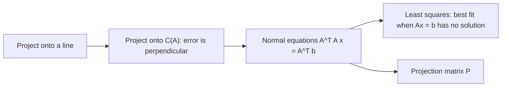
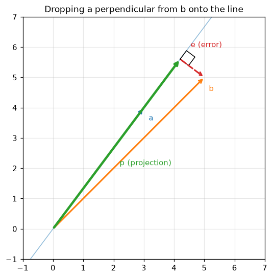
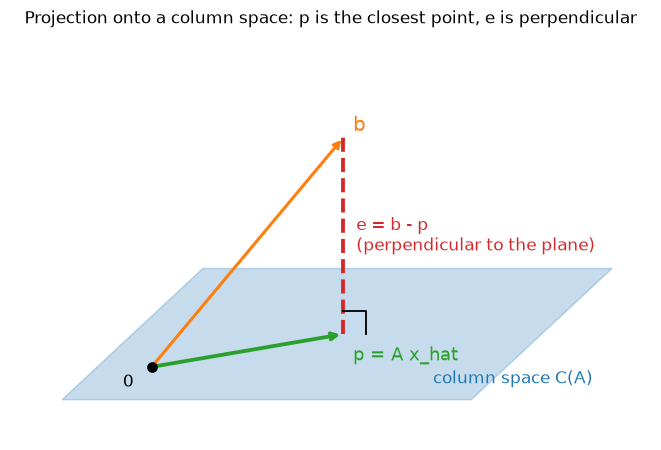
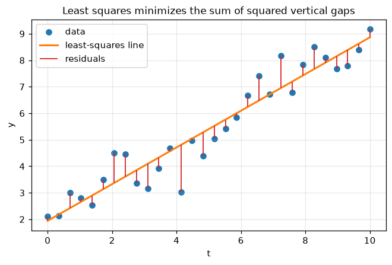
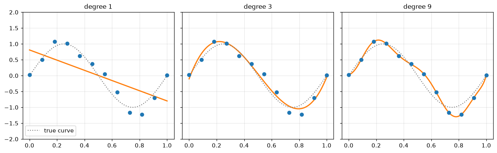

# Projections and Least Squares

**Course:** [Linear Algebra](../README.md) · **Hands-on:** [notebook.ipynb](notebook.ipynb) · **Practice:** [exercises](exercises/problems.md), [assignment](assignment.md)

Real data rarely fits a model exactly. You measure a hundred points and ask for a line, and no line passes through all of them. In matrix language, the system $A\mathbf{x} = \mathbf{b}$ has no solution, because $\mathbf{b}$ is not in the column space of $A$. This topic answers the natural follow-up: what is the **best** answer anyway? The answer is a picture you already have the tools for: drop a perpendicular from $\mathbf{b}$ onto the column space. The foot of that perpendicular is the closest point, and finding it is the same thing as **least squares**, the oldest and most-used way to fit a model to data.

## Learning goals

By the end of this topic you can:

- project a vector onto a line with $\dfrac{\mathbf{a}\cdot\mathbf{b}}{\mathbf{a}\cdot\mathbf{a}}\,\mathbf{a}$, and build the projection matrix for a line;
- find the projection of a vector onto the column space of a matrix by requiring the error to be perpendicular to every column, and derive the normal equations $A^\top A\,\hat{\mathbf{x}} = A^\top\mathbf{b}$;
- use the projection matrix $P = A(A^\top A)^{-1}A^\top$, and explain why $P^2 = P$ and $P^\top = P$;
- explain why least squares and projection are the same problem, and why the residual is perpendicular to every feature;
- fit a line (and a polynomial, or several features) to data by setting up a design matrix, and recognize underfitting and overfitting;
- solve least squares in practice with `lstsq` or QR rather than an inverse, and say what happens when the columns are dependent.

## Prerequisites

- [Orthogonality and Gram-Schmidt](../orthogonality-and-gram-schmidt/README.md): orthogonal vectors, orthogonal complements, orthonormal columns $Q$, and the QR factorization.
- [Vector Spaces and Subspaces](../vector-spaces-and-subspaces/README.md) and [Independence, Basis, and Dimension](../independence-basis-and-dimension/README.md): the column space, the left nullspace, and what "independent columns" buys you.
- [Matrix Operations and LU Decomposition](../matrix-operations-and-lu-decomposition/README.md): transposes, inverses, and symmetric matrices.
- [Vectors and Matrices](../vectors-and-matrices/README.md): the dot product.
- Basic Python and NumPy from [Python Basics](../../../getting-started/python-basics/README.md), only for the notebook.

## Outline

- [Notation at a glance](#notation-at-a-glance)
- [1. Projection onto a line](#1-projection-onto-a-line)
- [2. Projection onto a subspace](#2-projection-onto-a-subspace)
- [3. Least squares and fitting models](#3-least-squares-and-fitting-models)
- [The same ideas in NumPy](#the-same-ideas-in-numpy)
- [Common mistakes](#common-mistakes)
- [Why this matters for AI/ML](#why-this-matters-for-aiml)



> [!NOTE]
> **Concept ownership.** This topic teaches projections, projection matrices, the normal equations, and least squares in full. Later topics recap them and link back (see the [ownership map](../../../docs/design-notes.md)).

**What this topic leaves for later.**

| Question | Where it is answered |
|---|---|
| Why is least squares the right choice when the noise is Gaussian? (the probabilistic view) | [Estimation and MLE](../../probability-and-statistics/estimation-and-mle/README.md) |
| How do we keep a fit from overfitting (ridge, lasso), and how do we evaluate a model? | [Linear regression](../../../machine-learning/linear-regression/README.md), [regularization and hyperparameter tuning](../../../machine-learning/regularization-and-hyperparameter-tuning/README.md) |
| What is the pseudoinverse, and how does the SVD solve every least-squares problem? | [Singular value decomposition](../singular-value-decomposition/README.md) |
| Why does $A^\top A$ have such nice eigenvalues? | [Eigenvalues and eigenvectors](../eigenvalues-and-eigenvectors/README.md) |

## Key intuition

### Notation at a glance

| You see | It means |
|---|---|
| $\mathbf{p}$ | the **projection** of $\mathbf{b}$: the closest point to $\mathbf{b}$ in a line or subspace |
| $\mathbf{e} = \mathbf{b} - \mathbf{p}$ | the **error** vector, perpendicular to the line or subspace |
| $\hat{\mathbf{x}}$ ("x hat") | the best coefficients, with $\mathbf{p} = A\hat{\mathbf{x}}$ |
| $P$ | the **projection matrix**: $\mathbf{p} = P\mathbf{b}$ |
| $\mathbf{r} = \mathbf{b} - A\hat{\mathbf{x}}$ | the **residual** in a fit (the same vector as $\mathbf{e}$) |
| $A^\top A$ | a square, symmetric matrix built from $A$; the heart of the normal equations |

### 1. Projection onto a line

Take a line through the origin in the direction $\mathbf{a}$, and a vector $\mathbf{b}$ that is not on it. We want the point $\mathbf{p} = \hat{x}\,\mathbf{a}$ on the line that is closest to $\mathbf{b}$. Geometry gives the answer: the closest point is where a perpendicular dropped from $\mathbf{b}$ lands. So the **error** $\mathbf{e} = \mathbf{b} - \hat{x}\,\mathbf{a}$ must be perpendicular to $\mathbf{a}$:

$$
\mathbf{a}\cdot(\mathbf{b} - \hat{x}\,\mathbf{a}) = 0 \quad\Longrightarrow\quad \hat{x} = \frac{\mathbf{a}\cdot\mathbf{b}}{\mathbf{a}\cdot\mathbf{a}}, \qquad \mathbf{p} = \frac{\mathbf{a}\cdot\mathbf{b}}{\mathbf{a}\cdot\mathbf{a}}\,\mathbf{a}.
$$

A numeric example: $\mathbf{a} = (3,4)$ and $\mathbf{b} = (5,5)$. Then $\mathbf{a}\cdot\mathbf{b} = 35$ and $\mathbf{a}\cdot\mathbf{a} = 25$, so $\hat{x} = 1.4$ and $\mathbf{p} = 1.4\,(3,4) = (4.2, 5.6)$. The error is $\mathbf{e} = (5,5) - (4.2, 5.6) = (0.8, -0.6)$, and indeed $\mathbf{a}\cdot\mathbf{e} = 2.4 - 2.4 = 0$.



*The projection $\mathbf{p}$ is the point of the line closest to $\mathbf{b}$. The error $\mathbf{e}$ meets the line at a right angle.*

**The projection matrix.** The formula is linear in $\mathbf{b}$, so a matrix does it. Since $\hat{x} = \mathbf{a}^\top\mathbf{b}/\mathbf{a}^\top\mathbf{a}$ and $\mathbf{p} = \mathbf{a}\hat{x}$,

$$
\mathbf{p} = \frac{\mathbf{a}\,\mathbf{a}^\top}{\mathbf{a}^\top\mathbf{a}}\,\mathbf{b} = P\mathbf{b}, \qquad P = \frac{\mathbf{a}\,\mathbf{a}^\top}{\mathbf{a}^\top\mathbf{a}}.
$$

The matrix $\mathbf{a}\mathbf{a}^\top$ is a column times a row, a full grid (the fourth view of a product). For $\mathbf{a} = (3,4)$:

```math
P = \frac{1}{25}\begin{bmatrix} 9 & 12 \\ 12 & 16 \end{bmatrix} = \begin{bmatrix} 0.36 & 0.48 \\ 0.48 & 0.64 \end{bmatrix}, \qquad P\begin{bmatrix} 5 \\ 5 \end{bmatrix} = \begin{bmatrix} 4.2 \\ 5.6 \end{bmatrix}.
```

Two properties characterize every projection matrix. $P^\top = P$: it is symmetric (look at the matrix). And $P^2 = P$: projecting a second time changes nothing, because a point already on the line is its own closest point.

**Check yourself**

1. Project $\mathbf{b} = (2, 6)$ onto the line through $\mathbf{a} = (1, 1)$. What is the error?
2. What is the projection of $\mathbf{b}$ onto the line through $\mathbf{a}$ if $\mathbf{b}$ is already a multiple of $\mathbf{a}$?

<details>
<summary>Answers</summary>

1. $\mathbf{a}\cdot\mathbf{b} = 8$ and $\mathbf{a}\cdot\mathbf{a} = 2$, so $\hat{x} = 4$ and $\mathbf{p} = (4,4)$. The error is $(2,6) - (4,4) = (-2, 2)$, and $(1,1)\cdot(-2,2) = 0$.
2. $\mathbf{b}$ itself, and the error is $\mathbf{0}$.

</details>

### 2. Projection onto a subspace

Now replace the line by the column space of a matrix $A$ with **independent columns** (an $m \times n$ matrix with rank $n$). We want the point $\mathbf{p} = A\hat{\mathbf{x}}$ of $C(A)$ closest to $\mathbf{b}$. The same idea works: the error $\mathbf{e} = \mathbf{b} - A\hat{\mathbf{x}}$ must be perpendicular to the **whole** subspace, which means perpendicular to every column of $A$. Writing "every column dotted with $\mathbf{e}$ is zero" as one matrix equation, $A^\top\mathbf{e} = \mathbf{0}$, gives

$$
A^\top(\mathbf{b} - A\hat{\mathbf{x}}) = \mathbf{0} \quad\Longrightarrow\quad A^\top A\,\hat{\mathbf{x}} = A^\top\mathbf{b}.
$$

These are the **normal equations**, so called because they say the error is normal (perpendicular) to the subspace. Note what they say in the language of the four subspaces: $\mathbf{e}$ lies in the left nullspace $N(A^\top)$, the orthogonal complement of $C(A)$.

**When can we solve them?** If the columns of $A$ are independent, $A^\top A$ is invertible. Here is why: suppose $A^\top A\,\mathbf{x} = \mathbf{0}$. Then $\mathbf{x}^\top A^\top A\,\mathbf{x} = \|A\mathbf{x}\|^2 = 0$, so $A\mathbf{x} = \mathbf{0}$, and independent columns force $\mathbf{x} = \mathbf{0}$. So we get

$$
\hat{\mathbf{x}} = (A^\top A)^{-1}A^\top\mathbf{b}, \qquad \mathbf{p} = A\hat{\mathbf{x}} = A(A^\top A)^{-1}A^\top\,\mathbf{b}.
$$

The **projection matrix** is $P = A(A^\top A)^{-1}A^\top$. It has the same two properties as before, now for a subspace:

- $P^\top = P$, because $(A^\top A)^{-1}$ is symmetric.
- $P^2 = P$: $A(A^\top A)^{-1}A^\top A(A^\top A)^{-1}A^\top = A(A^\top A)^{-1}A^\top$, since the middle $A^\top A$ cancels its inverse. In words: a vector already in the column space is its own projection.

The matrix $I - P$ is also a projection. It sends $\mathbf{b}$ to $\mathbf{e} = \mathbf{b} - \mathbf{p}$, so it projects onto the left nullspace. Together, $\mathbf{b} = P\mathbf{b} + (I - P)\mathbf{b}$ splits $\mathbf{b}$ into a part in $C(A)$ and a perpendicular part, the splitting from the orthogonality topic. If the columns of $A$ are **orthonormal** (call the matrix $Q$), then $Q^\top Q = I$ and everything simplifies to $P = QQ^\top$ and $\hat{\mathbf{x}} = Q^\top\mathbf{b}$: the coordinates are dot products.

**A worked example.** Let the columns of $A$ be $(1,1,1)$ and $(0,1,2)$, and let $\mathbf{b} = (1, 3, 4)$. Then

```math
A^\top A = \begin{bmatrix} 3 & 3 \\ 3 & 5 \end{bmatrix}, \qquad A^\top\mathbf{b} = \begin{bmatrix} 8 \\ 11 \end{bmatrix}.
```

The normal equations $3\hat{x}_1 + 3\hat{x}_2 = 8$ and $3\hat{x}_1 + 5\hat{x}_2 = 11$ give (subtract the first from the second) $2\hat{x}_2 = 3$, so $\hat{x}_2 = 3/2$ and $\hat{x}_1 = 8/3 - 3/2 = 7/6$. Then

$$
\mathbf{p} = \tfrac76(1,1,1) + \tfrac32(0,1,2) = \left(\tfrac76,\ \tfrac83,\ \tfrac{25}{6}\right), \qquad \mathbf{e} = \mathbf{b} - \mathbf{p} = \left(-\tfrac16,\ \tfrac13,\ -\tfrac16\right).
$$

Check that $\mathbf{e}$ is perpendicular to both columns: $-\tfrac16 + \tfrac13 - \tfrac16 = 0$ and $0 + \tfrac13 - \tfrac13 = 0$. The projection matrix is

```math
P = \frac16\begin{bmatrix} 5 & 2 & -1 \\ 2 & 2 & 2 \\ -1 & 2 & 5 \end{bmatrix},
```

symmetric, with trace $(5 + 2 + 5)/6 = 2$, the dimension of the column space.



*The projection onto a subspace is the same picture as for a line: $\mathbf{p}$ is the closest point of the plane to $\mathbf{b}$, and the error is perpendicular to the plane.*

**Check yourself**

1. Why must the columns of $A$ be independent for $(A^\top A)^{-1}$ to exist?
2. Is $`\begin{bmatrix} 1 & 0 \\ 0 & 0 \end{bmatrix}`$ a projection matrix? Onto what?

<details>
<summary>Answers</summary>

1. If a column were a combination of the others, some nonzero $\mathbf{x}$ would satisfy $A\mathbf{x} = \mathbf{0}$, and then $A^\top A\,\mathbf{x} = \mathbf{0}$ too, so $A^\top A$ would be singular.
2. Yes: it is symmetric and squaring it gives itself. It projects onto the $x$-axis (it keeps the first coordinate and zeroes the second).

</details>

### 3. Least squares and fitting models

When $A\mathbf{x} = \mathbf{b}$ has more equations than unknowns, usually no $\mathbf{x}$ works. We then choose $\hat{\mathbf{x}}$ to make the **residual** $\mathbf{r} = \mathbf{b} - A\mathbf{x}$ as short as possible, that is, to minimize

$$
\|A\mathbf{x} - \mathbf{b}\|^2 = r_1^2 + r_2^2 + \dots + r_m^2,
$$

the **sum of squared errors**. This is exactly the projection problem. Every vector $A\mathbf{x}$ lies in $C(A)$, and the closest point of $C(A)$ to $\mathbf{b}$ is $\mathbf{p}$, so the best $\mathbf{x}$ is $\hat{\mathbf{x}}$. Pythagoras makes the proof short: for any $\mathbf{x}$, since $\mathbf{e} \perp C(A)$ and $\mathbf{p} - A\mathbf{x}$ lies in $C(A)$,

$$
\|\mathbf{b} - A\mathbf{x}\|^2 = \|\mathbf{e}\|^2 + \|\mathbf{p} - A\mathbf{x}\|^2 \ge \|\mathbf{e}\|^2,
$$

with equality only when $A\mathbf{x} = \mathbf{p}$. So **the least-squares solution solves the normal equations**, and the residual is perpendicular to every column of $A$.

**Why squares?** Squaring makes every error positive (so errors cannot cancel), punishes large errors more than small ones, and, most usefully, matches the geometry: squared lengths add up by Pythagoras, which is what turns the problem into a projection with a clean linear answer. Using absolute values instead is possible but has no formula like this. A calculus route gives the same equations: the gradient of $\|A\mathbf{x} - \mathbf{b}\|^2$ is $2A^\top(A\mathbf{x} - \mathbf{b})$, and setting it to zero is the normal equations again. See [multivariable calculus](../../calculus-and-optimization/multivariable-calculus/README.md) and [gradient descent](../../calculus-and-optimization/gradient-descent-and-its-variants/README.md).

**Fitting a line.** Suppose we measure $y$ at three values of $t$: $(t, y) = (0, 1)$, $(1, 3)$, $(2, 4)$. We want $y \approx c + dt$. Each point gives one equation, and together they form $A\mathbf{x} = \mathbf{b}$ with a **design matrix** whose first column is all ones (for the intercept $c$) and whose second column holds the inputs $t$:

```math
\begin{bmatrix} 1 & 0 \\ 1 & 1 \\ 1 & 2 \end{bmatrix}\begin{bmatrix} c \\ d \end{bmatrix} \approx \begin{bmatrix} 1 \\ 3 \\ 4 \end{bmatrix}.
```

This is the example above, so we already have the answer: $c = 7/6$, $d = 3/2$, and the best line is $\hat{y} = \tfrac76 + \tfrac32\,t$. The fitted values are $\mathbf{p} = (\tfrac76, \tfrac83, \tfrac{25}{6})$ and the residuals are $(-\tfrac16, \tfrac13, -\tfrac16)$, with sum of squares $\tfrac1{36} + \tfrac19 + \tfrac1{36} = \tfrac16$. Because the first column is all ones, $A^\top\mathbf{r} = \mathbf{0}$ says in particular that **the residuals add up to zero**, and the second row says they are uncorrelated with $t$.



*Least squares chooses the line that makes the sum of the squares of the red vertical gaps as small as possible.*

**More columns, more flexible fits.** To fit a quadratic $c + dt + et^2$, add a column of squares $t^2$; for a degree-$k$ polynomial, use the columns $1, t, \dots, t^k$ (a Vandermonde matrix, as in the elimination topic). To use several features at once, make each feature a column, plus a column of ones for the intercept. More columns enlarge $C(A)$, so the projection can only get closer to $\mathbf{b}$. With the 3 points above and degree 2, the matrix is square and invertible, $C(A) = \mathbb{R}^3$, and the curve passes through every point: $y = 1 + 2.5t - 0.5t^2$ with zero error. A perfect fit sounds wonderful, but with noisy data it is a warning: the curve is chasing noise (**overfitting**).



*Degree 1 underfits, degree 3 captures the shape, and degree 9 wiggles to hit the noise. Its error on the training points is tiny, but its error on fresh points is larger than for degree 3.*

**Solving it in practice.** Forming $A^\top A$ and inverting it is fine for hand examples but poor numerical practice. Libraries use QR (from the last topic): with $A = QR$ the normal equations reduce to $R\hat{\mathbf{x}} = Q^\top\mathbf{b}$, solved by back substitution, and `numpy.linalg.lstsq` goes further and handles every case. One honest reason: the condition number of $A^\top A$ is the **square** of the condition number of $A$. If $A$ is nearly dependent, squaring it can wipe out many digits of accuracy, while QR avoids forming $A^\top A$ at all.

**What if the columns are dependent?** Then $A^\top A$ is singular and the minimizer is no longer unique: if $\hat{\mathbf{x}}$ works, so does $\hat{\mathbf{x}}$ plus any vector of the nullspace, since $A$ cannot see it. The residual is the same for all of them. The usual choice is the one of smallest length, the **minimum-norm solution**, which `lstsq` returns. The matrix that produces it from $\mathbf{b}$ is called the **pseudoinverse**, $A^+$; the [SVD topic](../singular-value-decomposition/README.md) shows how to build it.

**Check yourself**

1. In a line fit with a column of ones, the residuals are $(0.5, -0.2, \dots)$ and the last one is missing. What must the sum of all residuals be?
2. A model has $m = 100$ data points and uses a polynomial of degree 99. What can you say about the training error, and about trusting the fit?

<details>
<summary>Answers</summary>

1. Zero. The first column of $A$ is all ones, so $A^\top\mathbf{r} = \mathbf{0}$ forces the residuals to sum to zero.
2. The matrix is $100 \times 100$ and (for distinct $t$ values) invertible, so the curve passes through every point and the training error is zero. That says nothing about performance on new data, and with noisy data it almost certainly overfits.

</details>

### The same ideas in NumPy

A projection onto a line, and the properties of $P$:

```python
import numpy as np

a = np.array([3.0, 4.0])
b = np.array([5.0, 5.0])
p = (a @ b) / (a @ a) * a
P = np.outer(a, a) / (a @ a)
print(p, b - p)
print(np.allclose(P @ b, p), np.allclose(P @ P, P), np.allclose(P.T, P))
```

```text
[4.2 5.6] [ 0.8 -0.6]
True True True
```

The normal equations on the $3 \times 2$ example, and the projection matrix:

```python
A = np.array([[1.0, 0.0],
              [1.0, 1.0],
              [1.0, 2.0]])
b = np.array([1.0, 3.0, 4.0])

x_hat = np.linalg.solve(A.T @ A, A.T @ b)
p = A @ x_hat
e = b - p
print(x_hat, p, e)
print(np.allclose(A.T @ e, 0))                      # the error is perpendicular to the columns

P = A @ np.linalg.inv(A.T @ A) @ A.T
print(np.allclose(P @ P, P), np.allclose(P.T, P), round(np.trace(P), 6))
```

```text
[1.16666667 1.5       ] [1.16666667 2.66666667 4.16666667] [-0.16666667  0.33333333 -0.16666667]
True
True True 2.0
```

The same fit with `lstsq` and with QR (on the $A$ and $\mathbf{b}$ from the block above):

```python
x_lstsq = np.linalg.lstsq(A, b, rcond=None)[0]
Q, R = np.linalg.qr(A)
x_qr = np.linalg.solve(R, Q.T @ b)
print(x_lstsq, x_qr)
print(np.allclose(x_lstsq, x_hat), np.allclose(x_qr, x_hat))
print(np.sum((b - A @ x_lstsq) ** 2))
```

```text
[1.16666667 1.5       ] [1.16666667 1.5       ]
True True
0.16666666666666669
```

A degree-1 and a degree-2 fit to the same three points (the `b` from the blocks above holds the $y$ values):

```python
t = np.array([0.0, 1.0, 2.0])
for degree in (1, 2):
    V = np.vander(t, degree + 1, increasing=True)       # columns 1, t, t^2, ...
    coef = np.linalg.lstsq(V, b, rcond=None)[0]
    print(degree, coef.round(4), "squared error:", round(float(np.sum((V @ coef - b) ** 2)), 10))
```

```text
1 [1.1667 1.5   ] squared error: 0.1666666667
2 [ 1.   2.5 -0.5] squared error: 0.0
```

## Common mistakes

- **Projecting onto the wrong thing.** The projection lands in the column space and the error lies in the left nullspace. The coefficients $\hat{\mathbf{x}}$ live in $\mathbb{R}^n$ (one entry per column), while $\mathbf{p}$ and $\mathbf{e}$ live in $\mathbb{R}^m$ (one entry per data point).
- **Forgetting the column of ones.** Without it the fitted line is forced through the origin.
- **Using the formula $(A^\top A)^{-1}A^\top\mathbf{b}$ when the columns are dependent.** The inverse does not exist. Use `lstsq`, which handles it.
- **Treating a perfect fit as a good model.** More columns always shrink the training error. Judge a model on data it has not seen.
- **Dividing by $\mathbf{a}\cdot\mathbf{a}$ with the wrong vector.** In the line projection, $\hat{x} = \mathbf{a}\cdot\mathbf{b}\,/\,\mathbf{a}\cdot\mathbf{a}$, with $\mathbf{a}$ (the direction), not $\mathbf{b}$, in the denominator.

## Why this matters for AI/ML

- **Linear regression is a projection.** The vector of predictions is the projection of the target vector $\mathbf{y}$ onto the span of the feature columns, and the residual is perpendicular to every feature. With an intercept column, that is why the residuals of an ordinary least-squares fit sum to zero and are uncorrelated with each feature. See [linear regression](../../../machine-learning/linear-regression/README.md).
- **The design matrix is the data.** Each row is an example, and each column is a feature, plus an intercept column of ones. Polynomial regression adds columns of powers, and adding columns until the projection hits the data exactly is the overfitting story of the bias-variance trade-off (see [KNN and model evaluation](../../../machine-learning/knn-and-model-evaluation/README.md)).
- **Normal equations versus iterative methods.** For a modest number of features, solving $A^\top A\,\hat{\mathbf{x}} = A^\top\mathbf{b}$ is quick. When there are millions of examples or features, forming $A^\top A$ is too expensive, and models are trained with gradient descent, which minimizes the same squared error step by step.
- **Collinear features break the formula.** If two features carry the same information, $A^\top A$ is singular and the weights are not unique, as in the [independence topic](../independence-basis-and-dimension/README.md). A tiny amount of noise makes them nearly collinear, and the weights become huge and unstable.
- **Projections are everywhere in embeddings.** The cosine similarity of two vectors is the signed length of the projection of one unit vector onto the direction of the other. Projecting **out** a direction, $\mathbf{x} - (\mathbf{x}\cdot\mathbf{d})\mathbf{d}$ for a unit vector $\mathbf{d}$, removes a chosen component, which is the idea behind some methods for reducing an unwanted bias in embeddings. Treat such methods with care, since removing one direction rarely removes a concept completely.
- **Not every mixing is a projection.** PCA, which keeps only the strongest directions of the data, is a projection (see [dimensionality reduction](../../../machine-learning/dimensionality-reduction/README.md)). Attention in a Transformer blends vectors with weights that sum to one. That is a weighted average, not a projection.

### Numerical practice

Use `numpy.linalg.lstsq` (or a QR factorization), not an explicit inverse. The reason shows up on nearly dependent columns. Below, the data are generated exactly from known coefficients, so we can measure each method's error:

```python
t = np.linspace(0, 1, 20)
A = np.vander(t, 10, increasing=True)                  # columns 1, t, ..., t^9
true_coef = np.arange(1, 11, dtype=float)
y = A @ true_coef

print(f"cond(A) = {np.linalg.cond(A):.1e}, cond(A^T A) = {np.linalg.cond(A.T @ A):.1e}")
Q, R = np.linalg.qr(A)
for name, coef in [("normal equations", np.linalg.solve(A.T @ A, A.T @ y)),
                   ("QR", np.linalg.solve(R, Q.T @ y)),
                   ("lstsq", np.linalg.lstsq(A, y, rcond=None)[0])]:
    print(f"{name:17s} largest coefficient error: {np.abs(coef - true_coef).max():.1e}")
```

```text
cond(A) = 3.8e+06, cond(A^T A) = 1.4e+13
normal equations  largest coefficient error: 1.2e-03
QR                largest coefficient error: 7.1e-10
lstsq             largest coefficient error: 1.7e-09
```

The normal equations lose about six more digits than QR here, as the squared condition number predicts. Two habits help further: **standardize the features** (subtract each column's mean and divide by its spread) so that no column is on a wildly different scale from the others, and compare the fit on held-out data, not just on the data used to fit it. Remember also that the checks above hold only up to rounding error: compare with `np.allclose`, never `==`.

## Summary

- The projection of $\mathbf{b}$ onto a line is $\dfrac{\mathbf{a}\cdot\mathbf{b}}{\mathbf{a}\cdot\mathbf{a}}\,\mathbf{a}$, and onto a column space it is $\mathbf{p} = A\hat{\mathbf{x}}$, where the error is perpendicular to every column.
- That condition gives the normal equations $A^\top A\,\hat{\mathbf{x}} = A^\top\mathbf{b}$. With independent columns, $P = A(A^\top A)^{-1}A^\top$ satisfies $P^2 = P$ and $P^\top = P$, and $I - P$ projects onto the left nullspace.
- Least squares, the best fit when $A\mathbf{x} = \mathbf{b}$ has no solution, is the same problem. The residual is perpendicular to every feature, and with an intercept column it sums to zero.
- A design matrix turns line fits, polynomial fits, and multi-feature fits into one recipe. More columns lower the training error and can overfit.
- In practice, use `lstsq` or QR, and expect many solutions (with the minimum-norm one returned) when columns are dependent.

## Further reading

Chapter pointers and free links are in [resources.md](resources.md).

## Practice

- [Notebook](notebook.ipynb): project onto a line and a plane, check the properties of $P$, solve least squares four ways, fit lines and polynomials, compare the accuracy of the normal equations with QR, and remove a direction from data. It follows the lesson:

  | Lesson section | Notebook section |
  |---|---|
  | 1. Projection onto a line | 1. Projection onto a line |
  | 2. Projection onto a subspace | 2. Projection onto a plane (a subspace) |
  | 3. Least squares and fitting models | 3. Four ways to solve the same least-squares problem, 4. A line fit and its residuals, 5. Polynomial fits, 7. Collinear columns |
  | Why this matters for AI/ML | 6. The normal equations lose accuracy, 8. Projecting out a direction |

- [Exercises](exercises/problems.md) (with [solutions](exercises/solutions.md)): ten problems, easy to harder.
- [Assignment](assignment.md): fit a trend to monthly measurements by hand-written normal equations, then add a seasonal feature and see the residual shrink.

---

[← Previous: Orthogonality and Gram-Schmidt](../orthogonality-and-gram-schmidt/README.md) | [Next: Eigenvalues and Eigenvectors →](../eigenvalues-and-eigenvectors/README.md)
