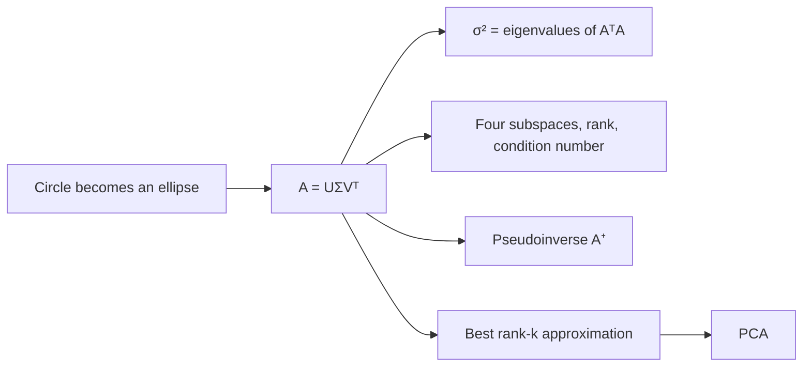
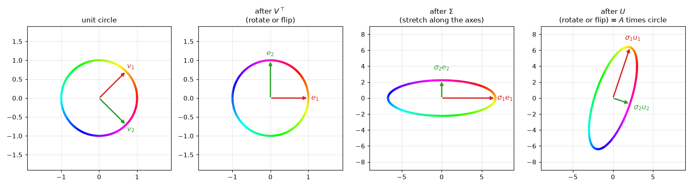
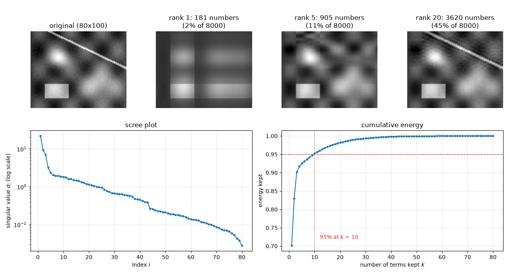

# Singular Value Decomposition

**Course:** [Linear Algebra](../README.md) · **Hands-on:** [notebook.ipynb](notebook.ipynb) · **Practice:** [exercises](exercises/problems.md), [assignment](assignment.md)

Eigenvalues need a square matrix, and only some square matrices behave well. Real data matrices are rarely square: 10,000 photos by 784 pixels, 5,000 users by 300 movies. The **singular value decomposition**, or **SVD**, works for every matrix of every shape. It says that any matrix, however messy, does three simple things in a row: it turns the input, stretches it along perpendicular axes, and turns the result. From that picture you get the four fundamental subspaces, a way to measure how healthy a linear system is, the best possible inverse for a matrix that has none, the best way to approximate a big matrix by a small one, and PCA.

## Learning goals

By the end of this topic you can:

- describe how any matrix maps the unit circle to an ellipse, and write the SVD $A = U\Sigma V^\top$ as rotate, stretch, rotate;
- compute the SVD of a small matrix by hand from the eigenvalues and eigenvectors of $A^\top A$, and check it with `np.linalg.svd`;
- read the four fundamental subspaces, the rank, and the condition number off the singular values and vectors;
- build the pseudoinverse $A^+ = V\Sigma^+U^\top$ and use it for the minimum-norm least-squares solution;
- approximate a matrix by its best rank-$k$ version, choose $k$ from a scree plot or an energy threshold, and count the storage saved;
- compute PCA from the SVD of the centered data matrix, with the right $n-1$ scaling, and name where low-rank structure shows up in AI/ML.

## Prerequisites

- [Eigenvalues and Eigenvectors](../eigenvalues-and-eigenvectors/README.md): the spectral theorem $A = Q\Lambda Q^\top$ for symmetric matrices, and positive semidefinite matrices such as $A^\top A$.
- [Projections and Least Squares](../projections-and-least-squares/README.md): the normal equations, the condition number of $A^\top A$, and the minimum-norm solution promised there.
- [Orthogonality and Gram-Schmidt](../orthogonality-and-gram-schmidt/README.md): orthonormal columns, orthogonal matrices with $Q^\top = Q^{-1}$, and perpendicular subspaces.
- [Independence, Basis, and Dimension](../independence-basis-and-dimension/README.md) and [Vector Spaces and Subspaces](../vector-spaces-and-subspaces/README.md): rank and the four fundamental subspaces.
- [Linear Transformations](../linear-transformations/README.md): a matrix is a transformation, and a basis change re-describes it.
- Basic Python and NumPy from [Python Basics](../../../getting-started/python-basics/README.md), only for the notebook.

## Outline

- [Notation at a glance](#notation-at-a-glance)
- [1. Every matrix is rotate, stretch, rotate](#1-every-matrix-is-rotate-stretch-rotate)
- [2. Where U, Sigma, and V come from](#2-where-u-sigma-and-v-come-from)
- [3. The four subspaces, the rank, and the condition number](#3-the-four-subspaces-the-rank-and-the-condition-number)
- [4. The pseudoinverse and minimum-norm solutions](#4-the-pseudoinverse-and-minimum-norm-solutions)
- [5. Low-rank approximation and compression](#5-low-rank-approximation-and-compression)
- [6. PCA from the SVD](#6-pca-from-the-svd)
- [The same ideas in NumPy](#the-same-ideas-in-numpy)
- [Common mistakes](#common-mistakes)
- [Why this matters for AI/ML](#why-this-matters-for-aiml)



> [!NOTE]
> **Concept ownership.** This topic teaches the SVD, singular values and vectors, the pseudoinverse, the best low-rank approximation, and the SVD route to PCA in full. Later topics recap them and link back (see the [ownership map](../../../docs/design-notes.md)).

**What this topic leaves for later.**

| Question | Where it is answered |
|---|---|
| How is PCA used as a machine-learning method, and how do you pick the number of components? | [Dimensionality reduction](../../../machine-learning/dimensionality-reduction/README.md) |
| How are weight matrices compressed and fine-tuned with low-rank adapters (LoRA)? | [GPT and efficient LLMs](../../../deep-learning/gpt-and-efficient-llms/README.md) |
| How do you keep an ill-conditioned least-squares fit stable with a penalty (ridge)? | [Regularization and hyperparameter tuning](../../../machine-learning/regularization-and-hyperparameter-tuning/README.md) |
| How do word and item embeddings come out of a factorized matrix? | [Text representations](../../../deep-learning/text-representations/README.md) |

## Key intuition

### Notation at a glance

| You see | It means |
|---|---|
| $A$ ($m \times n$) | any matrix: $m$ rows, $n$ columns, not necessarily square |
| $U$ ($m \times m$) | orthogonal matrix whose columns $\mathbf{u}_i$ are the **left singular vectors** |
| $V$ ($n \times n$) | orthogonal matrix whose columns $\mathbf{v}_i$ are the **right singular vectors** |
| $\Sigma$ (capital sigma) | $m \times n$ matrix, zero except for the numbers $\sigma_i$ on its diagonal |
| $\sigma_i$ (sigma) | the **singular values**, sorted so that $\sigma_1 \ge \sigma_2 \ge \dots \ge 0$ |
| $r$ | the rank of $A$, which equals the number of nonzero singular values |
| $A_k$ | the best rank-$k$ approximation of $A$: the first $k$ terms of the SVD |
| $A^+$ | the pseudoinverse of $A$ |
| $\kappa(A)$ (kappa) | the condition number, $\sigma_1/\sigma_r$ |

### 1. Every matrix is rotate, stretch, rotate

Take every unit vector in the plane, which together draw a circle, and multiply each by a $2\times 2$ matrix $A$. The circle comes out as an **ellipse** (possibly flattened to a line segment). An ellipse has a long axis and a short axis, and they are perpendicular. The same is true in any dimension: a matrix sends the unit sphere to an ellipsoid. The SVD describes that ellipse.

Look at the picture first. The lengths of the half-axes are the **singular values** $\sigma_1 \ge \sigma_2$. The directions of the axes in the output are the **left singular vectors** $\mathbf{u}_1, \mathbf{u}_2$. And there are two perpendicular directions $\mathbf{v}_1, \mathbf{v}_2$ in the input, the **right singular vectors**, that $A$ sends exactly onto those axes:

$$
A\mathbf{v}_i = \sigma_i\mathbf{u}_i .
$$

Stack these equations side by side: $AV = U\Sigma$, where $V$ and $U$ hold the vectors as columns and $\Sigma$ holds the stretch factors on its diagonal. Because $V$ is orthogonal, $V^{-1} = V^\top$, so multiplying on the right by $V^\top$ gives the **singular value decomposition**:

$$
A = U\Sigma V^\top, \qquad U^\top U = I, \quad V^\top V = I, \quad \sigma_1 \ge \dots \ge \sigma_r > 0 .
$$

Read it from right to left, like any product acting on a vector $\mathbf{x}$. First $V^\top$ turns (or flips) the input so that $\mathbf{v}_1, \mathbf{v}_2$ line up with the coordinate axes. Then $\Sigma$ stretches the first axis by $\sigma_1$ and the second by $\sigma_2$. Then $U$ turns (or flips) the stretched result into place. Orthogonal matrices keep lengths and angles, so all the stretching is done by $\Sigma$.

**A worked example.** Let $`A = \begin{bmatrix} 3 & 0 \\ 4 & 5 \end{bmatrix}`$. Its SVD is

```math
A = \underbrace{\frac{1}{\sqrt{10}}\begin{bmatrix} 1 & 3 \\ 3 & -1 \end{bmatrix}}_{U}
\underbrace{\begin{bmatrix} 3\sqrt5 & 0 \\ 0 & \sqrt5 \end{bmatrix}}_{\Sigma}
\underbrace{\frac{1}{\sqrt{2}}\begin{bmatrix} 1 & 1 \\ 1 & -1 \end{bmatrix}}_{V^\top} .
```

Test it on $\mathbf{x} = (1, 0)$, which $A$ sends to its first column $(3, 4)$. The matrix $V^\top$ turns $\mathbf{x}$ into $(1,1)/\sqrt2$. Then $\Sigma$ stretches that to $(3\sqrt5, \sqrt5)/\sqrt2$. Then $U$ gives $\frac{1}{\sqrt{10}}\big(3\sqrt5 + 3\sqrt5,\ 9\sqrt5 - \sqrt5\big)/\sqrt2 = (6, 8)\sqrt5/\sqrt{20} = (3, 4)$. It works. Here $\sigma_1 = 3\sqrt5 \approx 6.708$ and $\sigma_2 = \sqrt5 \approx 2.236$, so the ellipse has half-axes of about $6.7$ and $2.2$.



*Left to right: the unit circle, then the same circle after $V^\top$ (still a circle, only turned or flipped), after $\Sigma$ (an ellipse along the axes), and after $U$ (the ellipse $A$ really produces). The colors show where each point goes.*

**Full and thin versions.** If $A$ is $m \times n$ with $m > n$ (tall, like a data matrix), then $\Sigma$ is $m \times n$ and its bottom $m - n$ rows are all zeros, so the last $m - n$ columns of $U$ get multiplied by zero and never matter. The **thin** (or economy) SVD drops them: $U$ becomes $m \times n$, $\Sigma$ becomes $n \times n$, and the product is unchanged. The **full** SVD keeps $U$ square so that its columns are a complete orthonormal basis of $\mathbb{R}^m$. Use thin for computing and full when you need all the subspaces (Section 3). The same cut works for wide matrices.

For a $5\times3$ matrix, the full SVD has shapes $5\times5$, $5\times3$, $3\times3$ for $U$, $\Sigma$, $V^\top$, and the thin SVD has $5\times3$, $3\times3$, $3\times3$.

**What is and is not unique.** The singular values are unique. A singular vector pair can be flipped together, $(\mathbf{u}_i, \mathbf{v}_i) \to (-\mathbf{u}_i, -\mathbf{v}_i)$, and the equation still holds, so signs from different programs can differ. If two singular values are equal (a matrix that maps the circle to a circle), any perpendicular pair of axes works.

**Check yourself**

1. A $2\times2$ matrix has singular values $5$ and $2$. What are the half-axes of the ellipse it makes from the unit circle, and what is $|\det A|$?
2. For a $5 \times 3$ matrix, what shape is $\Sigma$ in the full SVD, and how many singular values are there?

<details>
<summary>Answers</summary>

1. The half-axes are $5$ and $2$. The area of the ellipse is $\pi\cdot5\cdot2 = 10\pi$, ten times the circle's area $\pi$, and the determinant measures that area factor, so $|\det A| = 5\cdot 2 = 10$.
2. $\Sigma$ is $5 \times 3$, with the three singular values on its diagonal and two rows of zeros below. There are $\min(5, 3) = 3$ singular values.

</details>

### 2. Where U, Sigma, and V come from

How do we find $V$, $\Sigma$, and $U$ for a given $A$? The trick is to ask the eigenvalues topic for help. Multiply $A = U\Sigma V^\top$ by its transpose:

$$
A^\top A = V\Sigma^\top U^\top U\Sigma V^\top = V(\Sigma^\top\Sigma)V^\top, \qquad AA^\top = U(\Sigma\Sigma^\top)U^\top .
$$

Both are exactly the spectral theorem, $Q\Lambda Q^\top$, for a symmetric matrix. So **the right singular vectors $\mathbf{v}_i$ are eigenvectors of $A^\top A$, the left singular vectors $\mathbf{u}_i$ are eigenvectors of $AA^\top$, and the singular values are $\sigma_i = \sqrt{\lambda_i}$**, the square roots of the eigenvalues of $A^\top A$. The two matrices share their nonzero eigenvalues. Eigenvalues of $A^\top A$ are never negative (it is positive semidefinite), which is why the square roots exist.

**Why it always works.** Take the eigenvectors $\mathbf{v}_i$ of $A^\top A$, chosen orthonormal (the spectral theorem guarantees this), with eigenvalues $\lambda_i \ge 0$. Then $\|A\mathbf{v}_i\|^2 = \mathbf{v}_i^\top A^\top A\mathbf{v}_i = \lambda_i$, so $A\mathbf{v}_i$ has length $\sigma_i = \sqrt{\lambda_i}$. And for $i \ne j$, $(A\mathbf{v}_i)\cdot(A\mathbf{v}_j) = \mathbf{v}_i^\top A^\top A\mathbf{v}_j = \lambda_j\,\mathbf{v}_i\cdot\mathbf{v}_j = 0$, so the images are perpendicular. Dividing by the lengths, $\mathbf{u}_i = A\mathbf{v}_i/\sigma_i$ (for $\sigma_i > 0$) are orthonormal, and $A\mathbf{v}_i = \sigma_i\mathbf{u}_i$ is exactly the SVD equation. Any missing columns of $U$ are filled in with extra orthonormal vectors. No assumption on $A$ was needed, so every matrix has an SVD.

**Worked example.** For $`A = \begin{bmatrix} 3 & 0 \\ 4 & 5 \end{bmatrix}`$:

```math
A^\top A = \begin{bmatrix} 25 & 20 \\ 20 & 25 \end{bmatrix}, \qquad \lambda^2 - 50\lambda + 225 = 0 \;\Rightarrow\; \lambda = 45,\ 5 .
```

The eigenvectors are $(1,1)/\sqrt2$ for $45$ and $(1,-1)/\sqrt2$ for $5$, which are the columns of $V$. So $\sigma_1 = \sqrt{45} = 3\sqrt5$ and $\sigma_2 = \sqrt5$. Then $A\mathbf{v}_1 = (3, 9)/\sqrt2$, and dividing by $\sigma_1$ gives $\mathbf{u}_1 = (1, 3)/\sqrt{10}$. Likewise $A\mathbf{v}_2 = (3, -1)/\sqrt2$ gives $\mathbf{u}_2 = (3, -1)/\sqrt{10}$. These are the matrices from Section 1, now derived. As a check, $\sigma_1\sigma_2 = 15 = |\det A|$.

**Singular values are not eigenvalues.** This matrix is triangular, so its eigenvalues are $3$ and $5$, not $6.7$ and $2.2$. Eigenvectors of a non-symmetric matrix need not be perpendicular, and eigenvalues can be complex, but singular vectors are always perpendicular and singular values are always real and non-negative. The two ideas agree for a symmetric positive semidefinite matrix, where $A = Q\Lambda Q^\top$ already is an SVD. For a symmetric matrix with a negative eigenvalue $\lambda$, the singular value is $|\lambda|$, and the sign moves into $U$ or $V$.

**Computing it in practice.** Call `np.linalg.svd(A)`. It returns `U`, a one-dimensional array `s` of singular values (largest first), and `Vt`, which is $V^\top$, not $V$. Do not follow the textbook route of forming $A^\top A$ and finding its eigenvalues. Forming $A^\top A$ squares the condition number (as in the [least squares topic](../projections-and-least-squares/README.md)), so singular values smaller than about $10^{-8}\sigma_1$ are drowned by rounding error, while the SVD routines keep them accurate down to about $10^{-16}\sigma_1$. Libraries first reduce $A$ to a thin band of numbers with orthogonal reflections and then iterate on that, never forming $A^\top A$. The cost is roughly $mn\cdot\min(m,n)$ operations.

**Check yourself**

1. $A^\top A$ has eigenvalues $16$ and $9$. What are the singular values of $A$?
2. Why can a singular value never be negative?

<details>
<summary>Answers</summary>

1. $\sigma_1 = 4$ and $\sigma_2 = 3$, the square roots.
2. Each $\sigma_i^2 = \lambda_i = \|A\mathbf{v}_i\|^2 \ge 0$, and $\sigma_i$ is defined as the non-negative square root. A "minus sign" would only mean a flipped direction, which is absorbed into $\mathbf{u}_i$.

</details>

### 3. The four subspaces, the rank, and the condition number

Once you have $A\mathbf{v}_i = \sigma_i\mathbf{u}_i$ for all $i$, the four subspaces from the [vector spaces](../vector-spaces-and-subspaces/README.md) and [independence](../independence-basis-and-dimension/README.md) topics fall out. Let $r$ be the number of nonzero singular values. For $i \le r$, $A$ sends $\mathbf{v}_i$ to a nonzero multiple of $\mathbf{u}_i$. For $i > r$, $\sigma_i = 0$ and $A\mathbf{v}_i = \mathbf{0}$. Therefore (use the full SVD):

- $\mathbf{v}_1, \dots, \mathbf{v}_r$ is an orthonormal basis of the **row space**;
- $\mathbf{v}_{r+1}, \dots, \mathbf{v}_n$ is an orthonormal basis of the **nullspace**;
- $\mathbf{u}_1, \dots, \mathbf{u}_r$ is an orthonormal basis of the **column space**;
- $\mathbf{u}_{r+1}, \dots, \mathbf{u}_m$ is an orthonormal basis of the **left nullspace**.


*The SVD gives an orthonormal basis for all four subspaces at once. $A$ carries the row space onto the column space, one axis at a time, and crushes the nullspace to zero.*

Why do these vectors span the right spaces? Any input is $\mathbf{x} = \sum c_i\mathbf{v}_i$, and $A\mathbf{x} = \sum_{i \le r} c_i\sigma_i\mathbf{u}_i$ lies in the span of $\mathbf{u}_1, \dots, \mathbf{u}_r$, so those $r$ vectors fill the column space. The rest follows by counting dimensions, and the perpendicularity of the row space and nullspace (and of the column space and left nullspace) is built in, since each pair uses different columns of one orthogonal matrix. **The rank $r$ is the number of nonzero singular values.**

**Example.** Let $`B = \begin{bmatrix} 1 & 2 \\ 2 & 4 \\ 3 & 6 \end{bmatrix}`$. Its second column is twice its first, so the rank is $1$. The SVD has one nonzero singular value, $\sigma_1 = \sqrt{70} \approx 8.37$ (the length of the column $(1,2,3)$ times the length of the row $(1,2)$), with $\mathbf{u}_1 = (1,2,3)/\sqrt{14}$ and $\mathbf{v}_1 = (1,2)/\sqrt5$. The other right singular vector, $\mathbf{v}_2 = (2,-1)/\sqrt5$, spans the nullspace: $B(2,-1) = \mathbf{0}$. The other two left singular vectors span the left nullspace, which is the plane perpendicular to $(1,2,3)$.

**Numerical rank.** In floating-point arithmetic, a singular value that should be exactly $0$ comes out as something like $10^{-16}$. So we count the singular values above a small tolerance. A common choice is $\max(m,n)\cdot\varepsilon\cdot\sigma_1$, where $\varepsilon \approx 2.2\times10^{-16}$ is the machine precision; this is what `np.linalg.matrix_rank` does. The test is trustworthy because singular values are stable: changing $A$ by a small perturbation moves no singular value by more than the size of the perturbation. (Row reduction can only tell you that a pivot is "small", with no clear threshold.) With noisy data, choose the tolerance from what you know about the noise.

**The condition number.** Think about solving $A\mathbf{x} = \mathbf{b}$ for a square invertible $A$: you run the stretching backwards. The longest axis of the ellipse is shrunk by $1/\sigma_1$ and the shortest is stretched by $1/\sigma_n$. The **condition number** is the ratio of the extremes:

$$
\kappa(A) = \frac{\sigma_1}{\sigma_r} \quad(\text{for a full-rank square } A,\ \sigma_r = \sigma_n).
$$

A relative error in $\mathbf{b}$ can be magnified by up to $\kappa(A)$ in $\mathbf{x}$. Take $`A = \begin{bmatrix} 1 & 1 \\ 1 & 1.0001 \end{bmatrix}`$, whose columns are almost parallel. Its singular values are about $2.00005$ and $0.00005$, so $\kappa \approx 40{,}000$. With $\mathbf{b} = (2, 2)$ the solution is $\mathbf{x} = (2, 0)$. Change $\mathbf{b}$ to $(2, 2.0001)$, a relative change of $0.0035\%$, and the solution jumps to $(1, 1)$, a change of about $70\%$. That is a magnification of about $20{,}000$, within the bound of $40{,}000$. A rough rule: you lose about $\log_{10}\kappa$ of your roughly $16$ digits. An orthogonal matrix has $\kappa = 1$, the best possible, because it maps the circle to a circle. This explains the warning in the [least squares topic](../projections-and-least-squares/README.md): the normal equations use $A^\top A$, whose singular values are $\sigma_i^2$, so its condition number is $\kappa(A)^2$.

**Check yourself**

1. A matrix has singular values $100$, $3$, and $0.01$. What is $\kappa$, and roughly how many of 16 digits might you lose solving a system with it?
2. A $4\times4$ matrix has singular values $9, 4, 0, 0$. What are the dimensions of its four subspaces?

<details>
<summary>Answers</summary>

1. $\kappa = 100/0.01 = 10^4$, so about $4$ digits.
2. The rank is $2$. The column space and row space have dimension $2$. The nullspace and the left nullspace have dimension $4 - 2 = 2$ each.

</details>

### 4. The pseudoinverse and minimum-norm solutions

A non-invertible or non-square matrix has no inverse, but the SVD shows what the best substitute should be. $A$ acts on the row space by turning each $\mathbf{v}_i$ into $\sigma_i\mathbf{u}_i$, and kills the nullspace. So undo the part that can be undone: send $\mathbf{u}_i$ back to $\mathbf{v}_i/\sigma_i$, and send everything else to zero. The result is the **pseudoinverse**:

$$
A^+ = V\Sigma^+U^\top, \qquad \Sigma^+ \text{ is } n\times m \text{ with } 1/\sigma_i \text{ on the diagonal for } \sigma_i > 0 \text{ and zeros elsewhere.}
$$

The zeros matter: we invert only the nonzero singular values, never $1/0$. If $A$ is invertible then $A^+ = A^{-1}$. If $A$ is tall with independent columns, $A^+ = (A^\top A)^{-1}A^\top$, the least-squares formula from the earlier topic. For the matrix $B$ above, $B = \sigma_1\mathbf{u}_1\mathbf{v}_1^\top$ and so $B^+ = \frac{1}{\sigma_1}\mathbf{v}_1\mathbf{u}_1^\top = B^\top/70$.

**The minimum-norm least-squares solution.** For any $A$ and $\mathbf{b}$, the vector $\mathbf{x}^+ = A^+\mathbf{b}$ solves the least-squares problem, and among all least-squares solutions it has the smallest length. Here is why. The product $AA^+ = U_rU_r^\top$ is the projection onto the column space (the first $r$ columns of $U$), so $A\mathbf{x}^+$ is the projection of $\mathbf{b}$ and the residual is perpendicular to the column space: that is the least-squares condition. Every other solution is $\mathbf{x}^+ + \mathbf{n}$ with $\mathbf{n}$ in the nullspace. But $\mathbf{x}^+$ is built from the $\mathbf{v}_i$ with $i \le r$, so it lies in the row space, perpendicular to the nullspace, and Pythagoras gives $\|\mathbf{x}^+ + \mathbf{n}\|^2 = \|\mathbf{x}^+\|^2 + \|\mathbf{n}\|^2$.

**Example.** The system $x_1 + x_2 = 2$, $x_2 + x_3 = 2$ has two equations and three unknowns, so it has infinitely many solutions $(t, 2 - t, t)$. Their squared length is $2t^2 + (2-t)^2$, smallest at $t = 2/3$. So the minimum-norm solution is $\mathbf{x}^+ = (2/3, 4/3, 2/3)$, and $A^+\mathbf{b}$ returns it. Check that it is perpendicular to the nullspace direction $(1, -1, 1)$: $2/3 - 4/3 + 2/3 = 0$.

**Check yourself**

1. What is the pseudoinverse of $`\begin{bmatrix} 2 & 0 \\ 0 & 0 \end{bmatrix}`$?
2. A system has more unknowns than independent equations. Why does the minimum-norm solution lie in the row space?

<details>
<summary>Answers</summary>

1. Invert only the nonzero entry: $`\begin{bmatrix} 1/2 & 0 \\ 0 & 0 \end{bmatrix}`$.
2. Any piece of a solution that lies in the nullspace adds length without changing $A\mathbf{x}$. Removing it leaves a solution made only of row-space directions, which is the shortest one.

</details>

### 5. Low-rank approximation and compression

Multiply out $U\Sigma V^\top$ one column and one row at a time and the SVD becomes a sum of simple pieces:

$$
A = \sigma_1\mathbf{u}_1\mathbf{v}_1^\top + \sigma_2\mathbf{u}_2\mathbf{v}_2^\top + \dots + \sigma_r\mathbf{u}_r\mathbf{v}_r^\top .
$$

Each product $\mathbf{u}\mathbf{v}^\top$ (a column times a row) is a **rank-one matrix**: every row is a multiple of $\mathbf{v}^\top$. So the SVD writes $A$ as layers, with the most important layer (the biggest $\sigma$) first. Keep only the first $k$ layers and you get $A_k$, a matrix of rank $k$. For $`A = \begin{bmatrix} 3 & 0 \\ 4 & 5 \end{bmatrix}`$, the first layer is

```math
A_1 = \sigma_1\mathbf{u}_1\mathbf{v}_1^\top = \begin{bmatrix} 1.5 & 1.5 \\ 4.5 & 4.5 \end{bmatrix}, \qquad
A - A_1 = \sigma_2\mathbf{u}_2\mathbf{v}_2^\top = \begin{bmatrix} 1.5 & -1.5 \\ -0.5 & 0.5 \end{bmatrix}.
```

**The best approximation (Eckart-Young).** Among all matrices of rank at most $k$, $A_k$ is the closest to $A$, measured either by the largest stretch of the difference (the 2-norm) or by the square root of the sum of squared entries (the Frobenius norm). The errors are exactly the leftover singular values:

$$
\|A - A_k\|_2 = \sigma_{k+1}, \qquad \|A - A_k\|_F = \sqrt{\sigma_{k+1}^2 + \dots + \sigma_r^2}.
$$

Here is the idea for the 2-norm. A matrix $B$ of rank $k$ has a nullspace of dimension at least $n - k$. The directions $\mathbf{v}_1, \dots, \mathbf{v}_{k+1}$ span a space of dimension $k+1$, and $(n - k) + (k + 1) > n$, so the two spaces share a unit vector $\mathbf{x}$. Then $B\mathbf{x} = \mathbf{0}$, and $\|(A - B)\mathbf{x}\| = \|A\mathbf{x}\| \ge \sigma_{k+1}$, because $A$ stretches every direction in that span by at least $\sigma_{k+1}$. So no rank-$k$ matrix can leave an error smaller than $\sigma_{k+1}$, and $A_k$ achieves it. In the example the error of $A_1$ is $\sigma_2 \approx 2.236$.

**Energy and choosing $k$.** Orthogonal matrices do not change the Frobenius norm, so $\|A\|_F^2 = \sigma_1^2 + \dots + \sigma_r^2$. We call this total the **energy**, and the energy kept by $A_k$ is $(\sigma_1^2 + \dots + \sigma_k^2)/(\sigma_1^2 + \dots + \sigma_r^2)$. In the example $A_1$ keeps $45/50 = 90\%$. To choose $k$, plot the singular values (a **scree plot**) and look for an elbow where they drop and then flatten, or take the smallest $k$ that keeps a target such as $95\%$ of the energy. There is no single right answer: it depends on how much error you can accept.

**Image compression.** A grayscale image is a matrix of brightness values, and smooth regions make its rows similar to each other, so the singular values fall quickly. The notebook builds an $80 \times 100$ image from smooth waves, two blobs, a rectangle, a thin line, and a little noise.



*Rank 1 gives blurry stripes, rank 5 shows the blobs and rectangle, and rank 20 starts to bring back the thin line. The scree plot drops fast and then flattens, and the cumulative energy passes $95\%$ at $k = 10$.*

**Storage.** $A_k = U_k\Sigma_kV_k^\top$ needs $k$ columns of length $m$, $k$ rows of length $n$, and $k$ singular values: $k(m + n + 1)$ numbers instead of $mn$. For the $80\times100$ image with $k = 10$ that is $1{,}810$ against $8{,}000$, about $23\%$. Compression only pays off when $k < mn/(m+n+1)$, which is about $44$ here.

**Noise reduction.** Random noise spreads itself over all the singular values, each small, while a smooth signal piles up in the first few. Dropping the small singular values removes most of the noise and keeps most of the signal. The cost is that real fine detail (like the thin line) also lives in small singular values and goes with it.

**Check yourself**

1. A $1000 \times 500$ matrix is approximated with $k = 20$. How many numbers do you store, compared with the original?
2. The singular values are $10, 5, 1$. How much energy does $A_1$ keep, and what is $\|A - A_1\|_2$?

<details>
<summary>Answers</summary>

1. $20\cdot(1000 + 500 + 1) = 30{,}020$ numbers against $500{,}000$, about $6\%$.
2. The energy is $100/(100 + 25 + 1) = 100/126 \approx 79\%$, and the 2-norm error is $\sigma_2 = 5$.

</details>

### 6. PCA from the SVD

Principal component analysis, introduced through the covariance matrix in the [eigenvalues topic](../eigenvalues-and-eigenvectors/README.md), is an SVD in disguise. Arrange the data as an $n \times d$ matrix $X$ with one row per sample, and **subtract the mean of each column** to get $X_c$. The covariance matrix is $C = X_c^\top X_c/(n-1)$. Plug in the thin SVD $X_c = U\Sigma V^\top$:

$$
C = \frac{1}{n-1}V\Sigma^2V^\top .
$$

That is the spectral decomposition of $C$. So the principal axes are the columns of $V$ (the rows of `Vt`), and the variance along axis $i$ is $\sigma_i^2/(n-1)$. The singular values themselves are $\sqrt{n-1}$ times the standard deviations along the axes, and forgetting the $n-1$ is a classic slip. The coordinates of the samples along the axes (the **scores**) are $X_cV = U\Sigma$. Keeping the first $k$ columns gives $X_cV_k = U_k\Sigma_k$, an $n \times k$ matrix, and $U_k\Sigma_kV_k^\top$ is the best rank-$k$ approximation of the centered data, by Eckart-Young. The fraction of variance explained by axis $i$ is $\sigma_i^2/\sum_j\sigma_j^2$, the same energy ratio as before.

Why go through the SVD? You never form $X_c^\top X_c$, which avoids squaring the condition number, and it works directly on the $n \times d$ matrix, which is handy when $d$ is large. Centering is essential. Without it, the first singular vector mostly points at the mean of the data instead of along the direction of greatest spread.

**Check yourself**

1. Centered data has $n = 101$ points and $\sigma_1 = 20$. What is the variance along the first principal axis?
2. In $X_c = U\Sigma V^\top$, which factor holds the principal axes, and which holds the scores?

<details>
<summary>Answers</summary>

1. $\sigma_1^2/(n-1) = 400/100 = 4$.
2. The columns of $V$ are the principal axes, and the scores are $U\Sigma$ (equal to $X_cV$).

</details>

### The same ideas in NumPy

The SVD of the $2\times2$ example, and its checks against $A^\top A$:

```python
import numpy as np

A = np.array([[3.0, 0.0],
              [4.0, 5.0]])
U, s, Vt = np.linalg.svd(A)
print(s)
print(np.allclose(U @ np.diag(s) @ Vt, A))
print(np.allclose(U.T @ U, np.eye(2)), np.allclose(Vt @ Vt.T, np.eye(2)))
print(np.allclose(s ** 2, np.linalg.eigvalsh(A.T @ A)[::-1]))      # eigvalsh sorts ascending
print(np.prod(s), np.linalg.det(A))
```

```text
[6.70820393 2.23606798]
True
True True
True
15.0 15.0
```

Full versus thin shapes, the rank, and the four subspaces of a rank-2 matrix whose third column is the sum of the first two:

```python
M = np.array([[1.0, 0.0, 1.0],
              [0.0, 1.0, 1.0],
              [1.0, 1.0, 2.0],
              [2.0, 1.0, 3.0]])
U, s, Vt = np.linalg.svd(M)
print(U.shape, s.shape, Vt.shape)
U_thin, s_thin, Vt_thin = np.linalg.svd(M, full_matrices=False)
print(U_thin.shape, s_thin.shape, Vt_thin.shape)
print(s.round(4))
tol = max(M.shape) * np.finfo(float).eps * s[0]
r = int(np.sum(s > tol))
print(r, np.linalg.matrix_rank(M))
print(np.allclose(M @ Vt[r:].T, 0), np.allclose(U[:, r:].T @ M, 0))   # nullspace, left nullspace
```

```text
(4, 4) (3,) (3, 3)
(4, 3) (3,) (3, 3)
[4.7767 1.0878 0.    ]
2 2
True True
```

The pseudoinverse, the minimum-norm solution of the underdetermined system from Section 4, and an ill-conditioned matrix:

```python
W = np.array([[1.0, 1.0, 0.0],
              [0.0, 1.0, 1.0]])
b = np.array([2.0, 2.0])
U, s, Vt = np.linalg.svd(W, full_matrices=False)
W_plus = Vt.T @ np.diag(1 / s) @ U.T
print(np.allclose(W_plus, np.linalg.pinv(W)))
x_plus = W_plus @ b
print(x_plus, np.allclose(W @ x_plus, b))
print(np.allclose(x_plus, np.linalg.lstsq(W, b, rcond=None)[0]))
n_vec = np.array([1.0, -1.0, 1.0])               # spans the nullspace of W
for t in (0.0, 1.0):
    print(np.linalg.norm(x_plus + t * n_vec).round(4))
B_near = np.array([[1.0, 1.0], [1.0, 1.0001]])
print(np.linalg.svd(B_near, compute_uv=False), np.linalg.cond(B_near))
print(np.linalg.solve(B_near, [2.0, 2.0]), np.linalg.solve(B_near, [2.0, 2.0001]))
```

```text
True
[0.66666667 1.33333333 0.66666667] True
True
1.633
2.3805
[2.000050e+00 4.999875e-05] 40002.00007491187
[2. 0.] [1. 1.]
```

The best rank-2 approximation of a random $6\times5$ matrix, with the Eckart-Young errors:

```python
rng = np.random.default_rng(0)
G = rng.normal(size=(6, 5))
U, s, Vt = np.linalg.svd(G, full_matrices=False)
k = 2
G_k = (U[:, :k] * s[:k]) @ Vt[:k]
print(np.linalg.matrix_rank(G_k))
print(np.linalg.norm(G - G_k, 2).round(6), s[k].round(6))                       # 2-norm error = sigma_{k+1}
print(np.linalg.norm(G - G_k, "fro").round(6), np.sqrt(np.sum(s[k:] ** 2)).round(6))
```

```text
2
1.901393 1.901393
2.110012 2.110012
```

## Common mistakes

- **Expecting `Vt` to be $V$.** `np.linalg.svd` returns $V^\top$. The right singular vectors are the **rows** of `Vt`. It also returns `s` as a one-dimensional array, so rebuild $\Sigma$ with `np.diag(s)`, padded with zero rows for the full SVD of a non-square matrix.
- **Treating singular values as eigenvalues.** They agree only for symmetric positive semidefinite matrices. In general $\sigma_i = \sqrt{\lambda_i(A^\top A)}$.
- **Computing the SVD through $A^\top A$.** That squares the condition number and loses the small singular values. Call the library routine on $A$.
- **Inverting tiny singular values.** In the pseudoinverse, $1/\sigma$ for a singular value that is really noise explodes. Invert only values above a tolerance, as `np.linalg.pinv` does with its `rcond` option.
- **Counting exact zeros to find the rank.** Rounding makes zeros $10^{-16}$. Use a tolerance.
- **Comparing singular vectors across runs without allowing for signs.** Flipping $\mathbf{u}_i$ and $\mathbf{v}_i$ together is equally valid, and repeated singular values leave the vectors undetermined.
- **Running PCA on uncentered data**, or forgetting the $n - 1$ when converting singular values to variances.
- **Thinking a truncated SVD deletes columns or features.** It keeps all $m \times n$ entries in a new, low-rank arrangement. What is dropped is the weak directions.

## Why this matters for AI/ML

- **PCA is the SVD of centered data.** A data matrix of $10{,}000$ handwritten digits of $28 \times 28$ pixels is $10{,}000 \times 784$. Its thin SVD has $V$ of size $784\times784$. Keeping $k = 50$ axes turns each image into $50$ scores ($X_cV_k$ is $10{,}000\times 50$), and the first few axes usually carry most of the variance. See [dimensionality reduction](../../../machine-learning/dimensionality-reduction/README.md) for PCA as a full ML workflow.
- **Latent factors in recommenders and text search.** A user-item rating matrix (say $5{,}000$ users by $300$ movies), or a term-document count matrix, is often close to low rank because people's tastes, or the topics of documents, are driven by a few hidden factors. A rank-$k$ SVD turns each user and each item into a vector of $k$ numbers, and the reconstruction $A_k$ predicts ratings. The same idea with word counts is called latent semantic analysis. In the notebook, a small invented rating matrix with one missing entry is filled by repeatedly replacing the hole with the rank-2 reconstruction, and the prediction lands near $5$. Real systems fit only the observed ratings and are tested on held-out ones. Treat the factors as patterns in the data, not as proven causes. The same idea, producing vectors from a factorized matrix, underlies some [embeddings](../../../deep-learning/text-representations/README.md).
- **Compressing weights and embedding tables.** A $4096\times4096$ weight matrix has $16{,}777{,}216$ entries. A rank-$64$ truncated SVD stores $64\cdot(4096 + 4096 + 1) = 524{,}608$ numbers, about $3\%$. An embedding table of $50{,}000$ tokens by $768$ dimensions holds $38{,}400{,}000$ numbers, and rank $100$ stores about $5.1$ million ($13\%$). The catch is that trained weights are often not close to low rank, so the error can be large, and compressed networks usually need some fine-tuning afterwards.
- **LoRA learns a low-rank update.** In low-rank adaptation, the pretrained matrix $W_0$ is frozen, and training learns a correction $\Delta W = BA$ with $B$ of size $d \times r$ and $A$ of size $r\times d$. For $d = 4096$ and $r = 8$ that is $2\cdot4096\cdot8 = 65{,}536$ trainable numbers instead of $16{,}777{,}216$, about $0.4\%$. To be clear, LoRA does not compute an SVD of the weights. It assumes the useful change is low rank and builds that into the parametrization. See [GPT and efficient LLMs](../../../deep-learning/gpt-and-efficient-llms/README.md).
- **Underdetermined problems and gradient descent.** A model with more parameters than data points has infinitely many exact fits, and the pseudoinverse picks the shortest. For plain linear least squares, gradient descent with a small enough step, started at zero, gives the same answer: every gradient $A^\top(A\mathbf{x} - \mathbf{b})$ lies in the row space, so the iterates never leave it, and the only solution in the row space is $A^+\mathbf{b}$. Whether a similar "preference for short solutions" holds for deep networks and other optimizers is an active research question, so treat it as a useful intuition and not a theorem there.
- **Conditioning and regression.** Nearly collinear features give a tiny $\sigma_r$, a huge $\kappa$, and wild coefficients, the failure described in the [least squares topic](../projections-and-least-squares/README.md). Dropping or shrinking the directions with tiny singular values (a truncated pseudoinverse, or the ridge penalty from [regularization](../../../machine-learning/regularization-and-hyperparameter-tuning/README.md)) stabilizes the fit.
- **Noise filtering and a data-driven view of structure.** Zeroing small singular values denoises signals and images, as in Section 5. The SVD can be seen as a cousin of the Fourier transform: Fourier uses fixed sines and cosines as building blocks, while the SVD finds building blocks adapted to your data.

### PCA by SVD in code

On seeded random $3$-dimensional data, the SVD of the centered matrix gives the same variances as the eigenvalues of the covariance matrix, and the same axes up to sign:

```python
rng = np.random.default_rng(1)
X = rng.normal(size=(200, 3)) @ np.array([[3.0, 0.0, 0.0], [1.0, 1.0, 0.0], [0.5, 0.2, 0.3]])
Xc = X - X.mean(axis=0)
U, s, Vt = np.linalg.svd(Xc, full_matrices=False)
w, V = np.linalg.eigh(np.cov(X.T))
print(np.allclose(s ** 2 / (len(X) - 1), w[::-1]))                 # variance = sigma^2 / (n - 1)
print(np.allclose(np.abs(Vt), np.abs(V[:, ::-1].T)))               # same axes, up to sign
scores = Xc @ Vt.T
print(np.allclose(scores, U * s))                                  # scores = X_c V = U Sigma
print((s ** 2 / np.sum(s ** 2)).round(3))                          # variance explained per axis
```

```text
True
True
True
[0.909 0.083 0.008]
```

## Summary

- Every matrix maps the unit sphere to an ellipsoid, and the SVD $A = U\Sigma V^\top$ says so: turn by $V^\top$, stretch by the singular values $\sigma_1 \ge \dots \ge 0$, turn by $U$. It works for any shape and always exists.
- $\sigma_i = \sqrt{\lambda_i(A^\top A)}$, the $\mathbf{v}_i$ are eigenvectors of $A^\top A$, and the $\mathbf{u}_i$ are eigenvectors of $AA^\top$. Compute it with `np.linalg.svd`, not by forming $A^\top A$.
- The first $r$ columns of $U$ and $V$ are orthonormal bases of the column space and row space, and the remaining columns span the left nullspace and nullspace. The rank is the number of singular values above a tolerance, and $\kappa = \sigma_1/\sigma_r$ measures how much errors can grow when solving a system.
- $A^+ = V\Sigma^+U^\top$ gives the minimum-norm least-squares solution $A^+\mathbf{b}$ for any matrix.
- $A = \sum\sigma_i\mathbf{u}_i\mathbf{v}_i^\top$, and keeping the top $k$ terms is the best rank-$k$ approximation, with 2-norm error $\sigma_{k+1}$. It stores $k(m+n+1)$ numbers and keeps the energy $\sum_{i\le k}\sigma_i^2/\sum_i\sigma_i^2$.
- PCA is the SVD of centered data: axes are the columns of $V$, variances are $\sigma_i^2/(n-1)$, and scores are $U\Sigma$.

## Further reading

Chapter pointers and free links are in [resources.md](resources.md).

## Practice

- [Notebook](notebook.ipynb): push a circle through a matrix and watch rotate-stretch-rotate, check $A = U\Sigma V^\top$ and the link to $A^\top A$, compare full and thin shapes, read the four subspaces and the rank off $U$ and $V$, measure a condition number, build the pseudoinverse, check Eckart-Young, compress a synthetic image, run PCA through the SVD, factorize a small rating matrix, and count LoRA parameters. It follows the lesson:

  | Lesson section | Notebook section |
  |---|---|
  | 1. Every matrix is rotate, stretch, rotate | 1. A matrix maps the circle to an ellipse, 2. Rotate, stretch, rotate step by step, 3. Full versus thin |
  | 2. Where U, Sigma, and V come from | 4. Singular values and the eigenvalues of A transpose A |
  | 3. The four subspaces, the rank, and the condition number | 5. The four subspaces from U and V, 6. Numerical rank and the condition number |
  | 4. The pseudoinverse and minimum-norm solutions | 7. The pseudoinverse and the minimum-norm solution |
  | 5. Low-rank approximation and compression | 8. A matrix as a sum of rank-one pieces, 9. Eckart-Young: the error is sigma k+1, 10. Compressing an image, 11. Noise reduction |
  | 6. PCA from the SVD | 12. PCA through the SVD |
  | Why this matters for AI/ML | 13. A small recommender, 14. Weight compression and LoRA parameter counts |

- [Exercises](exercises/problems.md) (with [solutions](exercises/solutions.md)): ten problems, easy to harder.
- [Assignment](assignment.md): compress a synthetic image at several ranks and find the smallest rank that keeps $95\%$ of the energy.

---

[← Previous: Linear Transformations](../linear-transformations/README.md) | [Next: Review and Project →](../review-and-project/README.md)
