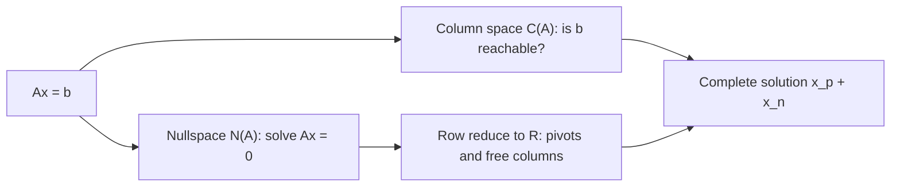
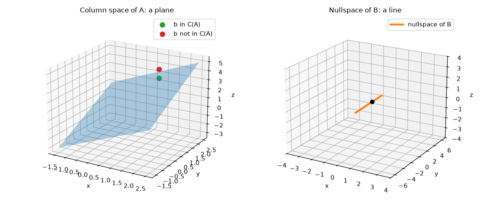
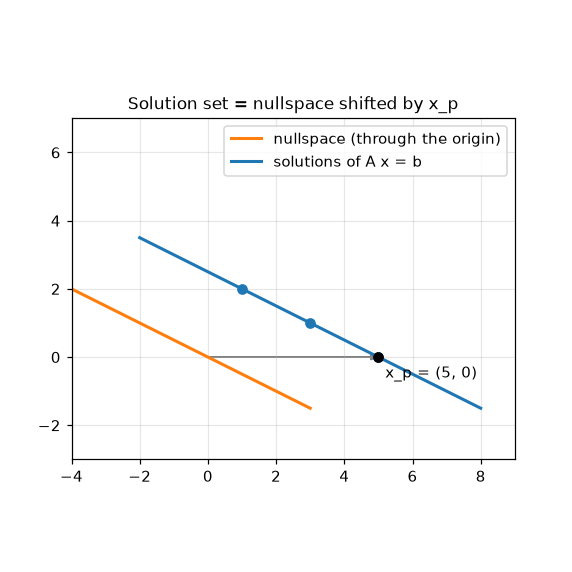

# Vector Spaces and Subspaces

**Course:** [Linear Algebra](../README.md) · **Hands-on:** [notebook.ipynb](notebook.ipynb) · **Practice:** [exercises](exercises/problems.md), [assignment](assignment.md)

So far we have asked how to solve $A\mathbf{x} = \mathbf{b}$. This topic asks a better question: **which** right-hand sides can be reached at all, and what exactly are *all* the solutions when there are many? The answers use two sets of vectors that every matrix carries with it, the **column space** and the **nullspace**, and a clean way of describing sets of vectors, the **subspace**. Once you have them, the three outcomes from the elimination topic (one solution, none, infinitely many) stop being a list to memorize and become one picture.

## Learning goals

By the end of this topic you can:

- say what a vector space and a subspace are, and test a set against the two subspace rules;
- describe the column space $C(A)$ and decide whether $A\mathbf{x} = \mathbf{b}$ is solvable by asking whether $\mathbf{b}$ lies in it;
- find the nullspace $N(A)$ by row reducing to $R$, and read off one special solution per free column;
- tell pivot columns from free columns, and use the number of pivots (the rank) to describe a matrix;
- write the complete solution of $A\mathbf{x} = \mathbf{b}$ as $\mathbf{x}_p + \mathbf{x}_n$ and picture it as a shifted copy of the nullspace;
- name the four cases of an $m \times n$ matrix by its rank, and say how many solutions each allows.

## Prerequisites

- [Linear Equations and Gaussian Elimination](../linear-equations-and-gaussian-elimination/README.md): $A\mathbf{x} = \mathbf{b}$, pivots, back substitution, and the row and column pictures.
- [Matrix Operations and LU Decomposition](../matrix-operations-and-lu-decomposition/README.md): products, inverses, and the idea that row operations are matrix multiplications.
- [Vectors and Matrices](../vectors-and-matrices/README.md): linear combinations and the column view of $A\mathbf{x}$.
- Basic Python and NumPy from [Python Basics](../../../getting-started/python-basics/README.md), only for the notebook.

## Outline

- [Notation at a glance](#notation-at-a-glance)
- [1. Vector spaces, subspaces, and the column space](#1-vector-spaces-subspaces-and-the-column-space)
- [2. The nullspace and solving Ax = 0](#2-the-nullspace-and-solving-ax--0)
- [3. The complete solution to Ax = b](#3-the-complete-solution-to-ax--b)
- [The same ideas in NumPy](#the-same-ideas-in-numpy)
- [Common mistakes](#common-mistakes)
- [Why this matters for AI/ML](#why-this-matters-for-aiml)



> [!NOTE]
> **Concept ownership.** This topic teaches vector spaces, subspaces, the column space, the nullspace, special solutions, the reduced row echelon form, and the complete solution in full. Later topics recap them and link back (see the [ownership map](../../../docs/design-notes.md)).

**What this topic leaves for later.**

| Question | Where it is answered |
|---|---|
| What are independence, basis, and dimension? What are the row space and the left nullspace (the four fundamental subspaces)? | [Independence, basis, and dimension](../independence-basis-and-dimension/README.md) |
| How do subspaces meet at right angles, and what is an orthogonal complement? | [Orthogonality and Gram-Schmidt](../orthogonality-and-gram-schmidt/README.md) |
| What do we do when $\mathbf{b}$ is not in the column space? | [Projections and least squares](../projections-and-least-squares/README.md) |
| How does the SVD describe these subspaces? | [Singular value decomposition](../singular-value-decomposition/README.md) |

## Key intuition

### Notation at a glance

| You see | It means |
|---|---|
| $\mathbb{R}^n$ | the space of all vectors with $n$ real entries |
| $C(A)$ | the **column space** of $A$: all combinations of its columns, which equals the set of all products $A\mathbf{x}$ |
| $N(A)$ | the **nullspace** of $A$: all vectors $\mathbf{x}$ with $A\mathbf{x} = \mathbf{0}$ |
| $R$ | the **reduced row echelon form** of $A$ |
| $r$ | the **rank**: for now, the number of pivots |
| $\mathbf{x}_p$, $\mathbf{x}_n$ | a particular solution of $A\mathbf{x} = \mathbf{b}$, and a vector from the nullspace |

### 1. Vector spaces, subspaces, and the column space

A **vector space** is a collection of vectors where you can add any two members and multiply any member by any number, and the results stay in the collection. It must also contain the zero vector. The main example is $\mathbb{R}^n$: add two vectors with $n$ entries and you get another one. The same rules fit other objects too. Polynomials $a + bt + ct^2$ form a vector space (add two and you get a polynomial; scale one and you get a polynomial), and so do all grayscale images of a fixed size, if you read each image as a long list of pixel values. Linear algebra works on any such collection, but we will mostly stay in $\mathbb{R}^n$.

A **subspace** is a vector space that lives inside a bigger one. To check a set $S$ of vectors, ask two questions:

1. If $\mathbf{u}$ and $\mathbf{v}$ are in $S$, is $\mathbf{u} + \mathbf{v}$ in $S$?
2. If $\mathbf{u}$ is in $S$ and $c$ is any number, is $c\mathbf{u}$ in $S$?

If both answers are always yes, $S$ is a subspace. Taking $c = 0$ in the second rule shows that **every subspace contains the zero vector**, so a set that misses $\mathbf{0}$ can never be one.

| Set in the plane | Subspace? | Why |
|---|---|---|
| the line $y = 2x$ | yes | it passes through $\mathbf{0}$, and sums and multiples of points on it stay on it |
| the line $y = 2x + 1$ | no | it misses $\mathbf{0}$; also $(0,1) + (1,3) = (1,4)$ is off the line |
| the first quadrant | no | closed under addition, but $-1 \cdot (1,1) = (-1,-1)$ leaves it |
| the $x$-axis together with the $y$-axis | no | $(1,0) + (0,1) = (1,1)$ is on neither axis |

In $\mathbb{R}^3$ the subspaces are the origin alone, lines through the origin, planes through the origin, and all of $\mathbb{R}^3$. The **intersection** of two subspaces (the vectors in both) is again a subspace, because both rules hold in each. The union usually is not, as the two axes show.

**The column space.** The **column space** $C(A)$ is the set of all combinations of the columns of $A$. By the column view of $A\mathbf{x}$, that is the same as the set of all products $A\mathbf{x}$. It is a subspace: a sum of two combinations of the columns is another combination, and so is a multiple. For

```math
A = \begin{bmatrix} 1 & 0 \\ 0 & 1 \\ 1 & 1 \end{bmatrix}
```

the columns are $(1,0,1)$ and $(0,1,1)$, and every combination $x_1(1,0,1) + x_2(0,1,1) = (x_1, x_2, x_1 + x_2)$ satisfies $z = x + y$. So $C(A)$ is the **plane** $z = x + y$ inside $\mathbb{R}^3$.

This gives the key fact about solvability: **$A\mathbf{x} = \mathbf{b}$ has a solution exactly when $\mathbf{b}$ is in $C(A)$**, because a solution $\mathbf{x}$ says "$\mathbf{b}$ is this combination of the columns". For $\mathbf{b} = (1, 2, 3)$ we have $3 = 1 + 2$, so it is on the plane and the system is solvable ($x_1 = 1$, $x_2 = 2$). For $\mathbf{b} = (1, 2, 4)$ it is not on the plane, and no solution exists. Elimination reports the same thing: on the augmented matrix, the last row becomes $0 = b_3 - b_1 - b_2$, which is a contradiction unless $\mathbf{b}$ is on the plane.



*Left: the column space of this $A$ is a plane. The green $\mathbf{b}$ lies on it, so the system is solvable. The red one floats above it, so it is not. Right: a nullspace, the line of all $\mathbf{x}$ with $B\mathbf{x} = \mathbf{0}$ for another matrix $B$ (section 2).*

**Check yourself**

1. Is $\{(x, y) : x + y = 0\}$ a subspace of $\mathbb{R}^2$? What about $\{(x, y) : x + y = 1\}$?
2. For the matrix $A$ above, is $\mathbf{b} = (2, 3, 5)$ in $C(A)$?

<details>
<summary>Answers</summary>

1. The first is the line $y = -x$, which passes through the origin and is closed under addition and scaling, so it is a subspace. The second is a line that misses the origin, so it is not.
2. Yes: $5 = 2 + 3$, so the system is solvable with $x_1 = 2$, $x_2 = 3$.

</details>

### 2. The nullspace and solving Ax = 0

The **nullspace** $N(A)$ is the set of all vectors $\mathbf{x}$ with $A\mathbf{x} = \mathbf{0}$. It always contains $\mathbf{x} = \mathbf{0}$, and it is a subspace: if $A\mathbf{x} = \mathbf{0}$ and $A\mathbf{y} = \mathbf{0}$, then $A(\mathbf{x} + \mathbf{y}) = \mathbf{0}$ and $A(c\mathbf{x}) = \mathbf{0}$. Note where each lives. For an $m \times n$ matrix, $C(A)$ is in $\mathbb{R}^m$ (the outputs), but $N(A)$ is in $\mathbb{R}^n$ (the inputs).

**Finding it by elimination.** Row operations do not change the solutions of $A\mathbf{x} = \mathbf{0}$, so we can simplify $A$ first. Take

```math
A = \begin{bmatrix} 1 & 2 & 1 & 3 \\ 2 & 4 & 3 & 8 \\ 3 & 6 & 4 & 11 \end{bmatrix}.
```

Row 2 minus $2\times$ row 1 gives $(0, 0, 1, 2)$. Row 3 minus $3\times$ row 1 gives $(0, 0, 1, 2)$. Row 3 minus the new row 2 gives a row of zeros. The matrix is now in echelon form: pivots in columns $1$ and $3$. Go one step further and clear the entry above the second pivot (row 1 minus row 2), and scale each pivot to $1$ if necessary. The result is the **reduced row echelon form** (RREF):

```math
R = \begin{bmatrix} 1 & 2 & 0 & 1 \\ 0 & 0 & 1 & 2 \\ 0 & 0 & 0 & 0 \end{bmatrix}.
```

In $R$ every pivot is $1$, every pivot column has zeros above and below the pivot, and zero rows sit at the bottom. This is Gauss-Jordan elimination from the last topic, done on $A$ alone.

**Pivot columns and free columns.** Columns $1$ and $3$ have pivots, so they are **pivot columns**. Columns $2$ and $4$ do not, so they are **free columns**, and the matching unknowns $x_2$ and $x_4$ are **free variables**: we may choose them as we like, and the pivot variables $x_1$ and $x_3$ follow. The number of pivots is the **rank** $r$ (here $r = 2$). The matrix has $n = 4$ columns, so there are $n - r = 2$ free columns. The next topic explains what rank means more deeply.

**Special solutions.** The equations $R\mathbf{x} = \mathbf{0}$ read $x_1 + 2x_2 + x_4 = 0$ and $x_3 + 2x_4 = 0$. Make one free variable $1$ and the other $0$, and solve for the pivot variables:

- $x_2 = 1$, $x_4 = 0$: then $x_1 = -2$ and $x_3 = 0$, giving $\mathbf{s}_1 = (-2, 1, 0, 0)$.
- $x_2 = 0$, $x_4 = 1$: then $x_1 = -1$ and $x_3 = -2$, giving $\mathbf{s}_2 = (-1, 0, -2, 1)$.

These are the **special solutions**, one per free column. You can read them straight off $R$: put a $1$ in the free variable's position, put the *negatives* of that column's entries in the pivot positions, and zeros elsewhere. Check $\mathbf{s}_1$ in the original $A$: $-2 + 2 = 0$, $-4 + 4 = 0$, $-6 + 6 = 0$.

Every solution of $A\mathbf{x} = \mathbf{0}$ is a combination $x_2\mathbf{s}_1 + x_4\mathbf{s}_2$, so $N(A)$ is the **plane** in $\mathbb{R}^4$ spanned by $\mathbf{s}_1$ and $\mathbf{s}_2$.

**When the nullspace is only $\{\mathbf{0}\}$.** If every column is a pivot column, there are no free variables and no special solutions, so the only solution of $A\mathbf{x} = \mathbf{0}$ is $\mathbf{x} = \mathbf{0}$. This is the case for the $3 \times 2$ matrix of section 1: its two columns both have pivots.

**Check yourself**

1. For $`A = \begin{bmatrix} 1 & 2 \\ 3 & 6 \end{bmatrix}`$, find the pivot column, the free column, and the nullspace. (The rows of $A$ are $(1,2)$ and $(3,6)$.)
2. A $5 \times 8$ matrix has rank $3$. How many free columns, and how many special solutions?

<details>
<summary>Answers</summary>

1. Row 2 minus $3\times$ row 1 gives $(0, 0)$, so $R$ has rows $(1, 2)$ and $(0, 0)$. Column 1 is the pivot column and column 2 is free. With $x_2 = 1$ we get $x_1 = -2$, so $N(A)$ is all multiples of $(-2, 1)$: a line through the origin.
2. $8 - 3 = 5$ free columns, so $5$ special solutions.

</details>

### 3. The complete solution to Ax = b

Now put a nonzero right-hand side in. Row reduce the augmented matrix $[A \mid \mathbf{b}]$ to $[R \mid \mathbf{d}]$. Use the same $A$ and $\mathbf{b} = (1, 3, 4)$:

```math
\left[\begin{array}{cccc|c} 1 & 2 & 1 & 3 & 1 \\ 2 & 4 & 3 & 8 & 3 \\ 3 & 6 & 4 & 11 & 4 \end{array}\right]
\;\longrightarrow\;
\left[\begin{array}{cccc|c} 1 & 2 & 0 & 1 & 0 \\ 0 & 0 & 1 & 2 & 1 \\ 0 & 0 & 0 & 0 & 0 \end{array}\right].
```

The zero row ends with $0$, so there is no contradiction and the system is solvable. (With $\mathbf{b} = (1, 3, 5)$ the last row would end with $1$, meaning $0 = 1$: no solution, because that $\mathbf{b}$ is not in $C(A)$.)

**A particular solution.** Set every free variable to $0$ and read off the pivot variables from the last column: $x_2 = x_4 = 0$ gives $x_1 = 0$ and $x_3 = 1$. So $\mathbf{x}_p = (0, 0, 1, 0)$. Check: it is the third column of $A$, which is $(1, 3, 4) = \mathbf{b}$.

**The complete solution.** Anything from the nullspace can be added without changing $A\mathbf{x}$, because $A(\mathbf{x}_p + \mathbf{x}_n) = \mathbf{b} + \mathbf{0}$. Conversely, if $A\mathbf{x} = \mathbf{b}$ and $A\mathbf{x}_p = \mathbf{b}$, then $A(\mathbf{x} - \mathbf{x}_p) = \mathbf{0}$, so the difference lies in the nullspace. Together:

$$
\mathbf{x} = \mathbf{x}_p + \mathbf{x}_n, \qquad \mathbf{x}_n \text{ any vector in } N(A).
$$

For our example, $\mathbf{x} = (0,0,1,0) + x_2(-2,1,0,0) + x_4(-1,0,-2,1)$, a plane of solutions in $\mathbb{R}^4$.

**The picture.** The set of solutions is the nullspace **shifted** by $\mathbf{x}_p$. In the plane, take $`A = \begin{bmatrix}1&2\\2&4\end{bmatrix}`$ and $\mathbf{b} = (5, 10)$: the nullspace is the line through the origin spanned by $(-2, 1)$, and the solutions are the parallel line through $\mathbf{x}_p = (5, 0)$, which is $(5 - 2t, t)$ (it contains the points $(5,0)$ and $(1,2)$ from the elimination topic). That line misses the origin, so **the solution set is not a subspace** unless $\mathbf{b} = \mathbf{0}$.



*The orange line is the nullspace. The blue line is the solution set, the same line moved so that it passes through the particular solution $\mathbf{x}_p = (5, 0)$.*

**Four cases by rank.** For an $m \times n$ matrix of rank $r$, we always have $r \le m$ and $r \le n$. The extremes decide how many solutions there are:

| Case | Rank | $R$ looks like | Solutions of $A\mathbf{x} = \mathbf{b}$ |
|---|---|---|---|
| square, invertible | $r = m = n$ | $I$ | exactly one, for every $\mathbf{b}$ |
| tall, full column rank | $r = n < m$ | $I$ with zero rows below | none or exactly one |
| wide, full row rank | $r = m < n$ | $I$ with extra free columns | always solvable, infinitely many |
| neither | $r < m$ and $r < n$ | $I$ with free columns and zero rows | none or infinitely many |

These match the three outcomes of the elimination topic. **One solution** needs $N(A) = \{\mathbf{0}\}$ (no free columns) and $\mathbf{b}$ in $C(A)$. **No solution** means $\mathbf{b}$ is not in $C(A)$. **Infinitely many** means $\mathbf{b}$ is in $C(A)$ and there is at least one free column.

**Check yourself**

1. A $2 \times 3$ matrix has rank $2$. How many solutions does $A\mathbf{x} = \mathbf{b}$ have for a given $\mathbf{b}$?
2. If $\mathbf{x}_1$ and $\mathbf{x}_2$ both solve $A\mathbf{x} = \mathbf{b}$, what can you say about $\mathbf{x}_1 - \mathbf{x}_2$?

<details>
<summary>Answers</summary>

1. Infinitely many, for every $\mathbf{b}$: this is the wide, full row rank case ($r = m = 2 < n = 3$), with one free column.
2. It is in the nullspace, because $A(\mathbf{x}_1 - \mathbf{x}_2) = \mathbf{b} - \mathbf{b} = \mathbf{0}$.

</details>

### The same ideas in NumPy

Is $\mathbf{b}$ in the column space? Appending $\mathbf{b}$ as an extra column leaves the rank unchanged exactly when it is:

```python
import numpy as np

A = np.array([[1, 2, 1, 3],
              [2, 4, 3, 8],
              [3, 6, 4, 11]])
for b in ([1, 3, 4], [1, 3, 5]):
    in_column_space = np.linalg.matrix_rank(np.column_stack([A, b])) == np.linalg.matrix_rank(A)
    print(b, "in the column space:", in_column_space)
```

```text
[1, 3, 4] in the column space: True
[1, 3, 5] in the column space: False
```

SymPy reduces a matrix to $R$ exactly, with fractions, and can list the special solutions:

```python
import sympy as sp

R, pivot_columns = sp.Matrix(A).rref()
print(R)
print(pivot_columns)
print([list(v) for v in sp.Matrix(A).nullspace()])   # the special solutions
```

```text
Matrix([[1, 2, 0, 1], [0, 0, 1, 2], [0, 0, 0, 0]])
(0, 2)
[[-2, 1, 0, 0], [-1, 0, -2, 1]]
```

(SymPy counts columns from 0, so pivot columns `(0, 2)` are our columns 1 and 3.) SciPy gives an orthonormal basis for the nullspace, and we can check the complete solution:

```python
import scipy.linalg as sla

Z = sla.null_space(A)
print(Z.shape, np.allclose(A @ Z, 0))

x_p = np.array([0, 0, 1, 0])
s1 = np.array([-2, 1, 0, 0])
s2 = np.array([-1, 0, -2, 1])
x = x_p + 3 * s1 - 2 * s2                  # any combination of special solutions works
print(A @ x)
```

```text
(4, 2) True
[1 3 4]
```

## Common mistakes

- **Mixing up the two spaces.** $C(A)$ lives in $\mathbb{R}^m$ and $N(A)$ lives in $\mathbb{R}^n$. For the $3 \times 4$ example the column space sits in $\mathbb{R}^3$ and the nullspace in $\mathbb{R}^4$.
- **Taking pivot columns of $R$ as the column space.** The pivot columns of $R$ are not a basis for $C(A)$. The *positions* of the pivots tell you which columns of the original $A$ to use.
- **Forgetting the zero vector.** A set that misses $\mathbf{0}$, such as a line not through the origin, is never a subspace. The solution set of $A\mathbf{x} = \mathbf{b}$ with $\mathbf{b} \ne \mathbf{0}$ is exactly such a set.
- **Setting the wrong variables to zero.** For $\mathbf{x}_p$, set the *free* variables to $0$ and solve for the pivot variables, not the other way around.
- **Dropping the sign in a special solution.** Special solutions carry the *negatives* of the free column's entries in the pivot positions. Check each one by multiplying by $A$.

## Why this matters for AI/ML

- **The column space is what a linear model can output.** A linear model with data matrix $X$ and weights $\mathbf{w}$ produces predictions $X\mathbf{w}$, which always lie in $C(X)$. If the targets $\mathbf{y}$ are not in $C(X)$, no weights fit exactly, and the best we can do is the closest point of $C(X)$. That is **least squares**. See [projections and least squares](../projections-and-least-squares/README.md) and [linear regression](../../../machine-learning/linear-regression/README.md).
- **The nullspace is what a linear map cannot see.** Any change to the input that lies in $N(A)$ leaves the output untouched. A layer that maps 768 inputs to 128 outputs must have at least $768 - 128 = 640$ free variables, so it throws away a lot of input variation. The same holds for projections used to compress data.
- **Many solutions mean overparameterized models.** When a system is underdetermined (more unknowns than equations), the solutions are $\mathbf{x}_p + \mathbf{x}_n$, an entire shifted subspace of weights that all fit the data equally well. Training has to pick one. For a simple linear model, gradient descent started from zero picks the solution of smallest length, an idea the [SVD](../singular-value-decomposition/README.md) topic makes precise.
- **Low-rank structure is a teaser for what is next.** A matrix of rank $r$ is built from only $r$ independent directions. Methods such as LoRA (low-rank adapters) fine-tune a huge weight matrix by adding a change that is deliberately low rank, so it needs few numbers. See [GPT and efficient LLMs](../../../deep-learning/gpt-and-efficient-llms/README.md).

### Collinear features: a concrete check

If one feature is a combination of the others, the data matrix has a nonzero nullspace. Take three features where the third is the sum of the first two:

```python
X = np.array([[1, 2, 3],
              [2, 0, 2],
              [0, 1, 1],
              [3, 1, 4]])          # third column = first column + second column
print(np.linalg.matrix_rank(X))
print(np.linalg.matrix_rank(X.T @ X))
print(sla.null_space(X).round(3).ravel())
```

```text
2
2
[-0.577 -0.577  0.577]
```

The rank is $2$ for a matrix with $3$ columns, so $X^\top X$ is a $3 \times 3$ matrix of rank $2$: singular, and the normal equations of least squares have no unique solution. The nullspace vector, proportional to $(1, 1, -1)$, names the redundancy ($\text{col}_1 + \text{col}_2 - \text{col}_3 = \mathbf{0}$). Adding any multiple of it to the weights leaves every prediction unchanged, so the weights are not identifiable. The notebook shows this and the fix of dropping a column.

## Summary

- A subspace contains $\mathbf{0}$ and is closed under addition and scaling. Lines and planes through the origin are subspaces; sets that miss the origin or have a boundary are not.
- The column space $C(A)$ is all combinations of the columns, and $A\mathbf{x} = \mathbf{b}$ is solvable exactly when $\mathbf{b}$ is in $C(A)$.
- The nullspace $N(A)$ holds all $\mathbf{x}$ with $A\mathbf{x} = \mathbf{0}$. Row reduce to $R$, find pivot and free columns, and read one special solution per free column.
- The complete solution of $A\mathbf{x} = \mathbf{b}$ is $\mathbf{x}_p + \mathbf{x}_n$: the nullspace shifted by a particular solution.
- The rank (the number of pivots) and the shape $m \times n$ give four cases that cover one solution, none, or infinitely many.

## Further reading

Chapter pointers and free links are in [resources.md](resources.md).

## Practice

- [Notebook](notebook.ipynb): test sets against the subspace rules, see a column space and a nullspace in 3D, row reduce from scratch, and meet a data matrix with a hidden redundant column. It follows the lesson:

  | Lesson section | Notebook section |
  |---|---|
  | 1. Vector spaces, subspaces, and the column space | 1. The subspace test as code, 2. Column space: a plane inside 3D |
  | 2. The nullspace and solving Ax = 0 | 3. Row reduction to R from scratch, 4. Special solutions and the nullspace |
  | 3. The complete solution to Ax = b | 5. The complete solution, 6. Four cases by rank |
  | Why this matters for AI/ML | 7. A hidden redundant column |

- [Exercises](exercises/problems.md) (with [solutions](exercises/solutions.md)): ten problems, easy to harder.
- [Assignment](assignment.md): find the hidden redundant feature in a small data matrix and describe all the weight vectors that fit.

---

[← Previous: Matrix Operations and LU Decomposition](../matrix-operations-and-lu-decomposition/README.md) | [Next: Independence, Basis, and Dimension →](../independence-basis-and-dimension/README.md)
