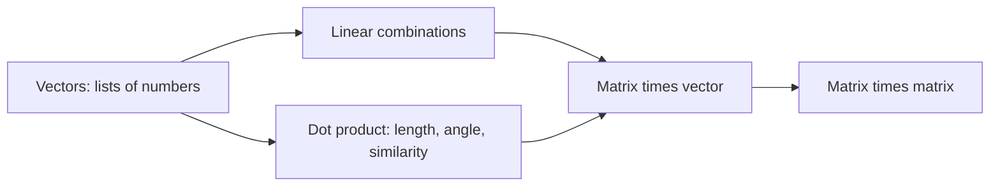

# Vectors and Matrices

**Course:** [Linear Algebra](../README.md) · **Hands-on:** [notebook.ipynb](notebook.ipynb) · **Practice:** [exercises](exercises/problems.md), [assignment](assignment.md)

Almost everything in machine learning starts with one idea: turn things (a photo, a sentence, a customer) into lists of numbers, then do arithmetic on those lists. This topic gives you the three tools for that arithmetic: **vectors**, the **dot product**, and **matrices**.

## Learning goals

By the end of this topic you can:

- picture a vector as an arrow, as a point, and as a plain list of numbers, and move between the three views;
- add vectors, scale them, and combine them into a **linear combination**;
- compute the **length** of a vector and the **dot product** of two vectors, and say what the dot product tells you about the angle between them;
- multiply a matrix by a vector in two different ways (row by row, or column by column) and explain why both give the same answer;
- multiply two matrices, check that the shapes fit, and explain why $AB$ is usually not the same as $BA$;
- say, in one sentence each, how embeddings, similarity search, and a neural network layer use these tools.

## Prerequisites

- High-school algebra and the coordinate plane.
- Basic Python and NumPy from [Getting Started: Python basics](../../../getting-started/python-basics/README.md), only needed for the notebook.

## Outline

1. [Vectors and linear combinations](#1-vectors-and-linear-combinations)
2. [Length and the dot product](#2-length-and-the-dot-product)
3. [Matrices and matrix-vector multiplication](#3-matrices-and-matrix-vector-multiplication)
4. [Multiplying two matrices](#4-multiplying-two-matrices)
5. [Why this matters for AI/ML](#why-this-matters-for-aiml)

> **Concept ownership.** This topic teaches vectors, the dot product, and matrix multiplication in full. Later topics recap them in a few lines and only add what is new (see the [ownership map](../../../docs/design-notes.md)).

## Key intuition

### 1. Vectors and linear combinations

A **vector** is an ordered list of numbers, such as $\mathbf{v} = (2, 3)$. You can read it three ways, and good intuition means switching freely between them:

- **A list.** Two numbers: "2, then 3". This is how a computer stores it.
- **A point.** Start at the origin, go 2 steps right and 3 steps up.
- **An arrow.** Draw an arrow from the origin to that point. It has a direction and a size.

Vectors can live in any dimension. A vector with 3 numbers is a point in 3D space. A vector with 768 numbers (a common size for text embeddings) is a point in 768-dimensional space. You cannot draw it, but every rule you learn from 2D pictures still holds.

There are only two basic moves:

- **Adding** vectors: add them entry by entry, $(1, 2) + (3, 1) = (4, 3)$. As arrows, place the second arrow's tail at the first one's tip.
- **Scaling** a vector: multiply every entry by a number, $3 \cdot (1, 2) = (3, 6)$. The arrow keeps its direction and gets 3 times longer (a negative number flips it).

Do both at once and you get a **linear combination**:

$$
c\,\mathbf{v} + d\,\mathbf{w}
$$

where $c$ and $d$ are any numbers. For example, $2\cdot(1,0) + 3\cdot(0,1) = (2,3)$: the point $(2,3)$ is "2 steps along the first direction and 3 along the second". A linear combination is the basic way vectors are mixed, and later topics ask: *which vectors can I reach by mixing these ones?*

### 2. Length and the dot product

The **length** (or **norm**) of $\mathbf{v} = (v_1, v_2)$ comes straight from Pythagoras:

$$
\|\mathbf{v}\| = \sqrt{v_1^2 + v_2^2}
$$

so $\|(3,4)\| = 5$. In more dimensions you just add more squares under the root.

The **dot product** of two vectors multiplies matching entries and adds them up:

$$
\mathbf{v}\cdot\mathbf{w} = v_1 w_1 + v_2 w_2 + \dots + v_n w_n
$$

For example, $(1,2,3)\cdot(4,-5,2) = 4 - 10 + 6 = 0$. Notice that $\mathbf{v}\cdot\mathbf{v}$ is the squared length, so $\|\mathbf{v}\| = \sqrt{\mathbf{v}\cdot\mathbf{v}}$.

The dot product has a geometric meaning that is worth remembering:

$$
\mathbf{v}\cdot\mathbf{w} = \|\mathbf{v}\|\,\|\mathbf{w}\|\cos\theta
$$

where $\theta$ is the angle between the two arrows. Read it as a measure of **how much two vectors point the same way**:

| Dot product | Meaning |
|---|---|
| large and positive | the arrows point roughly the same way |
| zero | the arrows are perpendicular (we say **orthogonal**) |
| negative | the arrows point roughly opposite ways |

If you divide out the lengths you get the **cosine similarity**, a number between $-1$ and $1$ that ignores how long the vectors are and only looks at direction:

$$
\cos\theta = \frac{\mathbf{v}\cdot\mathbf{w}}{\|\mathbf{v}\|\,\|\mathbf{w}\|}
$$

(You will sometimes see the dot product written $\mathbf{v}^\top\mathbf{w}$. The little $\top$ means "transpose", which the [matrix operations topic](../matrix-operations-and-lu-decomposition/README.md) covers properly. For now it is just another way to write the same sum.)

### 3. Matrices and matrix-vector multiplication

A **matrix** is a rectangular grid of numbers. A matrix $A$ with $m$ rows and $n$ columns is called "$m$ by $n$":

$$
A = \begin{bmatrix} 1 & 2 \\ 3 & 4 \\ 5 & 6 \end{bmatrix} \quad \text{is a } 3 \times 2 \text{ matrix.}
$$

You can add two matrices of the same shape, or scale a matrix, entry by entry, just like vectors. The interesting operation is multiplying a matrix by a vector. Take

$$
A = \begin{bmatrix} 1 & 2 \\ 3 & 4 \end{bmatrix}, \qquad \mathbf{x} = \begin{bmatrix} 2 \\ 1 \end{bmatrix}.
$$

There are two ways to compute $A\mathbf{x}$, and both are worth knowing.

**Row view: a stack of dot products.** Each entry of the answer is the dot product of one row of $A$ with $\mathbf{x}$:

$$
A\mathbf{x} = \begin{bmatrix} 1\cdot 2 + 2\cdot 1 \\ 3\cdot 2 + 4\cdot 1 \end{bmatrix} = \begin{bmatrix} 4 \\ 10 \end{bmatrix}
$$

**Column view: a linear combination.** The entries of $\mathbf{x}$ are the amounts, and the columns of $A$ are the ingredients:

$$
A\mathbf{x} = 2\begin{bmatrix} 1 \\ 3 \end{bmatrix} + 1\begin{bmatrix} 2 \\ 4 \end{bmatrix} = \begin{bmatrix} 4 \\ 10 \end{bmatrix}
$$

Same answer, two stories. The row view is handy for computing; the column view is handy for understanding. It tells you that $A\mathbf{x}$ always lies among the combinations of the columns of $A$, an idea that returns in [vector spaces](../vector-spaces-and-subspaces/README.md).

There is a third story, the most important one for machine learning: **a matrix is a machine that turns vectors into vectors.** Feed $\mathbf{x}$ in, get $A\mathbf{x}$ out. Some matrices rotate the plane, some stretch it, some squash it onto a line. The notebook lets you watch this happen to a whole grid of points, and the [linear transformations topic](../linear-transformations/README.md) builds on it.

The shapes must fit: an $m \times n$ matrix needs a vector with $n$ entries and returns a vector with $m$ entries.

### 4. Multiplying two matrices

To multiply $A$ by $B$, apply the matrix-vector rule to each column of $B$. Entry in row $i$, column $j$ of $AB$ is the dot product of row $i$ of $A$ with column $j$ of $B$:

$$
\begin{bmatrix} 1 & 2 \\ 0 & 1 \end{bmatrix}
\begin{bmatrix} 0 & 1 \\ 1 & 0 \end{bmatrix}
=
\begin{bmatrix} 2 & 1 \\ 1 & 0 \end{bmatrix}
$$

Two rules to remember:

- **Shapes.** $(m \times n)(n \times p)$ gives $m \times p$. The two inner numbers must match and then disappear.
- **Order matters.** Swap the factors above and you get $\begin{bmatrix} 0 & 1 \\ 1 & 2 \end{bmatrix}$, a different matrix. Doing "A then B" is not the same as "B then A", just as putting on socks then shoes differs from shoes then socks. The full rules of matrix arithmetic (what *does* hold, such as grouping) come in [matrix operations and LU decomposition](../matrix-operations-and-lu-decomposition/README.md).

## Why this matters for AI/ML

- **Embeddings are vectors.** A word, an image, or a song is turned into a vector of a few hundred numbers so that similar things end up close together. Everything a model does next is vector arithmetic.
- **The dot product is similarity.** When a search engine or a retrieval system looks for the passages "closest in meaning" to your question, it ranks them by dot product or cosine similarity between embeddings. The same dot product is the core of the attention mechanism inside Transformers.
- **A neural network layer is a matrix.** A layer computes $\mathbf{y} = W\mathbf{x} + \mathbf{b}$: multiply the input vector by a weight matrix, then add a bias vector. Each row of $W$ is one neuron doing a dot product with the input. Training a network means finding good numbers for $W$.
- **Data is a matrix.** A table with 1,000 examples and 20 features is a $1000 \times 20$ matrix, and a whole batch of examples can be pushed through a layer with a single matrix multiplication, which is exactly what GPUs are built to do fast.

Where these ideas come back: [least squares](../projections-and-least-squares/README.md) (fitting lines), [SVD](../singular-value-decomposition/README.md) and PCA (compressing data), and [backpropagation](../../../deep-learning/backpropagation/README.md) (training networks).

## Further reading

Chapter pointers and free links are in [resources.md](resources.md).

## Practice

- [Notebook](notebook.ipynb): draw vectors, build linear combinations, measure angles, and watch a matrix transform the plane.
- [Exercises](exercises/problems.md) (with [solutions](exercises/solutions.md)): eight problems, easy to harder.
- [Assignment](assignment.md): a small movie-recommendation task using dot products.

---

[← Previous: How to Use this Repo](../../../getting-started/how-to-use-this-repo/README.md) | [Next: Linear Equations and Gaussian Elimination →](../linear-equations-and-gaussian-elimination/README.md)
