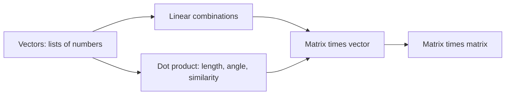

# Vectors and Matrices

**Course:** [Linear Algebra](../README.md) · **Hands-on:** [notebook.ipynb](notebook.ipynb) · **Practice:** [exercises](exercises/problems.md), [assignment](assignment.md)

Almost everything in machine learning starts the same way: turn something (a photo, a sentence, a customer) into a list of numbers, then do arithmetic on that list. This topic gives you the three tools for that arithmetic: **vectors**, the **dot product**, and **matrices**. They look like a lot of symbols at first, but each rule is a few lines of ordinary multiplication and addition, and we will work every one with small numbers.

## Learning goals

By the end of this topic you can:

- picture a vector as an arrow, as a point, and as a plain list of numbers, and move between the three views;
- add vectors, scale them, and combine them into a **linear combination**;
- compute the **length** of a vector and the **dot product** of two vectors, and say what the dot product tells you about the angle between them;
- multiply a matrix by a vector in two ways (row by row, or column by column) and explain why both give the same answer;
- multiply two matrices, check that the shapes fit, and explain why $AB$ is usually not the same as $BA$;
- say, in one sentence each, how embeddings, similarity search, and a neural network layer use these tools.

## Prerequisites

- High-school algebra and the coordinate plane (points like $(2, 3)$).
- Basic Python and NumPy from [Python Basics](../../../getting-started/python-basics/README.md). You only need it for the notebook, and the lesson itself can be read without it.

## Outline

- [Notation at a glance](#notation-at-a-glance)
- [1. Vectors and linear combinations](#1-vectors-and-linear-combinations)
- [2. Length and the dot product](#2-length-and-the-dot-product)
- [3. Matrices and matrix-vector multiplication](#3-matrices-and-matrix-vector-multiplication)
- [4. Multiplying two matrices](#4-multiplying-two-matrices)
- [The same ideas in NumPy](#the-same-ideas-in-numpy)
- [Common mistakes](#common-mistakes)
- [Why this matters for AI/ML](#why-this-matters-for-aiml)



> [!NOTE]
> **Concept ownership.** This is the first topic that uses vectors, the dot product, and matrix multiplication, so it teaches them in full. Later topics recap them in a few lines and link back here (see the [ownership map](../../../docs/design-notes.md)).

**What this topic leaves for later.** Some natural questions come up along the way. We note them and park them on purpose, so that this page stays small.

| Question | Where it is answered |
|---|---|
| Which vectors can I reach by mixing a given set? When are some of them redundant? | [Vector spaces and subspaces](../vector-spaces-and-subspaces/README.md) and [independence, basis, and dimension](../independence-basis-and-dimension/README.md) |
| Given $A$ and $\mathbf{b}$, how do I find $\mathbf{x}$ with $A\mathbf{x} = \mathbf{b}$? | [Linear equations and Gaussian elimination](../linear-equations-and-gaussian-elimination/README.md) |
| What is the transpose in full, what is an inverse, and which rules does matrix arithmetic obey? | [Matrix operations and LU decomposition](../matrix-operations-and-lu-decomposition/README.md) |
| What does a matrix do to the plane, in general? | [Linear transformations](../linear-transformations/README.md) |

## Key intuition

### Notation at a glance

| You see | It means |
|---|---|
| $\mathbf{v}$, $\mathbf{w}$, $\mathbf{x}$ (bold lowercase) | a vector, a list of numbers |
| $v_1, v_2, \dots, v_n$ | the entries of $\mathbf{v}$; the small low number is the position |
| $A$, $B$, $W$ (capital letters) | a matrix, a grid of numbers |
| $c$, $d$ (plain lowercase) | a single number, called a **scalar** |
| $\|\mathbf{v}\|$ | the length of $\mathbf{v}$ |
| $\mathbf{v}\cdot\mathbf{w}$ | the dot product of $\mathbf{v}$ and $\mathbf{w}$ |

Handwriting usually draws a small arrow over a vector instead of making it bold. Both mean the same thing.

### 1. Vectors and linear combinations

A **vector** is an ordered list of numbers, such as $\mathbf{v} = (2, 3)$. You can read it three ways, and good intuition means switching freely between them:

- **A list.** Two numbers: "2, then 3". This is how a computer stores it.
- **A point.** Start at the origin, go 2 steps right and 3 steps up.
- **An arrow.** Draw an arrow from the origin to that point. It has a direction and a size.

Vectors can have any number of entries. A vector with 3 entries is a point in 3D space. A vector with 768 entries (a common size for text embeddings) is a point in a 768-dimensional space. You cannot draw it, but every rule from the 2D pictures still holds.

There are only two basic moves.

**Adding** vectors means adding entry by entry. As arrows, you place the second arrow's tail at the first one's tip.

$$
(1, 2) + (3, 1) = (1 + 3,\ 2 + 1) = (4, 3)
$$

**Scaling** a vector means multiplying every entry by a number. The arrow keeps its direction and gets longer or shorter. A negative number flips it.

$$
3 \cdot (1, 2) = (3, 6), \qquad -1 \cdot (1, 2) = (-1, -2)
$$

Do both at once and you get a **linear combination**, $c\,\mathbf{v} + d\,\mathbf{w}$, where $c$ and $d$ are any numbers. Here is one with $c = 2$ and $d = -1$:

$$
2\,(1, 2) + (-1)\,(3, 1) = (2, 4) + (-3, -1) = (-1, 3)
$$

A simpler one shows the idea behind coordinates: $2\cdot(1,0) + 3\cdot(0,1) = (2,3)$. The point $(2,3)$ means "2 steps along the first direction and 3 along the second". A linear combination is the basic way to mix vectors, and later topics ask which vectors you can reach by mixing a given set.

**Check yourself**

1. Compute $\mathbf{v} + 2\mathbf{w}$ for $\mathbf{v} = (1, 0)$ and $\mathbf{w} = (2, 5)$.
2. Can you add a vector with 2 entries to a vector with 3 entries?

<details>
<summary>Answers</summary>

1. $2\mathbf{w} = (4, 10)$, so $\mathbf{v} + 2\mathbf{w} = (5, 10)$.
2. No. Addition works entry by entry, so the two vectors need the same number of entries.

</details>

### 2. Length and the dot product

The **length** (or **norm**) of $\mathbf{v} = (v_1, v_2)$ comes straight from Pythagoras:

$$
\|\mathbf{v}\| = \sqrt{v_1^2 + v_2^2}
$$

so $\|(3,4)\| = \sqrt{9 + 16} = 5$. With more entries, you just add more squares under the root.

The **dot product** multiplies matching entries and adds the results:

$$
\mathbf{v}\cdot\mathbf{w} = v_1 w_1 + v_2 w_2 + \dots + v_n w_n
$$

For example, $(1,2,3)\cdot(4,-5,2) = 4 - 10 + 6 = 0$. The answer is a single number, not a vector. Notice that $\mathbf{v}\cdot\mathbf{v}$ is the squared length, so $\|\mathbf{v}\| = \sqrt{\mathbf{v}\cdot\mathbf{v}}$.

The dot product also has a geometric meaning:

$$
\mathbf{v}\cdot\mathbf{w} = \|\mathbf{v}\|\,\|\mathbf{w}\|\cos\theta
$$

where $\theta$ is the angle between the two arrows. Read it as a measure of how much two vectors point the same way:

| Dot product | Meaning |
|---|---|
| large and positive | the arrows point roughly the same way |
| zero | the arrows are perpendicular, which we call **orthogonal** |
| negative | the arrows point roughly opposite ways |

Divide the dot product by both lengths and you get the **cosine similarity**, a number between $-1$ and $1$ that ignores how long the vectors are and compares only their directions:

$$
\cos\theta = \frac{\mathbf{v}\cdot\mathbf{w}}{\|\mathbf{v}\|\,\|\mathbf{w}\|}
$$

Worked example: take $\mathbf{v} = (3, 1)$ and $\mathbf{w} = (1, 3)$. The dot product is $3\cdot1 + 1\cdot3 = 6$, and each length is $\sqrt{10}$, so the cosine similarity is $6/10 = 0.6$. The arrows lean the same way, but not closely. Now take $\mathbf{w}' = (6, 2)$, which is $\mathbf{v}$ stretched to twice its length. The dot product is $18 + 2 = 20$ and the lengths are $\sqrt{10}$ and $\sqrt{40}$, so the cosine is $20/20 = 1$. Same direction means similarity 1, however long the arrow.

> [!NOTE]
> You will sometimes see the dot product written $\mathbf{v}^\top\mathbf{w}$. The small $\top$ means **transpose**, which turns a column of numbers into a row (and the reverse). Written that way, "row times column" is the dot product. This page does not need transposes beyond that, and the [matrix operations topic](../matrix-operations-and-lu-decomposition/README.md) covers them properly.

**Check yourself**

1. Find $\|(5, 12)\|$ and $(2, -1, 3)\cdot(1, 4, 2)$.
2. Two vectors have cosine similarity $-1$. What does that say about their directions?

<details>
<summary>Answers</summary>

1. $\sqrt{25 + 144} = 13$, and $2 - 4 + 6 = 4$.
2. They point in exactly opposite directions.

</details>

### 3. Matrices and matrix-vector multiplication

A **matrix** is a rectangular grid of numbers. A matrix with $m$ rows and $n$ columns is called "$m$ by $n$", and we write $m \times n$. Rows are listed first, then columns.

```math
A = \begin{bmatrix} 1 & 2 \\ 3 & 4 \\ 5 & 6 \end{bmatrix} \quad \text{is a } 3 \times 2 \text{ matrix.}
```

You can add two matrices of the same shape, or scale a matrix, entry by entry, just like vectors. The interesting operation is multiplying a matrix by a vector. Take

```math
A = \begin{bmatrix} 1 & 2 \\ 3 & 4 \end{bmatrix}, \qquad \mathbf{x} = \begin{bmatrix} 2 \\ 1 \end{bmatrix}.
```

There are two ways to compute $A\mathbf{x}$, and it pays to know both.

**Row view: a stack of dot products.** Each entry of the answer is the dot product of one row of $A$ with $\mathbf{x}$:

```math
A\mathbf{x} = \begin{bmatrix} 1\cdot 2 + 2\cdot 1 \\ 3\cdot 2 + 4\cdot 1 \end{bmatrix} = \begin{bmatrix} 4 \\ 10 \end{bmatrix}
```

**Column view: a linear combination.** The entries of $\mathbf{x}$ say how much of each column of $A$ to take:

```math
A\mathbf{x} = 2\begin{bmatrix} 1 \\ 3 \end{bmatrix} + 1\begin{bmatrix} 2 \\ 4 \end{bmatrix} = \begin{bmatrix} 4 \\ 10 \end{bmatrix}
```

Same answer, two ways of seeing it. The row view is convenient for computing, and the column view is convenient for understanding: it shows that $A\mathbf{x}$ is always a mix of the columns of $A$, an idea that returns in [vector spaces](../vector-spaces-and-subspaces/README.md).

There is a third view, the most important one for machine learning: **a matrix is a machine that turns vectors into vectors.** Feed $\mathbf{x}$ in, get $A\mathbf{x}$ out. Some matrices rotate the plane, some stretch it, and some squash it onto a line. The [notebook](notebook.ipynb) lets you watch this happen to a letter F, and the [linear transformations topic](../linear-transformations/README.md) builds on it.

**The shape rule.** An $m \times n$ matrix needs a vector with $n$ entries, and returns a vector with $m$ entries. In the example, a $2 \times 2$ matrix took a vector with 2 entries and returned a vector with 2 entries. The $3 \times 2$ matrix above would take 2 entries and return 3.

**Check yourself**

1. For $`A = \begin{bmatrix} 1 & 0 \\ 0 & 2 \end{bmatrix}`$ and $\mathbf{x} = (3, 5)$, find $A\mathbf{x}$ with either view. (The rows of $A$ are $(1,0)$ and $(0,2)$.)
2. A matrix is $4 \times 3$. How many entries must the vector have, and how many entries does the answer have?

<details>
<summary>Answers</summary>

1. Rows: $1\cdot3 + 0\cdot5 = 3$ and $0\cdot3 + 2\cdot5 = 10$, so the answer is $(3, 10)$. Columns: $3\,(1,0) + 5\,(0,2) = (3, 10)$. This matrix leaves the first entry alone and doubles the second.
2. The vector needs 3 entries (the number of columns), and the answer has 4 entries (the number of rows).

</details>

### 4. Multiplying two matrices

To multiply $A$ by $B$, apply the matrix-vector rule to each column of $B$. Put another way, the entry in row $i$ and column $j$ of $AB$ is the dot product of row $i$ of $A$ with column $j$ of $B$.

```math
\begin{bmatrix} 1 & 2 \\ 0 & 1 \end{bmatrix}
\begin{bmatrix} 0 & 1 \\ 1 & 0 \end{bmatrix}
=
\begin{bmatrix} 1\cdot0+2\cdot1 & 1\cdot1+2\cdot0 \\ 0\cdot0+1\cdot1 & 0\cdot1+1\cdot0 \end{bmatrix}
=
\begin{bmatrix} 2 & 1 \\ 1 & 0 \end{bmatrix}
```

Two rules to remember:

- **Shapes.** $(m \times n)(n \times p)$ gives $m \times p$. The two inner numbers must match, and then they disappear. A $2 \times 3$ matrix times a $3 \times 4$ matrix gives a $2 \times 4$ matrix. A $3 \times 2$ matrix times a $3 \times 4$ matrix is not defined, because the inner numbers 2 and 3 differ.
- **Order matters.** Swap the factors above and you get $`\begin{bmatrix} 0 & 1 \\ 1 & 2 \end{bmatrix}`$, a different matrix. Doing "A then B" differs from "B then A", just as putting on socks and then shoes differs from shoes and then socks. The rules that do hold, such as regrouping a product of three matrices, come in [matrix operations and LU decomposition](../matrix-operations-and-lu-decomposition/README.md).

In $AB\mathbf{x}$, the matrix next to the vector acts first. So $AB\mathbf{x}$ means "apply $B$ to $\mathbf{x}$, then apply $A$ to the result".

**Check yourself**

1. $A$ is $5 \times 2$ and $B$ is $2 \times 7$. Is $AB$ defined, and what is its shape? What about $BA$?
2. If $AB$ is defined, does that mean $BA$ is defined?

<details>
<summary>Answers</summary>

1. $AB$ is defined and is $5 \times 7$. $BA$ would be $(2 \times 7)(5 \times 2)$, and the inner numbers 7 and 5 differ, so it is not defined.
2. No, as the previous question shows. Even when both are defined, they are usually different.

</details>

### The same ideas in NumPy

Every example above is one line in NumPy, where `@` is the dot product and the matrix product. The output matches the hand calculations.

```python
import numpy as np

v = np.array([3, 1])
w = np.array([1, 3])
print(v + 2 * w)                      # a linear combination
print(round(np.linalg.norm(v), 3))    # length of v
print(v @ w)                          # dot product
print(round(v @ w / (np.linalg.norm(v) * np.linalg.norm(w)), 2))   # cosine similarity

A = np.array([[1, 2],
              [3, 4]])
x = np.array([2, 1])
print(A @ x)                          # matrix times vector

P = np.array([[1, 2],
              [0, 1]])
Q = np.array([[0, 1],
              [1, 0]])
print(P @ Q)                          # matrix times matrix
print(Q @ P)                          # the other order
print((P @ Q).shape)
```

```text
[5 7]
3.162
6
0.6
[ 4 10]
[[2 1]
 [1 0]]
[[0 1]
 [1 2]]
(2, 2)
```

(The notebook builds on these lines and draws the pictures.)

## Common mistakes

- **Mixing up rows and columns.** Shapes are always written rows first. A $3 \times 2$ matrix has 3 rows and 2 columns, and it takes a vector with 2 entries.
- **Forgetting to check shapes.** Before multiplying, write the shapes side by side, such as $(2 \times 3)(3 \times 4)$, and look at the two inner numbers. Most errors in matrix code are shape errors.
- **Assuming $AB = BA$.** It is usually false, and often one side is not even defined.
- **Confusing the two products of vectors.** The dot product $\mathbf{v}\cdot\mathbf{w}$ gives one number. In NumPy, `v * w` gives a vector (entry by entry), while `v @ w` gives the dot product.
- **Reading cosine similarity as distance.** A cosine of 1 means "same direction", not "same place". The vectors $(1,1)$ and $(100,100)$ have cosine similarity 1 and are far apart.

## Why this matters for AI/ML

- **Embeddings are vectors.** A word, an image, or a song is turned into a vector of a few hundred numbers, so that similar things end up pointing the same way. Everything a model does next is vector arithmetic.
- **Similarity search is a dot product.** Suppose a retrieval system stores 1,000,000 document embeddings with 768 entries each, as a matrix $D$ of shape $1000000 \times 768$. A question becomes a vector $\mathbf{q}$ with 768 entries, and the single product $D\mathbf{q}$ gives all 1,000,000 scores. When embeddings are scaled to length 1, each score is a cosine similarity. The same dot product sits inside the attention mechanism of Transformers.
- **A neural network layer is a matrix.** A layer computes $\mathbf{y} = W\mathbf{x} + \mathbf{b}$: multiply the input vector by a weight matrix, then add a bias vector. A layer that turns 768 numbers into 3072 uses a $3072 \times 768$ matrix, and each row of $W$ is one neuron taking a dot product with the input. Training a network means finding good numbers for $W$ and $\mathbf{b}$.
- **A batch is a matrix product.** A table with 1,000 examples and 20 features is a $1000 \times 20$ matrix. To push the whole table through a layer, you stack the examples side by side and do one matrix multiplication instead of 1,000 separate ones. That is the operation GPUs are built to do fast. (Some libraries store each example as a row instead of a column, so the multiplication is written the other way around. The idea is identical.)

A toy version of the first two bullets, with numbers invented for illustration (the notebook uses the same ones): give each word three scores for "animal-like", "vehicle-like", and "size". Say cat is $(0.9, 0, 0.2)$, kitten is $(0.95, 0, 0.1)$, and car is $(0, 0.9, 0.6)$. The cosine similarity of cat and kitten is about $0.99$, and of cat and car about $0.12$. The arithmetic is exactly the dot-product recipe from section 2, and it ranks kitten far above car as a neighbour of cat. Real embeddings are learned from data rather than invented, and they have hundreds of entries, but the comparison works the same way.

Where these ideas return: [least squares](../projections-and-least-squares/README.md) (fitting lines), [SVD](../singular-value-decomposition/README.md) and PCA (compressing data), and [backpropagation](../../../deep-learning/backpropagation/README.md) (training networks).

## Summary

- A vector is a list of numbers, which you can read as a point or an arrow. You add vectors and scale them entry by entry, and mixing the two gives linear combinations.
- The length is $\sqrt{\mathbf{v}\cdot\mathbf{v}}$. The dot product multiplies matching entries and adds them. It is zero for perpendicular vectors, and dividing by the lengths gives the cosine similarity.
- A matrix times a vector is a stack of dot products (rows) and also a mix of the columns. A matrix can be seen as a machine that moves vectors.
- To multiply matrices, the inner shapes must match, and the order matters.
- Embeddings, similarity search, neural network layers, and batches are all built from these operations.

## Further reading

Chapter pointers and free links are in [resources.md](resources.md).

## Practice

- [Notebook](notebook.ipynb): draw vectors, build linear combinations, measure angles, and watch a matrix transform the plane. Read each lesson section, then run the matching part:

  | Lesson section | Notebook section |
  |---|---|
  | 1. Vectors and linear combinations | 1. Vectors as arrows, 2. Linear combinations |
  | 2. Length and the dot product | 3. Length and the dot product (with toy embeddings) |
  | 3. Matrices and matrix-vector multiplication | 4. Matrices and matrix-vector multiplication |
  | 4. Multiplying two matrices | 5. Multiplying two matrices |
  | Why this matters for AI/ML | 6. A neural network layer is a matrix |
- [Exercises](exercises/problems.md) (with [solutions](exercises/solutions.md)): ten problems, easy to harder.
- [Assignment](assignment.md): a small movie-recommendation task using dot products.

---

[← Previous: Python Basics](../../../getting-started/python-basics/README.md) | [Next: Linear Equations and Gaussian Elimination →](../linear-equations-and-gaussian-elimination/README.md)
